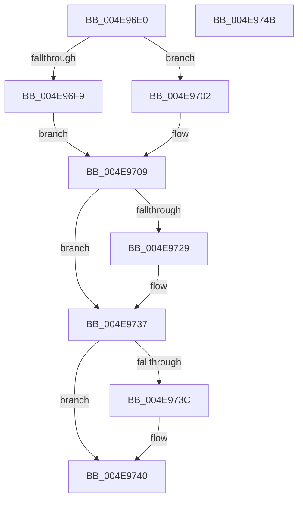

# PspLockThreadSecurityExclusive

- RVA: `0x004E96E0`–`0x004E974C` (길이 `108` bytes)
- VA: `0x00000001404E96E0`
- 실행 섹션: `.text`
- PDB 이름 있음: `예`; PDB Function 태그: `아니요`
- unwind 정보 RVA: `0x0005CAAC`
- 디코드: `32`개 명령, `108/108` bytes 표시
- 미해석 바이트: `0` (있으면 어셈블리에 `.byte`로 보존)

> 이 문서는 커널 이미지의 기계어와 PDB 기호를 분석해 생성했습니다. 4번과 5번은 함수 원형과 자료형을 바이너리 사용 방식에서 추정한 C 해석이며 원본 소스 복구 결과는 아닙니다.

## 1. Dependencies

- 직접 호출 지점: **3**; 고유 호출 대상: **3**
- 직접 호출자로 확인된 함수: **5**
- RIP 상대 이미지 참조: **0**

### Outgoing calls
- `0x004E96F0` → [Feature_ThreadLockGuardedRegion__private_IsEnabledDeviceUsageNoInline](../5E/Feature_ThreadLockGuardedRegion__private_IsEnabledDeviceUsageNoInline_function_005E2CEC.md) (function, `0x005E2CEC`)
- `0x004E9719` → [KeAbPreAcquire](../21/KeAbPreAcquire_function_00210230.md) (function, `0x00210230`)
- `0x004E9732` → [ExfAcquirePushLockExclusiveEx](../20/ExfAcquirePushLockExclusiveEx_function_0020FC90.md) (function, `0x0020FC90`)

### Direct callers
- [NtOpenThreadTokenEx](../../page/8B/NtOpenThreadTokenEx_function_008B7840.md) at `0x008B79DC`
- [NtOpenThreadTokenEx](../../page/8B/NtOpenThreadTokenEx_function_008B7840.md) at `0x008B7CE8`
- [NtOpenThreadTokenEx](../../page/8B/NtOpenThreadTokenEx_function_008B7840.md) at `0x008B7DB3`
- [NtSetInformationThread](../../page/8C/NtSetInformationThread_function_008C9F60.md) at `0x008CA926`
- [PsImpersonateClient](../../page/8C/PsImpersonateClient_function_008CBE10.md) at `0x008CBF2A`
- [PsImpersonateClient](../../page/8C/PsImpersonateClient_function_008CBE10.md) at `0x008CC005`
- [sub_009E6F2D](../../page/9E/Unknown_function_009E6F2D.md) at `0x009E6F83`
- [PsDisableImpersonation](../../page/9E/PsDisableImpersonation_function_009E89B0.md) at `0x009E89F8`

### Static image references
- 디코드된 RIP-relative 메모리 참조가 없습니다.

## 2. Other-region calls and transfers

- 다른 실행 섹션으로 향하는 call: **0**
- 별도 외부 분기/꼬리 이동을 확인하지 못했습니다.

## 3. Assembly (complete function range)

```asm
004E96E0  48 89 5C 24 08                  mov qword ptr [rsp + 8], rbx
004E96E5  57                              push rdi
004E96E6  48 83 EC 20                     sub rsp, 0x20
004E96EA  48 8B DA                        mov rbx, rdx
004E96ED  48 8B F9                        mov rdi, rcx
004E96F0  E8 F7 95 0F 00                  call 0x1405e2cec
004E96F5  85 C0                           test eax, eax
004E96F7  74 09                           je 0x1404e9702
004E96F9  66 FF 8B E6 01 00 00            dec word ptr [rbx + 0x1e6]
004E9700  EB 07                           jmp 0x1404e9709
004E9702  66 FF 8B E4 01 00 00            dec word ptr [rbx + 0x1e4]
004E9709  48 81 C7 90 05 00 00            add rdi, 0x590
004E9710  45 33 C0                        xor r8d, r8d
004E9713  48 8B CF                        mov rcx, rdi
004E9716  33 D2                           xor edx, edx
004E9718  90                              nop
004E9719  E8 12 6B D2 FF                  call 0x140210230
004E971E  F0 48 0F BA 2F 00               lock bts qword ptr [rdi], 0
004E9724  48 8B D8                        mov rbx, rax
004E9727  73 0E                           jae 0x1404e9737
004E9729  4C 8B C7                        mov r8, rdi
004E972C  48 8B D0                        mov rdx, rax
004E972F  48 8B CF                        mov rcx, rdi
004E9732  E8 59 65 D2 FF                  call 0x14020fc90
004E9737  48 85 DB                        test rbx, rbx
004E973A  74 04                           je 0x1404e9740
004E973C  C6 43 0A 01                     mov byte ptr [rbx + 0xa], 1
004E9740  48 8B 5C 24 30                  mov rbx, qword ptr [rsp + 0x30]
004E9745  48 83 C4 20                     add rsp, 0x20
004E9749  5F                              pop rdi
004E974A  C3                              ret
004E974B  CC                              int3
```

## 4. C-style interpretation (structured pseudocode)

```c
__int64 __fastcall PspLockThreadSecurityExclusive(__int64 a1, __int64 a2, int a3)
{
    __int64 result;
    __int64 v_rdi;
    __int64 v_rsp;
    unsigned __int64 v_stack_p8;

    v_stack_p8 = v_rbx;
    v_rsp = (v_rsp) - (32);
    result = Feature_ThreadLockGuardedRegion__private_IsEnabledDeviceUsageNoInline(a1, a2, a3, a4);
    if ((unsigned int)(result) == 0) goto loc_004E9702;
    goto loc_004E9709;
loc_004E9702:
loc_004E9709:
    v_rdi = (a1) + (0x590ULL);
    a3 = 0;
    a2 = 0;
    result = KeAbPreAcquire(v_rdi, a2, a3, a4);
    if (!(condition_is_above_or_equal)) {
        a3 = v_rdi;
        a2 = result;
        a1 = v_rdi;
        result = ExfAcquirePushLockExclusiveEx(a1, a2, a3, a4);
    }
    if (result != 0) {
        *(unsigned __int8 *)(result + 10) = 1;
    }
    v_rsp = (v_rsp) + (32);
    return result;
}
```

## 5. (Beta) C Style

```c
int64_t PspLockThreadSecurityExclusive(void *Arg1, void *Arg2, int32_t Arg3)
{
    uint8_t *arg1 = (uint8_t *)Arg1;
    uint8_t *arg2 = (uint8_t *)Arg2;

    int64_t result;
    int64_t local_rdi;
    int64_t local_rsp;
    uint64_t v_stack_p8;

    v_stack_p8 = local_rbx;
    local_rsp = (local_rsp) - (32);
    result = Feature_ThreadLockGuardedRegion__private_IsEnabledDeviceUsageNoInline(Arg1, Arg2, Arg3, a4);
    if ((uint32_t)(result) == 0) goto loc_004E9702;
    goto loc_004E9709;
loc_004E9702:
loc_004E9709:
    local_rdi = (Arg1) + (0x590ULL);
    Arg3 = 0;
    Arg2 = 0;
    result = KeAbPreAcquire(local_rdi, Arg2, Arg3, a4);
    if (!(condition_is_above_or_equal)) {
        Arg3 = local_rdi;
        Arg2 = result;
        Arg1 = local_rdi;
        result = ExfAcquirePushLockExclusiveEx(Arg1, Arg2, Arg3, a4);
    }
    if (result != 0) {
        *(uint8_t *)(result + 0xA) = 1;
    }
    local_rsp = (local_rsp) + (32);
    return result;
}
```

### 관측된 메모리 오프셋

구조체 형식이 확인되지 않은 접근은 인자 기준의 오프셋으로만 기록했습니다.

| 기준 인자 | 오프셋 표현 | 폭 (bit) | 접근 |
|---|---:|---:|---|
| `Arg1` | `+ 0x0` | `64` | `R/W` |
| `Arg2` | `+ 0x1E4` | `16` | `R/W` |
| `Arg2` | `+ 0x1E6` | `16` | `R/W` |

## 6. Execution-region graph

[열기: 2D/3D 그래프와 함수 탐색 컨트롤 패널](../../../control-panel.html?section=text&rva=0x004E96E0&view=graph)

- 2D 그래프는 위에서 아래로 흐르고, 3D 그래프는 빈 공간을 드래그해 회전합니다. Shift+드래그는 이동, 휠은 확대·축소, 함수 노드 선택은 대상 보고서 이동입니다.

### Static fallback


