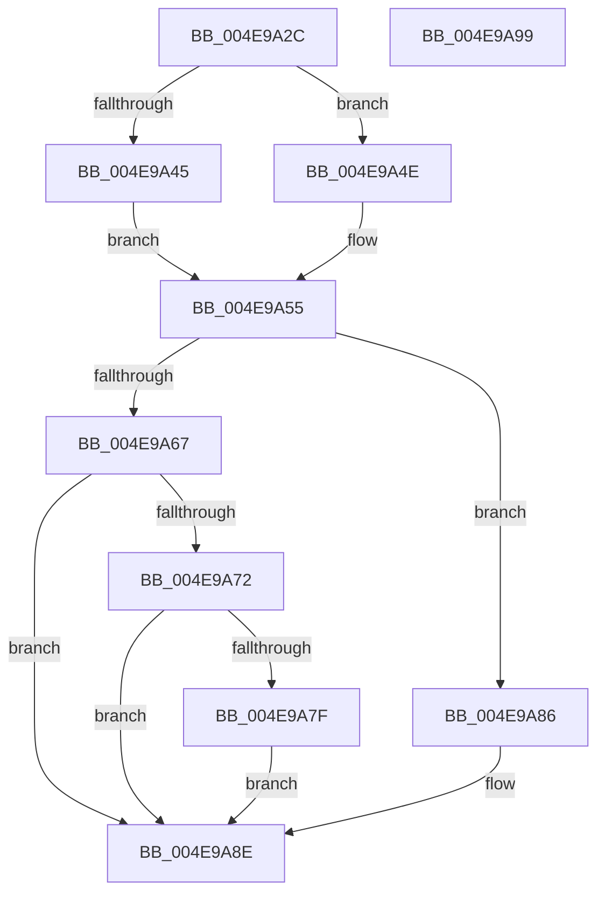

# PspLockUnlockTebAccessExclusive

- RVA: `0x004E9A2C`–`0x004E9A9A` (길이 `110` bytes)
- VA: `0x00000001404E9A2C`
- 실행 섹션: `.text`
- PDB 이름 있음: `예`; PDB Function 태그: `아니요`
- unwind 정보 RVA: `0x0005CAAC`
- 디코드: `33`개 명령, `110/110` bytes 표시
- 미해석 바이트: `0` (있으면 어셈블리에 `.byte`로 보존)

> 이 문서는 커널 이미지의 기계어와 PDB 기호를 분석해 생성했습니다. 4번과 5번은 함수 원형과 자료형을 바이너리 사용 방식에서 추정한 C 해석이며 원본 소스 복구 결과는 아닙니다.

## 1. Dependencies

- 직접 호출 지점: **5**; 고유 호출 대상: **4**
- 직접 호출자로 확인된 함수: **1**
- RIP 상대 이미지 참조: **0**

### Outgoing calls
- `0x004E9A3C` → [Feature_ThreadLockGuardedRegion__private_IsEnabledDeviceUsageNoInline](../5E/Feature_ThreadLockGuardedRegion__private_IsEnabledDeviceUsageNoInline_function_005E2CEC.md) (function, `0x005E2CEC`)
- `0x004E9A59` → [PspLockUnlockThreadSecurityExclusiveUnsafe](PspLockUnlockThreadSecurityExclusiveUnsafe_function_004E96AC.md) (function, `0x004E96AC`)
- `0x004E9A5E` → [Feature_ThreadLockGuardedRegion__private_IsEnabledDeviceUsageNoInline](../5E/Feature_ThreadLockGuardedRegion__private_IsEnabledDeviceUsageNoInline_function_005E2CEC.md) (function, `0x005E2CEC`)
- `0x004E9A7F` → [KiCheckForKernelApcDelivery](../2E/KiCheckForKernelApcDelivery_function_002E2C80.md) (function, `0x002E2C80`)
- `0x004E9A89` → [KiLeaveCriticalRegionUnsafe](../25/KiLeaveCriticalRegionUnsafe_function_0025F010.md) (function, `0x0025F010`)

### Direct callers
- [PspExitThread](../../page/90/PspExitThread_function_00905F60.md) at `0x009062EA`

### Static image references
- 디코드된 RIP-relative 메모리 참조가 없습니다.

## 2. Other-region calls and transfers

- 다른 실행 섹션으로 향하는 call: **0**
- 별도 외부 분기/꼬리 이동을 확인하지 못했습니다.

## 3. Assembly (complete function range)

```asm
004E9A2C  48 89 5C 24 08                  mov qword ptr [rsp + 8], rbx
004E9A31  57                              push rdi
004E9A32  48 83 EC 20                     sub rsp, 0x20
004E9A36  48 8B DA                        mov rbx, rdx
004E9A39  48 8B F9                        mov rdi, rcx
004E9A3C  E8 AB 92 0F 00                  call 0x1405e2cec
004E9A41  85 C0                           test eax, eax
004E9A43  74 09                           je 0x1404e9a4e
004E9A45  66 FF 8B E6 01 00 00            dec word ptr [rbx + 0x1e6]
004E9A4C  EB 07                           jmp 0x1404e9a55
004E9A4E  66 FF 8B E4 01 00 00            dec word ptr [rbx + 0x1e4]
004E9A55  48 8B CF                        mov rcx, rdi
004E9A58  90                              nop
004E9A59  E8 4E FC FF FF                  call 0x1404e96ac
004E9A5E  E8 89 92 0F 00                  call 0x1405e2cec
004E9A63  85 C0                           test eax, eax
004E9A65  74 1F                           je 0x1404e9a86
004E9A67  90                              nop
004E9A68  66 83 83 E6 01 00 00 01         add word ptr [rbx + 0x1e6], 1
004E9A70  75 1C                           jne 0x1404e9a8e
004E9A72  48 8D 83 98 00 00 00            lea rax, [rbx + 0x98]
004E9A79  90                              nop
004E9A7A  48 39 00                        cmp qword ptr [rax], rax
004E9A7D  74 0F                           je 0x1404e9a8e
004E9A7F  E8 FC 91 DF FF                  call 0x1402e2c80
004E9A84  EB 08                           jmp 0x1404e9a8e
004E9A86  48 8B CB                        mov rcx, rbx
004E9A89  E8 82 55 D7 FF                  call 0x14025f010
004E9A8E  48 8B 5C 24 30                  mov rbx, qword ptr [rsp + 0x30]
004E9A93  48 83 C4 20                     add rsp, 0x20
004E9A97  5F                              pop rdi
004E9A98  C3                              ret
004E9A99  CC                              int3
```

## 4. C-style interpretation (structured pseudocode)

```c
__int64 __fastcall PspLockUnlockTebAccessExclusive(__int64 a1, __int64 a2)
{
    __int64 result;
    __int64 v_rsp;
    unsigned __int64 v_stack_p8;

    v_stack_p8 = v_rbx;
    v_rsp = (v_rsp) - (32);
    result = Feature_ThreadLockGuardedRegion__private_IsEnabledDeviceUsageNoInline(a1, a2, a3, a4);
    if ((unsigned int)(result) == 0) goto loc_004E9A4E;
    goto loc_004E9A55;
loc_004E9A4E:
loc_004E9A55:
    result = PspLockUnlockThreadSecurityExclusiveUnsafe(a1, a2, a3, a4);
    result = Feature_ThreadLockGuardedRegion__private_IsEnabledDeviceUsageNoInline(a1, a2, a3, a4);
    if ((unsigned int)(result) == 0) goto loc_004E9A86;
    if ((unsigned int)(result) != 0) goto loc_004E9A8E;
    if ((*(unsigned __int64 *)(a2 + 152)) == (a2 + 152)) goto loc_004E9A8E;
    result = KiCheckForKernelApcDelivery(a1, a2, a3, a4);
    goto loc_004E9A8E;
loc_004E9A86:
    result = KiLeaveCriticalRegionUnsafe(a2, a2, a3, a4);
loc_004E9A8E:
    v_rsp = (v_rsp) + (32);
    return result;
}
```

## 5. (Beta) C Style

```c
int64_t PspLockUnlockTebAccessExclusive(int64_t Arg1, void *Arg2)
{
    uint8_t *arg2 = (uint8_t *)Arg2;

    int64_t result;
    int64_t local_rsp;
    uint64_t v_stack_p8;

    v_stack_p8 = local_rbx;
    local_rsp = (local_rsp) - (32);
    result = Feature_ThreadLockGuardedRegion__private_IsEnabledDeviceUsageNoInline(Arg1, Arg2, a3, a4);
    if ((uint32_t)(result) == 0) goto loc_004E9A4E;
    goto loc_004E9A55;
loc_004E9A4E:
loc_004E9A55:
    result = PspLockUnlockThreadSecurityExclusiveUnsafe(Arg1, Arg2, a3, a4);
    result = Feature_ThreadLockGuardedRegion__private_IsEnabledDeviceUsageNoInline(Arg1, Arg2, a3, a4);
    if ((uint32_t)(result) == 0) goto loc_004E9A86;
    if ((uint32_t)(result) != 0) goto loc_004E9A8E;
    if ((*(uint64_t *)(arg2 + 0x98)) == (Arg2 + 152)) goto loc_004E9A8E;
    result = KiCheckForKernelApcDelivery(Arg1, Arg2, a3, a4);
    goto loc_004E9A8E;
loc_004E9A86:
    result = KiLeaveCriticalRegionUnsafe(Arg2, Arg2, a3, a4);
loc_004E9A8E:
    local_rsp = (local_rsp) + (32);
    return result;
}
```

### 관측된 메모리 오프셋

구조체 형식이 확인되지 않은 접근은 인자 기준의 오프셋으로만 기록했습니다.

| 기준 인자 | 오프셋 표현 | 폭 (bit) | 접근 |
|---|---:|---:|---|
| `Arg2` | `+ 0x0` | `64` | `R` |
| `Arg2` | `+ 0x98` | `64` | `R` |
| `Arg2` | `+ 0x1E4` | `16` | `R/W` |
| `Arg2` | `+ 0x1E6` | `16` | `R/W` |

## 6. Execution-region graph

[열기: 2D/3D 그래프와 함수 탐색 컨트롤 패널](../../../control-panel.html?section=text&rva=0x004E9A2C&view=graph)

- 2D 그래프는 위에서 아래로 흐르고, 3D 그래프는 빈 공간을 드래그해 회전합니다. Shift+드래그는 이동, 휠은 확대·축소, 함수 노드 선택은 대상 보고서 이동입니다.

### Static fallback


