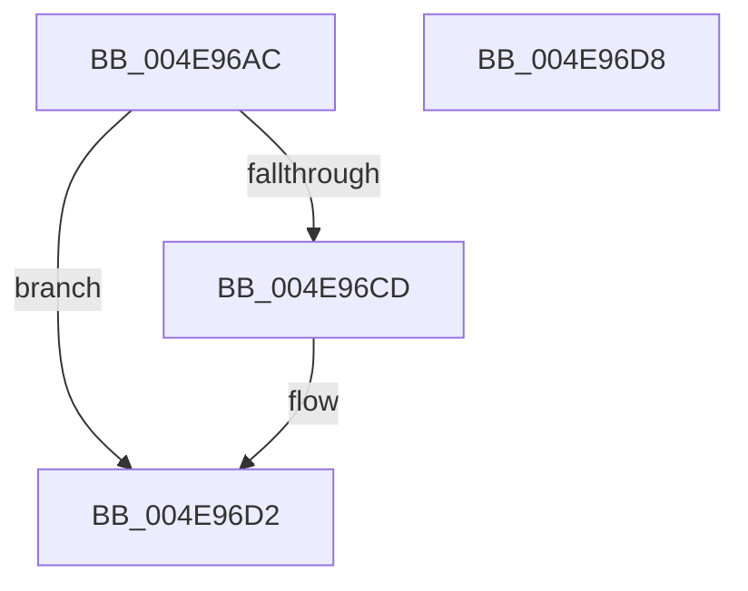

# PspLockUnlockThreadSecurityExclusiveUnsafe

- RVA: `0x004E96AC`–`0x004E96D9` (길이 `45` bytes)
- VA: `0x00000001404E96AC`
- 실행 섹션: `.text`
- PDB 이름 있음: `예`; PDB Function 태그: `아니요`
- unwind 정보 RVA: `0x0005CF00`
- 디코드: `14`개 명령, `45/45` bytes 표시
- 미해석 바이트: `0` (있으면 어셈블리에 `.byte`로 보존)

> 이 문서는 커널 이미지의 기계어와 PDB 기호를 분석해 생성했습니다. 4번과 5번은 함수 원형과 자료형을 바이너리 사용 방식에서 추정한 C 해석이며 원본 소스 복구 결과는 아닙니다.

## 1. Dependencies

- 직접 호출 지점: **2**; 고유 호출 대상: **2**
- 직접 호출자로 확인된 함수: **5**
- RIP 상대 이미지 참조: **0**

### Outgoing calls
- `0x004E96B5` → [Feature_ThreadLockGuardedRegion__private_IsEnabledDeviceUsageNoInline](../5E/Feature_ThreadLockGuardedRegion__private_IsEnabledDeviceUsageNoInline_function_005E2CEC.md) (function, `0x005E2CEC`)
- `0x004E96CD` → [ExfAcquireReleasePushLockExclusive](../41/ExfAcquireReleasePushLockExclusive_function_00419C2C.md) (function, `0x00419C2C`)

### Direct callers
- [PspLockUnlockTebAccessExclusive](PspLockUnlockTebAccessExclusive_function_004E9A2C.md) at `0x004E9A59`
- [sub_00868496](../../page/86/Unknown_function_00868496.md) at `0x00868590`
- [sub_008CBB8C](../../page/8C/Unknown_function_008CBB8C.md) at `0x008CBC83`
- [sub_009A7932](../../page/9A/Unknown_function_009A7932.md) at `0x009A7A29`
- [PsSynchronizeWithThreadInsertion](../../page/A1/PsSynchronizeWithThreadInsertion_function_00A111DC.md) at `0x00A11209`

### Static image references
- 디코드된 RIP-relative 메모리 참조가 없습니다.

## 2. Other-region calls and transfers

- 다른 실행 섹션으로 향하는 call: **0**
- 별도 외부 분기/꼬리 이동을 확인하지 못했습니다.

## 3. Assembly (complete function range)

```asm
004E96AC  40 53                           push rbx
004E96AE  48 83 EC 20                     sub rsp, 0x20
004E96B2  48 8B D9                        mov rbx, rcx
004E96B5  E8 32 96 0F 00                  call 0x1405e2cec
004E96BA  48 8D 8B 90 05 00 00            lea rcx, [rbx + 0x590]
004E96C1  F0 83 0C 24 00                  lock or dword ptr [rsp], 0
004E96C6  48 8B 01                        mov rax, qword ptr [rcx]
004E96C9  A8 01                           test al, 1
004E96CB  74 05                           je 0x1404e96d2
004E96CD  E8 5A 05 F3 FF                  call 0x140419c2c
004E96D2  48 83 C4 20                     add rsp, 0x20
004E96D6  5B                              pop rbx
004E96D7  C3                              ret
004E96D8  CC                              int3
```

## 4. C-style interpretation (structured pseudocode)

```c
__int64 __fastcall PspLockUnlockThreadSecurityExclusiveUnsafe(__int64 a1)
{
    __int64 result;
    __int64 v_rsp;
    unsigned int v_stack_m28;

    v_rsp = (v_rsp) - (32);
    result = Feature_ThreadLockGuardedRegion__private_IsEnabledDeviceUsageNoInline(a1, a2, a3, a4);
    result = *(unsigned __int64 *)(a1 + 1424);
    if ((((unsigned __int8)(*(unsigned __int64 *)(a1 + 1424))) & (1)) != 0) {
        result = ExfAcquireReleasePushLockExclusive(a1 + 1424, a2, a3, a4);
    }
    v_rsp = (v_rsp) + (32);
    return result;
}
```

## 5. (Beta) C Style

```c
int64_t PspLockUnlockThreadSecurityExclusiveUnsafe(void *Arg1)
{
    uint8_t *arg1 = (uint8_t *)Arg1;

    int64_t result;
    int64_t local_rsp;
    uint32_t v_stack_m28;

    local_rsp = (local_rsp) - (32);
    result = Feature_ThreadLockGuardedRegion__private_IsEnabledDeviceUsageNoInline(Arg1, a2, a3, a4);
    result = *(uint64_t *)(arg1 + 0x590);
    if ((((uint8_t)(*(uint64_t *)(arg1 + 0x590))) & (1)) != 0) {
        result = ExfAcquireReleasePushLockExclusive(Arg1 + 1424, a2, a3, a4);
    }
    local_rsp = (local_rsp) + (32);
    return result;
}
```

### 관측된 메모리 오프셋

구조체 형식이 확인되지 않은 접근은 인자 기준의 오프셋으로만 기록했습니다.

| 기준 인자 | 오프셋 표현 | 폭 (bit) | 접근 |
|---|---:|---:|---|
| `Arg1` | `+ 0x0` | `64` | `R` |
| `Arg1` | `+ 0x590` | `64` | `R` |

## 6. Execution-region graph

[열기: 2D/3D 그래프와 함수 탐색 컨트롤 패널](../../../control-panel.html?section=text&rva=0x004E96AC&view=graph)

- 2D 그래프는 위에서 아래로 흐르고, 3D 그래프는 빈 공간을 드래그해 회전합니다. Shift+드래그는 이동, 휠은 확대·축소, 함수 노드 선택은 대상 보고서 이동입니다.

### Static fallback


