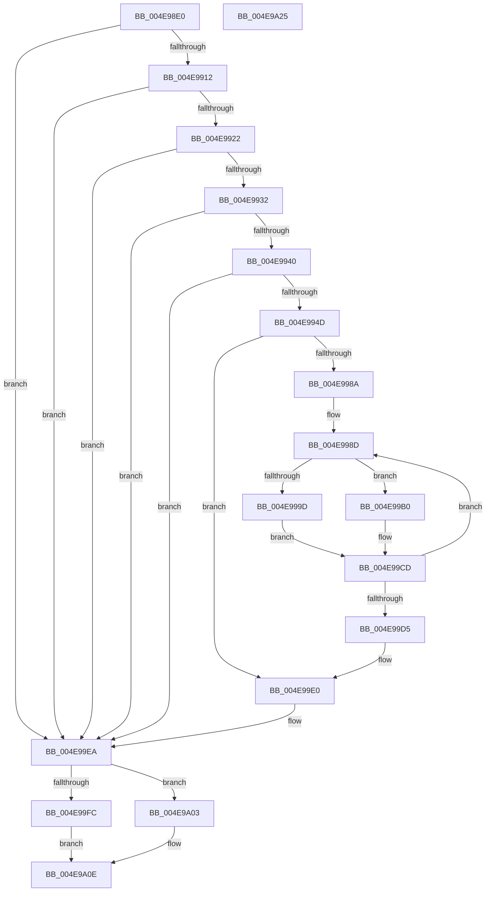

# PspSetProcessFreezeStateCallback

- RVA: `0x004E98E0`–`0x004E9A26` (길이 `326` bytes)
- VA: `0x00000001404E98E0`
- 실행 섹션: `.text`
- PDB 이름 있음: `예`; PDB Function 태그: `아니요`
- unwind 정보 RVA: `0x000B384C`
- 디코드: `86`개 명령, `326/326` bytes 표시
- 미해석 바이트: `0` (있으면 어셈블리에 `.byte`로 보존)

> 이 문서는 커널 이미지의 기계어와 PDB 기호를 분석해 생성했습니다. 4번과 5번은 함수 원형과 자료형을 바이너리 사용 방식에서 추정한 C 해석이며 원본 소스 복구 결과는 아닙니다.

## 1. Dependencies

- 직접 호출 지점: **9**; 고유 호출 대상: **9**
- 직접 호출자로 확인된 함수: **0**
- RIP 상대 이미지 참조: **0**

### Outgoing calls
- `0x004E9957` → [KeAcquireSpinLockRaiseToDpc](../20/KeAcquireSpinLockRaiseToDpc_function_00208470.md) (function, `0x00208470`)
- `0x004E99A9` → [ExpTimerPause](../3D/ExpTimerPause_function_003D38C4.md) (function, `0x003D38C4`)
- `0x004E99B4` → [KeAcquireSpinLockAtDpcLevel](../20/KeAcquireSpinLockAtDpcLevel_function_00208430.md) (function, `0x00208430`)
- `0x004E99BF` → [ExpTimerResume](../22/ExpTimerResume_function_0022FD60.md) (function, `0x0022FD60`)
- `0x004E99C8` → [KxReleaseSpinLock](../20/KxReleaseSpinLock_function_00206670.md) (function, `0x00206670`)
- `0x004E99E5` → [KeReleaseSpinLock](../39/KeReleaseSpinLock_function_00392BA0.md) (function, `0x00392BA0`)
- `0x004E99EA` → [Feature_ProcesDirectSwap__private_IsEnabledDeviceUsageNoInline](../5E/Feature_ProcesDirectSwap__private_IsEnabledDeviceUsageNoInline_function_005E3264.md) (function, `0x005E3264`)
- `0x004E99FC` → [PspRequestProcessExecutionStateLegacy](../5E/PspRequestProcessExecutionStateLegacy_function_005E42D8.md) (function, `0x005E42D8`)
- `0x004E9A09` → [PspRequestProcessExecutionState](../../page/AE/PspRequestProcessExecutionState_function_00AEC7EC.md) (function, `0x00AEC7EC`)

### Direct callers
- 이 함수 시작 RVA로 연결되는 직접 call은 확인되지 않았습니다. 간접 호출은 완전히 역산할 수 없습니다.

### Static image references
- 디코드된 RIP-relative 메모리 참조가 없습니다.

## 2. Other-region calls and transfers

- 다른 실행 섹션으로 향하는 call: **1**
  - `0x004E9A09` → [PspRequestProcessExecutionState](../../page/AE/PspRequestProcessExecutionState_function_00AEC7EC.md) (`.text` → `PAGE`)
- 별도 외부 분기/꼬리 이동을 확인하지 못했습니다.

## 3. Assembly (complete function range)

```asm
004E98E0  48 89 5C 24 10                  mov qword ptr [rsp + 0x10], rbx
004E98E5  55                              push rbp
004E98E6  56                              push rsi
004E98E7  57                              push rdi
004E98E8  41 54                           push r12
004E98EA  41 55                           push r13
004E98EC  41 56                           push r14
004E98EE  41 57                           push r15
004E98F0  48 83 EC 20                     sub rsp, 0x20
004E98F4  48 8B F2                        mov rsi, rdx
004E98F7  48 8B F9                        mov rdi, rcx
004E98FA  48 8B 91 A0 02 00 00            mov rdx, qword ptr [rcx + 0x2a0]
004E9901  8B 81 F4 01 00 00               mov eax, dword ptr [rcx + 0x1f4]
004E9907  A9 08 00 00 40                  test eax, 0x40000008
004E990C  0F 85 D8 00 00 00               jne 0x1404e99ea
004E9912  8B 81 F4 01 00 00               mov eax, dword ptr [rcx + 0x1f4]
004E9918  0F BA E0 1A                     bt eax, 0x1a
004E991C  0F 83 C8 00 00 00               jae 0x1404e99ea
004E9922  F7 82 10 06 00 00 00 00 04 00   test dword ptr [rdx + 0x610], 0x40000
004E992C  0F 84 B8 00 00 00               je 0x1404e99ea
004E9932  48 8B 06                        mov rax, qword ptr [rsi]
004E9935  8B 08                           mov ecx, dword ptr [rax]
004E9937  F6 C1 01                        test cl, 1
004E993A  0F 84 AA 00 00 00               je 0x1404e99ea
004E9940  83 BA 28 04 00 00 01            cmp dword ptr [rdx + 0x428], 1
004E9947  0F 87 9D 00 00 00               ja 0x1404e99ea
004E994D  4C 8D A7 08 07 00 00            lea r12, [rdi + 0x708]
004E9954  49 8B CC                        mov rcx, r12
004E9957  E8 14 EB D1 FF                  call 0x140208470
004E995C  4C 8D BF 10 07 00 00            lea r15, [rdi + 0x710]
004E9963  88 44 24 60                     mov byte ptr [rsp + 0x60], al
004E9967  49 BD 08 00 00 00 80 F7 FF FF   movabs r13, 0xfffff78000000008
004E9971  48 B9 14 00 00 00 80 F7 FF FF   movabs rcx, 0xfffff78000000014
004E997B  4D 8B 6D 00                     mov r13, qword ptr [r13]
004E997F  48 8B 09                        mov rcx, qword ptr [rcx]
004E9982  4D 8B 37                        mov r14, qword ptr [r15]
004E9985  4D 3B F7                        cmp r14, r15
004E9988  74 56                           je 0x1404e99e0
004E998A  4C 8B E1                        mov r12, rcx
004E998D  48 8B 0E                        mov rcx, qword ptr [rsi]
004E9990  49 8D AE E0 FE FF FF            lea rbp, [r14 - 0x120]
004E9997  80 79 04 00                     cmp byte ptr [rcx + 4], 0
004E999B  74 13                           je 0x1404e99b0
004E999D  45 33 C9                        xor r9d, r9d
004E99A0  4D 8B C5                        mov r8, r13
004E99A3  49 8B D4                        mov rdx, r12
004E99A6  48 8B CD                        mov rcx, rbp
004E99A9  E8 16 9F EE FF                  call 0x1403d38c4
004E99AE  EB 1D                           jmp 0x1404e99cd
004E99B0  48 8D 4D 40                     lea rcx, [rbp + 0x40]
004E99B4  E8 77 EA D1 FF                  call 0x140208430
004E99B9  49 8B D5                        mov rdx, r13
004E99BC  48 8B CD                        mov rcx, rbp
004E99BF  E8 9C 63 D4 FF                  call 0x14022fd60
004E99C4  48 8D 4D 40                     lea rcx, [rbp + 0x40]
004E99C8  E8 A3 CC D1 FF                  call 0x140206670
004E99CD  4D 8B 36                        mov r14, qword ptr [r14]
004E99D0  4D 3B F7                        cmp r14, r15
004E99D3  75 B8                           jne 0x1404e998d
004E99D5  8A 44 24 60                     mov al, byte ptr [rsp + 0x60]
004E99D9  4C 8D A7 08 07 00 00            lea r12, [rdi + 0x708]
004E99E0  8A D0                           mov dl, al
004E99E2  49 8B CC                        mov rcx, r12
004E99E5  E8 B6 91 EA FF                  call 0x140392ba0
004E99EA  E8 75 98 0F 00                  call 0x1405e3264
004E99EF  8A 56 08                        mov dl, byte ptr [rsi + 8]
004E99F2  45 33 C0                        xor r8d, r8d
004E99F5  48 8B CF                        mov rcx, rdi
004E99F8  85 C0                           test eax, eax
004E99FA  75 07                           jne 0x1404e9a03
004E99FC  E8 D7 A8 0F 00                  call 0x1405e42d8
004E9A01  EB 0B                           jmp 0x1404e9a0e
004E9A03  41 B9 07 00 00 00               mov r9d, 7
004E9A09  E8 DE 2D 60 00                  call 0x140aec7ec
004E9A0E  48 8B 5C 24 68                  mov rbx, qword ptr [rsp + 0x68]
004E9A13  33 C0                           xor eax, eax
004E9A15  48 83 C4 20                     add rsp, 0x20
004E9A19  41 5F                           pop r15
004E9A1B  41 5E                           pop r14
004E9A1D  41 5D                           pop r13
004E9A1F  41 5C                           pop r12
004E9A21  5F                              pop rdi
004E9A22  5E                              pop rsi
004E9A23  5D                              pop rbp
004E9A24  C3                              ret
004E9A25  CC                              int3
```

## 4. C-style interpretation (structured pseudocode)

```c
__int64 __fastcall PspSetProcessFreezeStateCallback(__int64 a1, __int64 a2, __int64 a3, int a4)
{
    __int64 result;
    __int64 v_rsp;
    unsigned __int64 v_stack_p10;
    unsigned __int8 v_stack_p8;

    v_stack_p10 = v_rbx;
    v_rsp = (v_rsp) - (32);
    if ((((unsigned int)((unsigned int)(*(unsigned int *)(a1 + 500)))) & (0x40000008ULL)) != 0) goto loc_004E99EA;
    if (condition_is_above_or_equal) goto loc_004E99EA;
    if (((*(unsigned int *)(*(unsigned __int64 *)(a1 + 672) + 1552)) & (0x40000ULL)) == 0) goto loc_004E99EA;
    if ((((unsigned __int8)((unsigned int)(*(unsigned int *)(*(unsigned __int64 *)(a2))))) & (1)) == 0) goto loc_004E99EA;
    if ((*(unsigned int *)(*(unsigned __int64 *)(a1 + 672) + 1064)) > 1) goto loc_004E99EA;
    result = KeAcquireSpinLockRaiseToDpc(a1 + 1800, *(unsigned __int64 *)(a1 + 672), a3, a4);
    v_stack_p8 = (unsigned __int8)(result);
    if ((*(unsigned __int64 *)(a1 + 1808)) == (a1 + 1808)) goto loc_004E99E0;
loc_004E998D:
    if ((*(unsigned __int8 *)(*(unsigned __int64 *)(a2) + 4)) == 0) goto loc_004E99B0;
    a4 = 0;
    result = ExpTimerPause(*(unsigned __int64 *)(a1 + 1808) - 288, *(unsigned __int64 *)(a1 + 1800), *(unsigned __int64 *)(v_r13), a4);
    goto loc_004E99CD;
loc_004E99B0:
    result = KeAcquireSpinLockAtDpcLevel(*(unsigned __int64 *)(a1 + 1808) - 288 + 64, *(unsigned __int64 *)(a1 + 1800), *(unsigned __int64 *)(v_r13), a4);
    result = ExpTimerResume(*(unsigned __int64 *)(a1 + 1808) - 288, *(unsigned __int64 *)(v_r13), *(unsigned __int64 *)(v_r13), a4);
    result = KxReleaseSpinLock(*(unsigned __int64 *)(a1 + 1808) - 288 + 64, *(unsigned __int64 *)(v_r13), *(unsigned __int64 *)(v_r13), a4);
loc_004E99CD:
    if ((*(unsigned __int64 *)(*(unsigned __int64 *)(a1 + 1808))) != (a1 + 1808)) goto loc_004E998D;
loc_004E99E0:
    result = KeReleaseSpinLock(a1 + 1800, (unsigned __int8)(v_stack_p8), *(unsigned __int64 *)(v_r13), a4);
loc_004E99EA:
    result = Feature_ProcesDirectSwap__private_IsEnabledDeviceUsageNoInline(a1 + 1800, (unsigned __int8)(v_stack_p8), *(unsigned __int64 *)(v_r13), a4);
    a3 = 0;
    if ((unsigned int)(result) != 0) goto loc_004E9A03;
    result = PspRequestProcessExecutionStateLegacy(a1, *(unsigned __int8 *)(a2 + 8), a3, a4);
    goto loc_004E9A0E;
loc_004E9A03:
    result = PspRequestProcessExecutionState(a1, *(unsigned __int8 *)(a2 + 8), a3, 7);
loc_004E9A0E:
    result = 0;
    v_rsp = (v_rsp) + (32);
    return result;
}
```

## 5. (Beta) C Style

```c
int64_t PspSetProcessFreezeStateCallback(void *Arg1, void *Arg2, int64_t Arg3, int32_t Arg4)
{
    uint8_t *arg1 = (uint8_t *)Arg1;
    uint8_t *arg2 = (uint8_t *)Arg2;

    int64_t result;
    int64_t local_rsp;
    uint64_t v_stack_p10;
    uint8_t v_stack_p8;

    v_stack_p10 = local_rbx;
    local_rsp = (local_rsp) - (32);
    if ((((uint32_t)((uint32_t)(*(uint32_t *)(arg1 + 0x1F4)))) & (0x40000008ULL)) != 0) goto loc_004E99EA;
    if (condition_is_above_or_equal) goto loc_004E99EA;
    if (((*(uint32_t *)(*(uint64_t *)(arg1 + 0x2A0) + 0x610)) & (0x40000ULL)) == 0) goto loc_004E99EA;
    if ((((uint8_t)((uint32_t)(*(uint32_t *)(*(uint64_t *)(arg2))))) & (1)) == 0) goto loc_004E99EA;
    if ((*(uint32_t *)(*(uint64_t *)(arg1 + 0x2A0) + 0x428)) > 1) goto loc_004E99EA;
    result = KeAcquireSpinLockRaiseToDpc(Arg1 + 1800, *(uint64_t *)(arg1 + 0x2A0), Arg3, Arg4);
    v_stack_p8 = (uint8_t)(result);
    if ((*(uint64_t *)(arg1 + 0x710)) == (Arg1 + 1808)) goto loc_004E99E0;
loc_004E998D:
    if ((*(uint8_t *)(*(uint64_t *)(arg2) + 0x4)) == 0) goto loc_004E99B0;
    Arg4 = 0;
    result = ExpTimerPause(*(uint64_t *)(arg1 + 0x710) - 288, *(uint64_t *)(arg1 + 0x708), *(uint64_t *)(local_r13), Arg4);
    goto loc_004E99CD;
loc_004E99B0:
    result = KeAcquireSpinLockAtDpcLevel(*(uint64_t *)(arg1 + 0x710) - 288 + 64, *(uint64_t *)(arg1 + 0x708), *(uint64_t *)(local_r13), Arg4);
    result = ExpTimerResume(*(uint64_t *)(arg1 + 0x710) - 288, *(uint64_t *)(local_r13), *(uint64_t *)(local_r13), Arg4);
    result = KxReleaseSpinLock(*(uint64_t *)(arg1 + 0x710) - 288 + 64, *(uint64_t *)(local_r13), *(uint64_t *)(local_r13), Arg4);
loc_004E99CD:
    if ((*(uint64_t *)(*(uint64_t *)(arg1 + 0x710))) != (Arg1 + 1808)) goto loc_004E998D;
loc_004E99E0:
    result = KeReleaseSpinLock(Arg1 + 1800, (uint8_t)(v_stack_p8), *(uint64_t *)(local_r13), Arg4);
loc_004E99EA:
    result = Feature_ProcesDirectSwap__private_IsEnabledDeviceUsageNoInline(Arg1 + 1800, (uint8_t)(v_stack_p8), *(uint64_t *)(local_r13), Arg4);
    Arg3 = 0;
    if ((uint32_t)(result) != 0) goto loc_004E9A03;
    result = PspRequestProcessExecutionStateLegacy(Arg1, *(uint8_t *)(arg2 + 0x8), Arg3, Arg4);
    goto loc_004E9A0E;
loc_004E9A03:
    result = PspRequestProcessExecutionState(Arg1, *(uint8_t *)(arg2 + 0x8), Arg3, 7);
loc_004E9A0E:
    result = 0;
    local_rsp = (local_rsp) + (32);
    return result;
}
```

### 관측된 메모리 오프셋

구조체 형식이 확인되지 않은 접근은 인자 기준의 오프셋으로만 기록했습니다.

| 기준 인자 | 오프셋 표현 | 폭 (bit) | 접근 |
|---|---:|---:|---|
| `Arg1` | `+ 0x0` | `64` | `R` |
| `Arg1` | `+ 0x1F4` | `32` | `R` |
| `Arg1` | `+ 0x2A0` | `64` | `R` |
| `Arg1` | `+ 0x708` | `64` | `R` |
| `Arg1` | `+ 0x710` | `64` | `R` |
| `Arg2` | `+ 0x0` | `64` | `R` |
| `Arg2` | `+ 0x8` | `8` | `R` |

## 6. Execution-region graph

[열기: 2D/3D 그래프와 함수 탐색 컨트롤 패널](../../../control-panel.html?section=text&rva=0x004E98E0&view=graph)

- 2D 그래프는 위에서 아래로 흐르고, 3D 그래프는 빈 공간을 드래그해 회전합니다. Shift+드래그는 이동, 휠은 확대·축소, 함수 노드 선택은 대상 보고서 이동입니다.

### Static fallback


