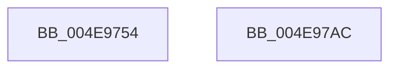

# PspSetProcessPriorityByClass

- RVA: `0x004E9754`–`0x004E97AD` (길이 `89` bytes)
- VA: `0x00000001404E9754`
- 실행 섹션: `.text`
- PDB 이름 있음: `예`; PDB Function 태그: `아니요`
- unwind 정보 RVA: `0x000AA39C`
- 디코드: `26`개 명령, `89/89` bytes 표시
- 미해석 바이트: `0` (있으면 어셈블리에 `.byte`로 보존)

> 이 문서는 커널 이미지의 기계어와 PDB 기호를 분석해 생성했습니다. 4번과 5번은 함수 원형과 자료형을 바이너리 사용 방식에서 추정한 C 해석이며 원본 소스 복구 결과는 아닙니다.

## 1. Dependencies

- 직접 호출 지점: **3**; 고유 호출 대상: **3**
- 직접 호출자로 확인된 함수: **3**
- RIP 상대 이미지 참조: **0**

### Outgoing calls
- `0x004E977D` → [PspComputeQuantumAndPriority](../../page/A3/PspComputeQuantumAndPriority_function_00A3BFB0.md) (function, `0x00A3BFB0`)
- `0x004E9799` → [KeSetPriorityAndQuantumProcess](../3C/KeSetPriorityAndQuantumProcess_function_003C2EC0.md) (function, `0x003C2EC0`)
- `0x004E97A1` → [PspEnqueueProcessQosChangeNotification](../5E/PspEnqueueProcessQosChangeNotification_function_005E2ED0.md) (function, `0x005E2ED0`)

### Direct callers
- [PsSetProcessPriorityByClass](../../page/A4/PsSetProcessPriorityByClass_function_00A45DA0.md) at `0x00A45DA9`
- [PspSetProcessForegroundBackgroundRequest](../../page/A4/PspSetProcessForegroundBackgroundRequest_function_00A45DCC.md) at `0x00A45EAF`
- [PspApplyJobLimitsToProcess](../../page/A5/PspApplyJobLimitsToProcess_function_00A57274.md) at `0x00A57373`

### Static image references
- 디코드된 RIP-relative 메모리 참조가 없습니다.

## 2. Other-region calls and transfers

- 다른 실행 섹션으로 향하는 call: **1**
  - `0x004E977D` → [PspComputeQuantumAndPriority](../../page/A3/PspComputeQuantumAndPriority_function_00A3BFB0.md) (`.text` → `PAGE`)
- 별도 외부 분기/꼬리 이동을 확인하지 못했습니다.

## 3. Assembly (complete function range)

```asm
004E9754  4C 8B DC                        mov r11, rsp
004E9757  53                              push rbx
004E9758  48 83 EC 30                     sub rsp, 0x30
004E975C  33 C0                           xor eax, eax
004E975E  4D 8D 4B 20                     lea r9, [r11 + 0x20]
004E9762  89 44 24 50                     mov dword ptr [rsp + 0x50], eax
004E9766  4D 8D 43 08                     lea r8, [r11 + 8]
004E976A  88 44 24 40                     mov byte ptr [rsp + 0x40], al
004E976E  48 8B D9                        mov rbx, rcx
004E9771  89 44 24 58                     mov dword ptr [rsp + 0x58], eax
004E9775  49 8D 43 18                     lea rax, [r11 + 0x18]
004E9779  49 89 43 E8                     mov qword ptr [r11 - 0x18], rax
004E977D  E8 2E 28 55 00                  call 0x140a3bfb0
004E9782  8B 54 24 50                     mov edx, dword ptr [rsp + 0x50]
004E9786  48 8B CB                        mov rcx, rbx
004E9789  44 8B 4C 24 58                  mov r9d, dword ptr [rsp + 0x58]
004E978E  44 8A 44 24 40                  mov r8b, byte ptr [rsp + 0x40]
004E9793  89 54 24 20                     mov dword ptr [rsp + 0x20], edx
004E9797  8B D0                           mov edx, eax
004E9799  E8 22 97 ED FF                  call 0x1403c2ec0
004E979E  48 8B CB                        mov rcx, rbx
004E97A1  E8 2A 97 0F 00                  call 0x1405e2ed0
004E97A6  48 83 C4 30                     add rsp, 0x30
004E97AA  5B                              pop rbx
004E97AB  C3                              ret
004E97AC  CC                              int3
```

## 4. C-style interpretation (structured pseudocode)

```c
__int64 __fastcall PspSetProcessPriorityByClass(__int64 a1)
{
    __int64 result;
    __int64 v_rsp;
    unsigned int v_stack_m18;
    unsigned int v_stack_p18;
    unsigned int v_stack_p20;
    unsigned __int8 v_stack_p8;

    v_rsp = (v_rsp) - (48);
    result = 0;
    v_stack_p18 = 0;
    v_stack_p8 = 0;
    v_stack_p20 = 0;
    *(unsigned __int64 *)(v_rsp - 24) = v_rsp + 24;
    result = PspComputeQuantumAndPriority(a1, a2, v_rsp + 8, v_rsp + 32);
    v_stack_m18 = (unsigned int)((unsigned int)(v_stack_p18));
    result = KeSetPriorityAndQuantumProcess(a1, (unsigned int)((unsigned int)(result)), v_stack_p8, (unsigned int)(v_stack_p20));
    result = PspEnqueueProcessQosChangeNotification(a1, (unsigned int)((unsigned int)(result)), v_stack_p8, (unsigned int)(v_stack_p20));
    v_rsp = (v_rsp) + (48);
    return result;
}
```

## 5. (Beta) C Style

```c
int64_t PspSetProcessPriorityByClass(int64_t Arg1)
{
    int64_t result;
    int64_t local_rsp;
    uint32_t v_stack_m18;
    uint32_t v_stack_p18;
    uint32_t v_stack_p20;
    uint8_t v_stack_p8;

    local_rsp = (local_rsp) - (48);
    result = 0;
    v_stack_p18 = 0;
    v_stack_p8 = 0;
    v_stack_p20 = 0;
    *(uint64_t *)(local_rsp - 0x18) = local_rsp + 24;
    result = PspComputeQuantumAndPriority(Arg1, a2, local_rsp + 8, local_rsp + 32);
    v_stack_m18 = (uint32_t)((uint32_t)(v_stack_p18));
    result = KeSetPriorityAndQuantumProcess(Arg1, (uint32_t)((uint32_t)(result)), v_stack_p8, (uint32_t)(v_stack_p20));
    result = PspEnqueueProcessQosChangeNotification(Arg1, (uint32_t)((uint32_t)(result)), v_stack_p8, (uint32_t)(v_stack_p20));
    local_rsp = (local_rsp) + (48);
    return result;
}
```

## 6. Execution-region graph

[열기: 2D/3D 그래프와 함수 탐색 컨트롤 패널](../../../control-panel.html?section=text&rva=0x004E9754&view=graph)

- 2D 그래프는 위에서 아래로 흐르고, 3D 그래프는 빈 공간을 드래그해 회전합니다. Shift+드래그는 이동, 휠은 확대·축소, 함수 노드 선택은 대상 보고서 이동입니다.

### Static fallback


