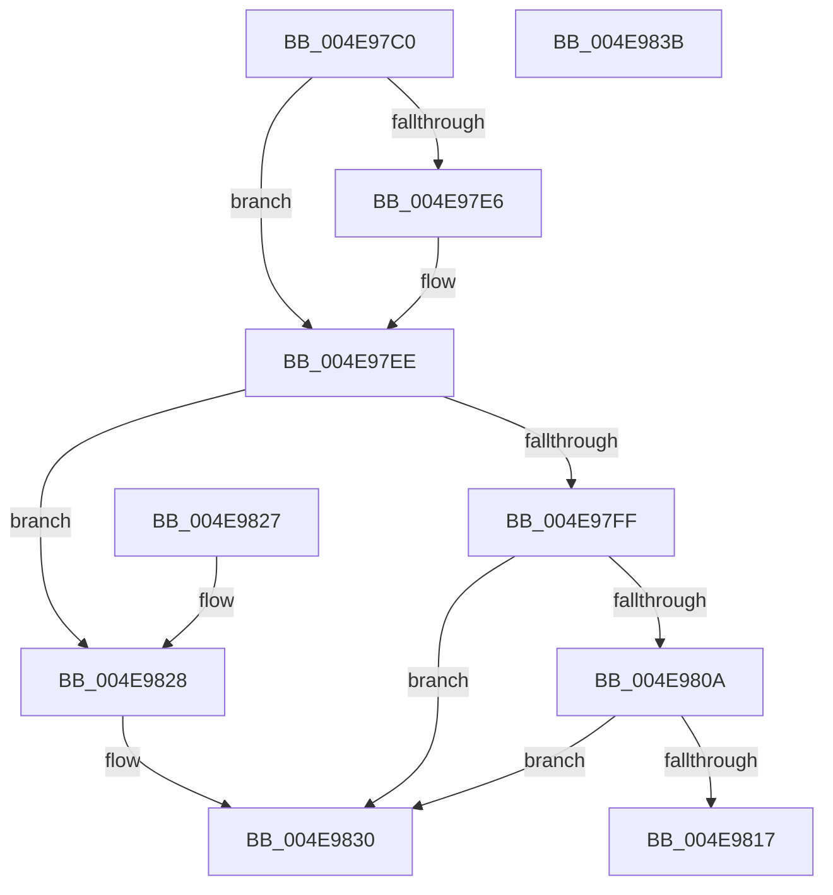

# PspUnlockThreadSecurityExclusive

- RVA: `0x004E97C0`–`0x004E983C` (길이 `124` bytes)
- VA: `0x00000001404E97C0`
- 실행 섹션: `.text`
- PDB 이름 있음: `예`; PDB Function 태그: `아니요`
- unwind 정보 RVA: `0x000CE3A0`
- 디코드: `37`개 명령, `124/124` bytes 표시
- 미해석 바이트: `0` (있으면 어셈블리에 `.byte`로 보존)

> 이 문서는 커널 이미지의 기계어와 PDB 기호를 분석해 생성했습니다. 4번과 5번은 함수 원형과 자료형을 바이너리 사용 방식에서 추정한 C 해석이며 원본 소스 복구 결과는 아닙니다.

## 1. Dependencies

- 직접 호출 지점: **5**; 고유 호출 대상: **5**
- 직접 호출자로 확인된 함수: **6**
- RIP 상대 이미지 참조: **0**

### Outgoing calls
- `0x004E97E9` → [ExfTryToWakePushLock](../26/ExfTryToWakePushLock_function_00265DD0.md) (function, `0x00265DD0`)
- `0x004E97F1` → [KeAbPostRelease](../2E/KeAbPostRelease_function_002E1600.md) (function, `0x002E1600`)
- `0x004E97F6` → [Feature_ThreadLockGuardedRegion__private_IsEnabledDeviceUsageNoInline](../5E/Feature_ThreadLockGuardedRegion__private_IsEnabledDeviceUsageNoInline_function_005E2CEC.md) (function, `0x005E2CEC`)
- `0x004E9817` → [KiCheckForKernelApcDelivery](../2E/KiCheckForKernelApcDelivery_function_002E2C80.md) (function, `0x002E2C80`)
- `0x004E982B` → [KiLeaveCriticalRegionUnsafe](../25/KiLeaveCriticalRegionUnsafe_function_0025F010.md) (function, `0x0025F010`)

### Direct callers
- [NtOpenThreadTokenEx](../../page/8B/NtOpenThreadTokenEx_function_008B7840.md) at `0x008B7A3F`
- [NtOpenThreadTokenEx](../../page/8B/NtOpenThreadTokenEx_function_008B7840.md) at `0x008B7D43`
- [NtOpenThreadTokenEx](../../page/8B/NtOpenThreadTokenEx_function_008B7840.md) at `0x008B7E2A`
- [NtSetInformationThread](../../page/8C/NtSetInformationThread_function_008C9F60.md) at `0x008CA9AA`
- [PsImpersonateClient](../../page/8C/PsImpersonateClient_function_008CBE10.md) at `0x008CBFA0`
- [PsImpersonateClient](../../page/8C/PsImpersonateClient_function_008CBE10.md) at `0x008CC078`
- [sub_009E6F2D](../../page/9E/Unknown_function_009E6F2D.md) at `0x009E6FCC`
- [PsDisableImpersonation](../../page/9E/PsDisableImpersonation_function_009E89B0.md) at `0x009E8A51`
- [PsDisableImpersonation](../../page/9E/PsDisableImpersonation_function_009E89B0.md) at `0x009E8A6F`
- [NtSetInformationThread$fin$1](../../page/B0/NtSetInformationThread_fin_1_function_00B0ED68.md) at `0x00B0ED83`

### Static image references
- 디코드된 RIP-relative 메모리 참조가 없습니다.

## 2. Other-region calls and transfers

- 다른 실행 섹션으로 향하는 call: **0**
- 별도 외부 분기/꼬리 이동을 확인하지 못했습니다.

## 3. Assembly (complete function range)

```asm
004E97C0  48 89 5C 24 08                  mov qword ptr [rsp + 8], rbx
004E97C5  57                              push rdi
004E97C6  48 83 EC 20                     sub rsp, 0x20
004E97CA  48 8B DA                        mov rbx, rdx
004E97CD  48 8D B9 90 05 00 00            lea rdi, [rcx + 0x590]
004E97D4  48 C7 C0 FF FF FF FF            mov rax, 0xffffffffffffffff
004E97DB  F0 48 0F C1 07                  lock xadd qword ptr [rdi], rax
004E97E0  24 06                           and al, 6
004E97E2  3C 02                           cmp al, 2
004E97E4  75 08                           jne 0x1404e97ee
004E97E6  48 8B CF                        mov rcx, rdi
004E97E9  E8 E2 C5 D7 FF                  call 0x140265dd0
004E97EE  48 8B CF                        mov rcx, rdi
004E97F1  E8 0A 7E DF FF                  call 0x1402e1600
004E97F6  E8 F1 94 0F 00                  call 0x1405e2cec
004E97FB  85 C0                           test eax, eax
004E97FD  74 29                           je 0x1404e9828
004E97FF  90                              nop
004E9800  66 83 83 E6 01 00 00 01         add word ptr [rbx + 0x1e6], 1
004E9808  75 26                           jne 0x1404e9830
004E980A  48 8D 83 98 00 00 00            lea rax, [rbx + 0x98]
004E9811  90                              nop
004E9812  48 39 00                        cmp qword ptr [rax], rax
004E9815  74 19                           je 0x1404e9830
004E9817  E8 64 94 DF FF                  call 0x1402e2c80
004E981C  48 8B 5C 24 30                  mov rbx, qword ptr [rsp + 0x30]
004E9821  48 83 C4 20                     add rsp, 0x20
004E9825  5F                              pop rdi
004E9826  C3                              ret
004E9827  CC                              int3
004E9828  48 8B CB                        mov rcx, rbx
004E982B  E8 E0 57 D7 FF                  call 0x14025f010
004E9830  48 8B 5C 24 30                  mov rbx, qword ptr [rsp + 0x30]
004E9835  48 83 C4 20                     add rsp, 0x20
004E9839  5F                              pop rdi
004E983A  C3                              ret
004E983B  CC                              int3
```

## 4. C-style interpretation (structured pseudocode)

```c
__int64 __fastcall PspUnlockThreadSecurityExclusive(__int64 a1, __int64 a2)
{
    __int64 result;
    __int64 v_rsp;
    unsigned __int64 v_stack_p30;
    unsigned __int64 v_stack_p8;

    v_stack_p8 = v_rbx;
    v_rsp = (v_rsp) - (32);
    result = (unsigned __int8)((-1) & (6));
    if (((unsigned __int8)(result)) == 2) {
        a1 = a1 + 1424;
        result = ExfTryToWakePushLock(a1, a2, a3, a4);
    }
    result = KeAbPostRelease(a1 + 1424, a2, a3, a4);
    result = Feature_ThreadLockGuardedRegion__private_IsEnabledDeviceUsageNoInline(a1 + 1424, a2, a3, a4);
    if ((unsigned int)(result) == 0) goto loc_004E9828;
    if ((unsigned int)(result) != 0) goto loc_004E9830;
    if ((*(unsigned __int64 *)(a2 + 152)) == (a2 + 152)) goto loc_004E9830;
    result = KiCheckForKernelApcDelivery(a1 + 1424, a2, a3, a4);
    v_rsp = (v_rsp) + (32);
    return result;
loc_004E9828:
    result = KiLeaveCriticalRegionUnsafe(v_stack_p8, a2, a3, a4);
loc_004E9830:
    v_rsp = (v_rsp) + (32);
    return result;
}
```

## 5. (Beta) C Style

```c
int64_t PspUnlockThreadSecurityExclusive(void *Arg1, void *Arg2)
{
    uint8_t *arg1 = (uint8_t *)Arg1;
    uint8_t *arg2 = (uint8_t *)Arg2;

    int64_t result;
    int64_t local_rsp;
    uint64_t v_stack_p30;
    uint64_t v_stack_p8;

    v_stack_p8 = local_rbx;
    local_rsp = (local_rsp) - (32);
    result = (uint8_t)((-1) & (6));
    if (((uint8_t)(result)) == 2) {
        Arg1 = Arg1 + 1424;
        result = ExfTryToWakePushLock(Arg1, Arg2, a3, a4);
    }
    result = KeAbPostRelease(Arg1 + 1424, Arg2, a3, a4);
    result = Feature_ThreadLockGuardedRegion__private_IsEnabledDeviceUsageNoInline(Arg1 + 1424, Arg2, a3, a4);
    if ((uint32_t)(result) == 0) goto loc_004E9828;
    if ((uint32_t)(result) != 0) goto loc_004E9830;
    if ((*(uint64_t *)(arg2 + 0x98)) == (Arg2 + 152)) goto loc_004E9830;
    result = KiCheckForKernelApcDelivery(Arg1 + 1424, Arg2, a3, a4);
    local_rsp = (local_rsp) + (32);
    return result;
loc_004E9828:
    result = KiLeaveCriticalRegionUnsafe(v_stack_p8, Arg2, a3, a4);
loc_004E9830:
    local_rsp = (local_rsp) + (32);
    return result;
}
```

### 관측된 메모리 오프셋

구조체 형식이 확인되지 않은 접근은 인자 기준의 오프셋으로만 기록했습니다.

| 기준 인자 | 오프셋 표현 | 폭 (bit) | 접근 |
|---|---:|---:|---|
| `Arg1` | `+ 0x0` | `64` | `R/W` |
| `Arg1` | `+ 0x590` | `64` | `R` |
| `Arg2` | `+ 0x0` | `64` | `R` |
| `Arg2` | `+ 0x98` | `64` | `R` |
| `Arg2` | `+ 0x1E6` | `16` | `R/W` |

## 6. Execution-region graph

[열기: 2D/3D 그래프와 함수 탐색 컨트롤 패널](../../../control-panel.html?section=text&rva=0x004E97C0&view=graph)

- 2D 그래프는 위에서 아래로 흐르고, 3D 그래프는 빈 공간을 드래그해 회전합니다. Shift+드래그는 이동, 휠은 확대·축소, 함수 노드 선택은 대상 보고서 이동입니다.

### Static fallback


