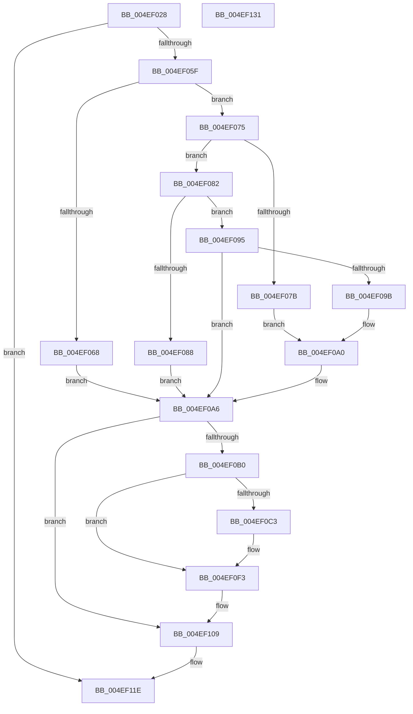

# RtlGetExtendedContextLength3

- RVA: `0x004EF028`–`0x004EF132` (길이 `266` bytes)
- VA: `0x00000001404EF028`
- 실행 섹션: `.text`
- PDB 이름 있음: `예`; PDB Function 태그: `아니요`
- unwind 정보 RVA: `0x000A2264`
- 디코드: `79`개 명령, `266/266` bytes 표시
- 미해석 바이트: `0` (있으면 어셈블리에 `.byte`로 보존)

> 이 문서는 커널 이미지의 기계어와 PDB 기호를 분석해 생성했습니다. 4번과 5번은 함수 원형과 자료형을 바이너리 사용 방식에서 추정한 C 해석이며 원본 소스 복구 결과는 아닙니다.

## 1. Dependencies

- 직접 호출 지점: **3**; 고유 호출 대상: **3**
- 직접 호출자로 확인된 함수: **4**
- RIP 상대 이미지 참조: **0**

### Outgoing calls
- `0x004EF052` → [RtlpValidateContextFlags2](RtlpValidateContextFlags2_function_004EF138.md) (function, `0x004EF138`)
- `0x004EF0E9` → [RtlpRemoveArchDisallowedXStateFeatures](../2F/RtlpRemoveArchDisallowedXStateFeatures_function_002F32FC.md) (function, `0x002F32FC`)
- `0x004EF0F9` → [RtlpGetEntireXStateAreaLength2](RtlpGetEntireXStateAreaLength2_function_004EF20C.md) (function, `0x004EF20C`)

### Direct callers
- [KiContinuePreviousModeUser](../2F/KiContinuePreviousModeUser_function_002F9B10.md) at `0x002F9C43`
- [RtlGetExtendedContextLength](../3D/RtlGetExtendedContextLength_function_003D7190.md) at `0x003D71F2`
- [KiDispatchException](../3D/KiDispatchException_function_003D7650.md) at `0x003D7733`
- [RtlGetExtendedContextLength2](../49/RtlGetExtendedContextLength2_function_00493FE0.md) at `0x00493FEE`

### Static image references
- 디코드된 RIP-relative 메모리 참조가 없습니다.

## 2. Other-region calls and transfers

- 다른 실행 섹션으로 향하는 call: **0**
- 별도 외부 분기/꼬리 이동을 확인하지 못했습니다.

## 3. Assembly (complete function range)

```asm
004EF028  48 8B C4                        mov rax, rsp
004EF02B  48 89 58 08                     mov qword ptr [rax + 8], rbx
004EF02F  48 89 68 10                     mov qword ptr [rax + 0x10], rbp
004EF033  56                              push rsi
004EF034  57                              push rdi
004EF035  41 56                           push r14
004EF037  48 83 EC 30                     sub rsp, 0x30
004EF03B  49 8B E8                        mov rbp, r8
004EF03E  4C 8B F2                        mov r14, rdx
004EF041  33 DB                           xor ebx, ebx
004EF043  48 8D 50 D8                     lea rdx, [rax - 0x28]
004EF047  4D 8B C1                        mov r8, r9
004EF04A  89 58 D8                        mov dword ptr [rax - 0x28], ebx
004EF04D  49 8B F1                        mov rsi, r9
004EF050  8B F9                           mov edi, ecx
004EF052  E8 E1 00 00 00                  call 0x1404ef138
004EF057  85 C0                           test eax, eax
004EF059  0F 88 BF 00 00 00               js 0x1404ef11e
004EF05F  44 8B DB                        mov r11d, ebx
004EF062  0F BA E7 10                     bt edi, 0x10
004EF066  73 0D                           jae 0x1404ef075
004EF068  BB CC 02 00 00                  mov ebx, 0x2cc
004EF06D  41 BB 04 00 00 00               mov r11d, 4
004EF073  EB 31                           jmp 0x1404ef0a6
004EF075  0F BA E7 14                     bt edi, 0x14
004EF079  73 07                           jae 0x1404ef082
004EF07B  BB D0 04 00 00                  mov ebx, 0x4d0
004EF080  EB 1E                           jmp 0x1404ef0a0
004EF082  0F BA E7 15                     bt edi, 0x15
004EF086  73 0D                           jae 0x1404ef095
004EF088  BB A0 01 00 00                  mov ebx, 0x1a0
004EF08D  41 BB 08 00 00 00               mov r11d, 8
004EF093  EB 11                           jmp 0x1404ef0a6
004EF095  0F BA E7 16                     bt edi, 0x16
004EF099  73 0B                           jae 0x1404ef0a6
004EF09B  BB 90 03 00 00                  mov ebx, 0x390
004EF0A0  41 BB 10 00 00 00               mov r11d, 0x10
004EF0A6  83 C3 20                        add ebx, 0x20
004EF0A9  F6 44 24 20 02                  test byte ptr [rsp + 0x20], 2
004EF0AE  74 59                           je 0x1404ef109
004EF0B0  FF CB                           dec ebx
004EF0B2  41 8B C3                        mov eax, r11d
004EF0B5  F7 D8                           neg eax
004EF0B7  41 03 DB                        add ebx, r11d
004EF0BA  23 D8                           and ebx, eax
004EF0BC  8B 46 14                        mov eax, dword ptr [rsi + 0x14]
004EF0BF  A8 02                           test al, 2
004EF0C1  74 30                           je 0x1404ef0f3
004EF0C3  48 8B 8E 30 03 00 00            mov rcx, qword ptr [rsi + 0x330]
004EF0CA  48 8D 54 24 60                  lea rdx, [rsp + 0x60]
004EF0CF  48 0B 0E                        or rcx, qword ptr [rsi]
004EF0D2  48 B8 00 00 00 00 00 00 00 80   movabs rax, 0x8000000000000000
004EF0DC  48 0B C8                        or rcx, rax
004EF0DF  48 23 E9                        and rbp, rcx
004EF0E2  8B CF                           mov ecx, edi
004EF0E4  48 89 6C 24 60                  mov qword ptr [rsp + 0x60], rbp
004EF0E9  E8 0E 42 E0 FF                  call 0x1402f32fc
004EF0EE  48 8B 6C 24 60                  mov rbp, qword ptr [rsp + 0x60]
004EF0F3  48 8B D6                        mov rdx, rsi
004EF0F6  48 8B CD                        mov rcx, rbp
004EF0F9  E8 0E 01 00 00                  call 0x1404ef20c
004EF0FE  41 2B DB                        sub ebx, r11d
004EF101  81 C3 40 FE FF FF               add ebx, 0xfffffe40
004EF107  03 D8                           add ebx, eax
004EF109  F6 44 24 20 04                  test byte ptr [rsp + 0x20], 4
004EF10E  8D 43 20                        lea eax, [rbx + 0x20]
004EF111  0F 44 C3                        cmove eax, ebx
004EF114  FF C8                           dec eax
004EF116  41 03 C3                        add eax, r11d
004EF119  41 89 06                        mov dword ptr [r14], eax
004EF11C  33 C0                           xor eax, eax
004EF11E  48 8B 5C 24 50                  mov rbx, qword ptr [rsp + 0x50]
004EF123  48 8B 6C 24 58                  mov rbp, qword ptr [rsp + 0x58]
004EF128  48 83 C4 30                     add rsp, 0x30
004EF12C  41 5E                           pop r14
004EF12E  5F                              pop rdi
004EF12F  5E                              pop rsi
004EF130  C3                              ret
004EF131  CC                              int3
```

## 4. C-style interpretation (structured pseudocode)

```c
__int64 __fastcall RtlGetExtendedContextLength3(int a1, __int64 a2, __int64 a3, __int64 a4)
{
    __int64 result;
    __int64 v_rbp;
    __int64 v_rbx;
    __int64 v_rsp;
    unsigned __int8 v_stack_m28;
    unsigned __int64 v_stack_p10;
    unsigned __int64 v_stack_p18;
    unsigned __int64 v_stack_p8;

    *(unsigned __int64 *)(v_rsp + 8) = v_rbx;
    *(unsigned __int64 *)(v_rsp + 16) = v_rbp;
    v_rsp = (v_rsp) - (48);
    v_rbx = 0;
    *(unsigned int *)(v_rsp - 40) = 0;
    result = RtlpValidateContextFlags2(a1, v_rsp - 40, a4, a4);
    if (sign_flag) goto loc_004EF11E;
    if (condition_is_above_or_equal) goto loc_004EF075;
    goto loc_004EF0A6;
loc_004EF075:
    if (condition_is_above_or_equal) goto loc_004EF082;
    goto loc_004EF0A0;
loc_004EF082:
    if (condition_is_above_or_equal) goto loc_004EF095;
    goto loc_004EF0A6;
loc_004EF095:
    if (condition_is_above_or_equal) goto loc_004EF0A6;
loc_004EF0A0:
loc_004EF0A6:
    v_rbx = (unsigned int)((912) + (32));
    if (((v_stack_m28) & (2)) == 0) goto loc_004EF109;
    v_rbx = (unsigned int)((v_rbx) - 1);
    result = (unsigned int)(-(16));
    v_rbx = (unsigned int)((v_rbx) + (16));
    v_rbx = (unsigned int)((v_rbx) & ((unsigned int)(result)));
    result = (unsigned int)(*(unsigned int *)(a4 + 20));
    v_rbp = a3;
    if ((((unsigned __int8)((unsigned int)(*(unsigned int *)(a4 + 20)))) & (2)) != 0) {
        a1 = *(unsigned __int64 *)(a4 + 816);
        a2 = v_stack_p18;
        a1 = (a1) | (*(unsigned __int64 *)(a4));
        a1 = (a1) | ((unsigned int)(*(unsigned int *)(a4 + 20)));
        v_rbp = (a3) & (a1);
        a1 = (unsigned int)((unsigned int)(a1));
        v_stack_p18 = v_rbp;
        result = RtlpRemoveArchDisallowedXStateFeatures(a1, a2, a4, a4);
        v_rbp = v_stack_p18;
    }
    result = RtlpGetEntireXStateAreaLength2(v_rbp, a4, a4, a4);
    v_rbx = (unsigned int)((v_rbx) - (16));
    v_rbx = (unsigned int)((v_rbx) + (0xFFFFFE40ULL));
    v_rbx = (unsigned int)((v_rbx) + ((unsigned int)(result)));
loc_004EF109:
    result = v_rbx + 32;
    if (((v_stack_m28) & (4)) == 0) { result = (unsigned int)(v_rbx); }
    result = (unsigned int)((result) - 1);
    result = (unsigned int)((result) + (16));
    *(unsigned int *)(a2) = (unsigned int)(result);
    result = 0;
loc_004EF11E:
    v_rsp = (v_rsp) + (48);
    return result;
}
```

## 5. (Beta) C Style

```c
int64_t RtlGetExtendedContextLength3(int32_t Arg1, void *Arg2, int64_t Arg3, void *Arg4)
{
    uint8_t *arg2 = (uint8_t *)Arg2;
    uint8_t *arg4 = (uint8_t *)Arg4;

    int64_t result;
    int64_t local_rbp;
    int64_t local_rbx;
    int64_t local_rsp;
    uint8_t v_stack_m28;
    uint64_t v_stack_p10;
    uint64_t v_stack_p18;
    uint64_t v_stack_p8;

    *(uint64_t *)(local_rsp + 0x8) = local_rbx;
    *(uint64_t *)(local_rsp + 0x10) = local_rbp;
    local_rsp = (local_rsp) - (48);
    local_rbx = 0;
    *(uint32_t *)(local_rsp - 0x28) = 0;
    result = RtlpValidateContextFlags2(Arg1, local_rsp - 40, Arg4, Arg4);
    if (sign_flag) goto loc_004EF11E;
    if (condition_is_above_or_equal) goto loc_004EF075;
    goto loc_004EF0A6;
loc_004EF075:
    if (condition_is_above_or_equal) goto loc_004EF082;
    goto loc_004EF0A0;
loc_004EF082:
    if (condition_is_above_or_equal) goto loc_004EF095;
    goto loc_004EF0A6;
loc_004EF095:
    if (condition_is_above_or_equal) goto loc_004EF0A6;
loc_004EF0A0:
loc_004EF0A6:
    local_rbx = (uint32_t)((912) + (32));
    if (((v_stack_m28) & (2)) == 0) goto loc_004EF109;
    local_rbx = (uint32_t)((local_rbx) - 1);
    result = (uint32_t)(-(16));
    local_rbx = (uint32_t)((local_rbx) + (16));
    local_rbx = (uint32_t)((local_rbx) & ((uint32_t)(result)));
    result = (uint32_t)(*(uint32_t *)(arg4 + 0x14));
    local_rbp = Arg3;
    if ((((uint8_t)((uint32_t)(*(uint32_t *)(arg4 + 0x14)))) & (2)) != 0) {
        Arg1 = *(uint64_t *)(arg4 + 0x330);
        Arg2 = v_stack_p18;
        Arg1 = (Arg1) | (*(uint64_t *)(arg4));
        Arg1 = (Arg1) | ((uint32_t)(*(uint32_t *)(arg4 + 0x14)));
        local_rbp = (Arg3) & (Arg1);
        Arg1 = (uint32_t)((uint32_t)(Arg1));
        v_stack_p18 = local_rbp;
        result = RtlpRemoveArchDisallowedXStateFeatures(Arg1, Arg2, Arg4, Arg4);
        local_rbp = v_stack_p18;
    }
    result = RtlpGetEntireXStateAreaLength2(local_rbp, Arg4, Arg4, Arg4);
    local_rbx = (uint32_t)((local_rbx) - (16));
    local_rbx = (uint32_t)((local_rbx) + (0xFFFFFE40ULL));
    local_rbx = (uint32_t)((local_rbx) + ((uint32_t)(result)));
loc_004EF109:
    result = local_rbx + 32;
    if (((v_stack_m28) & (4)) == 0) { result = (uint32_t)(local_rbx); }
    result = (uint32_t)((result) - 1);
    result = (uint32_t)((result) + (16));
    *(uint32_t *)(arg2) = (uint32_t)(result);
    result = 0;
loc_004EF11E:
    local_rsp = (local_rsp) + (48);
    return result;
}
```

### 관측된 메모리 오프셋

구조체 형식이 확인되지 않은 접근은 인자 기준의 오프셋으로만 기록했습니다.

| 기준 인자 | 오프셋 표현 | 폭 (bit) | 접근 |
|---|---:|---:|---|
| `Arg2` | `+ 0x0` | `32` | `W` |
| `Arg4` | `+ 0x0` | `64` | `R` |
| `Arg4` | `+ 0x14` | `32` | `R` |
| `Arg4` | `+ 0x330` | `64` | `R` |

## 6. Execution-region graph

[열기: 2D/3D 그래프와 함수 탐색 컨트롤 패널](../../../control-panel.html?section=text&rva=0x004EF028&view=graph)

- 2D 그래프는 위에서 아래로 흐르고, 3D 그래프는 빈 공간을 드래그해 회전합니다. Shift+드래그는 이동, 휠은 확대·축소, 함수 노드 선택은 대상 보고서 이동입니다.

### Static fallback


