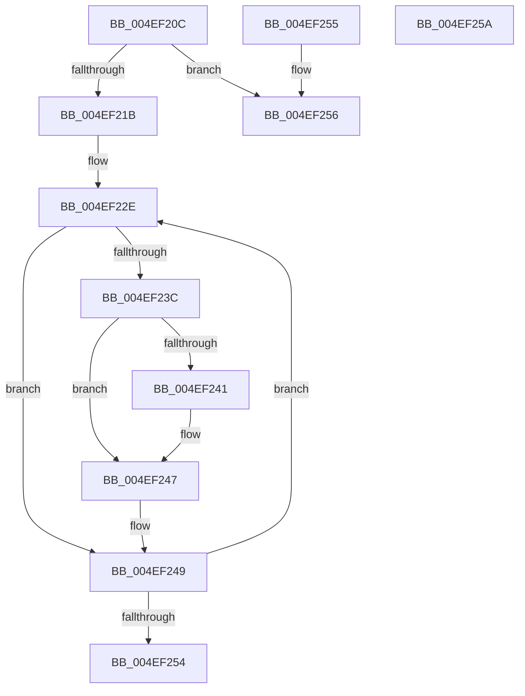

# RtlpGetEntireXStateAreaLength2

- RVA: `0x004EF20C`–`0x004EF25B` (길이 `79` bytes)
- VA: `0x00000001404EF20C`
- 실행 섹션: `.text`
- PDB 이름 있음: `예`; PDB Function 태그: `아니요`
- unwind 정보 RVA: `0x000DB714`
- 디코드: `26`개 명령, `79/79` bytes 표시
- 미해석 바이트: `0` (있으면 어셈블리에 `.byte`로 보존)

> 이 문서는 커널 이미지의 기계어와 PDB 기호를 분석해 생성했습니다. 4번과 5번은 함수 원형과 자료형을 바이너리 사용 방식에서 추정한 C 해석이며 원본 소스 복구 결과는 아닙니다.

## 1. Dependencies

- 직접 호출 지점: **0**; 고유 호출 대상: **0**
- 직접 호출자로 확인된 함수: **8**
- RIP 상대 이미지 참조: **0**

### Outgoing calls
- 직접 디코드된 call 명령이 없습니다.

### Direct callers
- [RtlUnwind](../2F/RtlUnwind_function_002F1CB0.md) at `0x002F1DD7`
- [RtlDispatchException](../2F/RtlDispatchException_function_002F22A0.md) at `0x002F2687`
- [RtlUnwindEx](../2F/RtlUnwindEx_function_002F2830.md) at `0x002F2E60`
- [RtlpWalkFrameChain](../2F/RtlpWalkFrameChain_function_002F3ED0.md) at `0x002F4DC6`
- [RtlInitializeExtendedContext2](../2F/RtlInitializeExtendedContext2_function_002F5D40.md) at `0x002F5E9F`
- [RtlpGetNonLegacyXStateAreaLength](../3D/RtlpGetNonLegacyXStateAreaLength_function_003D995C.md) at `0x003D9997`
- [RtlpGetEntireXStateAreaLength](../48/RtlpGetEntireXStateAreaLength_function_0048BE10.md) at `0x0048BE1E`
- [RtlGetExtendedContextLength3](RtlGetExtendedContextLength3_function_004EF028.md) at `0x004EF0F9`

### Static image references
- 디코드된 RIP-relative 메모리 참조가 없습니다.

## 2. Other-region calls and transfers

- 다른 실행 섹션으로 향하는 call: **0**
- 별도 외부 분기/꼬리 이동을 확인하지 못했습니다.

## 3. Assembly (complete function range)

```asm
004EF20C  8B 42 14                        mov eax, dword ptr [rdx + 0x14]
004EF20F  4C 8B D1                        mov r10, rcx
004EF212  B9 02 00 00 00                  mov ecx, 2
004EF217  84 C1                           test cl, al
004EF219  74 3B                           je 0x1404ef256
004EF21B  4C 8B 8A 20 02 00 00            mov r9, qword ptr [rdx + 0x220]
004EF222  B8 40 02 00 00                  mov eax, 0x240
004EF227  48 81 C2 34 02 00 00            add rdx, 0x234
004EF22E  41 B8 01 00 00 00               mov r8d, 1
004EF234  49 D3 E0                        shl r8, cl
004EF237  4D 85 C2                        test r10, r8
004EF23A  74 0D                           je 0x1404ef249
004EF23C  4D 85 C1                        test r9, r8
004EF23F  74 06                           je 0x1404ef247
004EF241  83 C0 3F                        add eax, 0x3f
004EF244  83 E0 C0                        and eax, 0xffffffc0
004EF247  03 02                           add eax, dword ptr [rdx]
004EF249  FF C1                           inc ecx
004EF24B  48 83 C2 04                     add rdx, 4
004EF24F  83 F9 40                        cmp ecx, 0x40
004EF252  72 DA                           jb 0x1404ef22e
004EF254  C3                              ret
004EF255  CC                              int3
004EF256  8B 42 10                        mov eax, dword ptr [rdx + 0x10]
004EF259  C3                              ret
004EF25A  CC                              int3
```

## 4. C-style interpretation (structured pseudocode)

```c
__int64 __fastcall RtlpGetEntireXStateAreaLength2(__int64 a1, __int64 a2)
{
    __int64 result;

    if (((2) & ((unsigned __int8)((unsigned int)(*(unsigned int *)(a2 + 20))))) == 0) goto loc_004EF256;
    a2 = (a2) + (564);
loc_004EF22E:
    a3 = (1) << (2);
    if (((a1) & (a3)) == 0) goto loc_004EF249;
    result = 576;
    if (((*(unsigned __int64 *)(a2 + 544)) & (a3)) != 0) {
        result = (unsigned int)((576) + (63));
        result = (unsigned int)((result) & (0xFFFFFFC0ULL));
    }
    result = (unsigned int)((result) + (*(unsigned int *)(a2)));
loc_004EF249:
    a1 = (unsigned int)((2) + 1);
    a2 = (a2) + (4);
    if (((unsigned int)(a1)) < 64) goto loc_004EF22E;
    return result;
loc_004EF256:
    return (unsigned int)(*(unsigned int *)(a2 + 16));
}
```

## 5. (Beta) C Style

```c
int64_t RtlpGetEntireXStateAreaLength2(int64_t Arg1, void *Arg2)
{
    uint8_t *arg2 = (uint8_t *)Arg2;

    int64_t result;

    if (((2) & ((uint8_t)((uint32_t)(*(uint32_t *)(arg2 + 0x14))))) == 0) goto loc_004EF256;
    Arg2 = (Arg2) + (564);
loc_004EF22E:
    a3 = (1) << (2);
    if (((Arg1) & (a3)) == 0) goto loc_004EF249;
    result = 576;
    if (((*(uint64_t *)(arg2 + 0x220)) & (a3)) != 0) {
        result = (uint32_t)((576) + (63));
        result = (uint32_t)((result) & (0xFFFFFFC0ULL));
    }
    result = (uint32_t)((result) + (*(uint32_t *)(arg2)));
loc_004EF249:
    Arg1 = (uint32_t)((2) + 1);
    Arg2 = (Arg2) + (4);
    if (((uint32_t)(Arg1)) < 64) goto loc_004EF22E;
    return result;
loc_004EF256:
    return (uint32_t)(*(uint32_t *)(arg2 + 0x10));
}
```

### 관측된 메모리 오프셋

구조체 형식이 확인되지 않은 접근은 인자 기준의 오프셋으로만 기록했습니다.

| 기준 인자 | 오프셋 표현 | 폭 (bit) | 접근 |
|---|---:|---:|---|
| `Arg2` | `+ 0x0` | `32` | `R` |
| `Arg2` | `+ 0x10` | `32` | `R` |
| `Arg2` | `+ 0x14` | `32` | `R` |
| `Arg2` | `+ 0x220` | `64` | `R` |

## 6. Execution-region graph

[열기: 2D/3D 그래프와 함수 탐색 컨트롤 패널](../../../control-panel.html?section=text&rva=0x004EF20C&view=graph)

- 2D 그래프는 위에서 아래로 흐르고, 3D 그래프는 빈 공간을 드래그해 회전합니다. Shift+드래그는 이동, 휠은 확대·축소, 함수 노드 선택은 대상 보고서 이동입니다.

### Static fallback


