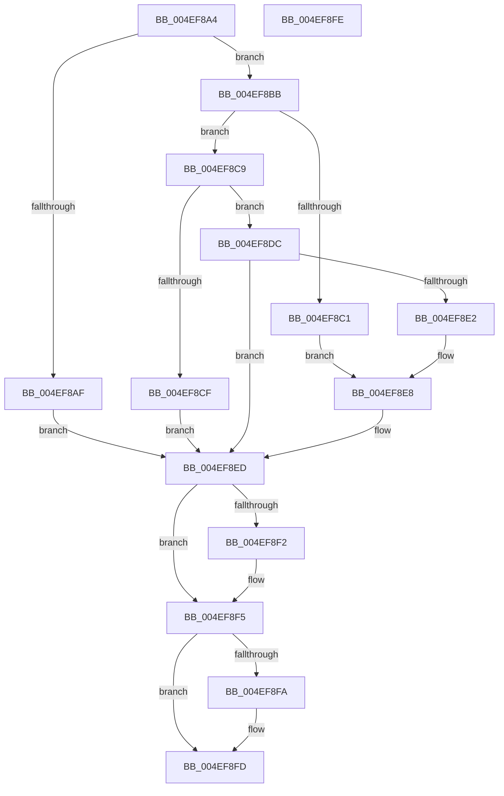

# RtlpGetLegacyContextLength2

- RVA: `0x004EF8A4`–`0x004EF8FF` (길이 `91` bytes)
- VA: `0x00000001404EF8A4`
- 실행 섹션: `.text`
- PDB 이름 있음: `예`; PDB Function 태그: `아니요`
- unwind 정보 RVA: `0x000DB714`
- 디코드: `28`개 명령, `91/91` bytes 표시
- 미해석 바이트: `0` (있으면 어셈블리에 `.byte`로 보존)

> 이 문서는 커널 이미지의 기계어와 PDB 기호를 분석해 생성했습니다. 4번과 5번은 함수 원형과 자료형을 바이너리 사용 방식에서 추정한 C 해석이며 원본 소스 복구 결과는 아닙니다.

## 1. Dependencies

- 직접 호출 지점: **0**; 고유 호출 대상: **0**
- 직접 호출자로 확인된 함수: **1**
- RIP 상대 이미지 참조: **0**

### Outgoing calls
- 직접 디코드된 call 명령이 없습니다.

### Direct callers
- [RtlpGetLegacyContextLength](../4B/RtlpGetLegacyContextLength_function_004B6060.md) at `0x004B6064`

### Static image references
- 디코드된 RIP-relative 메모리 참조가 없습니다.

## 2. Other-region calls and transfers

- 다른 실행 섹션으로 향하는 call: **0**
- 별도 외부 분기/꼬리 이동을 확인하지 못했습니다.

## 3. Assembly (complete function range)

```asm
004EF8A4  45 33 C9                        xor r9d, r9d
004EF8A7  33 C0                           xor eax, eax
004EF8A9  0F BA E1 10                     bt ecx, 0x10
004EF8AD  73 0C                           jae 0x1404ef8bb
004EF8AF  41 8D 41 04                     lea eax, [r9 + 4]
004EF8B3  41 B9 CC 02 00 00               mov r9d, 0x2cc
004EF8B9  EB 32                           jmp 0x1404ef8ed
004EF8BB  0F BA E1 14                     bt ecx, 0x14
004EF8BF  73 08                           jae 0x1404ef8c9
004EF8C1  41 B9 D0 04 00 00               mov r9d, 0x4d0
004EF8C7  EB 1F                           jmp 0x1404ef8e8
004EF8C9  0F BA E1 15                     bt ecx, 0x15
004EF8CD  73 0D                           jae 0x1404ef8dc
004EF8CF  B8 08 00 00 00                  mov eax, 8
004EF8D4  41 B9 A0 01 00 00               mov r9d, 0x1a0
004EF8DA  EB 11                           jmp 0x1404ef8ed
004EF8DC  0F BA E1 16                     bt ecx, 0x16
004EF8E0  73 0B                           jae 0x1404ef8ed
004EF8E2  41 B9 90 03 00 00               mov r9d, 0x390
004EF8E8  B8 10 00 00 00                  mov eax, 0x10
004EF8ED  48 85 D2                        test rdx, rdx
004EF8F0  74 03                           je 0x1404ef8f5
004EF8F2  44 89 0A                        mov dword ptr [rdx], r9d
004EF8F5  4D 85 C0                        test r8, r8
004EF8F8  74 03                           je 0x1404ef8fd
004EF8FA  41 89 00                        mov dword ptr [r8], eax
004EF8FD  C3                              ret
004EF8FE  CC                              int3
```

## 4. C-style interpretation (structured pseudocode)

```c
__int64 __fastcall RtlpGetLegacyContextLength2(int a1, __int64 a2, __int64 a3, int a4)
{
    __int64 result;

    a4 = 0;
    result = 0;
    if (condition_is_above_or_equal) goto loc_004EF8BB;
    goto loc_004EF8ED;
loc_004EF8BB:
    if (condition_is_above_or_equal) goto loc_004EF8C9;
    goto loc_004EF8E8;
loc_004EF8C9:
    if (condition_is_above_or_equal) goto loc_004EF8DC;
    goto loc_004EF8ED;
loc_004EF8DC:
    if (condition_is_above_or_equal) goto loc_004EF8ED;
loc_004EF8E8:
loc_004EF8ED:
    if (a2 != 0) {
        *(unsigned int *)(a2) = 912;
    }
    if (a3 != 0) {
        *(unsigned int *)(a3) = 16;
    }
    return 16;
}
```

## 5. (Beta) C Style

```c
int64_t RtlpGetLegacyContextLength2(int32_t Arg1, int64_t Arg2, int64_t Arg3, int32_t Arg4)
{
    int64_t result;

    Arg4 = 0;
    result = 0;
    if (condition_is_above_or_equal) goto loc_004EF8BB;
    goto loc_004EF8ED;
loc_004EF8BB:
    if (condition_is_above_or_equal) goto loc_004EF8C9;
    goto loc_004EF8E8;
loc_004EF8C9:
    if (condition_is_above_or_equal) goto loc_004EF8DC;
    goto loc_004EF8ED;
loc_004EF8DC:
    if (condition_is_above_or_equal) goto loc_004EF8ED;
loc_004EF8E8:
loc_004EF8ED:
    if (Arg2 != 0) {
        *(uint32_t *)(Arg2) = 912;
    }
    if (Arg3 != 0) {
        *(uint32_t *)(Arg3) = 16;
    }
    return 16;
}
```

## 6. Execution-region graph

[열기: 2D/3D 그래프와 함수 탐색 컨트롤 패널](../../../control-panel.html?section=text&rva=0x004EF8A4&view=graph)

- 2D 그래프는 위에서 아래로 흐르고, 3D 그래프는 빈 공간을 드래그해 회전합니다. Shift+드래그는 이동, 휠은 확대·축소, 함수 노드 선택은 대상 보고서 이동입니다.

### Static fallback


