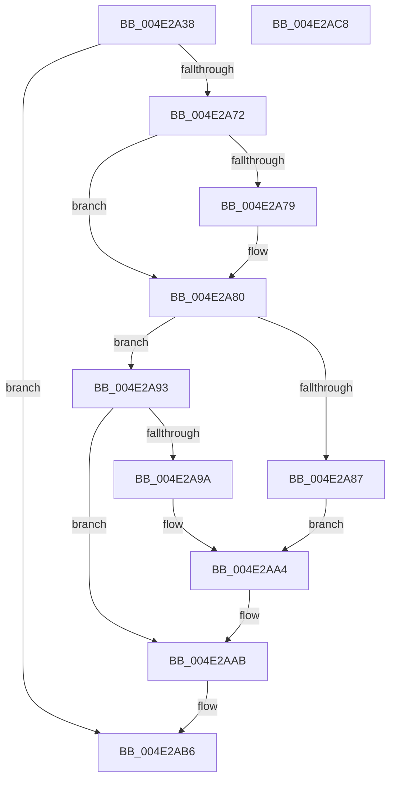

# RtlpInitializeNonVolatileFlush

- RVA: `0x004E2A38`–`0x004E2AC9` (길이 `145` bytes)
- VA: `0x00000001404E2A38`
- 실행 섹션: `.text`
- PDB 이름 있음: `예`; PDB Function 태그: `아니요`
- unwind 정보 RVA: `0x00060904`
- 디코드: `33`개 명령, `145/145` bytes 표시
- 미해석 바이트: `0` (있으면 어셈블리에 `.byte`로 보존)

> 이 문서는 커널 이미지의 기계어와 PDB 기호를 분석해 생성했습니다. 4번과 5번은 함수 원형과 자료형을 바이너리 사용 방식에서 추정한 C 해석이며 원본 소스 복구 결과는 아닙니다.

## 1. Dependencies

- 직접 호출 지점: **2**; 고유 호출 대상: **2**
- 직접 호출자로 확인된 함수: **1**
- RIP 상대 이미지 참조: **5**

### Outgoing calls
- `0x004E2A69` → [ZwQuerySystemInformation](../6A/ZwQuerySystemInformation_function_006AD790.md) (function, `0x006AD790`)
- `0x004E2ABE` → [_security_check_cookie](../6A/_security_check_cookie_function_006AC640.md) (function, `0x006AC640`)

### Direct callers
- [Phase1InitializationIoReady](../../init/C7/Phase1InitializationIoReady_function_00C70458.md) at `0x00C7047A`

### Static image references
- `0x004E2A3C` → RVA `0x00E0A740` (`.data`; read)
- `0x004E2A79` → RVA `0x00E0C5BC` (`.data`; write)
- `0x004E2A87` → RVA `0x00E0C5B8` (`.data`; write)
- `0x004E2AA4` → RVA `0x00E67B08` (`.data`; write)
- `0x004E2AAF` → RVA `0x00E0C5B0` (`.data`; write)

## 2. Other-region calls and transfers

- 다른 실행 섹션으로 향하는 call: **0**
- 별도 외부 분기/꼬리 이동을 확인하지 못했습니다.

## 3. Assembly (complete function range)

```asm
004E2A38  48 83 EC 58                     sub rsp, 0x58
004E2A3C  48 8B 05 FD 7C 92 00            mov rax, qword ptr [rip + 0x927cfd]
004E2A43  48 33 C4                        xor rax, rsp
004E2A46  48 89 44 24 40                  mov qword ptr [rsp + 0x40], rax
004E2A4B  0F 57 C0                        xorps xmm0, xmm0
004E2A4E  48 8D 54 24 20                  lea rdx, [rsp + 0x20]
004E2A53  45 33 C9                        xor r9d, r9d
004E2A56  B9 C0 00 00 00                  mov ecx, 0xc0
004E2A5B  0F 11 44 24 20                  movups xmmword ptr [rsp + 0x20], xmm0
004E2A60  0F 11 44 24 30                  movups xmmword ptr [rsp + 0x30], xmm0
004E2A65  45 8D 41 20                     lea r8d, [r9 + 0x20]
004E2A69  E8 22 AD 1C 00                  call 0x1406ad790
004E2A6E  85 C0                           test eax, eax
004E2A70  78 44                           js 0x1404e2ab6
004E2A72  F6 44 24 28 01                  test byte ptr [rsp + 0x28], 1
004E2A77  74 07                           je 0x1404e2a80
004E2A79  C6 05 3C 9B 92 00 00            mov byte ptr [rip + 0x929b3c], 0
004E2A80  F6 44 24 20 04                  test byte ptr [rsp + 0x20], 4
004E2A85  74 0C                           je 0x1404e2a93
004E2A87  C7 05 27 9B 92 00 02 00 00 00   mov dword ptr [rip + 0x929b27], 2
004E2A91  EB 11                           jmp 0x1404e2aa4
004E2A93  F6 44 24 20 02                  test byte ptr [rsp + 0x20], 2
004E2A98  74 11                           je 0x1404e2aab
004E2A9A  C7 05 14 9B 92 00 03 00 00 00   mov dword ptr [rip + 0x929b14], 3
004E2AA4  C6 05 5D 50 98 00 01            mov byte ptr [rip + 0x98505d], 1
004E2AAB  8B 44 24 24                     mov eax, dword ptr [rsp + 0x24]
004E2AAF  48 89 05 FA 9A 92 00            mov qword ptr [rip + 0x929afa], rax
004E2AB6  48 8B 4C 24 40                  mov rcx, qword ptr [rsp + 0x40]
004E2ABB  48 33 CC                        xor rcx, rsp
004E2ABE  E8 7D 9B 1C 00                  call 0x1406ac640
004E2AC3  48 83 C4 58                     add rsp, 0x58
004E2AC7  C3                              ret
004E2AC8  CC                              int3
```

## 4. C-style interpretation (structured pseudocode)

```c
__int64 __fastcall RtlpInitializeNonVolatileFlush(__int64 a1, __int64 a2, __int64 a3, int a4)
{
    __int64 result;
    __int64 v_rsp;
    unsigned __int64 v_stack_m18;
    unsigned __int64 v_stack_m28;
    unsigned __int8 v_stack_m30;
    unsigned int v_stack_m34;
    unsigned __int64 v_stack_m38;

    v_rsp = (v_rsp) - (88);
    result = (*(unsigned __int64 *)(v_rip + 9600253)) ^ (v_rsp);
    v_stack_m18 = result;
    a4 = 0;
    v_stack_m38 = v_xmm0;
    v_stack_m28 = v_xmm0;
    result = ZwQuerySystemInformation(192, v_stack_m38, a4 + 32, a4);
    if (sign_flag) goto loc_004E2AB6;
    if (((v_stack_m30) & (1)) != 0) {
        *(unsigned __int8 *)(v_rip + 9607996) = 0;
    }
    if (((v_stack_m38) & (4)) == 0) goto loc_004E2A93;
    *(unsigned int *)(v_rip + 9607975) = 2;
    goto loc_004E2AA4;
loc_004E2A93:
    if (((v_stack_m38) & (2)) == 0) goto loc_004E2AAB;
    *(unsigned int *)(v_rip + 9607956) = 3;
loc_004E2AA4:
    *(unsigned __int8 *)(v_rip + 9982045) = 1;
loc_004E2AAB:
    *(unsigned __int64 *)(v_rip + 9607930) = (unsigned int)(v_stack_m34);
loc_004E2AB6:
    a1 = (v_stack_m18) ^ (v_rsp);
    result = _security_check_cookie(a1, v_stack_m38, a4 + 32, a4);
    v_rsp = (v_rsp) + (88);
    return result;
}
```

## 5. (Beta) C Style

```c
int64_t RtlpInitializeNonVolatileFlush(int64_t Arg1, int64_t Arg2, int64_t Arg3, int32_t Arg4)
{
    int64_t result;
    int64_t local_rsp;
    uint64_t v_stack_m18;
    uint64_t v_stack_m28;
    uint8_t v_stack_m30;
    uint32_t v_stack_m34;
    uint64_t v_stack_m38;

    local_rsp = (local_rsp) - (88);
    result = (*(uint64_t *)(v_rip + 0x927CFD)) ^ (local_rsp);
    v_stack_m18 = result;
    Arg4 = 0;
    v_stack_m38 = v_xmm0;
    v_stack_m28 = v_xmm0;
    result = ZwQuerySystemInformation(192, v_stack_m38, Arg4 + 32, Arg4);
    if (sign_flag) goto loc_004E2AB6;
    if (((v_stack_m30) & (1)) != 0) {
        *(uint8_t *)(v_rip + 0x929B3C) = 0;
    }
    if (((v_stack_m38) & (4)) == 0) goto loc_004E2A93;
    *(uint32_t *)(v_rip + 0x929B27) = 2;
    goto loc_004E2AA4;
loc_004E2A93:
    if (((v_stack_m38) & (2)) == 0) goto loc_004E2AAB;
    *(uint32_t *)(v_rip + 0x929B14) = 3;
loc_004E2AA4:
    *(uint8_t *)(v_rip + 0x98505D) = 1;
loc_004E2AAB:
    *(uint64_t *)(v_rip + 0x929AFA) = (uint32_t)(v_stack_m34);
loc_004E2AB6:
    Arg1 = (v_stack_m18) ^ (local_rsp);
    result = _security_check_cookie(Arg1, v_stack_m38, Arg4 + 32, Arg4);
    local_rsp = (local_rsp) + (88);
    return result;
}
```

## 6. Execution-region graph

[열기: 2D/3D 그래프와 함수 탐색 컨트롤 패널](../../../control-panel.html?section=text&rva=0x004E2A38&view=graph)

- 2D 그래프는 위에서 아래로 흐르고, 3D 그래프는 빈 공간을 드래그해 회전합니다. Shift+드래그는 이동, 휠은 확대·축소, 함수 노드 선택은 대상 보고서 이동입니다.

### Static fallback


