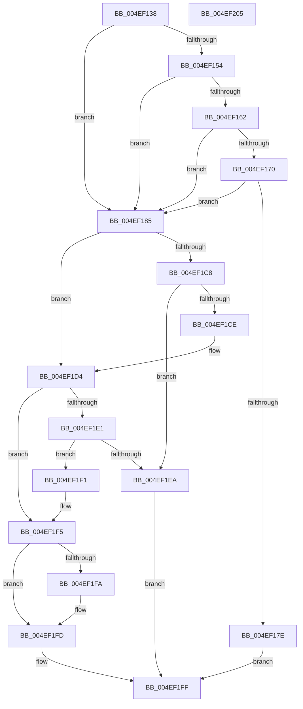

# RtlpValidateContextFlags2

- RVA: `0x004EF138`–`0x004EF206` (길이 `206` bytes)
- VA: `0x00000001404EF138`
- 실행 섹션: `.text`
- PDB 이름 있음: `예`; PDB Function 태그: `아니요`
- unwind 정보 RVA: `0x00071750`
- 디코드: `61`개 명령, `206/206` bytes 표시
- 미해석 바이트: `0` (있으면 어셈블리에 `.byte`로 보존)

> 이 문서는 커널 이미지의 기계어와 PDB 기호를 분석해 생성했습니다. 4번과 5번은 함수 원형과 자료형을 바이너리 사용 방식에서 추정한 C 해석이며 원본 소스 복구 결과는 아닙니다.

## 1. Dependencies

- 직접 호출 지점: **0**; 고유 호출 대상: **0**
- 직접 호출자로 확인된 함수: **10**
- RIP 상대 이미지 참조: **1**

### Outgoing calls
- 직접 디코드된 call 명령이 없습니다.

### Direct callers
- [RtlUnwind](../2F/RtlUnwind_function_002F1CB0.md) at `0x002F1D17`
- [RtlDispatchException](../2F/RtlDispatchException_function_002F22A0.md) at `0x002F23C5`
- [RtlUnwindEx](../2F/RtlUnwindEx_function_002F2830.md) at `0x002F2D7F`
- [RtlpWalkFrameChain](../2F/RtlpWalkFrameChain_function_002F3ED0.md) at `0x002F3FF4`
- [RtlInitializeExtendedContext2](../2F/RtlInitializeExtendedContext2_function_002F5D40.md) at `0x002F5D7C`
- [KiContinuePreviousModeUser](../2F/KiContinuePreviousModeUser_function_002F9B10.md) at `0x002F9BDF`
- [KiContinuePreviousModeUser](../2F/KiContinuePreviousModeUser_function_002F9B10.md) at `0x002F9C16`
- [KiContinuePreviousModeUser](../2F/KiContinuePreviousModeUser_function_002F9B10.md) at `0x002F9C96`
- [RtlGetExtendedContextLength](../3D/RtlGetExtendedContextLength_function_003D7190.md) at `0x003D71C0`
- [RtlInitializeExtendedContext](../3D/RtlInitializeExtendedContext_function_003D7220.md) at `0x003D7253`
- [RtlpValidateContextFlags](../49/RtlpValidateContextFlags_function_0049BF20.md) at `0x0049BF2E`
- [RtlGetExtendedContextLength3](RtlGetExtendedContextLength3_function_004EF028.md) at `0x004EF052`

### Static image references
- `0x004EF1E1` → RVA `0x01201841` (`CFGRO`; read)

## 2. Other-region calls and transfers

- 다른 실행 섹션으로 향하는 call: **0**
- 별도 외부 분기/꼬리 이동을 확인하지 못했습니다.

## 3. Assembly (complete function range)

```asm
004EF138  48 89 5C 24 08                  mov qword ptr [rsp + 8], rbx
004EF13D  8B C1                           mov eax, ecx
004EF13F  49 8B D8                        mov rbx, r8
004EF142  25 80 FF FF 27                  and eax, 0x27ffff80
004EF147  4C 8B DA                        mov r11, rdx
004EF14A  44 8B C9                        mov r9d, ecx
004EF14D  3D 00 00 01 00                  cmp eax, 0x10000
004EF152  74 31                           je 0x1404ef185
004EF154  8B C1                           mov eax, ecx
004EF156  25 20 FF FF 07                  and eax, 0x7ffff20
004EF15B  3D 00 00 10 00                  cmp eax, 0x100000
004EF160  74 23                           je 0x1404ef185
004EF162  8B C1                           mov eax, ecx
004EF164  25 F0 FF FF 07                  and eax, 0x7fffff0
004EF169  3D 00 00 20 00                  cmp eax, 0x200000
004EF16E  74 15                           je 0x1404ef185
004EF170  8B C1                           mov eax, ecx
004EF172  25 00 FF FF 07                  and eax, 0x7ffff00
004EF177  3D 00 00 40 00                  cmp eax, 0x400000
004EF17C  74 07                           je 0x1404ef185
004EF17E  B8 0D 00 00 C0                  mov eax, 0xc000000d
004EF183  EB 7A                           jmp 0x1404ef1ff
004EF185  B9 40 00 10 00                  mov ecx, 0x100040
004EF18A  45 8B C1                        mov r8d, r9d
004EF18D  41 81 E0 20 00 40 00            and r8d, 0x400020
004EF194  41 8B C1                        mov eax, r9d
004EF197  23 C1                           and eax, ecx
004EF199  41 BA 01 00 00 00               mov r10d, 1
004EF19F  3B C1                           cmp eax, ecx
004EF1A1  B9 40 00 01 00                  mov ecx, 0x10040
004EF1A6  41 8B C1                        mov eax, r9d
004EF1A9  0F 95 C2                        setne dl
004EF1AC  23 C1                           and eax, ecx
004EF1AE  3B C1                           cmp eax, ecx
004EF1B0  0F 95 C0                        setne al
004EF1B3  33 C9                           xor ecx, ecx
004EF1B5  22 D0                           and dl, al
004EF1B7  41 81 F8 20 00 40 00            cmp r8d, 0x400020
004EF1BE  0F B6 C2                        movzx eax, dl
004EF1C1  0F 45 C8                        cmovne ecx, eax
004EF1C4  84 C9                           test cl, cl
004EF1C6  75 0C                           jne 0x1404ef1d4
004EF1C8  48 83 3B 00                     cmp qword ptr [rbx], 0
004EF1CC  74 1C                           je 0x1404ef1ea
004EF1CE  41 BA 03 00 00 00               mov r10d, 3
004EF1D4  B8 80 00 10 00                  mov eax, 0x100080
004EF1D9  44 23 C8                        and r9d, eax
004EF1DC  44 3B C8                        cmp r9d, eax
004EF1DF  75 14                           jne 0x1404ef1f5
004EF1E1  80 3D 59 26 D1 00 00            cmp byte ptr [rip + 0xd12659], 0
004EF1E8  75 07                           jne 0x1404ef1f1
004EF1EA  B8 BB 00 00 C0                  mov eax, 0xc00000bb
004EF1EF  EB 0E                           jmp 0x1404ef1ff
004EF1F1  41 83 CA 04                     or r10d, 4
004EF1F5  4D 85 DB                        test r11, r11
004EF1F8  74 03                           je 0x1404ef1fd
004EF1FA  45 89 13                        mov dword ptr [r11], r10d
004EF1FD  33 C0                           xor eax, eax
004EF1FF  48 8B 5C 24 08                  mov rbx, qword ptr [rsp + 8]
004EF204  C3                              ret
004EF205  CC                              int3
```

## 4. C-style interpretation (structured pseudocode)

```c
__int64 __fastcall RtlpValidateContextFlags2(int a1, __int64 a2, __int64 a3)
{
    __int64 result;
    __int64 v_r10;
    unsigned __int64 v_stack_p8;

    v_stack_p8 = v_rbx;
    result = (unsigned int)(((unsigned int)(a1)) & (0x27FFFF80ULL));
    if (((unsigned int)(result)) == 0x10000ULL) goto loc_004EF185;
    result = (unsigned int)(((unsigned int)(a1)) & (0x7FFFF20ULL));
    if (((unsigned int)(result)) == 0x100000ULL) goto loc_004EF185;
    result = (unsigned int)(((unsigned int)(a1)) & (0x7FFFFF0ULL));
    if (((unsigned int)(result)) == 0x200000ULL) goto loc_004EF185;
    result = (unsigned int)(((unsigned int)(a1)) & (0x7FFFF00ULL));
    if (((unsigned int)(result)) == 0x400000ULL) goto loc_004EF185;
    goto loc_004EF1FF;
loc_004EF185:
    a3 = (unsigned int)(((unsigned int)((unsigned int)((unsigned int)(a1)))) & (0x400020ULL));
    result = (unsigned int)(((unsigned int)((unsigned int)((unsigned int)(a1)))) & ((unsigned int)((unsigned int)(0x100040ULL))));
    a2 = (((unsigned int)(result)) != ((unsigned int)((unsigned int)(0x100040ULL)))) ? 1 : 0;
    result = (unsigned int)(((unsigned int)((unsigned int)((unsigned int)(a1)))) & ((unsigned int)((unsigned int)(0x10040ULL))));
    result = (((unsigned int)(result)) != ((unsigned int)((unsigned int)(0x10040ULL)))) ? 1 : 0;
    a1 = 0;
    a2 = (unsigned __int8)((a2) & ((unsigned __int8)(result)));
    if (((unsigned int)(a3)) != 0x400020ULL) { a1 = (unsigned int)((unsigned __int8)(a2)); }
    if ((unsigned __int8)(a1) != 0) goto loc_004EF1D4;
    if ((*(unsigned __int64 *)(a3)) == 0) goto loc_004EF1EA;
loc_004EF1D4:
    a4 = (unsigned int)(((unsigned int)(a1)) & ((unsigned int)((unsigned int)(0x100080ULL))));
    if (((unsigned int)(a4)) != ((unsigned int)((unsigned int)(0x100080ULL)))) goto loc_004EF1F5;
    if ((*(unsigned __int8 *)(v_rip + 13706841)) != 0) goto loc_004EF1F1;
loc_004EF1EA:
    goto loc_004EF1FF;
loc_004EF1F1:
    v_r10 = (unsigned int)((3) | (4));
loc_004EF1F5:
    if (a2 != 0) {
        *(unsigned int *)(a2) = (unsigned int)(v_r10);
    }
    result = 0;
loc_004EF1FF:
    return result;
}
```

## 5. (Beta) C Style

```c
int64_t RtlpValidateContextFlags2(int32_t Arg1, int64_t Arg2, void *Arg3)
{
    uint8_t *arg3 = (uint8_t *)Arg3;

    int64_t result;
    int64_t local_r10;
    uint64_t v_stack_p8;

    v_stack_p8 = local_rbx;
    result = (uint32_t)(((uint32_t)(Arg1)) & (0x27FFFF80ULL));
    if (((uint32_t)(result)) == 0x10000ULL) goto loc_004EF185;
    result = (uint32_t)(((uint32_t)(Arg1)) & (0x7FFFF20ULL));
    if (((uint32_t)(result)) == 0x100000ULL) goto loc_004EF185;
    result = (uint32_t)(((uint32_t)(Arg1)) & (0x7FFFFF0ULL));
    if (((uint32_t)(result)) == 0x200000ULL) goto loc_004EF185;
    result = (uint32_t)(((uint32_t)(Arg1)) & (0x7FFFF00ULL));
    if (((uint32_t)(result)) == 0x400000ULL) goto loc_004EF185;
    goto loc_004EF1FF;
loc_004EF185:
    Arg3 = (uint32_t)(((uint32_t)((uint32_t)((uint32_t)(Arg1)))) & (0x400020ULL));
    result = (uint32_t)(((uint32_t)((uint32_t)((uint32_t)(Arg1)))) & ((uint32_t)((uint32_t)(0x100040ULL))));
    Arg2 = (((uint32_t)(result)) != ((uint32_t)((uint32_t)(0x100040ULL)))) ? 1 : 0;
    result = (uint32_t)(((uint32_t)((uint32_t)((uint32_t)(Arg1)))) & ((uint32_t)((uint32_t)(0x10040ULL))));
    result = (((uint32_t)(result)) != ((uint32_t)((uint32_t)(0x10040ULL)))) ? 1 : 0;
    Arg1 = 0;
    Arg2 = (uint8_t)((Arg2) & ((uint8_t)(result)));
    if (((uint32_t)(Arg3)) != 0x400020ULL) { Arg1 = (uint32_t)((uint8_t)(Arg2)); }
    if ((uint8_t)(Arg1) != 0) goto loc_004EF1D4;
    if ((*(uint64_t *)(arg3)) == 0) goto loc_004EF1EA;
loc_004EF1D4:
    a4 = (uint32_t)(((uint32_t)(Arg1)) & ((uint32_t)((uint32_t)(0x100080ULL))));
    if (((uint32_t)(a4)) != ((uint32_t)((uint32_t)(0x100080ULL)))) goto loc_004EF1F5;
    if ((*(uint8_t *)(v_rip + 0xD12659)) != 0) goto loc_004EF1F1;
loc_004EF1EA:
    goto loc_004EF1FF;
loc_004EF1F1:
    local_r10 = (uint32_t)((3) | (4));
loc_004EF1F5:
    if (Arg2 != 0) {
        *(uint32_t *)(Arg2) = (uint32_t)(local_r10);
    }
    result = 0;
loc_004EF1FF:
    return result;
}
```

### 관측된 메모리 오프셋

구조체 형식이 확인되지 않은 접근은 인자 기준의 오프셋으로만 기록했습니다.

| 기준 인자 | 오프셋 표현 | 폭 (bit) | 접근 |
|---|---:|---:|---|
| `Arg3` | `+ 0x0` | `64` | `R` |

## 6. Execution-region graph

[열기: 2D/3D 그래프와 함수 탐색 컨트롤 패널](../../../control-panel.html?section=text&rva=0x004EF138&view=graph)

- 2D 그래프는 위에서 아래로 흐르고, 3D 그래프는 빈 공간을 드래그해 회전합니다. Shift+드래그는 이동, 휠은 확대·축소, 함수 노드 선택은 대상 보고서 이동입니다.

### Static fallback


