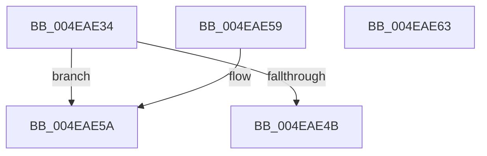

# SMKM_STORE&lt;SM_TRAITS&gt;::SmStGetRegionVA

- RVA: `0x004EAE34`–`0x004EAE64` (길이 `48` bytes)
- VA: `0x00000001404EAE34`
- 실행 섹션: `.text`
- PDB 이름 있음: `예`; PDB Function 태그: `아니요`
- unwind 정보 RVA: `0x000DB714`
- 디코드: `13`개 명령, `48/48` bytes 표시
- 미해석 바이트: `0` (있으면 어셈블리에 `.byte`로 보존)

> 이 문서는 커널 이미지의 기계어와 PDB 기호를 분석해 생성했습니다. 4번과 5번은 함수 원형과 자료형을 바이너리 사용 방식에서 추정한 C 해석이며 원본 소스 복구 결과는 아닙니다.

## 1. Dependencies

- 직접 호출 지점: **0**; 고유 호출 대상: **0**
- 직접 호출자로 확인된 함수: **1**
- RIP 상대 이미지 참조: **0**

### Outgoing calls
- 직접 디코드된 call 명령이 없습니다.

### Direct callers
- [SMKM_STORE&lt;SM_TRAITS&gt;::SmStCompareRegionDataCallback](../34/SMKM_STORE_SM_TRAITS_SmStCompareRegionDataCallback_function_0034D390.md) at `0x0034D704`

### Static image references
- 디코드된 RIP-relative 메모리 참조가 없습니다.

## 2. Other-region calls and transfers

- 다른 실행 섹션으로 향하는 call: **0**
- 별도 외부 분기/꼬리 이동을 확인하지 못했습니다.

## 3. Assembly (complete function range)

```asm
004EAE34  F6 81 95 1A 00 00 04            test byte ptr [rcx + 0x1a95], 4
004EAE3B  44 8B C2                        mov r8d, edx
004EAE3E  48 8B 91 68 1B 00 00            mov rdx, qword ptr [rcx + 0x1b68]
004EAE45  4A 8B 04 C2                     mov rax, qword ptr [rdx + r8*8]
004EAE49  74 0F                           je 0x1404eae5a
004EAE4B  48 B9 00 00 FF FF FF FF FF 7F   movabs rcx, 0x7fffffffffff0000
004EAE55  48 23 C1                        and rax, rcx
004EAE58  C3                              ret
004EAE59  CC                              int3
004EAE5A  48 83 E0 F8                     and rax, 0xfffffffffffffff8
004EAE5E  48 8B 40 18                     mov rax, qword ptr [rax + 0x18]
004EAE62  C3                              ret
004EAE63  CC                              int3
```

## 4. C-style interpretation (structured pseudocode)

```c
__int64 __fastcall SMKM_STORE_SM_TRAITS___SmStGetRegionVA(__int64 a1, int a2)
{
    __int64 result;

    if (((*(unsigned __int8 *)(a1 + 6805)) & (4)) == 0) goto loc_004EAE5A;
    result = (*(unsigned __int64 *)(*(unsigned __int64 *)(a1 + 7016) + (unsigned int)(a2) * 8)) & (a1);
    return result;
loc_004EAE5A:
    result = (result) & (-8);
    return *(unsigned __int64 *)(result + 24);
}
```

## 5. (Beta) C Style

```c
int64_t SMKM_STORE_SM_TRAITS___SmStGetRegionVA(void *Arg1, int32_t Arg2)
{
    uint8_t *arg1 = (uint8_t *)Arg1;

    int64_t result;

    if (((*(uint8_t *)(arg1 + 0x1A95)) & (4)) == 0) goto loc_004EAE5A;
    result = (*(uint64_t *)(*(uint64_t *)(arg1 + 0x1B68) + (uint32_t)(Arg2) * 8)) & (Arg1);
    return result;
loc_004EAE5A:
    result = (result) & (-8);
    return *(uint64_t *)(result + 0x18);
}
```

### 관측된 메모리 오프셋

구조체 형식이 확인되지 않은 접근은 인자 기준의 오프셋으로만 기록했습니다.

| 기준 인자 | 오프셋 표현 | 폭 (bit) | 접근 |
|---|---:|---:|---|
| `Arg1` | `+ 0x1A95` | `8` | `R` |
| `Arg1` | `+ 0x1B68` | `64` | `R` |

## 6. Execution-region graph

[열기: 2D/3D 그래프와 함수 탐색 컨트롤 패널](../../../control-panel.html?section=text&rva=0x004EAE34&view=graph)

- 2D 그래프는 위에서 아래로 흐르고, 3D 그래프는 빈 공간을 드래그해 회전합니다. Shift+드래그는 이동, 휠은 확대·축소, 함수 노드 선택은 대상 보고서 이동입니다.

### Static fallback


