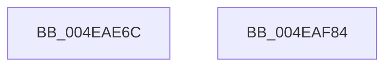

# SMKM_STORE&lt;SM_TRAITS&gt;::SmStInitialize

- RVA: `0x004EAE6C`–`0x004EAF85` (길이 `281` bytes)
- VA: `0x00000001404EAE6C`
- 실행 섹션: `.text`
- PDB 이름 있음: `예`; PDB Function 태그: `아니요`
- unwind 정보 RVA: `0x00060BC4`
- 디코드: `60`개 명령, `281/281` bytes 표시
- 미해석 바이트: `0` (있으면 어셈블리에 `.byte`로 보존)

> 이 문서는 커널 이미지의 기계어와 PDB 기호를 분석해 생성했습니다. 4번과 5번은 함수 원형과 자료형을 바이너리 사용 방식에서 추정한 C 해석이며 원본 소스 복구 결과는 아닙니다.

## 1. Dependencies

- 직접 호출 지점: **3**; 고유 호출 대상: **2**
- 직접 호출자로 확인된 함수: **1**
- RIP 상대 이미지 참조: **0**

### Outgoing calls
- `0x004EAE86` → [memset](../6C/memset_function_006C6C40.md) (function, `0x006C6C40`)
- `0x004EAE95` → [ST_STORE<SM_TRAITS>::StInitialize](../46/ST_STORE_SM_TRAITS_StInitialize_function_00468158.md) (function, `0x00468158`)
- `0x004EAF45` → [memset](../6C/memset_function_006C6C40.md) (function, `0x006C6C40`)

### Direct callers
- [SmProcessCreateRequest](../../page/A5/SmProcessCreateRequest_function_00A50DD0.md) at `0x00A5101C`

### Static image references
- 디코드된 RIP-relative 메모리 참조가 없습니다.

## 2. Other-region calls and transfers

- 다른 실행 섹션으로 향하는 call: **0**
- 별도 외부 분기/꼬리 이동을 확인하지 못했습니다.

## 3. Assembly (complete function range)

```asm
004EAE6C  48 89 5C 24 08                  mov qword ptr [rsp + 8], rbx
004EAE71  48 89 74 24 10                  mov qword ptr [rsp + 0x10], rsi
004EAE76  57                              push rdi
004EAE77  48 83 EC 20                     sub rsp, 0x20
004EAE7B  33 D2                           xor edx, edx
004EAE7D  41 B8 B0 1D 00 00               mov r8d, 0x1db0
004EAE83  48 8B F9                        mov rdi, rcx
004EAE86  E8 B5 BD 1D 00                  call 0x1406c6c40
004EAE8B  48 8B CF                        mov rcx, rdi
004EAE8E  C6 87 94 1A 00 00 02            mov byte ptr [rdi + 0x1a94], 2
004EAE95  E8 BE D2 F7 FF                  call 0x140468158
004EAE9A  33 F6                           xor esi, esi
004EAE9C  48 8D 87 D0 1A 00 00            lea rax, [rdi + 0x1ad0]
004EAEA3  48 89 40 08                     mov qword ptr [rax + 8], rax
004EAEA7  48 8D 9F 18 1D 00 00            lea rbx, [rdi + 0x1d18]
004EAEAE  48 89 30                        mov qword ptr [rax], rsi
004EAEB1  33 D2                           xor edx, edx
004EAEB3  48 8D 87 E0 1A 00 00            lea rax, [rdi + 0x1ae0]
004EAEBA  48 8B CB                        mov rcx, rbx
004EAEBD  48 89 40 08                     mov qword ptr [rax + 8], rax
004EAEC1  44 8D 46 78                     lea r8d, [rsi + 0x78]
004EAEC5  48 89 30                        mov qword ptr [rax], rsi
004EAEC8  48 8D 87 F0 1A 00 00            lea rax, [rdi + 0x1af0]
004EAECF  48 89 40 08                     mov qword ptr [rax + 8], rax
004EAED3  48 89 30                        mov qword ptr [rax], rsi
004EAED6  48 8D 87 30 1B 00 00            lea rax, [rdi + 0x1b30]
004EAEDD  48 89 40 08                     mov qword ptr [rax + 8], rax
004EAEE1  48 89 00                        mov qword ptr [rax], rax
004EAEE4  48 8D 87 18 1B 00 00            lea rax, [rdi + 0x1b18]
004EAEEB  48 89 40 08                     mov qword ptr [rax + 8], rax
004EAEEF  48 89 00                        mov qword ptr [rax], rax
004EAEF2  48 8D 87 48 1B 00 00            lea rax, [rdi + 0x1b48]
004EAEF9  48 89 40 08                     mov qword ptr [rax + 8], rax
004EAEFD  48 89 00                        mov qword ptr [rax], rax
004EAF00  48 89 B7 C8 1A 00 00            mov qword ptr [rdi + 0x1ac8], rsi
004EAF07  66 89 B7 28 1B 00 00            mov word ptr [rdi + 0x1b28], si
004EAF0E  C6 87 2A 1B 00 00 06            mov byte ptr [rdi + 0x1b2a], 6
004EAF15  89 B7 2C 1B 00 00               mov dword ptr [rdi + 0x1b2c], esi
004EAF1B  66 89 B7 10 1B 00 00            mov word ptr [rdi + 0x1b10], si
004EAF22  C6 87 12 1B 00 00 06            mov byte ptr [rdi + 0x1b12], 6
004EAF29  89 B7 14 1B 00 00               mov dword ptr [rdi + 0x1b14], esi
004EAF2F  66 C7 87 40 1B 00 00 01 00      mov word ptr [rdi + 0x1b40], 1
004EAF38  C6 87 42 1B 00 00 06            mov byte ptr [rdi + 0x1b42], 6
004EAF3F  89 B7 44 1B 00 00               mov dword ptr [rdi + 0x1b44], esi
004EAF45  E8 F6 BC 1D 00                  call 0x1406c6c40
004EAF4A  89 73 0C                        mov dword ptr [rbx + 0xc], esi
004EAF4D  48 8D 43 10                     lea rax, [rbx + 0x10]
004EAF51  48 89 73 20                     mov qword ptr [rbx + 0x20], rsi
004EAF55  66 C7 43 08 01 00               mov word ptr [rbx + 8], 1
004EAF5B  C6 43 0A 06                     mov byte ptr [rbx + 0xa], 6
004EAF5F  48 8B 5C 24 30                  mov rbx, qword ptr [rsp + 0x30]
004EAF64  48 89 40 08                     mov qword ptr [rax + 8], rax
004EAF68  48 89 00                        mov qword ptr [rax], rax
004EAF6B  48 89 B7 98 1A 00 00            mov qword ptr [rdi + 0x1a98], rsi
004EAF72  48 89 B7 B0 1A 00 00            mov qword ptr [rdi + 0x1ab0], rsi
004EAF79  48 8B 74 24 38                  mov rsi, qword ptr [rsp + 0x38]
004EAF7E  48 83 C4 20                     add rsp, 0x20
004EAF82  5F                              pop rdi
004EAF83  C3                              ret
004EAF84  CC                              int3
```

## 4. C-style interpretation (structured pseudocode)

```c
__int64 __fastcall SMKM_STORE_SM_TRAITS___SmStInitialize(__int64 a1, int a2)
{
    __int64 result;
    __int64 v_rsi;
    __int64 v_rsp;
    unsigned __int64 v_stack_p10;
    unsigned __int64 v_stack_p8;

    v_stack_p8 = v_rbx;
    v_stack_p10 = v_rsi;
    v_rsp = (v_rsp) - (32);
    a2 = 0;
    result = memset(a1, a2, (unsigned int)(0x1DB0ULL), a4);
    *(unsigned __int8 *)(a1 + 6804) = 2;
    result = ST_STORE_SM_TRAITS___StInitialize(a1, a2, (unsigned int)(0x1DB0ULL), a4);
    v_rsi = 0;
    *(unsigned __int64 *)(a1 + 6864 + 8) = a1 + 6864;
    *(unsigned __int64 *)(a1 + 6864) = 0;
    a2 = 0;
    *(unsigned __int64 *)(a1 + 6880 + 8) = a1 + 6880;
    *(unsigned __int64 *)(a1 + 6880) = 0;
    *(unsigned __int64 *)(a1 + 6896 + 8) = a1 + 6896;
    *(unsigned __int64 *)(a1 + 6896) = 0;
    *(unsigned __int64 *)(a1 + 6960 + 8) = a1 + 6960;
    *(unsigned __int64 *)(a1 + 6960) = a1 + 6960;
    *(unsigned __int64 *)(a1 + 6936 + 8) = a1 + 6936;
    *(unsigned __int64 *)(a1 + 6936) = a1 + 6936;
    *(unsigned __int64 *)(a1 + 6984 + 8) = a1 + 6984;
    *(unsigned __int64 *)(a1 + 6984) = a1 + 6984;
    *(unsigned __int64 *)(a1 + 6856) = 0;
    *(unsigned __int16 *)(a1 + 6952) = 0;
    *(unsigned __int8 *)(a1 + 6954) = 6;
    *(unsigned int *)(a1 + 6956) = 0;
    *(unsigned __int16 *)(a1 + 6928) = 0;
    *(unsigned __int8 *)(a1 + 6930) = 6;
    *(unsigned int *)(a1 + 6932) = 0;
    *(unsigned __int16 *)(a1 + 6976) = 1;
    *(unsigned __int8 *)(a1 + 6978) = 6;
    *(unsigned int *)(a1 + 6980) = 0;
    result = memset(a1 + 7448, a2, v_rsi + 120, a4);
    *(unsigned int *)(a1 + 7448 + 12) = 0;
    *(unsigned __int64 *)(a1 + 7448 + 32) = 0;
    *(unsigned __int16 *)(a1 + 7448 + 8) = 1;
    *(unsigned __int8 *)(a1 + 7448 + 10) = 6;
    *(unsigned __int64 *)(a1 + 7448 + 16 + 8) = a1 + 7448 + 16;
    *(unsigned __int64 *)(a1 + 7448 + 16) = a1 + 7448 + 16;
    *(unsigned __int64 *)(a1 + 6808) = 0;
    *(unsigned __int64 *)(a1 + 6832) = 0;
    v_rsp = (v_rsp) + (32);
    return a1 + 7448 + 16;
}
```

## 5. (Beta) C Style

```c
int64_t SMKM_STORE_SM_TRAITS___SmStInitialize(void *Arg1, int32_t Arg2)
{
    uint8_t *arg1 = (uint8_t *)Arg1;

    int64_t result;
    int64_t local_rsi;
    int64_t local_rsp;
    uint64_t v_stack_p10;
    uint64_t v_stack_p8;

    v_stack_p8 = local_rbx;
    v_stack_p10 = local_rsi;
    local_rsp = (local_rsp) - (32);
    Arg2 = 0;
    result = memset(Arg1, Arg2, (uint32_t)(0x1DB0ULL), a4);
    *(uint8_t *)(arg1 + 0x1A94) = 2;
    result = ST_STORE_SM_TRAITS___StInitialize(Arg1, Arg2, (uint32_t)(0x1DB0ULL), a4);
    local_rsi = 0;
    *(void **)(arg1 + 0x1AD0 + 0x8) = Arg1 + 6864;
    *(uint64_t *)(arg1 + 0x1AD0) = 0;
    Arg2 = 0;
    *(void **)(arg1 + 0x1AE0 + 0x8) = Arg1 + 6880;
    *(uint64_t *)(arg1 + 0x1AE0) = 0;
    *(void **)(arg1 + 0x1AF0 + 0x8) = Arg1 + 6896;
    *(uint64_t *)(arg1 + 0x1AF0) = 0;
    *(void **)(arg1 + 0x1B30 + 0x8) = Arg1 + 6960;
    *(void **)(arg1 + 0x1B30) = Arg1 + 6960;
    *(void **)(arg1 + 0x1B18 + 0x8) = Arg1 + 6936;
    *(void **)(arg1 + 0x1B18) = Arg1 + 6936;
    *(void **)(arg1 + 0x1B48 + 0x8) = Arg1 + 6984;
    *(void **)(arg1 + 0x1B48) = Arg1 + 6984;
    *(uint64_t *)(arg1 + 0x1AC8) = 0;
    *(uint16_t *)(arg1 + 0x1B28) = 0;
    *(uint8_t *)(arg1 + 0x1B2A) = 6;
    *(uint32_t *)(arg1 + 0x1B2C) = 0;
    *(uint16_t *)(arg1 + 0x1B10) = 0;
    *(uint8_t *)(arg1 + 0x1B12) = 6;
    *(uint32_t *)(arg1 + 0x1B14) = 0;
    *(uint16_t *)(arg1 + 0x1B40) = 1;
    *(uint8_t *)(arg1 + 0x1B42) = 6;
    *(uint32_t *)(arg1 + 0x1B44) = 0;
    result = memset(Arg1 + 7448, Arg2, local_rsi + 120, a4);
    *(uint32_t *)(arg1 + 0x1D18 + 0xC) = 0;
    *(uint64_t *)(arg1 + 0x1D18 + 0x20) = 0;
    *(uint16_t *)(arg1 + 0x1D18 + 0x8) = 1;
    *(uint8_t *)(arg1 + 0x1D18 + 0xA) = 6;
    *(void **)(arg1 + 0x1D18 + 0x10 + 0x8) = Arg1 + 7448 + 16;
    *(void **)(arg1 + 0x1D18 + 0x10) = Arg1 + 7448 + 16;
    *(uint64_t *)(arg1 + 0x1A98) = 0;
    *(uint64_t *)(arg1 + 0x1AB0) = 0;
    local_rsp = (local_rsp) + (32);
    return Arg1 + 7448 + 16;
}
```

### 관측된 메모리 오프셋

구조체 형식이 확인되지 않은 접근은 인자 기준의 오프셋으로만 기록했습니다.

| 기준 인자 | 오프셋 표현 | 폭 (bit) | 접근 |
|---|---:|---:|---|
| `Arg1` | `+ 0x0` | `64` | `W` |
| `Arg1` | `+ 0x8` | `16` | `W` |
| `Arg1` | `+ 0x8` | `64` | `W` |
| `Arg1` | `+ 0xA` | `8` | `W` |
| `Arg1` | `+ 0xC` | `32` | `W` |
| `Arg1` | `+ 0x10` | `64` | `R` |
| `Arg1` | `+ 0x20` | `64` | `W` |
| `Arg1` | `+ 0x1A94` | `8` | `W` |
| `Arg1` | `+ 0x1A98` | `64` | `W` |
| `Arg1` | `+ 0x1AB0` | `64` | `W` |
| `Arg1` | `+ 0x1AC8` | `64` | `W` |
| `Arg1` | `+ 0x1AD0` | `64` | `R` |
| `Arg1` | `+ 0x1AE0` | `64` | `R` |
| `Arg1` | `+ 0x1AF0` | `64` | `R` |
| `Arg1` | `+ 0x1B10` | `16` | `W` |
| `Arg1` | `+ 0x1B12` | `8` | `W` |
| `Arg1` | `+ 0x1B14` | `32` | `W` |
| `Arg1` | `+ 0x1B18` | `64` | `R` |
| `Arg1` | `+ 0x1B28` | `16` | `W` |
| `Arg1` | `+ 0x1B2A` | `8` | `W` |
| `Arg1` | `+ 0x1B2C` | `32` | `W` |
| `Arg1` | `+ 0x1B30` | `64` | `R` |
| `Arg1` | `+ 0x1B40` | `16` | `W` |
| `Arg1` | `+ 0x1B42` | `8` | `W` |
| `Arg1` | `+ 0x1B44` | `32` | `W` |
| `Arg1` | `+ 0x1B48` | `64` | `R` |
| `Arg1` | `+ 0x1D18` | `64` | `R` |

## 6. Execution-region graph

[열기: 2D/3D 그래프와 함수 탐색 컨트롤 패널](../../../control-panel.html?section=text&rva=0x004EAE6C&view=graph)

- 2D 그래프는 위에서 아래로 흐르고, 3D 그래프는 빈 공간을 드래그해 회전합니다. Shift+드래그는 이동, 휠은 확대·축소, 함수 노드 선택은 대상 보고서 이동입니다.

### Static fallback


