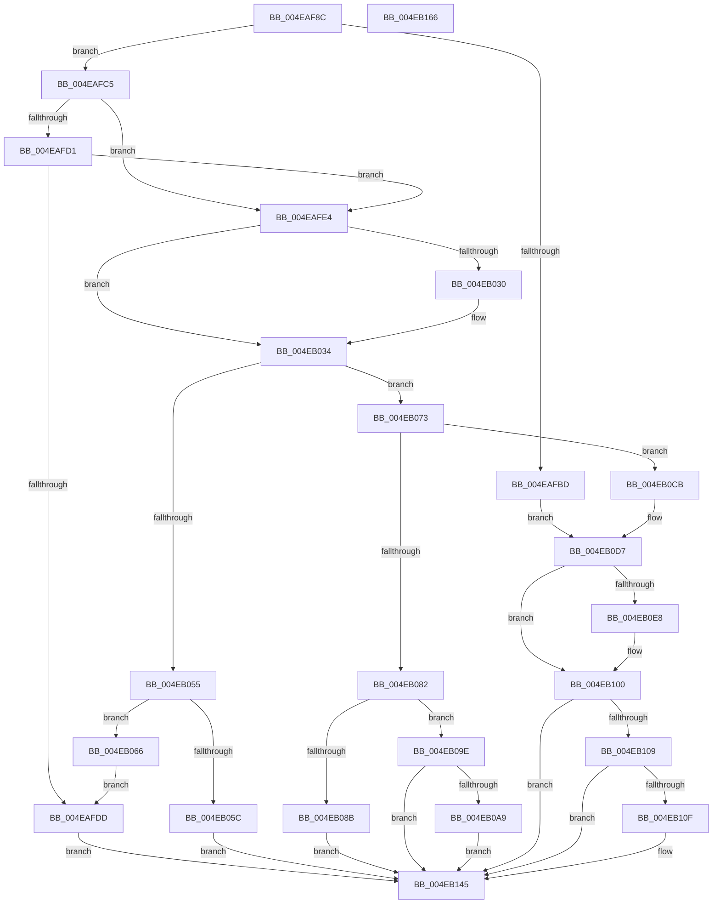

# SMKM_STORE&lt;SM_TRAITS&gt;::SmStLockVirtualRegion

- RVA: `0x004EAF8C`–`0x004EB167` (길이 `475` bytes)
- VA: `0x00000001404EAF8C`
- 실행 섹션: `.text`
- PDB 이름 있음: `예`; PDB Function 태그: `아니요`
- unwind 정보 RVA: `0x00092598`
- 디코드: `130`개 명령, `475/475` bytes 표시
- 미해석 바이트: `0` (있으면 어셈블리에 `.byte`로 보존)

> 이 문서는 커널 이미지의 기계어와 PDB 기호를 분석해 생성했습니다. 4번과 5번은 함수 원형과 자료형을 바이너리 사용 방식에서 추정한 C 해석이며 원본 소스 복구 결과는 아닙니다.

## 1. Dependencies

- 직접 호출 지점: **5**; 고유 호출 대상: **4**
- 직접 호출자로 확인된 함수: **1**
- RIP 상대 이미지 참조: **0**

### Outgoing calls
- `0x004EAFD4` → [SMKM_STORE<SM_TRAITS>::SmStCheckLockInProgressRegionComplete](../3B/SMKM_STORE_SM_TRAITS_SmStCheckLockInProgressRegionComplete_function_003B1B74.md) (function, `0x003B1B74`)
- `0x004EAFF5` → [SMKM_STORE<SM_TRAITS>::SmStFindVirtualLockedRegion](../46/SMKM_STORE_SM_TRAITS_SmStFindVirtualLockedRegion_function_00469C2C.md) (function, `0x00469C2C`)
- `0x004EB04C` → [SMKM_STORE<SM_TRAITS>::SmStHelperSendCommand](../3B/SMKM_STORE_SM_TRAITS_SmStHelperSendCommand_function_003B0530.md) (function, `0x003B0530`)
- `0x004EB0BF` → [SmLogConsumedPoison](../4C/SmLogConsumedPoison_function_004C6ADC.md) (function, `0x004C6ADC`)
- `0x004EB140` → [SMKM_STORE<SM_TRAITS>::SmStHelperSendCommand](../3B/SMKM_STORE_SM_TRAITS_SmStHelperSendCommand_function_003B0530.md) (function, `0x003B0530`)

### Direct callers
- [sub_0034D7E9](../34/Unknown_function_0034D7E9.md) at `0x0034D8B3`

### Static image references
- 디코드된 RIP-relative 메모리 참조가 없습니다.

## 2. Other-region calls and transfers

- 다른 실행 섹션으로 향하는 call: **0**
- 별도 외부 분기/꼬리 이동을 확인하지 못했습니다.

## 3. Assembly (complete function range)

```asm
004EAF8C  48 8B C4                        mov rax, rsp
004EAF8F  48 89 58 08                     mov qword ptr [rax + 8], rbx
004EAF93  48 89 70 10                     mov qword ptr [rax + 0x10], rsi
004EAF97  48 89 78 18                     mov qword ptr [rax + 0x18], rdi
004EAF9B  4C 89 60 20                     mov qword ptr [rax + 0x20], r12
004EAF9F  55                              push rbp
004EAFA0  41 56                           push r14
004EAFA2  41 57                           push r15
004EAFA4  48 8B EC                        mov rbp, rsp
004EAFA7  48 83 EC 60                     sub rsp, 0x60
004EAFAB  49 83 38 00                     cmp qword ptr [r8], 0
004EAFAF  4D 8B F9                        mov r15, r9
004EAFB2  49 8B F0                        mov rsi, r8
004EAFB5  44 8B F2                        mov r14d, edx
004EAFB8  48 8B D9                        mov rbx, rcx
004EAFBB  7D 08                           jge 0x1404eafc5
004EAFBD  49 8B F9                        mov rdi, r9
004EAFC0  E9 12 01 00 00                  jmp 0x1404eb0d7
004EAFC5  48 8B 91 F8 1C 00 00            mov rdx, qword ptr [rcx + 0x1cf8]
004EAFCC  48 85 D2                        test rdx, rdx
004EAFCF  74 13                           je 0x1404eafe4
004EAFD1  45 33 C0                        xor r8d, r8d
004EAFD4  E8 9B 6B EC FF                  call 0x1403b1b74
004EAFD9  85 C0                           test eax, eax
004EAFDB  75 07                           jne 0x1404eafe4
004EAFDD  33 FF                           xor edi, edi
004EAFDF  E9 61 01 00 00                  jmp 0x1404eb145
004EAFE4  8B 7D 40                        mov edi, dword ptr [rbp + 0x40]
004EAFE7  45 33 C0                        xor r8d, r8d
004EAFEA  8B D7                           mov edx, edi
004EAFEC  48 8B CB                        mov rcx, rbx
004EAFEF  C1 EA 08                        shr edx, 8
004EAFF2  83 E2 07                        and edx, 7
004EAFF5  E8 32 EC F7 FF                  call 0x140469c2c
004EAFFA  8B 8B 60 1B 00 00               mov ecx, dword ptr [rbx + 0x1b60]
004EB000  0F 57 C0                        xorps xmm0, xmm0
004EB003  0F 11 45 C0                     movups xmmword ptr [rbp - 0x40], xmm0
004EB007  4C 8B E0                        mov r12, rax
004EB00A  48 89 B3 F8 1C 00 00            mov qword ptr [rbx + 0x1cf8], rsi
004EB011  33 C0                           xor eax, eax
004EB013  4C 89 7D C0                     mov qword ptr [rbp - 0x40], r15
004EB017  48 89 45 F0                     mov qword ptr [rbp - 0x10], rax
004EB01B  48 89 4D C8                     mov qword ptr [rbp - 0x38], rcx
004EB01F  0F 11 45 D0                     movups xmmword ptr [rbp - 0x30], xmm0
004EB023  89 55 D0                        mov dword ptr [rbp - 0x30], edx
004EB026  0F 11 45 E0                     movups xmmword ptr [rbp - 0x20], xmm0
004EB02A  40 F6 C7 01                     test dil, 1
004EB02E  74 04                           je 0x1404eb034
004EB030  83 4D D4 01                     or dword ptr [rbp - 0x2c], 1
004EB034  83 E7 20                        and edi, 0x20
004EB037  4C 8D 45 C0                     lea r8, [rbp - 0x40]
004EB03B  83 CF 10                        or edi, 0x10
004EB03E  BA 04 00 00 00                  mov edx, 4
004EB043  C1 EF 02                        shr edi, 2
004EB046  48 8B CB                        mov rcx, rbx
004EB049  44 8B CF                        mov r9d, edi
004EB04C  E8 DF 54 EC FF                  call 0x1403b0530
004EB051  85 C0                           test eax, eax
004EB053  79 1E                           jns 0x1404eb073
004EB055  3D 20 01 00 C0                  cmp eax, 0xc0000120
004EB05A  75 0A                           jne 0x1404eb066
004EB05C  BF 03 00 00 00                  mov edi, 3
004EB061  E9 DF 00 00 00                  jmp 0x1404eb145
004EB066  48 83 A3 F8 1C 00 00 00         and qword ptr [rbx + 0x1cf8], 0
004EB06E  E9 6A FF FF FF                  jmp 0x1404eafdd
004EB073  48 83 A3 F8 1C 00 00 00         and qword ptr [rbx + 0x1cf8], 0
004EB07B  8B 45 F0                        mov eax, dword ptr [rbp - 0x10]
004EB07E  85 C0                           test eax, eax
004EB080  79 49                           jns 0x1404eb0cb
004EB082  33 FF                           xor edi, edi
004EB084  3D 33 04 00 C0                  cmp eax, 0xc0000433
004EB089  75 13                           jne 0x1404eb09e
004EB08B  B8 00 40 00 00                  mov eax, 0x4000
004EB090  66 F0 09 06                     lock or word ptr [rsi], ax
004EB094  BF 01 00 00 00                  mov edi, 1
004EB099  E9 A7 00 00 00                  jmp 0x1404eb145
004EB09E  3D E2 04 00 C0                  cmp eax, 0xc00004e2
004EB0A3  0F 85 9C 00 00 00               jne 0x1404eb145
004EB0A9  B8 00 40 00 00                  mov eax, 0x4000
004EB0AE  66 F0 09 06                     lock or word ptr [rsi], ax
004EB0B2  8B 93 60 1B 00 00               mov edx, dword ptr [rbx + 0x1b60]
004EB0B8  4C 8D 43 58                     lea r8, [rbx + 0x58]
004EB0BC  48 8B 0E                        mov rcx, qword ptr [rsi]
004EB0BF  E8 18 BA FD FF                  call 0x1404c6adc
004EB0C4  BF 04 00 00 00                  mov edi, 4
004EB0C9  EB 7A                           jmp 0x1404eb145
004EB0CB  48 8B 45 E0                     mov rax, qword ptr [rbp - 0x20]
004EB0CF  49 89 04 24                     mov qword ptr [r12], rax
004EB0D3  48 8B 78 18                     mov rdi, qword ptr [rax + 0x18]
004EB0D7  48 8B 93 F0 1C 00 00            mov rdx, qword ptr [rbx + 0x1cf0]
004EB0DE  48 8D 42 FF                     lea rax, [rdx - 1]
004EB0E2  48 83 F8 FD                     cmp rax, -3
004EB0E6  77 18                           ja 0x1404eb100
004EB0E8  49 8B CE                        mov rcx, r14
004EB0EB  41 83 E6 07                     and r14d, 7
004EB0EF  48 C1 E9 03                     shr rcx, 3
004EB0F3  48 03 4A 10                     add rcx, qword ptr [rdx + 0x10]
004EB0F7  0F BE 01                        movsx eax, byte ptr [rcx]
004EB0FA  44 0F B3 F0                     btr eax, r14d
004EB0FE  88 01                           mov byte ptr [rcx], al
004EB100  F6 83 95 1A 00 00 20            test byte ptr [rbx + 0x1a95], 0x20
004EB107  74 3C                           je 0x1404eb145
004EB109  48 83 3E 00                     cmp qword ptr [rsi], 0
004EB10D  7C 36                           jl 0x1404eb145
004EB10F  8B 8B 60 1B 00 00               mov ecx, dword ptr [rbx + 0x1b60]
004EB115  4C 8D 45 C0                     lea r8, [rbp - 0x40]
004EB119  33 C0                           xor eax, eax
004EB11B  0F 57 C0                        xorps xmm0, xmm0
004EB11E  0F 11 45 C0                     movups xmmword ptr [rbp - 0x40], xmm0
004EB122  48 89 4D C8                     mov qword ptr [rbp - 0x38], rcx
004EB126  48 8B CB                        mov rcx, rbx
004EB129  0F 11 45 D0                     movups xmmword ptr [rbp - 0x30], xmm0
004EB12D  44 8D 48 08                     lea r9d, [rax + 8]
004EB131  48 89 45 F0                     mov qword ptr [rbp - 0x10], rax
004EB135  8D 50 06                        lea edx, [rax + 6]
004EB138  4C 89 7D C0                     mov qword ptr [rbp - 0x40], r15
004EB13C  0F 11 45 E0                     movups xmmword ptr [rbp - 0x20], xmm0
004EB140  E8 EB 53 EC FF                  call 0x1403b0530
004EB145  4C 8D 5C 24 60                  lea r11, [rsp + 0x60]
004EB14A  48 8B C7                        mov rax, rdi
004EB14D  49 8B 5B 20                     mov rbx, qword ptr [r11 + 0x20]
004EB151  49 8B 73 28                     mov rsi, qword ptr [r11 + 0x28]
004EB155  49 8B 7B 30                     mov rdi, qword ptr [r11 + 0x30]
004EB159  4D 8B 63 38                     mov r12, qword ptr [r11 + 0x38]
004EB15D  49 8B E3                        mov rsp, r11
004EB160  41 5F                           pop r15
004EB162  41 5E                           pop r14
004EB164  5D                              pop rbp
004EB165  C3                              ret
004EB166  CC                              int3
```

## 4. C-style interpretation (structured pseudocode)

```c
__int64 __fastcall SMKM_STORE_SM_TRAITS___SmStLockVirtualRegion(__int64 a1, int a2, __int64 a3, __int64 a4, unsigned int a5)
{
    __int64 result;
    __int64 v_r14;
    __int64 v_rdi;
    __int64 v_rsp;
    unsigned __int64 v_stack_m18;
    unsigned __int64 v_stack_m28;
    unsigned __int64 v_stack_m38;
    unsigned int v_stack_m44;
    unsigned __int64 v_stack_m48;
    unsigned __int64 v_stack_m50;
    unsigned __int64 v_stack_m58;

    *(unsigned __int64 *)(v_rsp + 8) = v_rbx;
    *(unsigned __int64 *)(v_rsp + 16) = v_rsi;
    *(unsigned __int64 *)(v_rsp + 24) = v_rdi;
    *(unsigned __int64 *)(v_rsp + 32) = v_r12;
    v_rsp = (v_rsp) - (96);
    if ((*(unsigned __int64 *)(a3)) >= 0) goto loc_004EAFC5;
    goto loc_004EB0D7;
loc_004EAFC5:
    if (*(unsigned __int64 *)(a1 + 7416) == 0) goto loc_004EAFE4;
    a3 = 0;
    result = SMKM_STORE_SM_TRAITS___SmStCheckLockInProgressRegionComplete(a1, *(unsigned __int64 *)(a1 + 7416), a3, a4);
    if ((unsigned int)(result) != 0) goto loc_004EAFE4;
loc_004EAFDD:
    v_rdi = 0;
    goto loc_004EB145;
loc_004EAFE4:
    a3 = 0;
    a2 = (unsigned int)(((unsigned int)((unsigned int)((unsigned int)(a5)))) >> (8));
    a2 = (unsigned int)((a2) & (7));
    result = SMKM_STORE_SM_TRAITS___SmStFindVirtualLockedRegion(a1, a2, a3, a4);
    v_stack_m58 = v_xmm0;
    *(unsigned __int64 *)(a1 + 7416) = 0;
    result = 0;
    v_stack_m58 = a4;
    v_stack_m28 = 0;
    v_stack_m50 = (unsigned int)(*(unsigned int *)(a1 + 7008));
    v_stack_m48 = v_xmm0;
    v_stack_m48 = a2;
    v_stack_m38 = v_xmm0;
    if ((((unsigned __int8)((unsigned int)(a5))) & (1)) != 0) {
    }
    v_rdi = (unsigned int)(((unsigned int)(a5)) & (32));
    v_rdi = (unsigned int)((v_rdi) | (16));
    v_rdi = (unsigned int)((v_rdi) >> (2));
    result = SMKM_STORE_SM_TRAITS___SmStHelperSendCommand(a1, 4, v_stack_m58, (unsigned int)((unsigned int)(v_rdi)));
    if (!sign_flag) goto loc_004EB073;
    if (((unsigned int)(result)) != 0xC0000120ULL) goto loc_004EB066;
    goto loc_004EB145;
loc_004EB066:
    goto loc_004EAFDD;
loc_004EB073:
    if (!sign_flag) goto loc_004EB0CB;
    v_rdi = 0;
    if (((unsigned int)((unsigned int)(v_stack_m28))) != 0xC0000433ULL) goto loc_004EB09E;
    goto loc_004EB145;
loc_004EB09E:
    if (((unsigned int)((unsigned int)(0x4000ULL))) != 0xC00004E2ULL) goto loc_004EB145;
    result = SmLogConsumedPoison(*(unsigned __int64 *)(a3), (unsigned int)(*(unsigned int *)(a1 + 7008)), a1 + 88, (unsigned int)((unsigned int)(v_rdi)));
    goto loc_004EB145;
loc_004EB0CB:
    *(unsigned __int64 *)(result) = v_stack_m38;
loc_004EB0D7:
    result = *(unsigned __int64 *)(a1 + 7408) - 1;
    v_r14 = (unsigned int)(a2);
    if ((*(unsigned __int64 *)(a1 + 7408) - 1) <= -3) {
        a1 = (unsigned int)(a2);
        v_r14 = (unsigned int)(((unsigned int)(a2)) & (7));
        a1 = (a1) >> (3);
        a1 = (a1) + (*(unsigned __int64 *)(*(unsigned __int64 *)(a1 + 7408) + 16));
        result = (__int8)(*(unsigned __int8 *)(a1));
        *(unsigned __int8 *)(a1) = (unsigned __int8)(result);
    }
    if (((*(unsigned __int8 *)(a1 + 6805)) & (32)) == 0) goto loc_004EB145;
    if ((*(unsigned __int64 *)(a3)) >= 0) {
        a1 = *(unsigned int *)(a1 + 7008);
        a3 = v_stack_m58;
        result = 0;
        v_stack_m58 = v_xmm0;
        v_stack_m50 = a1;
        a1 = a1;
        v_stack_m48 = v_xmm0;
        a4 = result + 8;
        v_stack_m28 = 0;
        a2 = result + 6;
        v_stack_m58 = a4;
        v_stack_m38 = v_xmm0;
        result = SMKM_STORE_SM_TRAITS___SmStHelperSendCommand(a1, a2, a3, a4);
    }
    return *(unsigned __int64 *)(v_stack_m38 + 24);
}
```

## 5. (Beta) C Style

```c
int64_t SMKM_STORE_SM_TRAITS___SmStLockVirtualRegion(void *Arg1, int32_t Arg2, void *Arg3, int64_t Arg4, uint32_t Arg5)
{
    uint8_t *arg1 = (uint8_t *)Arg1;
    uint8_t *arg3 = (uint8_t *)Arg3;

    int64_t result;
    int64_t local_r14;
    int64_t local_rdi;
    int64_t local_rsp;
    uint64_t v_stack_m18;
    uint64_t v_stack_m28;
    uint64_t v_stack_m38;
    uint32_t v_stack_m44;
    uint64_t v_stack_m48;
    uint64_t v_stack_m50;
    uint64_t v_stack_m58;

    *(uint64_t *)(local_rsp + 0x8) = local_rbx;
    *(uint64_t *)(local_rsp + 0x10) = local_rsi;
    *(uint64_t *)(local_rsp + 0x18) = local_rdi;
    *(uint64_t *)(local_rsp + 0x20) = local_r12;
    local_rsp = (local_rsp) - (96);
    if ((*(uint64_t *)(arg3)) >= 0) goto loc_004EAFC5;
    goto loc_004EB0D7;
loc_004EAFC5:
    if (*(uint64_t *)(arg1 + 0x1CF8) == 0) goto loc_004EAFE4;
    Arg3 = 0;
    result = SMKM_STORE_SM_TRAITS___SmStCheckLockInProgressRegionComplete(Arg1, *(uint64_t *)(arg1 + 0x1CF8), Arg3, Arg4);
    if ((uint32_t)(result) != 0) goto loc_004EAFE4;
loc_004EAFDD:
    local_rdi = 0;
    goto loc_004EB145;
loc_004EAFE4:
    Arg3 = 0;
    Arg2 = (uint32_t)(((uint32_t)((uint32_t)((uint32_t)(Arg5)))) >> (8));
    Arg2 = (uint32_t)((Arg2) & (7));
    result = SMKM_STORE_SM_TRAITS___SmStFindVirtualLockedRegion(Arg1, Arg2, Arg3, Arg4);
    v_stack_m58 = v_xmm0;
    *(uint64_t *)(arg1 + 0x1CF8) = 0;
    result = 0;
    v_stack_m58 = Arg4;
    v_stack_m28 = 0;
    v_stack_m50 = (uint32_t)(*(uint32_t *)(arg1 + 0x1B60));
    v_stack_m48 = v_xmm0;
    v_stack_m48 = Arg2;
    v_stack_m38 = v_xmm0;
    if ((((uint8_t)((uint32_t)(Arg5))) & (1)) != 0) {
    }
    local_rdi = (uint32_t)(((uint32_t)(Arg5)) & (32));
    local_rdi = (uint32_t)((local_rdi) | (16));
    local_rdi = (uint32_t)((local_rdi) >> (2));
    result = SMKM_STORE_SM_TRAITS___SmStHelperSendCommand(Arg1, 4, v_stack_m58, (uint32_t)((uint32_t)(local_rdi)));
    if (!sign_flag) goto loc_004EB073;
    if (((uint32_t)(result)) != 0xC0000120ULL) goto loc_004EB066;
    goto loc_004EB145;
loc_004EB066:
    goto loc_004EAFDD;
loc_004EB073:
    if (!sign_flag) goto loc_004EB0CB;
    local_rdi = 0;
    if (((uint32_t)((uint32_t)(v_stack_m28))) != 0xC0000433ULL) goto loc_004EB09E;
    goto loc_004EB145;
loc_004EB09E:
    if (((uint32_t)((uint32_t)(0x4000ULL))) != 0xC00004E2ULL) goto loc_004EB145;
    result = SmLogConsumedPoison(*(uint64_t *)(arg3), (uint32_t)(*(uint32_t *)(arg1 + 0x1B60)), Arg1 + 88, (uint32_t)((uint32_t)(local_rdi)));
    goto loc_004EB145;
loc_004EB0CB:
    *(uint64_t *)(result) = v_stack_m38;
loc_004EB0D7:
    result = *(uint64_t *)(arg1 + 0x1CF0) - 1;
    local_r14 = (uint32_t)(Arg2);
    if ((*(uint64_t *)(arg1 + 0x1CF0) - 1) <= -3) {
        Arg1 = (uint32_t)(Arg2);
        local_r14 = (uint32_t)(((uint32_t)(Arg2)) & (7));
        Arg1 = (Arg1) >> (3);
        Arg1 = (Arg1) + (*(uint64_t *)(*(uint64_t *)(arg1 + 0x1CF0) + 0x10));
        result = (int8_t)(*(uint8_t *)(arg1));
        *(uint8_t *)(arg1) = (uint8_t)(result);
    }
    if (((*(uint8_t *)(arg1 + 0x1A95)) & (32)) == 0) goto loc_004EB145;
    if ((*(uint64_t *)(arg3)) >= 0) {
        Arg1 = *(uint32_t *)(arg1 + 0x1B60);
        Arg3 = v_stack_m58;
        result = 0;
        v_stack_m58 = v_xmm0;
        v_stack_m50 = Arg1;
        Arg1 = Arg1;
        v_stack_m48 = v_xmm0;
        Arg4 = result + 8;
        v_stack_m28 = 0;
        Arg2 = result + 6;
        v_stack_m58 = Arg4;
        v_stack_m38 = v_xmm0;
        result = SMKM_STORE_SM_TRAITS___SmStHelperSendCommand(Arg1, Arg2, Arg3, Arg4);
    }
    return *(uint64_t *)(v_stack_m38 + 0x18);
}
```

### 관측된 메모리 오프셋

구조체 형식이 확인되지 않은 접근은 인자 기준의 오프셋으로만 기록했습니다.

| 기준 인자 | 오프셋 표현 | 폭 (bit) | 접근 |
|---|---:|---:|---|
| `Arg1` | `+ 0x58` | `64` | `R` |
| `Arg1` | `+ 0x1A95` | `8` | `R` |
| `Arg1` | `+ 0x1B60` | `32` | `R` |
| `Arg1` | `+ 0x1CF0` | `64` | `R` |
| `Arg1` | `+ 0x1CF8` | `64` | `R` |
| `Arg1` | `+ 0x1CF8` | `64` | `R/W` |
| `Arg1` | `+ 0x1CF8` | `64` | `W` |
| `Arg3` | `+ 0x0` | `16` | `R/W` |
| `Arg3` | `+ 0x0` | `64` | `R` |

## 6. Execution-region graph

[열기: 2D/3D 그래프와 함수 탐색 컨트롤 패널](../../../control-panel.html?section=text&rva=0x004EAF8C&view=graph)

- 2D 그래프는 위에서 아래로 흐르고, 3D 그래프는 빈 공간을 드래그해 회전합니다. Shift+드래그는 이동, 휠은 확대·축소, 함수 노드 선택은 대상 보고서 이동입니다.

### Static fallback


