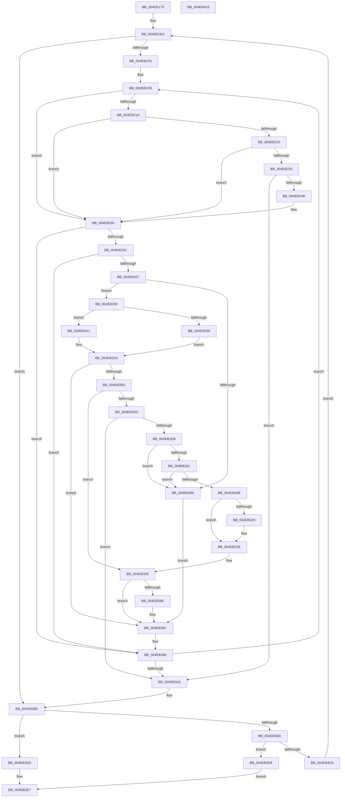

# ST_STORE&lt;SM_TRAITS&gt;::StCompactionPerformEmergency

- RVA: `0x004EB170`–`0x004EB419` (길이 `681` bytes)
- VA: `0x00000001404EB170`
- 실행 섹션: `.text`
- PDB 이름 있음: `예`; PDB Function 태그: `아니요`
- unwind 정보 RVA: `0x000BEDC8`
- 디코드: `175`개 명령, `681/681` bytes 표시
- 미해석 바이트: `0` (있으면 어셈블리에 `.byte`로 보존)

> 이 문서는 커널 이미지의 기계어와 PDB 기호를 분석해 생성했습니다. 4번과 5번은 함수 원형과 자료형을 바이너리 사용 방식에서 추정한 C 해석이며 원본 소스 복구 결과는 아닙니다.

## 1. Dependencies

- 직접 호출 지점: **11**; 고유 호출 대상: **9**
- 직접 호출자로 확인된 함수: **1**
- RIP 상대 이미지 참조: **0**

### Outgoing calls
- `0x004EB193` → [ST_STORE<SM_TRAITS>::StSetDataMovementInProgress](../60/ST_STORE_SM_TRAITS_StSetDataMovementInProgress_function_0060E9BC.md) (function, `0x0060E9BC`)
- `0x004EB1A0` → [ST_STORE<SM_TRAITS>::StDmLazyRegionsWorker](../49/ST_STORE_SM_TRAITS_StDmLazyRegionsWorker_function_0049FE78.md) (function, `0x0049FE78`)
- `0x004EB1B5` → [KiQueryUnbiasedInterruptTime](../42/KiQueryUnbiasedInterruptTime_function_0042D180.md) (function, `0x0042D180`)
- `0x004EB227` → [KiQueryUnbiasedInterruptTime](../42/KiQueryUnbiasedInterruptTime_function_0042D180.md) (function, `0x0042D180`)
- `0x004EB27D` → [SMKM_STORE<SM_TRAITS>::SmStIsRegionBusy](../43/SMKM_STORE_SM_TRAITS_SmStIsRegionBusy_function_0043DB80.md) (function, `0x0043DB80`)
- `0x004EB2CA` → [ST_STORE<SM_TRAITS>::StCompactRegions](../4A/ST_STORE_SM_TRAITS_StCompactRegions_function_004A48E0.md) (function, `0x004A48E0`)
- `0x004EB2DD` → [ST_STORE<SM_TRAITS>::StDmCheckForCompaction](../41/ST_STORE_SM_TRAITS_StDmCheckForCompaction_function_0041147C.md) (function, `0x0041147C`)
- `0x004EB2F7` → [ST_STORE<SM_TRAITS>::StMapAndLockRegion](ST_STORE_SM_TRAITS_StMapAndLockRegion_function_004EC090.md) (function, `0x004EC090`)
- `0x004EB320` → [ST_STORE<SM_TRAITS>::StCompactRegions](../4A/ST_STORE_SM_TRAITS_StCompactRegions_function_004A48E0.md) (function, `0x004A48E0`)
- `0x004EB330` → [ST_STORE<SM_TRAITS>::StUnlockAndUnmapRegion](../34/ST_STORE_SM_TRAITS_StUnlockAndUnmapRegion_function_0034C7F0.md) (function, `0x0034C7F0`)
- `0x004EB387` → [MmStoreDecommitVirtualMemory](../47/MmStoreDecommitVirtualMemory_function_00474BF0.md) (function, `0x00474BF0`)

### Direct callers
- [sub_0020634E](../20/Unknown_function_0020634E.md) at `0x0020647D`

### Static image references
- 디코드된 RIP-relative 메모리 참조가 없습니다.

## 2. Other-region calls and transfers

- 다른 실행 섹션으로 향하는 call: **0**
- 별도 외부 분기/꼬리 이동을 확인하지 못했습니다.

## 3. Assembly (complete function range)

```asm
004EB170  48 89 5C 24 20                  mov qword ptr [rsp + 0x20], rbx
004EB175  55                              push rbp
004EB176  56                              push rsi
004EB177  57                              push rdi
004EB178  41 54                           push r12
004EB17A  41 55                           push r13
004EB17C  41 56                           push r14
004EB17E  41 57                           push r15
004EB180  48 83 EC 30                     sub rsp, 0x30
004EB184  8B 99 10 03 00 00               mov ebx, dword ptr [rcx + 0x310]
004EB18A  48 8B F9                        mov rdi, rcx
004EB18D  89 5C 24 70                     mov dword ptr [rsp + 0x70], ebx
004EB191  33 ED                           xor ebp, ebp
004EB193  E8 24 38 12 00                  call 0x14060e9bc
004EB198  45 33 C0                        xor r8d, r8d
004EB19B  33 D2                           xor edx, edx
004EB19D  48 8B CF                        mov rcx, rdi
004EB1A0  E8 D3 4C FB FF                  call 0x14049fe78
004EB1A5  44 8D AB 00 F0 FF FF            lea r13d, [rbx - 0x1000]
004EB1AC  45 33 E4                        xor r12d, r12d
004EB1AF  41 C1 ED 04                     shr r13d, 4
004EB1B3  B1 01                           mov cl, 1
004EB1B5  E8 C6 1F F4 FF                  call 0x14042d180
004EB1BA  48 8B 97 78 05 00 00            mov rdx, qword ptr [rdi + 0x578]
004EB1C1  48 8B F0                        mov rsi, rax
004EB1C4  8B 8F B8 05 00 00               mov ecx, dword ptr [rdi + 0x5b8]
004EB1CA  48 89 44 24 78                  mov qword ptr [rsp + 0x78], rax
004EB1CF  4C 8D 34 4A                     lea r14, [rdx + rcx*2]
004EB1D3  8B 8F 58 03 00 00               mov ecx, dword ptr [rdi + 0x358]
004EB1D9  4C 89 B4 24 80 00 00 00         mov qword ptr [rsp + 0x80], r14
004EB1E1  4C 8D 3C 4A                     lea r15, [rdx + rcx*2]
004EB1E5  BA FF 1F 00 00                  mov edx, 0x1fff
004EB1EA  49 8B DE                        mov rbx, r14
004EB1ED  4D 3B F7                        cmp r14, r15
004EB1F0  0F 83 BF 01 00 00               jae 0x1404eb3b5
004EB1F6  44 8B 74 24 70                  mov r14d, dword ptr [rsp + 0x70]
004EB1FB  48 8B 87 20 03 00 00            mov rax, qword ptr [rdi + 0x320]
004EB202  8B 88 00 1B 00 00               mov ecx, dword ptr [rax + 0x1b00]
004EB208  03 88 08 1D 00 00               add ecx, dword ptr [rax + 0x1d08]
004EB20E  44 8B 98 04 1B 00 00            mov r11d, dword ptr [rax + 0x1b04]
004EB215  44 03 D9                        add r11d, ecx
004EB218  74 36                           je 0x1404eb250
004EB21A  41 F6 C4 03                     test r12b, 3
004EB21E  75 30                           jne 0x1404eb250
004EB220  45 85 E4                        test r12d, r12d
004EB223  74 2B                           je 0x1404eb250
004EB225  B1 01                           mov cl, 1
004EB227  E8 54 1F F4 FF                  call 0x14042d180
004EB22C  48 2B C6                        sub rax, rsi
004EB22F  41 B8 40 4B 4C 00               mov r8d, 0x4c4b40
004EB235  41 83 FB 40                     cmp r11d, 0x40
004EB239  48 1B C9                        sbb rcx, rcx
004EB23C  49 23 C8                        and rcx, r8
004EB23F  49 03 C8                        add rcx, r8
004EB242  48 3B C1                        cmp rax, rcx
004EB245  0F 83 58 01 00 00               jae 0x1404eb3a3
004EB24B  BA FF 1F 00 00                  mov edx, 0x1fff
004EB250  0F B7 03                        movzx eax, word ptr [rbx]
004EB253  66 85 C2                        test dx, ax
004EB256  0F 84 3A 01 00 00               je 0x1404eb396
004EB25C  23 C2                           and eax, edx
004EB25E  41 3B C5                        cmp eax, r13d
004EB261  0F 87 2F 01 00 00               ja 0x1404eb396
004EB267  48 8B 8F 20 03 00 00            mov rcx, qword ptr [rdi + 0x320]
004EB26E  48 8B F3                        mov rsi, rbx
004EB271  48 2B B7 78 05 00 00            sub rsi, qword ptr [rdi + 0x578]
004EB278  48 D1 FE                        sar rsi, 1
004EB27B  8B D6                           mov edx, esi
004EB27D  E8 FE 28 F5 FF                  call 0x14043db80
004EB282  85 C0                           test eax, eax
004EB284  74 0A                           je 0x1404eb290
004EB286  BD 01 00 00 00                  mov ebp, 1
004EB28B  E9 FC 00 00 00                  jmp 0x1404eb38c
004EB290  80 BF 08 03 00 00 00            cmp byte ptr [rdi + 0x308], 0
004EB297  75 08                           jne 0x1404eb2a1
004EB299  0F B7 03                        movzx eax, word ptr [rbx]
004EB29C  C1 E8 0D                        shr eax, 0xd
004EB29F  EB 02                           jmp 0x1404eb2a3
004EB2A1  33 C0                           xor eax, eax
004EB2A3  48 03 C0                        add rax, rax
004EB2A6  3B B4 C7 58 06 00 00            cmp esi, dword ptr [rdi + rax*8 + 0x658]
004EB2AD  0F 84 D9 00 00 00               je 0x1404eb38c
004EB2B3  83 64 24 28 00                  and dword ptr [rsp + 0x28], 0
004EB2B8  45 33 C9                        xor r9d, r9d
004EB2BB  44 8B C6                        mov r8d, esi
004EB2BE  89 74 24 20                     mov dword ptr [rsp + 0x20], esi
004EB2C2  33 D2                           xor edx, edx
004EB2C4  48 8B CF                        mov rcx, rdi
004EB2C7  41 FF C4                        inc r12d
004EB2CA  E8 11 96 FB FF                  call 0x1404a48e0
004EB2CF  85 C0                           test eax, eax
004EB2D1  79 62                           jns 0x1404eb335
004EB2D3  45 33 C0                        xor r8d, r8d
004EB2D6  48 8B CF                        mov rcx, rdi
004EB2D9  41 8D 50 02                     lea edx, [r8 + 2]
004EB2DD  E8 9A 61 F2 FF                  call 0x14041147c
004EB2E2  83 F8 02                        cmp eax, 2
004EB2E5  0F 85 B8 00 00 00               jne 0x1404eb3a3
004EB2EB  44 8D 48 FF                     lea r9d, [rax - 1]
004EB2EF  45 33 C0                        xor r8d, r8d
004EB2F2  8B D6                           mov edx, esi
004EB2F4  48 8B CF                        mov rcx, rdi
004EB2F7  E8 94 0D 00 00                  call 0x1404ec090
004EB2FC  48 85 C0                        test rax, rax
004EB2FF  74 85                           je 0x1404eb286
004EB301  48 83 F8 FF                     cmp rax, -1
004EB305  0F 84 7B FF FF FF               je 0x1404eb286
004EB30B  83 64 24 28 00                  and dword ptr [rsp + 0x28], 0
004EB310  4C 8B C8                        mov r9, rax
004EB313  44 8B C6                        mov r8d, esi
004EB316  89 74 24 20                     mov dword ptr [rsp + 0x20], esi
004EB31A  48 8B D0                        mov rdx, rax
004EB31D  48 8B CF                        mov rcx, rdi
004EB320  E8 BB 95 FB FF                  call 0x1404a48e0
004EB325  85 C0                           test eax, eax
004EB327  79 02                           jns 0x1404eb32b
004EB329  CD 2C                           int 0x2c
004EB32B  8B D6                           mov edx, esi
004EB32D  48 8B CF                        mov rcx, rdi
004EB330  E8 BB 14 E6 FF                  call 0x14034c7f0
004EB335  48 8B 87 20 03 00 00            mov rax, qword ptr [rdi + 0x320]
004EB33C  44 0F B7 0B                     movzx r9d, word ptr [rbx]
004EB340  41 81 E1 FF 1F 00 00            and r9d, 0x1fff
004EB347  44 8B C6                        mov r8d, esi
004EB34A  41 C1 E1 04                     shl r9d, 4
004EB34E  48 8B 90 68 1B 00 00            mov rdx, qword ptr [rax + 0x1b68]
004EB355  41 81 C1 FF 0F 00 00            add r9d, 0xfff
004EB35C  41 81 E1 00 F0 FF FF            and r9d, 0xfffff000
004EB363  4A 8B 0C C2                     mov rcx, qword ptr [rdx + r8*8]
004EB367  4A 83 3C C2 00                  cmp qword ptr [rdx + r8*8], 0
004EB36C  7C 1E                           jl 0x1404eb38c
004EB36E  48 B8 00 00 FF FF FF FF FF 7F   movabs rax, 0x7fffffffffff0000
004EB378  41 8B D6                        mov edx, r14d
004EB37B  48 23 C8                        and rcx, rax
004EB37E  41 2B D1                        sub edx, r9d
004EB381  41 8B C1                        mov eax, r9d
004EB384  48 03 C8                        add rcx, rax
004EB387  E8 64 98 F8 FF                  call 0x140474bf0
004EB38C  48 8B 74 24 78                  mov rsi, qword ptr [rsp + 0x78]
004EB391  BA FF 1F 00 00                  mov edx, 0x1fff
004EB396  48 83 C3 02                     add rbx, 2
004EB39A  49 3B DF                        cmp rbx, r15
004EB39D  0F 82 58 FE FF FF               jb 0x1404eb1fb
004EB3A3  4C 8B B4 24 80 00 00 00         mov r14, qword ptr [rsp + 0x80]
004EB3AB  BA FF 1F 00 00                  mov edx, 0x1fff
004EB3B0  48 8B 74 24 78                  mov rsi, qword ptr [rsp + 0x78]
004EB3B5  49 3B DF                        cmp rbx, r15
004EB3B8  75 23                           jne 0x1404eb3dd
004EB3BA  48 8B 87 78 05 00 00            mov rax, qword ptr [rdi + 0x578]
004EB3C1  4C 3B F0                        cmp r14, rax
004EB3C4  74 13                           je 0x1404eb3d9
004EB3C6  4D 8B FE                        mov r15, r14
004EB3C9  48 89 84 24 80 00 00 00         mov qword ptr [rsp + 0x80], rax
004EB3D1  4C 8B F0                        mov r14, rax
004EB3D4  E9 11 FE FF FF                  jmp 0x1404eb1ea
004EB3D9  33 DB                           xor ebx, ebx
004EB3DB  EB 0A                           jmp 0x1404eb3e7
004EB3DD  48 2B 9F 78 05 00 00            sub rbx, qword ptr [rdi + 0x578]
004EB3E4  48 D1 FB                        sar rbx, 1
004EB3E7  F7 DD                           neg ebp
004EB3E9  89 9F B8 05 00 00               mov dword ptr [rdi + 0x5b8], ebx
004EB3EF  48 8B 9C 24 88 00 00 00         mov rbx, qword ptr [rsp + 0x88]
004EB3F7  1B C0                           sbb eax, eax
004EB3F9  C7 87 C0 05 00 00 00 00 00 00   mov dword ptr [rdi + 0x5c0], 0
004EB403  25 2D 02 00 C0                  and eax, 0xc000022d
004EB408  48 83 C4 30                     add rsp, 0x30
004EB40C  41 5F                           pop r15
004EB40E  41 5E                           pop r14
004EB410  41 5D                           pop r13
004EB412  41 5C                           pop r12
004EB414  5F                              pop rdi
004EB415  5E                              pop rsi
004EB416  5D                              pop rbp
004EB417  C3                              ret
004EB418  CC                              int3
```

## 4. C-style interpretation (structured pseudocode)

```c
__int64 __fastcall ST_STORE_SM_TRAITS___StCompactionPerformEmergency(__int64 a1, int a2, int a3, int a4)
{
    __int64 result;
    __int64 v_r11;
    __int64 v_r12;
    __int64 v_r13;
    __int64 v_rbp;
    __int64 v_rbx;
    __int64 v_rsi;
    __int64 v_rsp;
    unsigned int v_stack_m40;
    unsigned int v_stack_m48;
    unsigned __int64 v_stack_p10;
    unsigned __int64 v_stack_p18;
    unsigned __int64 v_stack_p20;
    unsigned int v_stack_p8;

    v_stack_p20 = v_rbx;
    v_rsp = (v_rsp) - (48);
    v_stack_p8 = (unsigned int)((unsigned int)(*(unsigned int *)(a1 + 784)));
    v_rbp = 0;
    result = ST_STORE_SM_TRAITS___StSetDataMovementInProgress(a1, a2, a3, a4);
    a3 = 0;
    a2 = 0;
    result = ST_STORE_SM_TRAITS___StDmLazyRegionsWorker(a1, a2, a3, a4);
    v_r12 = 0;
    v_r13 = (unsigned int)(((unsigned int)(*(unsigned int *)(a1 + 784)) - 4096) >> (4));
    result = KiQueryUnbiasedInterruptTime(1, a2, a3, a4);
    v_stack_p10 = result;
    v_stack_p18 = *(unsigned __int64 *)(a1 + 1400) + (unsigned int)(*(unsigned int *)(a1 + 1464)) * 2;
loc_004EB1EA:
    if ((*(unsigned __int64 *)(a1 + 1400) + (unsigned int)(*(unsigned int *)(a1 + 1464)) * 2) >= (*(unsigned __int64 *)(a1 + 1400) + (unsigned int)(*(unsigned int *)(a1 + 856)) * 2)) goto loc_004EB3B5;
loc_004EB1FB:
    a1 = (unsigned int)(((unsigned int)(*(unsigned int *)(*(unsigned __int64 *)(a1 + 800) + 6912))) + (*(unsigned int *)(*(unsigned __int64 *)(a1 + 800) + 7432)));
    v_r11 = (unsigned int)(((unsigned int)(*(unsigned int *)(*(unsigned __int64 *)(a1 + 800) + 6916))) + ((unsigned int)(a1)));
    if (condition_is_equal) goto loc_004EB250;
    if (((0) & (3)) != 0) goto loc_004EB250;
    if (0 == 0) goto loc_004EB250;
    result = KiQueryUnbiasedInterruptTime(1, (unsigned int)(0x1FFFULL), a3, a4);
    result = (result) - (result);
    a1 = (1) & ((unsigned int)(0x4C4B40ULL));
    a1 = (a1) + ((unsigned int)(0x4C4B40ULL));
    if (result >= a1) goto loc_004EB3A3;
loc_004EB250:
    if ((((unsigned __int16)((unsigned int)(0x1FFFULL))) & ((unsigned __int16)(*(unsigned __int16 *)(*(unsigned __int64 *)(a1 + 1400) + (unsigned int)(*(unsigned int *)(a1 + 1464)) * 2)))) == 0) goto loc_004EB396;
    result = (unsigned int)((*(unsigned __int16 *)(*(unsigned __int64 *)(a1 + 1400) + (unsigned int)(*(unsigned int *)(a1 + 1464)) * 2)) & ((unsigned int)((unsigned int)(0x1FFFULL))));
    if (((unsigned int)(result)) > ((unsigned int)(v_r13))) goto loc_004EB396;
    v_rsi = (*(unsigned __int64 *)(a1 + 1400) + (unsigned int)(*(unsigned int *)(a1 + 1464)) * 2) - (*(unsigned __int64 *)(a1 + 1400));
    v_rsi = (v_rsi) >> (1);
    result = SMKM_STORE_SM_TRAITS___SmStIsRegionBusy(*(unsigned __int64 *)(a1 + 800), (unsigned int)((unsigned int)(v_rsi)), (unsigned int)(0x4C4B40ULL), a4);
    if ((unsigned int)(result) == 0) goto loc_004EB290;
loc_004EB286:
    goto loc_004EB38C;
loc_004EB290:
    if ((*(unsigned __int8 *)(a1 + 776)) != 0) goto loc_004EB2A1;
    result = (unsigned int)((*(unsigned __int16 *)(*(unsigned __int64 *)(a1 + 1400) + (unsigned int)(*(unsigned int *)(a1 + 1464)) * 2)) >> (13));
    goto loc_004EB2A3;
loc_004EB2A1:
    result = 0;
loc_004EB2A3:
    result = (result) + (0);
    if (((unsigned int)(v_rsi)) == (*(unsigned int *)(a1 + result * 8 + 1624))) goto loc_004EB38C;
    a4 = 0;
    v_stack_m48 = (unsigned int)(v_rsi);
    a2 = 0;
    v_r12 = (unsigned int)((v_r12) + 1);
    result = ST_STORE_SM_TRAITS___StCompactRegions(a1, a2, (unsigned int)((unsigned int)(v_rsi)), a4);
    if (!sign_flag) goto loc_004EB335;
    a3 = 0;
    result = ST_STORE_SM_TRAITS___StDmCheckForCompaction(a1, a3 + 2, a3, a4);
    if (((unsigned int)(result)) != 2) goto loc_004EB3A3;
    a3 = 0;
    result = ST_STORE_SM_TRAITS___StMapAndLockRegion(a1, (unsigned int)((unsigned int)(v_rsi)), a3, result - 1);
    if (result == 0) goto loc_004EB286;
    if (result == -1) goto loc_004EB286;
    v_stack_m48 = (unsigned int)(v_rsi);
    result = ST_STORE_SM_TRAITS___StCompactRegions(a1, result, (unsigned int)((unsigned int)(v_rsi)), result);
    if (sign_flag) {
    }
    result = ST_STORE_SM_TRAITS___StUnlockAndUnmapRegion(a1, (unsigned int)((unsigned int)(v_rsi)), (unsigned int)((unsigned int)(v_rsi)), result);
loc_004EB335:
    a4 = (unsigned int)((*(unsigned __int16 *)(*(unsigned __int64 *)(a1 + 1400) + (unsigned int)(*(unsigned int *)(a1 + 1464)) * 2)) & (0x1FFFULL));
    a4 = (unsigned int)((a4) << (4));
    a4 = (unsigned int)((a4) + (0xFFFULL));
    a4 = (unsigned int)((a4) & (0xFFFFF000ULL));
    result = *(unsigned __int64 *)(a1 + 800);
    if ((*(unsigned __int64 *)(*(unsigned __int64 *)(*(unsigned __int64 *)(a1 + 800) + 7016) + (unsigned int)((unsigned int)(v_rsi)) * 8)) >= 0) {
        a2 = (unsigned int)((unsigned int)(v_stack_p8));
        a1 = (*(unsigned __int64 *)(*(unsigned __int64 *)(*(unsigned __int64 *)(a1 + 800) + 7016) + (unsigned int)((unsigned int)(v_rsi)) * 8)) & (*(unsigned __int64 *)(a1 + 800));
        a2 = (unsigned int)((a2) - (a4));
        result = a4;
        a1 = (a1) + (result);
        result = MmStoreDecommitVirtualMemory(a1, a2, (unsigned int)((unsigned int)(v_rsi)), a4);
    }
loc_004EB396:
    v_rbx = (*(unsigned __int64 *)(a1 + 1400) + (unsigned int)(*(unsigned int *)(a1 + 1464)) * 2) + (2);
    if (v_rbx < (*(unsigned __int64 *)(a1 + 1400) + (unsigned int)(*(unsigned int *)(a1 + 856)) * 2)) goto loc_004EB1FB;
loc_004EB3A3:
loc_004EB3B5:
    if (v_rbx != (*(unsigned __int64 *)(a1 + 1400) + (unsigned int)(*(unsigned int *)(a1 + 856)) * 2)) goto loc_004EB3DD;
    if (v_stack_p18 == (*(unsigned __int64 *)(a1 + 1400))) goto loc_004EB3D9;
    v_stack_p18 = *(unsigned __int64 *)(a1 + 1400);
    goto loc_004EB1EA;
loc_004EB3D9:
    v_rbx = 0;
    goto loc_004EB3E7;
loc_004EB3DD:
    v_rbx = (v_rbx) - (*(unsigned __int64 *)(a1 + 1400));
    v_rbx = (v_rbx) >> (1);
loc_004EB3E7:
    v_rbp = (unsigned int)(-(1));
    *(unsigned int *)(a1 + 1464) = (unsigned int)(v_rbx);
    *(unsigned int *)(a1 + 1472) = 0;
    result = (unsigned int)((*(unsigned __int64 *)(a1 + 1400)) & (0xC000022DULL));
    v_rsp = (v_rsp) + (48);
    return result;
}
```

## 5. (Beta) C Style

```c
int64_t ST_STORE_SM_TRAITS___StCompactionPerformEmergency(void *Arg1, int32_t Arg2, int32_t Arg3, int32_t Arg4)
{
    uint8_t *arg1 = (uint8_t *)Arg1;

    int64_t result;
    int64_t local_r11;
    int64_t local_r12;
    int64_t local_r13;
    int64_t local_rbp;
    int64_t local_rbx;
    int64_t local_rsi;
    int64_t local_rsp;
    uint32_t v_stack_m40;
    uint32_t v_stack_m48;
    uint64_t v_stack_p10;
    uint64_t v_stack_p18;
    uint64_t v_stack_p20;
    uint32_t v_stack_p8;

    v_stack_p20 = local_rbx;
    local_rsp = (local_rsp) - (48);
    v_stack_p8 = (uint32_t)((uint32_t)(*(uint32_t *)(arg1 + 0x310)));
    local_rbp = 0;
    result = ST_STORE_SM_TRAITS___StSetDataMovementInProgress(Arg1, Arg2, Arg3, Arg4);
    Arg3 = 0;
    Arg2 = 0;
    result = ST_STORE_SM_TRAITS___StDmLazyRegionsWorker(Arg1, Arg2, Arg3, Arg4);
    local_r12 = 0;
    local_r13 = (uint32_t)(((uint32_t)(*(uint32_t *)(arg1 + 0x310)) - 4096) >> (4));
    result = KiQueryUnbiasedInterruptTime(1, Arg2, Arg3, Arg4);
    v_stack_p10 = result;
    v_stack_p18 = *(uint64_t *)(arg1 + 0x578) + (uint32_t)(*(uint32_t *)(arg1 + 0x5B8)) * 2;
loc_004EB1EA:
    if ((*(uint64_t *)(arg1 + 0x578) + (uint32_t)(*(uint32_t *)(arg1 + 0x5B8)) * 2) >= (*(uint64_t *)(arg1 + 0x578) + (uint32_t)(*(uint32_t *)(arg1 + 0x358)) * 2)) goto loc_004EB3B5;
loc_004EB1FB:
    Arg1 = (uint32_t)(((uint32_t)(*(uint32_t *)(*(uint64_t *)(arg1 + 0x320) + 0x1B00))) + (*(uint32_t *)(*(uint64_t *)(arg1 + 0x320) + 0x1D08)));
    local_r11 = (uint32_t)(((uint32_t)(*(uint32_t *)(*(uint64_t *)(arg1 + 0x320) + 0x1B04))) + ((uint32_t)(Arg1)));
    if (condition_is_equal) goto loc_004EB250;
    if (((0) & (3)) != 0) goto loc_004EB250;
    if (0 == 0) goto loc_004EB250;
    result = KiQueryUnbiasedInterruptTime(1, (uint32_t)(0x1FFFULL), Arg3, Arg4);
    result = (result) - (result);
    Arg1 = (1) & ((uint32_t)(0x4C4B40ULL));
    Arg1 = (Arg1) + ((uint32_t)(0x4C4B40ULL));
    if (result >= Arg1) goto loc_004EB3A3;
loc_004EB250:
    if ((((uint16_t)((uint32_t)(0x1FFFULL))) & ((uint16_t)(*(uint16_t *)(*(uint64_t *)(arg1 + 0x578) + (uint32_t)(*(uint32_t *)(arg1 + 0x5B8)) * 2)))) == 0) goto loc_004EB396;
    result = (uint32_t)((*(uint16_t *)(*(uint64_t *)(arg1 + 0x578) + (uint32_t)(*(uint32_t *)(arg1 + 0x5B8)) * 2)) & ((uint32_t)((uint32_t)(0x1FFFULL))));
    if (((uint32_t)(result)) > ((uint32_t)(local_r13))) goto loc_004EB396;
    local_rsi = (*(uint64_t *)(arg1 + 0x578) + (uint32_t)(*(uint32_t *)(arg1 + 0x5B8)) * 2) - (*(uint64_t *)(arg1 + 0x578));
    local_rsi = (local_rsi) >> (1);
    result = SMKM_STORE_SM_TRAITS___SmStIsRegionBusy(*(uint64_t *)(arg1 + 0x320), (uint32_t)((uint32_t)(local_rsi)), (uint32_t)(0x4C4B40ULL), Arg4);
    if ((uint32_t)(result) == 0) goto loc_004EB290;
loc_004EB286:
    goto loc_004EB38C;
loc_004EB290:
    if ((*(uint8_t *)(arg1 + 0x308)) != 0) goto loc_004EB2A1;
    result = (uint32_t)((*(uint16_t *)(*(uint64_t *)(arg1 + 0x578) + (uint32_t)(*(uint32_t *)(arg1 + 0x5B8)) * 2)) >> (13));
    goto loc_004EB2A3;
loc_004EB2A1:
    result = 0;
loc_004EB2A3:
    result = (result) + (0);
    if (((uint32_t)(local_rsi)) == (*(uint32_t *)(arg1 + result * 8 + 0x658))) goto loc_004EB38C;
    Arg4 = 0;
    v_stack_m48 = (uint32_t)(local_rsi);
    Arg2 = 0;
    local_r12 = (uint32_t)((local_r12) + 1);
    result = ST_STORE_SM_TRAITS___StCompactRegions(Arg1, Arg2, (uint32_t)((uint32_t)(local_rsi)), Arg4);
    if (!sign_flag) goto loc_004EB335;
    Arg3 = 0;
    result = ST_STORE_SM_TRAITS___StDmCheckForCompaction(Arg1, Arg3 + 2, Arg3, Arg4);
    if (((uint32_t)(result)) != 2) goto loc_004EB3A3;
    Arg3 = 0;
    result = ST_STORE_SM_TRAITS___StMapAndLockRegion(Arg1, (uint32_t)((uint32_t)(local_rsi)), Arg3, result - 1);
    if (result == 0) goto loc_004EB286;
    if (result == -1) goto loc_004EB286;
    v_stack_m48 = (uint32_t)(local_rsi);
    result = ST_STORE_SM_TRAITS___StCompactRegions(Arg1, result, (uint32_t)((uint32_t)(local_rsi)), result);
    if (sign_flag) {
    }
    result = ST_STORE_SM_TRAITS___StUnlockAndUnmapRegion(Arg1, (uint32_t)((uint32_t)(local_rsi)), (uint32_t)((uint32_t)(local_rsi)), result);
loc_004EB335:
    Arg4 = (uint32_t)((*(uint16_t *)(*(uint64_t *)(arg1 + 0x578) + (uint32_t)(*(uint32_t *)(arg1 + 0x5B8)) * 2)) & (0x1FFFULL));
    Arg4 = (uint32_t)((Arg4) << (4));
    Arg4 = (uint32_t)((Arg4) + (0xFFFULL));
    Arg4 = (uint32_t)((Arg4) & (0xFFFFF000ULL));
    result = *(uint64_t *)(arg1 + 0x320);
    if ((*(uint64_t *)(*(uint64_t *)(*(uint64_t *)(arg1 + 0x320) + 0x1B68) + (uint32_t)((uint32_t)(local_rsi)) * 8)) >= 0) {
        Arg2 = (uint32_t)((uint32_t)(v_stack_p8));
        Arg1 = (*(uint64_t *)(*(uint64_t *)(*(uint64_t *)(arg1 + 0x320) + 0x1B68) + (uint32_t)((uint32_t)(local_rsi)) * 8)) & (*(uint64_t *)(arg1 + 0x320));
        Arg2 = (uint32_t)((Arg2) - (Arg4));
        result = Arg4;
        Arg1 = (Arg1) + (result);
        result = MmStoreDecommitVirtualMemory(Arg1, Arg2, (uint32_t)((uint32_t)(local_rsi)), Arg4);
    }
loc_004EB396:
    local_rbx = (*(uint64_t *)(arg1 + 0x578) + (uint32_t)(*(uint32_t *)(arg1 + 0x5B8)) * 2) + (2);
    if (local_rbx < (*(uint64_t *)(arg1 + 0x578) + (uint32_t)(*(uint32_t *)(arg1 + 0x358)) * 2)) goto loc_004EB1FB;
loc_004EB3A3:
loc_004EB3B5:
    if (local_rbx != (*(uint64_t *)(arg1 + 0x578) + (uint32_t)(*(uint32_t *)(arg1 + 0x358)) * 2)) goto loc_004EB3DD;
    if (v_stack_p18 == (*(uint64_t *)(arg1 + 0x578))) goto loc_004EB3D9;
    v_stack_p18 = *(uint64_t *)(arg1 + 0x578);
    goto loc_004EB1EA;
loc_004EB3D9:
    local_rbx = 0;
    goto loc_004EB3E7;
loc_004EB3DD:
    local_rbx = (local_rbx) - (*(uint64_t *)(arg1 + 0x578));
    local_rbx = (local_rbx) >> (1);
loc_004EB3E7:
    local_rbp = (uint32_t)(-(1));
    *(uint32_t *)(arg1 + 0x5B8) = (uint32_t)(local_rbx);
    *(uint32_t *)(arg1 + 0x5C0) = 0;
    result = (uint32_t)((*(uint64_t *)(arg1 + 0x578)) & (0xC000022DULL));
    local_rsp = (local_rsp) + (48);
    return result;
}
```

### 관측된 메모리 오프셋

구조체 형식이 확인되지 않은 접근은 인자 기준의 오프셋으로만 기록했습니다.

| 기준 인자 | 오프셋 표현 | 폭 (bit) | 접근 |
|---|---:|---:|---|
| `Arg1` | `+ 0x308` | `8` | `R` |
| `Arg1` | `+ 0x310` | `32` | `R` |
| `Arg1` | `+ 0x320` | `64` | `R` |
| `Arg1` | `+ 0x358` | `32` | `R` |
| `Arg1` | `+ 0x578` | `64` | `R` |
| `Arg1` | `+ 0x5B8` | `32` | `R` |
| `Arg1` | `+ 0x5B8` | `32` | `W` |
| `Arg1` | `+ 0x5C0` | `32` | `W` |
| `Arg1` | `+ 0x658 + rax*8` | `32` | `R` |

## 6. Execution-region graph

[열기: 2D/3D 그래프와 함수 탐색 컨트롤 패널](../../../control-panel.html?section=text&rva=0x004EB170&view=graph)

- 2D 그래프는 위에서 아래로 흐르고, 3D 그래프는 빈 공간을 드래그해 회전합니다. Shift+드래그는 이동, 휠은 확대·축소, 함수 노드 선택은 대상 보고서 이동입니다.

### Static fallback


