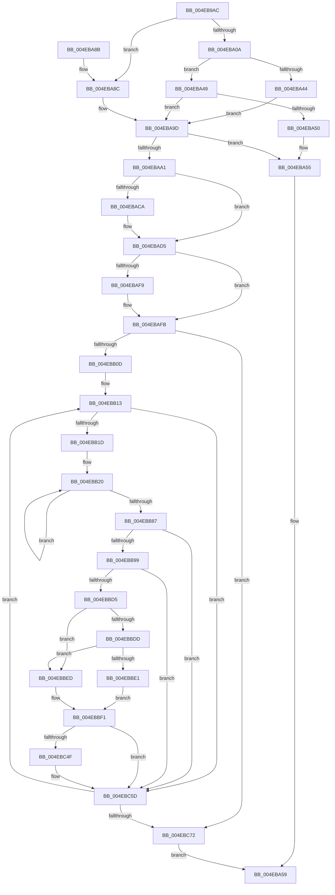

# ST_STORE&lt;SM_TRAITS&gt;::StDmCombineBufferProcess

- RVA: `0x004EB9AC`–`0x004EBC79` (길이 `717` bytes)
- VA: `0x00000001404EB9AC`
- 실행 섹션: `.text`
- PDB 이름 있음: `예`; PDB Function 태그: `아니요`
- unwind 정보 RVA: `0x000D183C`
- 디코드: `190`개 명령, `717/717` bytes 표시
- 미해석 바이트: `0` (있으면 어셈블리에 `.byte`로 보존)

> 이 문서는 커널 이미지의 기계어와 PDB 기호를 분석해 생성했습니다. 4번과 5번은 함수 원형과 자료형을 바이너리 사용 방식에서 추정한 C 해석이며 원본 소스 복구 결과는 아닙니다.

## 1. Dependencies

- 직접 호출 지점: **8**; 고유 호출 대상: **8**
- 직접 호출자로 확인된 함수: **1**
- RIP 상대 이미지 참조: **1**

### Outgoing calls
- `0x004EBA39` → [SMKM_STORE<SM_TRAITS>::SmStHelperSendCommand](../3B/SMKM_STORE_SM_TRAITS_SmStHelperSendCommand_function_003B0530.md) (function, `0x003B0530`)
- `0x004EBA63` → [B_TREE<unsigned long,ST_STORE<SM_TRAITS>::_ST_REGION_ENTRY,4096,NP_CONTEXT,ST_STORE<SM_TRAITS>::ST_REGION_ENTRY_COMPARATOR>::BTreeSearchResultCleanup](../3A/B_TREE_unsigned_long_ST_STORE_SM_TRAITS__ST_REGION_ENTRY_4096_NP_CONTEXT_ST_STORE_SM_TRAITS_ST_REGIO_function_003AC7E0.md) (function, `0x003AC7E0`)
- `0x004EBA96` → [SMKM_STORE<SM_TRAITS>::SmStCompareRegionDataCallback](../34/SMKM_STORE_SM_TRAITS_SmStCompareRegionDataCallback_function_0034D390.md) (function, `0x0034D390`)
- `0x004EBAD0` → [B_TREE<unsigned long,ST_STORE<SM_TRAITS>::_ST_REGION_ENTRY,4096,NP_CONTEXT,ST_STORE<SM_TRAITS>::ST_REGION_ENTRY_COMPARATOR>::BTreeSearchResultDeref](../3A/B_TREE_unsigned_long_ST_STORE_SM_TRAITS__ST_REGION_ENTRY_4096_NP_CONTEXT_ST_STORE_SM_TRAITS_ST_REGIO_function_003AD260.md) (function, `0x003AD260`)
- `0x004EBAF0` → [B_TREE<unsigned long,ST_STORE<SM_TRAITS>::_ST_REGION_ENTRY,4096,NP_CONTEXT,ST_STORE<SM_TRAITS>::ST_REGION_ENTRY_COMPARATOR>::BTreeSearchResultIterStart](../3A/B_TREE_unsigned_long_ST_STORE_SM_TRAITS__ST_REGION_ENTRY_4096_NP_CONTEXT_ST_STORE_SM_TRAITS_ST_REGIO_function_003AB794.md) (function, `0x003AB794`)
- `0x004EBB26` → [B_TREE<unsigned long,ST_STORE<SM_TRAITS>::_ST_REGION_ENTRY,4096,NP_CONTEXT,ST_STORE<SM_TRAITS>::ST_REGION_ENTRY_COMPARATOR>::BTreeFindPreviousEntry](../3A/B_TREE_unsigned_long_ST_STORE_SM_TRAITS__ST_REGION_ENTRY_4096_NP_CONTEXT_ST_STORE_SM_TRAITS_ST_REGIO_function_003A9B40.md) (function, `0x003A9B40`)
- `0x004EBBC8` → [B_TREE<unsigned long,ST_STORE<SM_TRAITS>::_ST_REGION_ENTRY,4096,NP_CONTEXT,ST_STORE<SM_TRAITS>::ST_REGION_ENTRY_COMPARATOR>::BTreeSearchKey](../3A/B_TREE_unsigned_long_ST_STORE_SM_TRAITS__ST_REGION_ENTRY_4096_NP_CONTEXT_ST_STORE_SM_TRAITS_ST_REGIO_function_003ACD20.md) (function, `0x003ACD20`)
- `0x004EBC58` → [ST_STORE<SM_TRAITS>::StDmCombinePageRecords](ST_STORE_SM_TRAITS_StDmCombinePageRecords_function_004EBC80.md) (function, `0x004EBC80`)

### Direct callers
- [ST_STORE&lt;SM_TRAITS&gt;::StDmCombineRegion](../3B/ST_STORE_SM_TRAITS_StDmCombineRegion_function_003B0E34.md) at `0x003B0FB1`
- [ST_STORE&lt;SM_TRAITS&gt;::StDmCombineRegion](../3B/ST_STORE_SM_TRAITS_StDmCombineRegion_function_003B0E34.md) at `0x003B103D`

### Static image references
- `0x004EBA1E` → RVA `0x0034D390` (`SMKM_STORE<SM_TRAITS>::SmStCompareRegionDataCallback`; read)

## 2. Other-region calls and transfers

- 다른 실행 섹션으로 향하는 call: **0**
- 별도 외부 분기/꼬리 이동을 확인하지 못했습니다.

## 3. Assembly (complete function range)

```asm
004EB9AC  48 89 5C 24 10                  mov qword ptr [rsp + 0x10], rbx
004EB9B1  48 89 74 24 18                  mov qword ptr [rsp + 0x18], rsi
004EB9B6  48 89 7C 24 20                  mov qword ptr [rsp + 0x20], rdi
004EB9BB  55                              push rbp
004EB9BC  41 54                           push r12
004EB9BE  41 55                           push r13
004EB9C0  41 56                           push r14
004EB9C2  41 57                           push r15
004EB9C4  48 8B EC                        mov rbp, rsp
004EB9C7  48 81 EC 80 00 00 00            sub rsp, 0x80
004EB9CE  33 C0                           xor eax, eax
004EB9D0  48 8D 71 58                     lea rsi, [rcx + 0x58]
004EB9D4  48 89 45 C0                     mov qword ptr [rbp - 0x40], rax
004EB9D8  0F 57 C0                        xorps xmm0, xmm0
004EB9DB  83 C8 01                        or eax, 1
004EB9DE  48 8B F9                        mov rdi, rcx
004EB9E1  48 8B 89 20 03 00 00            mov rcx, qword ptr [rcx + 0x320]
004EB9E8  4C 8B E2                        mov r12, rdx
004EB9EB  48 8B 12                        mov rdx, qword ptr [rdx]
004EB9EE  0F 11 45 B0                     movups xmmword ptr [rbp - 0x50], xmm0
004EB9F2  83 4D B8 FF                     or dword ptr [rbp - 0x48], 0xffffffff
004EB9F6  89 45 C0                        mov dword ptr [rbp - 0x40], eax
004EB9F9  0F 11 45 A0                     movups xmmword ptr [rbp - 0x60], xmm0
004EB9FD  F6 81 95 1A 00 00 04            test byte ptr [rcx + 0x1a95], 4
004EBA04  0F 84 82 00 00 00               je 0x1404eba8c
004EBA0A  33 C0                           xor eax, eax
004EBA0C  4C 8D 45 C8                     lea r8, [rbp - 0x38]
004EBA10  0F 11 45 C8                     movups xmmword ptr [rbp - 0x38], xmm0
004EBA14  41 B9 0C 00 00 00               mov r9d, 0xc
004EBA1A  48 89 45 F8                     mov qword ptr [rbp - 8], rax
004EBA1E  48 8D 05 6B 19 E6 FF            lea rax, [rip - 0x19e695]
004EBA25  48 89 55 D0                     mov qword ptr [rbp - 0x30], rdx
004EBA29  0F 11 45 D8                     movups xmmword ptr [rbp - 0x28], xmm0
004EBA2D  48 89 45 C8                     mov qword ptr [rbp - 0x38], rax
004EBA31  41 8D 51 F9                     lea edx, [r9 - 7]
004EBA35  0F 11 45 E8                     movups xmmword ptr [rbp - 0x18], xmm0
004EBA39  E8 F2 4A EC FF                  call 0x1403b0530
004EBA3E  8B D8                           mov ebx, eax
004EBA40  85 C0                           test eax, eax
004EBA42  75 05                           jne 0x1404eba49
004EBA44  8B 5D F8                        mov ebx, dword ptr [rbp - 8]
004EBA47  EB 54                           jmp 0x1404eba9d
004EBA49  3D 20 01 00 C0                  cmp eax, 0xc0000120
004EBA4E  75 4D                           jne 0x1404eba9d
004EBA50  49 83 24 24 00                  and qword ptr [r12], 0
004EBA55  4C 8D 7F 40                     lea r15, [rdi + 0x40]
004EBA59  45 33 C0                        xor r8d, r8d
004EBA5C  48 8D 55 A0                     lea rdx, [rbp - 0x60]
004EBA60  49 8B CF                        mov rcx, r15
004EBA63  E8 78 0D EC FF                  call 0x1403ac7e0
004EBA68  4C 8D 9C 24 80 00 00 00         lea r11, [rsp + 0x80]
004EBA70  8B C3                           mov eax, ebx
004EBA72  49 8B 5B 38                     mov rbx, qword ptr [r11 + 0x38]
004EBA76  49 8B 73 40                     mov rsi, qword ptr [r11 + 0x40]
004EBA7A  49 8B 7B 48                     mov rdi, qword ptr [r11 + 0x48]
004EBA7E  49 8B E3                        mov rsp, r11
004EBA81  41 5F                           pop r15
004EBA83  41 5E                           pop r14
004EBA85  41 5D                           pop r13
004EBA87  41 5C                           pop r12
004EBA89  5D                              pop rbp
004EBA8A  C3                              ret
004EBA8B  CC                              int3
004EBA8C  48 81 C1 78 1B 00 00            add rcx, 0x1b78
004EBA93  45 33 C0                        xor r8d, r8d
004EBA96  E8 F5 18 E6 FF                  call 0x14034d390
004EBA9B  8B D8                           mov ebx, eax
004EBA9D  85 DB                           test ebx, ebx
004EBA9F  78 B4                           js 0x1404eba55
004EBAA1  4D 8B 24 24                     mov r12, qword ptr [r12]
004EBAA5  4C 8D 7F 40                     lea r15, [rdi + 0x40]
004EBAA9  8B 8F 2C 03 00 00               mov ecx, dword ptr [rdi + 0x32c]
004EBAAF  45 8B 34 24                     mov r14d, dword ptr [r12]
004EBAB3  49 8D 5C 24 08                  lea rbx, [r12 + 8]
004EBAB8  8B 03                           mov eax, dword ptr [rbx]
004EBABA  C1 E8 04                        shr eax, 4
004EBABD  41 D3 E6                        shl r14d, cl
004EBAC0  44 0B F0                        or r14d, eax
004EBAC3  8B 46 20                        mov eax, dword ptr [rsi + 0x20]
004EBAC6  A8 01                           test al, 1
004EBAC8  74 0B                           je 0x1404ebad5
004EBACA  48 8B D6                        mov rdx, rsi
004EBACD  49 8B CF                        mov rcx, r15
004EBAD0  E8 8B 17 EC FF                  call 0x1403ad260
004EBAD5  83 66 20 FE                     and dword ptr [rsi + 0x20], 0xfffffffe
004EBAD9  49 8B D7                        mov rdx, r15
004EBADC  48 8B 87 F8 02 00 00            mov rax, qword ptr [rdi + 0x2f8]
004EBAE3  48 8B CE                        mov rcx, rsi
004EBAE6  44 89 30                        mov dword ptr [rax], r14d
004EBAE9  44 8B 87 00 03 00 00            mov r8d, dword ptr [rdi + 0x300]
004EBAF0  E8 9F FC EB FF                  call 0x1403ab794
004EBAF5  85 C0                           test eax, eax
004EBAF7  79 02                           jns 0x1404ebafb
004EBAF9  CD 2C                           int 0x2c
004EBAFB  45 0F B7 74 24 06               movzx r14d, word ptr [r12 + 6]
004EBB01  4D 03 F4                        add r14, r12
004EBB04  49 3B DE                        cmp rbx, r14
004EBB07  0F 83 65 01 00 00               jae 0x1404ebc72
004EBB0D  41 BC 00 F0 FF FF               mov r12d, 0xfffff000
004EBB13  80 7B 07 10                     cmp byte ptr [rbx + 7], 0x10
004EBB17  0F 83 40 01 00 00               jae 0x1404ebc5d
004EBB1D  C1 2B 04                        shr dword ptr [rbx], 4
004EBB20  48 8B D6                        mov rdx, rsi
004EBB23  49 8B CF                        mov rcx, r15
004EBB26  E8 15 E0 EB FF                  call 0x1403a9b40
004EBB2B  8B 8F C8 01 00 00               mov ecx, dword ptr [rdi + 0x1c8]
004EBB31  41 B8 01 00 00 00               mov r8d, 1
004EBB37  83 65 30 00                     and dword ptr [rbp + 0x30], 0
004EBB3B  44 8B 08                        mov r9d, dword ptr [rax]
004EBB3E  41 8B D1                        mov edx, r9d
004EBB41  44 23 8F CC 01 00 00            and r9d, dword ptr [rdi + 0x1cc]
004EBB48  44 0F AF 8F D0 01 00 00         imul r9d, dword ptr [rdi + 0x1d0]
004EBB50  D3 EA                           shr edx, cl
004EBB52  0F BD CA                        bsr ecx, edx
004EBB55  41 8B C1                        mov eax, r9d
004EBB58  41 D3 E0                        shl r8d, cl
004EBB5B  4C 33 C2                        xor r8, rdx
004EBB5E  4D 03 C0                        add r8, r8
004EBB61  48 8B 8C CF C0 00 00 00         mov rcx, qword ptr [rdi + rcx*8 + 0xc0]
004EBB69  4E 8B 2C C1                     mov r13, qword ptr [rcx + r8*8]
004EBB6D  4C 03 E8                        add r13, rax
004EBB70  8B 87 D8 01 00 00               mov eax, dword ptr [rdi + 0x1d8]
004EBB76  4C 03 E8                        add r13, rax
004EBB79  8B 87 28 03 00 00               mov eax, dword ptr [rdi + 0x328]
004EBB7F  41 23 45 00                     and eax, dword ptr [r13]
004EBB83  3B 03                           cmp eax, dword ptr [rbx]
004EBB85  75 99                           jne 0x1404ebb20
004EBB87  41 8B 45 04                     mov eax, dword ptr [r13 + 4]
004EBB8B  41 23 C4                        and eax, r12d
004EBB8E  3D 00 10 00 00                  cmp eax, 0x1000
004EBB93  0F 87 C4 00 00 00               ja 0x1404ebc5d
004EBB99  0F B6 43 07                     movzx eax, byte ptr [rbx + 7]
004EBB9D  4C 8D 45 A0                     lea r8, [rbp - 0x60]
004EBBA1  8B 8F 2C 03 00 00               mov ecx, dword ptr [rdi + 0x32c]
004EBBA7  8B 54 C3 0C                     mov edx, dword ptr [rbx + rax*8 + 0xc]
004EBBAB  8B 44 C3 08                     mov eax, dword ptr [rbx + rax*8 + 8]
004EBBAF  D3 E0                           shl eax, cl
004EBBB1  49 8B CF                        mov rcx, r15
004EBBB4  C1 EA 04                        shr edx, 4
004EBBB7  0B D0                           or edx, eax
004EBBB9  48 8B 87 F8 02 00 00            mov rax, qword ptr [rdi + 0x2f8]
004EBBC0  89 10                           mov dword ptr [rax], edx
004EBBC2  8B 97 00 03 00 00               mov edx, dword ptr [rdi + 0x300]
004EBBC8  E8 53 11 EC FF                  call 0x1403acd20
004EBBCD  85 C0                           test eax, eax
004EBBCF  0F 88 88 00 00 00               js 0x1404ebc5d
004EBBD5  8B 45 B8                        mov eax, dword ptr [rbp - 0x48]
004EBBD8  83 F8 FF                        cmp eax, -1
004EBBDB  74 10                           je 0x1404ebbed
004EBBDD  85 C0                           test eax, eax
004EBBDF  74 0C                           je 0x1404ebbed
004EBBE1  FF C8                           dec eax
004EBBE3  48 C1 E0 04                     shl rax, 4
004EBBE7  48 03 45 A0                     add rax, qword ptr [rbp - 0x60]
004EBBEB  EB 04                           jmp 0x1404ebbf1
004EBBED  48 8D 45 A8                     lea rax, [rbp - 0x58]
004EBBF1  48 8B 40 08                     mov rax, qword ptr [rax + 8]
004EBBF5  41 B8 01 00 00 00               mov r8d, 1
004EBBFB  8B 8F C8 01 00 00               mov ecx, dword ptr [rdi + 0x1c8]
004EBC01  83 65 30 00                     and dword ptr [rbp + 0x30], 0
004EBC05  44 8B 08                        mov r9d, dword ptr [rax]
004EBC08  41 8B D1                        mov edx, r9d
004EBC0B  44 23 8F CC 01 00 00            and r9d, dword ptr [rdi + 0x1cc]
004EBC12  44 0F AF 8F D0 01 00 00         imul r9d, dword ptr [rdi + 0x1d0]
004EBC1A  D3 EA                           shr edx, cl
004EBC1C  0F BD CA                        bsr ecx, edx
004EBC1F  41 8B C1                        mov eax, r9d
004EBC22  41 D3 E0                        shl r8d, cl
004EBC25  4C 33 C2                        xor r8, rdx
004EBC28  4D 03 C0                        add r8, r8
004EBC2B  48 8B 8C CF C0 00 00 00         mov rcx, qword ptr [rdi + rcx*8 + 0xc0]
004EBC33  4E 8B 0C C1                     mov r9, qword ptr [rcx + r8*8]
004EBC37  4C 03 C8                        add r9, rax
004EBC3A  8B 87 D8 01 00 00               mov eax, dword ptr [rdi + 0x1d8]
004EBC40  4C 03 C8                        add r9, rax
004EBC43  41 8B 41 04                     mov eax, dword ptr [r9 + 4]
004EBC47  41 23 C4                        and eax, r12d
004EBC4A  41 3B C4                        cmp eax, r12d
004EBC4D  74 0E                           je 0x1404ebc5d
004EBC4F  4C 8B C6                        mov r8, rsi
004EBC52  49 8B D5                        mov rdx, r13
004EBC55  48 8B CF                        mov rcx, rdi
004EBC58  E8 23 00 00 00                  call 0x1404ebc80
004EBC5D  0F B6 43 06                     movzx eax, byte ptr [rbx + 6]
004EBC61  48 8D 1C C3                     lea rbx, [rbx + rax*8]
004EBC65  48 83 C3 08                     add rbx, 8
004EBC69  49 3B DE                        cmp rbx, r14
004EBC6C  0F 82 A1 FE FF FF               jb 0x1404ebb13
004EBC72  33 DB                           xor ebx, ebx
004EBC74  E9 E0 FD FF FF                  jmp 0x1404eba59
```

## 4. C-style interpretation (structured pseudocode)

```c
__int64 __fastcall ST_STORE_SM_TRAITS___StDmCombineBufferProcess(__int64 a1, __int64 a2)
{
    __int64 result;
    __int64 v_r13;
    __int64 v_r14;
    __int64 v_rbx;
    __int64 v_rsp;
    unsigned __int64 v_stack_m28;
    unsigned __int64 v_stack_m30;
    unsigned __int64 v_stack_m40;
    unsigned __int64 v_stack_m50;
    unsigned __int64 v_stack_m58;
    unsigned __int64 v_stack_m60;
    unsigned __int64 v_stack_m68;
    unsigned int v_stack_m70;
    unsigned __int64 v_stack_m78;
    unsigned __int64 v_stack_m80;
    unsigned __int64 v_stack_m88;
    unsigned __int64 v_stack_p10;
    unsigned __int64 v_stack_p18;
    unsigned __int64 v_stack_p20;
    unsigned int v_stack_p8;

    v_stack_p10 = v_rbx;
    v_stack_p18 = v_rsi;
    v_stack_p20 = v_rdi;
    v_rsp = (v_rsp) - (128);
    result = 0;
    v_stack_m68 = 0;
    result = (unsigned int)((result) | (1));
    v_stack_m78 = v_xmm0;
    v_stack_m68 = (unsigned int)(result);
    v_stack_m88 = v_xmm0;
    if (((*(unsigned __int8 *)(*(unsigned __int64 *)(a1 + 800) + 6805)) & (4)) == 0) goto loc_004EBA8C;
    result = 0;
    v_stack_m60 = v_xmm0;
    v_stack_m30 = 0;
    v_stack_m58 = *(unsigned __int64 *)(a2);
    v_stack_m50 = v_xmm0;
    v_stack_m60 = v_rip - 1697429;
    v_stack_m40 = v_xmm0;
    result = SMKM_STORE_SM_TRAITS___SmStHelperSendCommand(*(unsigned __int64 *)(a1 + 800), 12 - 7, v_stack_m60, 12);
    if ((unsigned int)(result) != 0) goto loc_004EBA49;
    goto loc_004EBA9D;
loc_004EBA49:
    if (((unsigned int)(result)) != 0xC0000120ULL) goto loc_004EBA9D;
loc_004EBA55:
loc_004EBA59:
    a3 = 0;
    result = B_TREE_unsigned_long_ST_STORE_SM_TRAITS____ST_REGION_ENTRY_4096_NP_CONTEXT_ST_STORE_SM_TRAITS___ST_R(a1 + 64, v_stack_m88, a3, 12);
    return (unsigned int)((unsigned int)((unsigned int)(v_stack_m30)));
loc_004EBA8C:
    a1 = (a1 + 64) + (0x1B78ULL);
    a3 = 0;
    result = SMKM_STORE_SM_TRAITS___SmStCompareRegionDataCallback(a1, v_stack_m88, a3, 12);
loc_004EBA9D:
    if (sign_flag) goto loc_004EBA55;
    result = (unsigned int)(((unsigned int)(*(unsigned int *)(*(unsigned __int64 *)(a2) + 8))) >> (4));
    v_r14 = (unsigned int)(((unsigned int)(*(unsigned int *)(*(unsigned __int64 *)(a2)))) << ((unsigned __int8)((unsigned int)(*(unsigned int *)(*(unsigned __int64 *)(v_stack_m28 + 72) + 812)))));
    v_r14 = (unsigned int)((v_r14) | ((unsigned int)(result)));
    result = (unsigned int)(*(unsigned int *)(*(unsigned __int64 *)(v_stack_m28 + 64) + 32));
    if ((((unsigned __int8)((unsigned int)(*(unsigned int *)(*(unsigned __int64 *)(v_stack_m28 + 64) + 32)))) & (1)) != 0) {
        a2 = *(unsigned __int64 *)(v_stack_m28 + 64);
        a1 = *(unsigned __int64 *)(v_stack_m28 + 72) + 64;
        result = B_TREE_unsigned_long_ST_STORE_SM_TRAITS____ST_REGION_ENTRY_4096_NP_CONTEXT_ST_STORE_SM_TRAITS___ST_R(a1, a2, a3, 12);
    }
    *(unsigned int *)(*(unsigned __int64 *)(*(unsigned __int64 *)(v_stack_m28 + 72) + 760)) = (unsigned int)(v_r14);
    result = B_TREE_unsigned_long_ST_STORE_SM_TRAITS____ST_REGION_ENTRY_4096_NP_CONTEXT_ST_STORE_SM_TRAITS___ST_R(*(unsigned __int64 *)(v_stack_m28 + 64), *(unsigned __int64 *)(v_stack_m28 + 72) + 64, (unsigned int)(*(unsigned int *)(*(unsigned __int64 *)(v_stack_m28 + 72) + 768)), 12);
    if (sign_flag) {
    }
    v_r14 = (*(unsigned __int16 *)(*(unsigned __int64 *)(a2) + 6)) + (*(unsigned __int64 *)(a2));
    if ((*(unsigned __int64 *)(a2) + 8) >= v_r14) goto loc_004EBC72;
loc_004EBB13:
    if ((*(unsigned __int8 *)(*(unsigned __int64 *)(a2) + 8 + 7)) >= 16) goto loc_004EBC5D;
loc_004EBB20:
    result = B_TREE_unsigned_long_ST_STORE_SM_TRAITS____ST_REGION_ENTRY_4096_NP_CONTEXT_ST_STORE_SM_TRAITS___ST_R(*(unsigned __int64 *)(v_stack_m28 + 72) + 64, *(unsigned __int64 *)(v_stack_m28 + 64), (unsigned int)(*(unsigned int *)(*(unsigned __int64 *)(v_stack_m28 + 72) + 768)), 12);
    a4 = (unsigned int)(((unsigned int)(*(unsigned int *)(result))) & (*(unsigned int *)(*(unsigned __int64 *)(v_stack_m28 + 72) + 460)));
    a4 = (unsigned int)((a4) * (*(unsigned int *)(*(unsigned __int64 *)(v_stack_m28 + 72) + 464)));
    a2 = (unsigned int)(((unsigned int)((unsigned int)((unsigned int)(*(unsigned int *)(result))))) >> ((unsigned __int8)((unsigned int)(*(unsigned int *)(*(unsigned __int64 *)(v_stack_m28 + 72) + 456)))));
    a3 = (unsigned int)((1) << ((unsigned __int8)((unsigned int)(*(unsigned int *)(*(unsigned __int64 *)(v_stack_m28 + 72) + 456)))));
    a3 = (a3) ^ (a2);
    a3 = (a3) + (a3);
    v_r13 = (*(unsigned __int64 *)(*(unsigned __int64 *)(*(unsigned __int64 *)(v_stack_m28 + 72) + (unsigned int)(*(unsigned int *)(*(unsigned __int64 *)(v_stack_m28 + 72) + 456)) * 8 + 192) + a3 * 8)) + ((unsigned int)((unsigned int)(a4)));
    v_r13 = (v_r13) + ((unsigned int)(*(unsigned int *)(*(unsigned __int64 *)(v_stack_m28 + 72) + 472)));
    result = (unsigned int)(((unsigned int)(*(unsigned int *)(*(unsigned __int64 *)(v_stack_m28 + 72) + 808))) & (*(unsigned int *)(v_r13)));
    if (((unsigned int)(result)) != (*(unsigned int *)(*(unsigned __int64 *)(a2) + 8))) goto loc_004EBB20;
    result = (unsigned int)(((unsigned int)(*(unsigned int *)(v_r13 + 4))) & ((unsigned int)((unsigned int)(0xFFFFF000ULL))));
    if (((unsigned int)(result)) > 0x1000ULL) goto loc_004EBC5D;
    result = (unsigned int)(((unsigned int)(*(unsigned int *)(*(unsigned __int64 *)(a2) + 8 + *(unsigned __int8 *)(*(unsigned __int64 *)(a2) + 8 + 7) * 8 + 8))) << ((unsigned __int8)((unsigned int)(*(unsigned int *)(*(unsigned __int64 *)(v_stack_m28 + 72) + 812)))));
    a2 = (unsigned int)(((unsigned int)(*(unsigned int *)(*(unsigned __int64 *)(a2) + 8 + *(unsigned __int8 *)(*(unsigned __int64 *)(a2) + 8 + 7) * 8 + 12))) >> (4));
    a2 = (unsigned int)((a2) | ((unsigned int)(result)));
    *(unsigned int *)(*(unsigned __int64 *)(*(unsigned __int64 *)(v_stack_m28 + 72) + 760)) = (unsigned int)(a2);
    result = B_TREE_unsigned_long_ST_STORE_SM_TRAITS____ST_REGION_ENTRY_4096_NP_CONTEXT_ST_STORE_SM_TRAITS___ST_R(*(unsigned __int64 *)(v_stack_m28 + 72) + 64, (unsigned int)(*(unsigned int *)(*(unsigned __int64 *)(v_stack_m28 + 72) + 768)), v_stack_m88, a4);
    if (sign_flag) goto loc_004EBC5D;
    if (((unsigned int)((unsigned int)(v_stack_m70))) == -1) goto loc_004EBBED;
    if ((unsigned int)((unsigned int)(v_stack_m70)) == 0) goto loc_004EBBED;
    result = (unsigned int)(((unsigned int)(v_stack_m70)) - 1);
    result = (result) << (4);
    result = (result) + (v_stack_m88);
    goto loc_004EBBF1;
loc_004EBBED:
loc_004EBBF1:
    a4 = (unsigned int)(((unsigned int)(*(unsigned int *)(*(unsigned __int64 *)(v_stack_m80 + 8)))) & (*(unsigned int *)(*(unsigned __int64 *)(v_stack_m28 + 72) + 460)));
    a4 = (unsigned int)((a4) * (*(unsigned int *)(*(unsigned __int64 *)(v_stack_m28 + 72) + 464)));
    a2 = (unsigned int)(((unsigned int)((unsigned int)((unsigned int)(*(unsigned int *)(*(unsigned __int64 *)(v_stack_m80 + 8)))))) >> ((unsigned __int8)((unsigned int)(*(unsigned int *)(*(unsigned __int64 *)(v_stack_m28 + 72) + 456)))));
    a3 = (unsigned int)((1) << ((unsigned __int8)((unsigned int)(*(unsigned int *)(*(unsigned __int64 *)(v_stack_m28 + 72) + 456)))));
    a3 = (a3) ^ (a2);
    a3 = (a3) + (a3);
    a4 = (*(unsigned __int64 *)(*(unsigned __int64 *)(*(unsigned __int64 *)(v_stack_m28 + 72) + (unsigned int)(*(unsigned int *)(*(unsigned __int64 *)(v_stack_m28 + 72) + 456)) * 8 + 192) + a3 * 8)) + ((unsigned int)((unsigned int)(a4)));
    a4 = (a4) + ((unsigned int)(*(unsigned int *)(*(unsigned __int64 *)(v_stack_m28 + 72) + 472)));
    result = (unsigned int)(((unsigned int)(*(unsigned int *)(a4 + 4))) & ((unsigned int)((unsigned int)(0xFFFFF000ULL))));
    if (((unsigned int)(result)) != ((unsigned int)((unsigned int)(0xFFFFF000ULL)))) {
        a3 = *(unsigned __int64 *)(v_stack_m28 + 64);
        a2 = v_r13;
        a1 = *(unsigned __int64 *)(v_stack_m28 + 72);
        result = ST_STORE_SM_TRAITS___StDmCombinePageRecords(a1, a2, a3, a4);
    }
    v_rbx = (*(unsigned __int64 *)(a2) + 8 + *(unsigned __int8 *)(*(unsigned __int64 *)(a2) + 8 + 6) * 8) + (8);
    if (v_rbx < v_r14) goto loc_004EBB13;
loc_004EBC72:
    v_rbx = 0;
    goto loc_004EBA59;
}
```

## 5. (Beta) C Style

```c
int64_t ST_STORE_SM_TRAITS___StDmCombineBufferProcess(void *Arg1, void *Arg2)
{
    uint8_t *arg1 = (uint8_t *)Arg1;
    uint8_t *arg2 = (uint8_t *)Arg2;

    int64_t result;
    int64_t local_r13;
    int64_t local_r14;
    int64_t local_rbx;
    int64_t local_rsp;
    uint64_t v_stack_m28;
    uint64_t v_stack_m30;
    uint64_t v_stack_m40;
    uint64_t v_stack_m50;
    uint64_t v_stack_m58;
    uint64_t v_stack_m60;
    uint64_t v_stack_m68;
    uint32_t v_stack_m70;
    uint64_t v_stack_m78;
    uint64_t v_stack_m80;
    uint64_t v_stack_m88;
    uint64_t v_stack_p10;
    uint64_t v_stack_p18;
    uint64_t v_stack_p20;
    uint32_t v_stack_p8;

    v_stack_p10 = local_rbx;
    v_stack_p18 = local_rsi;
    v_stack_p20 = local_rdi;
    local_rsp = (local_rsp) - (128);
    result = 0;
    v_stack_m68 = 0;
    result = (uint32_t)((result) | (1));
    v_stack_m78 = v_xmm0;
    v_stack_m68 = (uint32_t)(result);
    v_stack_m88 = v_xmm0;
    if (((*(uint8_t *)(*(uint64_t *)(arg1 + 0x320) + 0x1A95)) & (4)) == 0) goto loc_004EBA8C;
    result = 0;
    v_stack_m60 = v_xmm0;
    v_stack_m30 = 0;
    v_stack_m58 = *(uint64_t *)(arg2);
    v_stack_m50 = v_xmm0;
    v_stack_m60 = v_rip - 1697429;
    v_stack_m40 = v_xmm0;
    result = SMKM_STORE_SM_TRAITS___SmStHelperSendCommand(*(uint64_t *)(arg1 + 0x320), 12 - 7, v_stack_m60, 12);
    if ((uint32_t)(result) != 0) goto loc_004EBA49;
    goto loc_004EBA9D;
loc_004EBA49:
    if (((uint32_t)(result)) != 0xC0000120ULL) goto loc_004EBA9D;
loc_004EBA55:
loc_004EBA59:
    a3 = 0;
    result = B_TREE_unsigned_long_ST_STORE_SM_TRAITS____ST_REGION_ENTRY_4096_NP_CONTEXT_ST_STORE_SM_TRAITS___ST_R(Arg1 + 64, v_stack_m88, a3, 12);
    return (uint32_t)((uint32_t)((uint32_t)(v_stack_m30)));
loc_004EBA8C:
    Arg1 = (Arg1 + 64) + (0x1B78ULL);
    a3 = 0;
    result = SMKM_STORE_SM_TRAITS___SmStCompareRegionDataCallback(Arg1, v_stack_m88, a3, 12);
loc_004EBA9D:
    if (sign_flag) goto loc_004EBA55;
    result = (uint32_t)(((uint32_t)(*(uint32_t *)(*(uint64_t *)(arg2) + 0x8))) >> (4));
    local_r14 = (uint32_t)(((uint32_t)(*(uint32_t *)(*(uint64_t *)(arg2)))) << ((uint8_t)((uint32_t)(*(uint32_t *)(*(uint64_t *)(v_stack_m28 + 0x48) + 0x32C)))));
    local_r14 = (uint32_t)((local_r14) | ((uint32_t)(result)));
    result = (uint32_t)(*(uint32_t *)(*(uint64_t *)(v_stack_m28 + 0x40) + 0x20));
    if ((((uint8_t)((uint32_t)(*(uint32_t *)(*(uint64_t *)(v_stack_m28 + 0x40) + 0x20)))) & (1)) != 0) {
        Arg2 = *(uint64_t *)(v_stack_m28 + 0x40);
        Arg1 = *(uint64_t *)(v_stack_m28 + 0x48) + 64;
        result = B_TREE_unsigned_long_ST_STORE_SM_TRAITS____ST_REGION_ENTRY_4096_NP_CONTEXT_ST_STORE_SM_TRAITS___ST_R(Arg1, Arg2, a3, 12);
    }
    *(uint32_t *)(*(uint64_t *)(*(uint64_t *)(v_stack_m28 + 0x48) + 0x2F8)) = (uint32_t)(local_r14);
    result = B_TREE_unsigned_long_ST_STORE_SM_TRAITS____ST_REGION_ENTRY_4096_NP_CONTEXT_ST_STORE_SM_TRAITS___ST_R(*(uint64_t *)(v_stack_m28 + 0x40), *(uint64_t *)(v_stack_m28 + 0x48) + 64, (uint32_t)(*(uint32_t *)(*(uint64_t *)(v_stack_m28 + 0x48) + 0x300)), 12);
    if (sign_flag) {
    }
    local_r14 = (*(uint16_t *)(*(uint64_t *)(arg2) + 0x6)) + (*(uint64_t *)(arg2));
    if ((*(uint64_t *)(arg2) + 8) >= local_r14) goto loc_004EBC72;
loc_004EBB13:
    if ((*(uint8_t *)(*(uint64_t *)(arg2) + 0x8 + 0x7)) >= 16) goto loc_004EBC5D;
loc_004EBB20:
    result = B_TREE_unsigned_long_ST_STORE_SM_TRAITS____ST_REGION_ENTRY_4096_NP_CONTEXT_ST_STORE_SM_TRAITS___ST_R(*(uint64_t *)(v_stack_m28 + 0x48) + 64, *(uint64_t *)(v_stack_m28 + 0x40), (uint32_t)(*(uint32_t *)(*(uint64_t *)(v_stack_m28 + 0x48) + 0x300)), 12);
    a4 = (uint32_t)(((uint32_t)(*(uint32_t *)(result))) & (*(uint32_t *)(*(uint64_t *)(v_stack_m28 + 0x48) + 0x1CC)));
    a4 = (uint32_t)((a4) * (*(uint32_t *)(*(uint64_t *)(v_stack_m28 + 0x48) + 0x1D0)));
    Arg2 = (uint32_t)(((uint32_t)((uint32_t)((uint32_t)(*(uint32_t *)(result))))) >> ((uint8_t)((uint32_t)(*(uint32_t *)(*(uint64_t *)(v_stack_m28 + 0x48) + 0x1C8)))));
    a3 = (uint32_t)((1) << ((uint8_t)((uint32_t)(*(uint32_t *)(*(uint64_t *)(v_stack_m28 + 0x48) + 0x1C8)))));
    a3 = (a3) ^ (Arg2);
    a3 = (a3) + (a3);
    local_r13 = (*(uint64_t *)(*(uint64_t *)(*(uint64_t *)(v_stack_m28 + 0x48) + (uint32_t)(*(uint32_t *)(*(uint64_t *)(v_stack_m28 + 0x48) + 0x1C8)) * 8 + 0xC0) + a3 * 8)) + ((uint32_t)((uint32_t)(a4)));
    local_r13 = (local_r13) + ((uint32_t)(*(uint32_t *)(*(uint64_t *)(v_stack_m28 + 0x48) + 0x1D8)));
    result = (uint32_t)(((uint32_t)(*(uint32_t *)(*(uint64_t *)(v_stack_m28 + 0x48) + 0x328))) & (*(uint32_t *)(local_r13)));
    if (((uint32_t)(result)) != (*(uint32_t *)(*(uint64_t *)(arg2) + 0x8))) goto loc_004EBB20;
    result = (uint32_t)(((uint32_t)(*(uint32_t *)(local_r13 + 0x4))) & ((uint32_t)((uint32_t)(0xFFFFF000ULL))));
    if (((uint32_t)(result)) > 0x1000ULL) goto loc_004EBC5D;
    result = (uint32_t)(((uint32_t)(*(uint32_t *)(*(uint64_t *)(arg2) + 0x8 + *(uint8_t *)(*(uint64_t *)(arg2) + 0x8 + 0x7) * 8 + 0x8))) << ((uint8_t)((uint32_t)(*(uint32_t *)(*(uint64_t *)(v_stack_m28 + 0x48) + 0x32C)))));
    Arg2 = (uint32_t)(((uint32_t)(*(uint32_t *)(*(uint64_t *)(arg2) + 0x8 + *(uint8_t *)(*(uint64_t *)(arg2) + 0x8 + 0x7) * 8 + 0xC))) >> (4));
    Arg2 = (uint32_t)((Arg2) | ((uint32_t)(result)));
    *(uint32_t *)(*(uint64_t *)(*(uint64_t *)(v_stack_m28 + 0x48) + 0x2F8)) = (uint32_t)(Arg2);
    result = B_TREE_unsigned_long_ST_STORE_SM_TRAITS____ST_REGION_ENTRY_4096_NP_CONTEXT_ST_STORE_SM_TRAITS___ST_R(*(uint64_t *)(v_stack_m28 + 0x48) + 64, (uint32_t)(*(uint32_t *)(*(uint64_t *)(v_stack_m28 + 0x48) + 0x300)), v_stack_m88, a4);
    if (sign_flag) goto loc_004EBC5D;
    if (((uint32_t)((uint32_t)(v_stack_m70))) == -1) goto loc_004EBBED;
    if ((uint32_t)((uint32_t)(v_stack_m70)) == 0) goto loc_004EBBED;
    result = (uint32_t)(((uint32_t)(v_stack_m70)) - 1);
    result = (result) << (4);
    result = (result) + (v_stack_m88);
    goto loc_004EBBF1;
loc_004EBBED:
loc_004EBBF1:
    a4 = (uint32_t)(((uint32_t)(*(uint32_t *)(*(uint64_t *)(v_stack_m80 + 0x8)))) & (*(uint32_t *)(*(uint64_t *)(v_stack_m28 + 0x48) + 0x1CC)));
    a4 = (uint32_t)((a4) * (*(uint32_t *)(*(uint64_t *)(v_stack_m28 + 0x48) + 0x1D0)));
    Arg2 = (uint32_t)(((uint32_t)((uint32_t)((uint32_t)(*(uint32_t *)(*(uint64_t *)(v_stack_m80 + 0x8)))))) >> ((uint8_t)((uint32_t)(*(uint32_t *)(*(uint64_t *)(v_stack_m28 + 0x48) + 0x1C8)))));
    a3 = (uint32_t)((1) << ((uint8_t)((uint32_t)(*(uint32_t *)(*(uint64_t *)(v_stack_m28 + 0x48) + 0x1C8)))));
    a3 = (a3) ^ (Arg2);
    a3 = (a3) + (a3);
    a4 = (*(uint64_t *)(*(uint64_t *)(*(uint64_t *)(v_stack_m28 + 0x48) + (uint32_t)(*(uint32_t *)(*(uint64_t *)(v_stack_m28 + 0x48) + 0x1C8)) * 8 + 0xC0) + a3 * 8)) + ((uint32_t)((uint32_t)(a4)));
    a4 = (a4) + ((uint32_t)(*(uint32_t *)(*(uint64_t *)(v_stack_m28 + 0x48) + 0x1D8)));
    result = (uint32_t)(((uint32_t)(*(uint32_t *)(a4 + 0x4))) & ((uint32_t)((uint32_t)(0xFFFFF000ULL))));
    if (((uint32_t)(result)) != ((uint32_t)((uint32_t)(0xFFFFF000ULL)))) {
        a3 = *(uint64_t *)(v_stack_m28 + 0x40);
        Arg2 = local_r13;
        Arg1 = *(uint64_t *)(v_stack_m28 + 0x48);
        result = ST_STORE_SM_TRAITS___StDmCombinePageRecords(Arg1, Arg2, a3, a4);
    }
    local_rbx = (*(uint64_t *)(arg2) + 8 + *(uint8_t *)(*(uint64_t *)(arg2) + 0x8 + 0x6) * 8) + (8);
    if (local_rbx < local_r14) goto loc_004EBB13;
loc_004EBC72:
    local_rbx = 0;
    goto loc_004EBA59;
}
```

### 관측된 메모리 오프셋

구조체 형식이 확인되지 않은 접근은 인자 기준의 오프셋으로만 기록했습니다.

| 기준 인자 | 오프셋 표현 | 폭 (bit) | 접근 |
|---|---:|---:|---|
| `Arg1` | `+ 0x20` | `32` | `R` |
| `Arg1` | `+ 0x20` | `32` | `R/W` |
| `Arg1` | `+ 0x40` | `64` | `R` |
| `Arg1` | `+ 0x58` | `64` | `R` |
| `Arg1` | `+ 0xC0 + rcx*8` | `64` | `R` |
| `Arg1` | `+ 0x1C8` | `32` | `R` |
| `Arg1` | `+ 0x1CC` | `32` | `R` |
| `Arg1` | `+ 0x1D0` | `32` | `R` |
| `Arg1` | `+ 0x1D8` | `32` | `R` |
| `Arg1` | `+ 0x2F8` | `64` | `R` |
| `Arg1` | `+ 0x300` | `32` | `R` |
| `Arg1` | `+ 0x320` | `64` | `R` |
| `Arg1` | `+ 0x328` | `32` | `R` |
| `Arg1` | `+ 0x32C` | `32` | `R` |
| `Arg2` | `+ 0x0` | `64` | `R` |
| `Arg2` | `+ 0x0` | `64` | `R/W` |

## 6. Execution-region graph

[열기: 2D/3D 그래프와 함수 탐색 컨트롤 패널](../../../control-panel.html?section=text&rva=0x004EB9AC&view=graph)

- 2D 그래프는 위에서 아래로 흐르고, 3D 그래프는 빈 공간을 드래그해 회전합니다. Shift+드래그는 이동, 휠은 확대·축소, 함수 노드 선택은 대상 보고서 이동입니다.

### Static fallback


