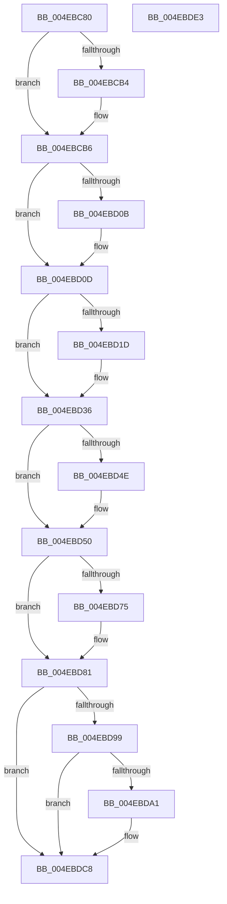

# ST_STORE&lt;SM_TRAITS&gt;::StDmCombinePageRecords

- RVA: `0x004EBC80`–`0x004EBDE4` (길이 `356` bytes)
- VA: `0x00000001404EBC80`
- 실행 섹션: `.text`
- PDB 이름 있음: `예`; PDB Function 태그: `아니요`
- unwind 정보 RVA: `0x0005E6B4`
- 디코드: `90`개 명령, `356/356` bytes 표시
- 미해석 바이트: `0` (있으면 어셈블리에 `.byte`로 보존)

> 이 문서는 커널 이미지의 기계어와 PDB 기호를 분석해 생성했습니다. 4번과 5번은 함수 원형과 자료형을 바이너리 사용 방식에서 추정한 C 해석이며 원본 소스 복구 결과는 아닙니다.

## 1. Dependencies

- 직접 호출 지점: **6**; 고유 호출 대상: **5**
- 직접 호출자로 확인된 함수: **1**
- RIP 상대 이미지 참조: **0**

### Outgoing calls
- `0x004EBCE9` → [ST_STORE<SM_TRAITS>::StDmPageRecordUnprotect](../26/ST_STORE_SM_TRAITS_StDmPageRecordUnprotect_function_00268B30.md) (function, `0x00268B30`)
- `0x004EBCF4` → [ST_STORE<SM_TRAITS>::StDmPageRecordUnprotect](../26/ST_STORE_SM_TRAITS_StDmPageRecordUnprotect_function_00268B30.md) (function, `0x00268B30`)
- `0x004EBD02` → [ST_STORE<SM_TRAITS>::StDmPageRecordRemove](../3A/ST_STORE_SM_TRAITS_StDmPageRecordRemove_function_003AD400.md) (function, `0x003AD400`)
- `0x004EBD24` → [StLockAcquireExclusive](../26/StLockAcquireExclusive_function_00266FF0.md) (function, `0x00266FF0`)
- `0x004EBD7C` → [StLockReleaseExclusive](../26/StLockReleaseExclusive_function_00267050.md) (function, `0x00267050`)
- `0x004EBDC3` → [ST_STORE<SM_TRAITS>::StLazyWorkMgrQueueWork](../41/ST_STORE_SM_TRAITS_StLazyWorkMgrQueueWork_function_00411800.md) (function, `0x00411800`)

### Direct callers
- [ST_STORE&lt;SM_TRAITS&gt;::StDmCombineBufferProcess](ST_STORE_SM_TRAITS_StDmCombineBufferProcess_function_004EB9AC.md) at `0x004EBC58`

### Static image references
- 디코드된 RIP-relative 메모리 참조가 없습니다.

## 2. Other-region calls and transfers

- 다른 실행 섹션으로 향하는 call: **0**
- 별도 외부 분기/꼬리 이동을 확인하지 못했습니다.

## 3. Assembly (complete function range)

```asm
004EBC80  48 8B C4                        mov rax, rsp
004EBC83  48 89 58 08                     mov qword ptr [rax + 8], rbx
004EBC87  48 89 68 10                     mov qword ptr [rax + 0x10], rbp
004EBC8B  48 89 70 18                     mov qword ptr [rax + 0x18], rsi
004EBC8F  48 89 78 20                     mov qword ptr [rax + 0x20], rdi
004EBC93  41 56                           push r14
004EBC95  48 83 EC 20                     sub rsp, 0x20
004EBC99  8B 42 04                        mov eax, dword ptr [rdx + 4]
004EBC9C  49 8B E9                        mov rbp, r9
004EBC9F  25 00 F0 FF FF                  and eax, 0xfffff000
004EBCA4  49 8B F8                        mov rdi, r8
004EBCA7  48 8B F2                        mov rsi, rdx
004EBCAA  48 8B D9                        mov rbx, rcx
004EBCAD  3D 00 10 00 00                  cmp eax, 0x1000
004EBCB2  74 02                           je 0x1404ebcb6
004EBCB4  CD 2C                           int 0x2c
004EBCB6  33 D2                           xor edx, edx
004EBCB8  8B C5                           mov eax, ebp
004EBCBA  2B 81 D8 01 00 00               sub eax, dword ptr [rcx + 0x1d8]
004EBCC0  4C 8B C5                        mov r8, rbp
004EBCC3  49 81 E0 00 F0 FF FF            and r8, 0xfffffffffffff000
004EBCCA  41 2B C0                        sub eax, r8d
004EBCCD  F7 B1 D0 01 00 00               div dword ptr [rcx + 0x1d0]
004EBCD3  8B 89 C8 01 00 00               mov ecx, dword ptr [rcx + 0x1c8]
004EBCD9  48 8B D6                        mov rdx, rsi
004EBCDC  45 8B 70 10                     mov r14d, dword ptr [r8 + 0x10]
004EBCE0  41 D3 E6                        shl r14d, cl
004EBCE3  48 8B CB                        mov rcx, rbx
004EBCE6  44 03 F0                        add r14d, eax
004EBCE9  E8 42 CE D7 FF                  call 0x140268b30
004EBCEE  48 8B D5                        mov rdx, rbp
004EBCF1  48 8B CB                        mov rcx, rbx
004EBCF4  E8 37 CE D7 FF                  call 0x140268b30
004EBCF9  4C 8B C7                        mov r8, rdi
004EBCFC  48 8B D6                        mov rdx, rsi
004EBCFF  48 8B CB                        mov rcx, rbx
004EBD02  E8 F9 16 EC FF                  call 0x1403ad400
004EBD07  85 C0                           test eax, eax
004EBD09  79 02                           jns 0x1404ebd0d
004EBD0B  CD 2C                           int 0x2c
004EBD0D  48 8B BB 20 03 00 00            mov rdi, qword ptr [rbx + 0x320]
004EBD14  F6 87 95 1A 00 00 04            test byte ptr [rdi + 0x1a95], 4
004EBD1B  74 19                           je 0x1404ebd36
004EBD1D  48 8D 8F B0 1A 00 00            lea rcx, [rdi + 0x1ab0]
004EBD24  E8 C7 B2 D7 FF                  call 0x140266ff0
004EBD29  48 FF 87 C0 1A 00 00            inc qword ptr [rdi + 0x1ac0]
004EBD30  89 87 B8 1A 00 00               mov dword ptr [rdi + 0x1ab8], eax
004EBD36  83 0E FF                        or dword ptr [rsi], 0xffffffff
004EBD39  44 89 76 04                     mov dword ptr [rsi + 4], r14d
004EBD3D  8B 55 04                        mov edx, dword ptr [rbp + 4]
004EBD40  8B C2                           mov eax, edx
004EBD42  25 00 F0 FF FF                  and eax, 0xfffff000
004EBD47  3D 00 F0 FF FF                  cmp eax, 0xfffff000
004EBD4C  72 02                           jb 0x1404ebd50
004EBD4E  CD 2C                           int 0x2c
004EBD50  8D 82 00 10 00 00               lea eax, [rdx + 0x1000]
004EBD56  8B C8                           mov ecx, eax
004EBD58  33 CA                           xor ecx, edx
004EBD5A  81 E1 FF 0F 00 00               and ecx, 0xfff
004EBD60  33 C8                           xor ecx, eax
004EBD62  89 4D 04                        mov dword ptr [rbp + 4], ecx
004EBD65  48 8B 8B 20 03 00 00            mov rcx, qword ptr [rbx + 0x320]
004EBD6C  F6 81 95 1A 00 00 04            test byte ptr [rcx + 0x1a95], 4
004EBD73  74 0C                           je 0x1404ebd81
004EBD75  48 81 C1 B0 1A 00 00            add rcx, 0x1ab0
004EBD7C  E8 CF B2 D7 FF                  call 0x140267050
004EBD81  8B 8B E0 08 00 00               mov ecx, dword ptr [rbx + 0x8e0]
004EBD87  8A 83 E9 08 00 00               mov al, byte ptr [rbx + 0x8e9]
004EBD8D  FF C1                           inc ecx
004EBD8F  89 8B E0 08 00 00               mov dword ptr [rbx + 0x8e0], ecx
004EBD95  A8 03                           test al, 3
004EBD97  75 2F                           jne 0x1404ebdc8
004EBD99  81 F9 00 04 00 00               cmp ecx, 0x400
004EBD9F  76 27                           jbe 0x1404ebdc8
004EBDA1  48 8B 8B F0 08 00 00            mov rcx, qword ptr [rbx + 0x8f0]
004EBDA8  24 FD                           and al, 0xfd
004EBDAA  0C 01                           or al, 1
004EBDAC  BA 05 00 00 00                  mov edx, 5
004EBDB1  41 B9 FE FF FF FF               mov r9d, 0xfffffffe
004EBDB7  88 83 E9 08 00 00               mov byte ptr [rbx + 0x8e9], al
004EBDBD  41 B8 30 75 00 00               mov r8d, 0x7530
004EBDC3  E8 38 5A F2 FF                  call 0x140411800
004EBDC8  48 8B 5C 24 30                  mov rbx, qword ptr [rsp + 0x30]
004EBDCD  48 8B 6C 24 38                  mov rbp, qword ptr [rsp + 0x38]
004EBDD2  48 8B 74 24 40                  mov rsi, qword ptr [rsp + 0x40]
004EBDD7  48 8B 7C 24 48                  mov rdi, qword ptr [rsp + 0x48]
004EBDDC  48 83 C4 20                     add rsp, 0x20
004EBDE0  41 5E                           pop r14
004EBDE2  C3                              ret
004EBDE3  CC                              int3
```

## 4. C-style interpretation (structured pseudocode)

```c
__int64 __fastcall ST_STORE_SM_TRAITS___StDmCombinePageRecords(__int64 a1, __int64 a2, __int64 a3, __int64 a4)
{
    __int64 result;
    __int64 v_r14;
    __int64 v_rsp;
    unsigned __int64 v_stack_p10;
    unsigned __int64 v_stack_p18;
    unsigned __int64 v_stack_p20;
    unsigned __int64 v_stack_p8;

    *(unsigned __int64 *)(v_rsp + 8) = v_rbx;
    *(unsigned __int64 *)(v_rsp + 16) = v_rbp;
    *(unsigned __int64 *)(v_rsp + 24) = v_rsi;
    *(unsigned __int64 *)(v_rsp + 32) = v_rdi;
    v_rsp = (v_rsp) - (32);
    result = (unsigned int)(((unsigned int)(*(unsigned int *)(a2 + 4))) & (0xFFFFF000ULL));
    if (((unsigned int)(result)) != 0x1000ULL) {
    }
    a2 = 0;
    result = (unsigned int)(((unsigned int)((unsigned int)(a4))) - (*(unsigned int *)(a1 + 472)));
    a3 = (a4) & (0xFFFFFFFFFFFFF000ULL);
    result = (unsigned int)((result) - ((unsigned int)(a3)));
    v_r14 = (unsigned int)(((unsigned int)(*(unsigned int *)(a3 + 16))) << ((unsigned __int8)((unsigned int)(*(unsigned int *)(a1 + 456)))));
    v_r14 = (unsigned int)((v_r14) + ((unsigned int)(result)));
    result = ST_STORE_SM_TRAITS___StDmPageRecordUnprotect(a1, 0, a3, a4);
    result = ST_STORE_SM_TRAITS___StDmPageRecordUnprotect(a1, a4, a3, a4);
    result = ST_STORE_SM_TRAITS___StDmPageRecordRemove(a1, 0, a3, a4);
    if (sign_flag) {
    }
    if (((*(unsigned __int8 *)(*(unsigned __int64 *)(a1 + 800) + 6805)) & (4)) != 0) {
        a1 = *(unsigned __int64 *)(a1 + 800) + 6832;
        result = StLockAcquireExclusive(a1, 0, a3, a4);
        *(unsigned int *)(*(unsigned __int64 *)(a1 + 800) + 6840) = (unsigned int)(result);
    }
    *(unsigned int *)(a2 + 4) = (unsigned int)(v_r14);
    result = (unsigned int)(((unsigned int)((unsigned int)((unsigned int)(*(unsigned int *)(a4 + 4))))) & (0xFFFFF000ULL));
    if (((unsigned int)(result)) >= 0xFFFFF000ULL) {
    }
    a1 = (unsigned int)(((unsigned int)((unsigned int)((unsigned int)(*(unsigned int *)(a4 + 4)) + 4096))) ^ ((unsigned int)((unsigned int)(*(unsigned int *)(a4 + 4)))));
    a1 = (unsigned int)((a1) & (0xFFFULL));
    a1 = (unsigned int)((a1) ^ ((unsigned int)((unsigned int)(*(unsigned int *)(a4 + 4)) + 4096)));
    *(unsigned int *)(a4 + 4) = (unsigned int)(a1);
    result = (unsigned int)(*(unsigned int *)(a4 + 4)) + 4096;
    if (((*(unsigned __int8 *)(*(unsigned __int64 *)(a1 + 800) + 6805)) & (4)) != 0) {
        a1 = (*(unsigned __int64 *)(a1 + 800)) + (0x1AB0ULL);
        result = StLockReleaseExclusive(a1, (unsigned int)(*(unsigned int *)(a4 + 4)), a3, a4);
    }
    a1 = (unsigned int)(((unsigned int)(*(unsigned int *)(a1 + 2272))) + 1);
    *(unsigned int *)(a1 + 2272) = (unsigned int)(a1);
    if ((((unsigned __int8)(*(unsigned __int8 *)(a1 + 2281))) & (3)) != 0) goto loc_004EBDC8;
    result = *(unsigned __int8 *)(a1 + 2281);
    if (((unsigned int)(a1)) >= = 0x400ULL) {
        a1 = *(unsigned __int64 *)(a1 + 2288);
        result = (unsigned __int8)((*(unsigned __int8 *)(a1 + 2281)) & (253));
        result = (unsigned __int8)((result) | (1));
        a2 = 5;
        a4 = 0xFFFFFFFEULL;
        *(unsigned __int8 *)(a1 + 2281) = (unsigned __int8)(result);
        a3 = 0x7530ULL;
        result = ST_STORE_SM_TRAITS___StLazyWorkMgrQueueWork(a1, a2, a3, a4);
    }
    v_rsp = (v_rsp) + (32);
    return result;
}
```

## 5. (Beta) C Style

```c
int64_t ST_STORE_SM_TRAITS___StDmCombinePageRecords(void *Arg1, void *Arg2, int64_t Arg3, void *Arg4)
{
    uint8_t *arg1 = (uint8_t *)Arg1;
    uint8_t *arg2 = (uint8_t *)Arg2;
    uint8_t *arg4 = (uint8_t *)Arg4;

    int64_t result;
    int64_t local_r14;
    int64_t local_rsp;
    uint64_t v_stack_p10;
    uint64_t v_stack_p18;
    uint64_t v_stack_p20;
    uint64_t v_stack_p8;

    *(uint64_t *)(local_rsp + 0x8) = local_rbx;
    *(uint64_t *)(local_rsp + 0x10) = local_rbp;
    *(uint64_t *)(local_rsp + 0x18) = local_rsi;
    *(uint64_t *)(local_rsp + 0x20) = local_rdi;
    local_rsp = (local_rsp) - (32);
    result = (uint32_t)(((uint32_t)(*(uint32_t *)(arg2 + 0x4))) & (0xFFFFF000ULL));
    if (((uint32_t)(result)) != 0x1000ULL) {
    }
    Arg2 = 0;
    result = (uint32_t)(((uint32_t)((uint32_t)(Arg4))) - (*(uint32_t *)(arg1 + 0x1D8)));
    Arg3 = (Arg4) & (0xFFFFFFFFFFFFF000ULL);
    result = (uint32_t)((result) - ((uint32_t)(Arg3)));
    local_r14 = (uint32_t)(((uint32_t)(*(uint32_t *)(Arg3 + 0x10))) << ((uint8_t)((uint32_t)(*(uint32_t *)(arg1 + 0x1C8)))));
    local_r14 = (uint32_t)((local_r14) + ((uint32_t)(result)));
    result = ST_STORE_SM_TRAITS___StDmPageRecordUnprotect(Arg1, 0, Arg3, Arg4);
    result = ST_STORE_SM_TRAITS___StDmPageRecordUnprotect(Arg1, Arg4, Arg3, Arg4);
    result = ST_STORE_SM_TRAITS___StDmPageRecordRemove(Arg1, 0, Arg3, Arg4);
    if (sign_flag) {
    }
    if (((*(uint8_t *)(*(uint64_t *)(arg1 + 0x320) + 0x1A95)) & (4)) != 0) {
        Arg1 = *(uint64_t *)(arg1 + 0x320) + 6832;
        result = StLockAcquireExclusive(Arg1, 0, Arg3, Arg4);
        *(uint32_t *)(*(uint64_t *)(arg1 + 0x320) + 0x1AB8) = (uint32_t)(result);
    }
    *(uint32_t *)(arg2 + 0x4) = (uint32_t)(local_r14);
    result = (uint32_t)(((uint32_t)((uint32_t)((uint32_t)(*(uint32_t *)(arg4 + 0x4))))) & (0xFFFFF000ULL));
    if (((uint32_t)(result)) >= 0xFFFFF000ULL) {
    }
    Arg1 = (uint32_t)(((uint32_t)((uint32_t)((uint32_t)(*(uint32_t *)(arg4 + 0x4)) + 4096))) ^ ((uint32_t)((uint32_t)(*(uint32_t *)(arg4 + 0x4)))));
    Arg1 = (uint32_t)((Arg1) & (0xFFFULL));
    Arg1 = (uint32_t)((Arg1) ^ ((uint32_t)((uint32_t)(*(uint32_t *)(arg4 + 0x4)) + 4096)));
    *(uint32_t *)(arg4 + 0x4) = (uint32_t)(Arg1);
    result = (uint32_t)(*(uint32_t *)(arg4 + 0x4)) + 4096;
    if (((*(uint8_t *)(*(uint64_t *)(arg1 + 0x320) + 0x1A95)) & (4)) != 0) {
        Arg1 = (*(uint64_t *)(arg1 + 0x320)) + (0x1AB0ULL);
        result = StLockReleaseExclusive(Arg1, (uint32_t)(*(uint32_t *)(arg4 + 0x4)), Arg3, Arg4);
    }
    Arg1 = (uint32_t)(((uint32_t)(*(uint32_t *)(arg1 + 0x8E0))) + 1);
    *(uint32_t *)(arg1 + 0x8E0) = (uint32_t)(Arg1);
    if ((((uint8_t)(*(uint8_t *)(arg1 + 0x8E9))) & (3)) != 0) goto loc_004EBDC8;
    result = *(uint8_t *)(arg1 + 0x8E9);
    if (((uint32_t)(Arg1)) >= = 0x400ULL) {
        Arg1 = *(uint64_t *)(arg1 + 0x8F0);
        result = (uint8_t)((*(uint8_t *)(arg1 + 0x8E9)) & (253));
        result = (uint8_t)((result) | (1));
        Arg2 = 5;
        Arg4 = 0xFFFFFFFEULL;
        *(uint8_t *)(arg1 + 0x8E9) = (uint8_t)(result);
        Arg3 = 0x7530ULL;
        result = ST_STORE_SM_TRAITS___StLazyWorkMgrQueueWork(Arg1, Arg2, Arg3, Arg4);
    }
    local_rsp = (local_rsp) + (32);
    return result;
}
```

### 관측된 메모리 오프셋

구조체 형식이 확인되지 않은 접근은 인자 기준의 오프셋으로만 기록했습니다.

| 기준 인자 | 오프셋 표현 | 폭 (bit) | 접근 |
|---|---:|---:|---|
| `Arg1` | `+ 0x1C8` | `32` | `R` |
| `Arg1` | `+ 0x1D0` | `32` | `R` |
| `Arg1` | `+ 0x1D8` | `32` | `R` |
| `Arg1` | `+ 0x320` | `64` | `R` |
| `Arg1` | `+ 0x8E0` | `32` | `R` |
| `Arg1` | `+ 0x8E0` | `32` | `W` |
| `Arg1` | `+ 0x8E9` | `8` | `R` |
| `Arg1` | `+ 0x8E9` | `8` | `W` |
| `Arg1` | `+ 0x8F0` | `64` | `R` |
| `Arg2` | `+ 0x0` | `32` | `R/W` |
| `Arg2` | `+ 0x4` | `32` | `R` |
| `Arg2` | `+ 0x4` | `32` | `W` |
| `Arg4` | `+ 0x4` | `32` | `R` |
| `Arg4` | `+ 0x4` | `32` | `W` |
| `Arg4` | `+ 0x10` | `32` | `R` |

## 6. Execution-region graph

[열기: 2D/3D 그래프와 함수 탐색 컨트롤 패널](../../../control-panel.html?section=text&rva=0x004EBC80&view=graph)

- 2D 그래프는 위에서 아래로 흐르고, 3D 그래프는 빈 공간을 드래그해 회전합니다. Shift+드래그는 이동, 휠은 확대·축소, 함수 노드 선택은 대상 보고서 이동입니다.

### Static fallback


