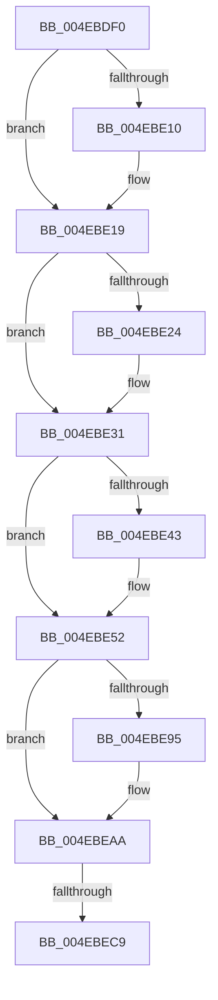

# ST_STORE&lt;SM_TRAITS&gt;::StDmpSinglePageInsert

- RVA: `0x004EBDF0`–`0x004EBED8` (길이 `232` bytes)
- VA: `0x00000001404EBDF0`
- 실행 섹션: `.text`
- PDB 이름 있음: `예`; PDB Function 태그: `아니요`
- unwind 정보 RVA: `0x000D18C4`
- 디코드: `62`개 명령, `232/232` bytes 표시
- 미해석 바이트: `0` (있으면 어셈블리에 `.byte`로 보존)

> 이 문서는 커널 이미지의 기계어와 PDB 기호를 분석해 생성했습니다. 4번과 5번은 함수 원형과 자료형을 바이너리 사용 방식에서 추정한 C 해석이며 원본 소스 복구 결과는 아닙니다.

## 1. Dependencies

- 직접 호출 지점: **4**; 고유 호출 대상: **4**
- 직접 호출자로 확인된 함수: **1**
- RIP 상대 이미지 참조: **0**

### Outgoing calls
- `0x004EBE14` → [B_TREE<_SM_PAGE_KEY,ST_STORE<SM_TRAITS>::_ST_PAGE_ENTRY,4096,NP_CONTEXT,B_TREE_KEY_COMPARATOR<_SM_PAGE_KEY> >::BTreeSearchResultDeref](../3A/B_TREE__SM_PAGE_KEY_ST_STORE_SM_TRAITS__ST_PAGE_ENTRY_4096_NP_CONTEXT_B_TREE_KEY_COMPARATOR__SM_PAGE_function_003AC5D0.md) (function, `0x003AC5D0`)
- `0x004EBE2C` → [B_TREE<unsigned long,ST_STORE<SM_TRAITS>::_ST_REGION_ENTRY,4096,NP_CONTEXT,ST_STORE<SM_TRAITS>::ST_REGION_ENTRY_COMPARATOR>::BTreeSearchResultDeref](../3A/B_TREE_unsigned_long_ST_STORE_SM_TRAITS__ST_REGION_ENTRY_4096_NP_CONTEXT_ST_STORE_SM_TRAITS_ST_REGIO_function_003AD260.md) (function, `0x003AD260`)
- `0x004EBE4D` → [B_TREE<unsigned long,ST_STORE<SM_TRAITS>::_ST_HASH_ENTRY,4096,NP_CONTEXT,ST_STORE<SM_TRAITS>::ST_HASH_ENTRY_COMPARATOR>::BTreeSearchResultDeref](../3A/B_TREE_unsigned_long_ST_STORE_SM_TRAITS__ST_HASH_ENTRY_4096_NP_CONTEXT_ST_STORE_SM_TRAITS_ST_HASH_EN_function_003AE310.md) (function, `0x003AE310`)
- `0x004EBEBC` → [B_TREE<unsigned long,ST_STORE<SM_TRAITS>::_ST_REGION_ENTRY,4096,NP_CONTEXT,ST_STORE<SM_TRAITS>::ST_REGION_ENTRY_COMPARATOR>::BTreeInsert](../3A/B_TREE_unsigned_long_ST_STORE_SM_TRAITS__ST_REGION_ENTRY_4096_NP_CONTEXT_ST_STORE_SM_TRAITS_ST_REGIO_function_003AC820.md) (function, `0x003AC820`)

### Direct callers
- [ST_STORE&lt;SM_TRAITS&gt;::StDmpSinglePageAdd](../20/ST_STORE_SM_TRAITS_StDmpSinglePageAdd_function_0020502C.md) at `0x002053E9`

### Static image references
- 디코드된 RIP-relative 메모리 참조가 없습니다.

## 2. Other-region calls and transfers

- 다른 실행 섹션으로 향하는 call: **0**
- call이 아닌 외부 분기/꼬리 이동: **1**
  - `0x004EBEC3` → [sub_004EBF54](Unknown_function_004EBF54.md) (`tail-transfer`)

## 3. Assembly (complete function range)

```asm
004EBDF0  40 53                           push rbx
004EBDF2  55                              push rbp
004EBDF3  57                              push rdi
004EBDF4  41 54                           push r12
004EBDF6  41 55                           push r13
004EBDF8  41 56                           push r14
004EBDFA  41 57                           push r15
004EBDFC  48 83 EC 50                     sub rsp, 0x50
004EBE00  8B 41 38                        mov eax, dword ptr [rcx + 0x38]
004EBE03  4D 8B F0                        mov r14, r8
004EBE06  4C 8B EA                        mov r13, rdx
004EBE09  48 8B F9                        mov rdi, rcx
004EBE0C  A8 01                           test al, 1
004EBE0E  74 09                           je 0x1404ebe19
004EBE10  48 8D 51 18                     lea rdx, [rcx + 0x18]
004EBE14  E8 B7 07 EC FF                  call 0x1403ac5d0
004EBE19  83 67 38 FE                     and dword ptr [rdi + 0x38], 0xfffffffe
004EBE1D  8B 47 78                        mov eax, dword ptr [rdi + 0x78]
004EBE20  A8 01                           test al, 1
004EBE22  74 0D                           je 0x1404ebe31
004EBE24  48 8D 4F 40                     lea rcx, [rdi + 0x40]
004EBE28  48 8D 57 58                     lea rdx, [rdi + 0x58]
004EBE2C  E8 2F 14 EC FF                  call 0x1403ad260
004EBE31  83 67 78 FE                     and dword ptr [rdi + 0x78], 0xfffffffe
004EBE35  48 8D AF 98 00 00 00            lea rbp, [rdi + 0x98]
004EBE3C  8B 45 20                        mov eax, dword ptr [rbp + 0x20]
004EBE3F  A8 01                           test al, 1
004EBE41  74 0F                           je 0x1404ebe52
004EBE43  48 8D 8F 80 00 00 00            lea rcx, [rdi + 0x80]
004EBE4A  48 8B D5                        mov rdx, rbp
004EBE4D  E8 BE 24 EC FF                  call 0x1403ae310
004EBE52  83 65 20 FE                     and dword ptr [rbp + 0x20], 0xfffffffe
004EBE56  33 D2                           xor edx, edx
004EBE58  8B 8F D8 01 00 00               mov ecx, dword ptr [rdi + 0x1d8]
004EBE5E  4D 8B CE                        mov r9, r14
004EBE61  49 81 E1 00 F0 FF FF            and r9, 0xfffffffffffff000
004EBE68  41 8B C6                        mov eax, r14d
004EBE6B  49 03 C9                        add rcx, r9
004EBE6E  41 BC FF 0F 00 00               mov r12d, 0xfff
004EBE74  2B C1                           sub eax, ecx
004EBE76  8B 8F C8 01 00 00               mov ecx, dword ptr [rdi + 0x1c8]
004EBE7C  F7 B7 D0 01 00 00               div dword ptr [rdi + 0x1d0]
004EBE82  45 8B 79 10                     mov r15d, dword ptr [r9 + 0x10]
004EBE86  41 D3 E7                        shl r15d, cl
004EBE89  44 03 F8                        add r15d, eax
004EBE8C  80 BF 08 03 00 00 00            cmp byte ptr [rdi + 0x308], 0
004EBE93  75 15                           jne 0x1404ebeaa
004EBE95  41 8B 4E 04                     mov ecx, dword ptr [r14 + 4]
004EBE99  8D 81 00 10 00 00               lea eax, [rcx + 0x1000]
004EBE9F  33 C8                           xor ecx, eax
004EBEA1  41 23 CC                        and ecx, r12d
004EBEA4  33 C8                           xor ecx, eax
004EBEA6  41 89 4E 04                     mov dword ptr [r14 + 4], ecx
004EBEAA  48 8D 4F 40                     lea rcx, [rdi + 0x40]
004EBEAE  44 89 7C 24 40                  mov dword ptr [rsp + 0x40], r15d
004EBEB3  4C 8D 47 58                     lea r8, [rdi + 0x58]
004EBEB7  48 8D 54 24 40                  lea rdx, [rsp + 0x40]
004EBEBC  E8 5F 09 EC FF                  call 0x1403ac820
004EBEC1  85 C0                           test eax, eax
004EBEC3  0F 88 8B 00 00 00               js 0x1404ebf54
004EBEC9  F7 87 08 03 00 00 00 00 10 00   test dword ptr [rdi + 0x308], 0x100000
004EBED3  BB 02 00 00 00                  mov ebx, 2
```

## 4. C-style interpretation (structured pseudocode)

```c
__int64 __fastcall ST_STORE_SM_TRAITS___StDmpSinglePageInsert(__int64 a1, __int64 a2, __int64 a3)
{
    __int64 result;
    __int64 v_r15;
    __int64 v_rsp;
    unsigned int v_stack_m48;

    v_rsp = (v_rsp) - (80);
    result = (unsigned int)(*(unsigned int *)(a1 + 56));
    if ((((unsigned __int8)((unsigned int)(*(unsigned int *)(a1 + 56)))) & (1)) != 0) {
        a2 = a1 + 24;
        result = B_TREE__SM_PAGE_KEY_ST_STORE_SM_TRAITS____ST_PAGE_ENTRY_4096_NP_CONTEXT_B_TREE_KEY_COMPARATOR__SM_PA(a1, a2, a3, a4);
    }
    result = (unsigned int)(*(unsigned int *)(a1 + 120));
    if ((((unsigned __int8)((unsigned int)(*(unsigned int *)(a1 + 120)))) & (1)) != 0) {
        a1 = a1 + 64;
        a2 = a1 + 88;
        result = B_TREE_unsigned_long_ST_STORE_SM_TRAITS____ST_REGION_ENTRY_4096_NP_CONTEXT_ST_STORE_SM_TRAITS___ST_R(a1, a2, a3, a4);
    }
    result = (unsigned int)(*(unsigned int *)(a1 + 152 + 32));
    if ((((unsigned __int8)((unsigned int)(*(unsigned int *)(a1 + 152 + 32)))) & (1)) != 0) {
        a1 = a1 + 128;
        a2 = a1 + 152;
        result = B_TREE_unsigned_long_ST_STORE_SM_TRAITS____ST_HASH_ENTRY_4096_NP_CONTEXT_ST_STORE_SM_TRAITS___ST_HAS(a1, a2, a3, a4);
    }
    a2 = 0;
    a4 = (a3) & (0xFFFFFFFFFFFFF000ULL);
    a1 = ((unsigned int)(*(unsigned int *)(a1 + 472))) + (a4);
    result = (unsigned int)(((unsigned int)((unsigned int)(a3))) - ((unsigned int)(a1)));
    v_r15 = (unsigned int)(((unsigned int)(*(unsigned int *)(a4 + 16))) << ((unsigned __int8)((unsigned int)(*(unsigned int *)(a1 + 456)))));
    v_r15 = (unsigned int)((v_r15) + ((unsigned int)(result)));
    if ((*(unsigned __int8 *)(a1 + 776)) == 0) {
        a1 = *(unsigned int *)(a3 + 4);
        result = a1 + 4096;
        a1 = (unsigned int)((a1) ^ ((unsigned int)(result)));
        a1 = (unsigned int)((a1) & ((unsigned int)((unsigned int)(0xFFFULL))));
        a1 = (unsigned int)((a1) ^ ((unsigned int)(result)));
        *(unsigned int *)(a3 + 4) = (unsigned int)(a1);
    }
    v_stack_m48 = (unsigned int)(v_r15);
    result = B_TREE_unsigned_long_ST_STORE_SM_TRAITS____ST_REGION_ENTRY_4096_NP_CONTEXT_ST_STORE_SM_TRAITS___ST_R(a1 + 64, v_stack_m48, a1 + 88, a4);
    return result;
}
```

## 5. (Beta) C Style

```c
int64_t ST_STORE_SM_TRAITS___StDmpSinglePageInsert(void *Arg1, int64_t Arg2, void *Arg3)
{
    uint8_t *arg1 = (uint8_t *)Arg1;
    uint8_t *arg3 = (uint8_t *)Arg3;

    int64_t result;
    int64_t local_r15;
    int64_t local_rsp;
    uint32_t v_stack_m48;

    local_rsp = (local_rsp) - (80);
    result = (uint32_t)(*(uint32_t *)(arg1 + 0x38));
    if ((((uint8_t)((uint32_t)(*(uint32_t *)(arg1 + 0x38)))) & (1)) != 0) {
        Arg2 = Arg1 + 24;
        result = B_TREE__SM_PAGE_KEY_ST_STORE_SM_TRAITS____ST_PAGE_ENTRY_4096_NP_CONTEXT_B_TREE_KEY_COMPARATOR__SM_PA(Arg1, Arg2, Arg3, a4);
    }
    result = (uint32_t)(*(uint32_t *)(arg1 + 0x78));
    if ((((uint8_t)((uint32_t)(*(uint32_t *)(arg1 + 0x78)))) & (1)) != 0) {
        Arg1 = Arg1 + 64;
        Arg2 = Arg1 + 88;
        result = B_TREE_unsigned_long_ST_STORE_SM_TRAITS____ST_REGION_ENTRY_4096_NP_CONTEXT_ST_STORE_SM_TRAITS___ST_R(Arg1, Arg2, Arg3, a4);
    }
    result = (uint32_t)(*(uint32_t *)(arg1 + 0x98 + 0x20));
    if ((((uint8_t)((uint32_t)(*(uint32_t *)(arg1 + 0x98 + 0x20)))) & (1)) != 0) {
        Arg1 = Arg1 + 128;
        Arg2 = Arg1 + 152;
        result = B_TREE_unsigned_long_ST_STORE_SM_TRAITS____ST_HASH_ENTRY_4096_NP_CONTEXT_ST_STORE_SM_TRAITS___ST_HAS(Arg1, Arg2, Arg3, a4);
    }
    Arg2 = 0;
    a4 = (Arg3) & (0xFFFFFFFFFFFFF000ULL);
    Arg1 = ((uint32_t)(*(uint32_t *)(arg1 + 0x1D8))) + (a4);
    result = (uint32_t)(((uint32_t)((uint32_t)(Arg3))) - ((uint32_t)(Arg1)));
    local_r15 = (uint32_t)(((uint32_t)(*(uint32_t *)(a4 + 0x10))) << ((uint8_t)((uint32_t)(*(uint32_t *)(arg1 + 0x1C8)))));
    local_r15 = (uint32_t)((local_r15) + ((uint32_t)(result)));
    if ((*(uint8_t *)(arg1 + 0x308)) == 0) {
        Arg1 = *(uint32_t *)(arg3 + 0x4);
        result = Arg1 + 4096;
        Arg1 = (uint32_t)((Arg1) ^ ((uint32_t)(result)));
        Arg1 = (uint32_t)((Arg1) & ((uint32_t)((uint32_t)(0xFFFULL))));
        Arg1 = (uint32_t)((Arg1) ^ ((uint32_t)(result)));
        *(uint32_t *)(arg3 + 0x4) = (uint32_t)(Arg1);
    }
    v_stack_m48 = (uint32_t)(local_r15);
    result = B_TREE_unsigned_long_ST_STORE_SM_TRAITS____ST_REGION_ENTRY_4096_NP_CONTEXT_ST_STORE_SM_TRAITS___ST_R(Arg1 + 64, v_stack_m48, Arg1 + 88, a4);
    return result;
}
```

### 관측된 메모리 오프셋

구조체 형식이 확인되지 않은 접근은 인자 기준의 오프셋으로만 기록했습니다.

| 기준 인자 | 오프셋 표현 | 폭 (bit) | 접근 |
|---|---:|---:|---|
| `Arg1` | `+ 0x18` | `64` | `R` |
| `Arg1` | `+ 0x20` | `32` | `R` |
| `Arg1` | `+ 0x20` | `32` | `R/W` |
| `Arg1` | `+ 0x38` | `32` | `R` |
| `Arg1` | `+ 0x38` | `32` | `R/W` |
| `Arg1` | `+ 0x40` | `64` | `R` |
| `Arg1` | `+ 0x58` | `64` | `R` |
| `Arg1` | `+ 0x78` | `32` | `R` |
| `Arg1` | `+ 0x78` | `32` | `R/W` |
| `Arg1` | `+ 0x80` | `64` | `R` |
| `Arg1` | `+ 0x98` | `64` | `R` |
| `Arg1` | `+ 0x1C8` | `32` | `R` |
| `Arg1` | `+ 0x1D0` | `32` | `R` |
| `Arg1` | `+ 0x1D8` | `32` | `R` |
| `Arg1` | `+ 0x308` | `8` | `R` |
| `Arg1` | `+ 0x308` | `32` | `R` |
| `Arg3` | `+ 0x4` | `32` | `R` |
| `Arg3` | `+ 0x4` | `32` | `W` |
| `Arg3` | `+ 0x10` | `32` | `R` |

## 6. Execution-region graph

[열기: 2D/3D 그래프와 함수 탐색 컨트롤 패널](../../../control-panel.html?section=text&rva=0x004EBDF0&view=graph)

- 2D 그래프는 위에서 아래로 흐르고, 3D 그래프는 빈 공간을 드래그해 회전합니다. Shift+드래그는 이동, 휠은 확대·축소, 함수 노드 선택은 대상 보고서 이동입니다.

### Static fallback


