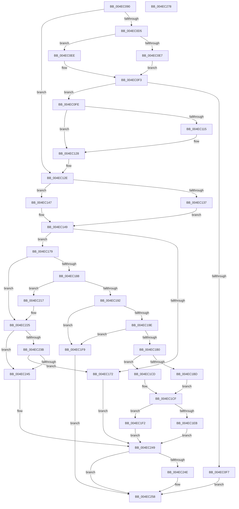

# ST_STORE&lt;SM_TRAITS&gt;::StMapAndLockRegion

- RVA: `0x004EC090`–`0x004EC279` (길이 `489` bytes)
- VA: `0x00000001404EC090`
- 실행 섹션: `.text`
- PDB 이름 있음: `예`; PDB Function 태그: `아니요`
- unwind 정보 RVA: `0x0008C20C`
- 디코드: `128`개 명령, `489/489` bytes 표시
- 미해석 바이트: `0` (있으면 어셈블리에 `.byte`로 보존)

> 이 문서는 커널 이미지의 기계어와 PDB 기호를 분석해 생성했습니다. 4번과 5번은 함수 원형과 자료형을 바이너리 사용 방식에서 추정한 C 해석이며 원본 소스 복구 결과는 아닙니다.

## 1. Dependencies

- 직접 호출 지점: **10**; 고유 호출 대상: **9**
- 직접 호출자로 확인된 함수: **3**
- RIP 상대 이미지 참조: **0**

### Outgoing calls
- `0x004EC0E7` → [SMKM_STORE<SM_TRAITS>::SmStAllocateVirtualRegion](../3B/SMKM_STORE_SM_TRAITS_SmStAllocateVirtualRegion_function_003B0464.md) (function, `0x003B0464`)
- `0x004EC0EE` → [SMKM_STORE<SM_TRAITS>::SmStAllocatePhysicalRegion](../60/SMKM_STORE_SM_TRAITS_SmStAllocatePhysicalRegion_function_0060CAC0.md) (function, `0x0060CAC0`)
- `0x004EC165` → [SMKM_STORE<SM_TRAITS>::SmStMapRegion](../34/SMKM_STORE_SM_TRAITS_SmStMapRegion_function_0034D738.md) (function, `0x0034D738`)
- `0x004EC1A7` → [SMKM_STORE<SM_TRAITS>::SmStIsRegionBusy](../43/SMKM_STORE_SM_TRAITS_SmStIsRegionBusy_function_0043DB80.md) (function, `0x0043DB80`)
- `0x004EC1EB` → [SMKM_STORE<SM_TRAITS>::SmStUnmapVirtualRegion](../34/SMKM_STORE_SM_TRAITS_SmStUnmapVirtualRegion_function_0034CCA0.md) (function, `0x0034CCA0`)
- `0x004EC1F2` → [SMKM_STORE<SM_TRAITS>::SmStUnmapPhysicalRegion](../3E/SMKM_STORE_SM_TRAITS_SmStUnmapPhysicalRegion_function_003E76E0.md) (function, `0x003E76E0`)
- `0x004EC210` → [SMKM_STORE<SM_TRAITS>::SmStMapRegion](../34/SMKM_STORE_SM_TRAITS_SmStMapRegion_function_0034D738.md) (function, `0x0034D738`)
- `0x004EC219` → [KiQueryUnbiasedInterruptTime](../42/KiQueryUnbiasedInterruptTime_function_0042D180.md) (function, `0x0042D180`)
- `0x004EC230` → [ST_STORE<SM_TRAITS>::StDmUpdateRegionLazyCleanup](../4B/ST_STORE_SM_TRAITS_StDmUpdateRegionLazyCleanup_function_004BC8DC.md) (function, `0x004BC8DC`)
- `0x004EC253` → [ST_STORE<SM_TRAITS>::StReleaseRegion](../3A/ST_STORE_SM_TRAITS_StReleaseRegion_function_003AF138.md) (function, `0x003AF138`)

### Direct callers
- [ST_STORE&lt;SM_TRAITS&gt;::StDmCurrentRegionSet](../3B/ST_STORE_SM_TRAITS_StDmCurrentRegionSet_function_003B1130.md) at `0x003B1193`
- [ST_STORE&lt;SM_TRAITS&gt;::StCompactionPerformInMem](../41/ST_STORE_SM_TRAITS_StCompactionPerformInMem_function_004111D8.md) at `0x004112C5`
- [ST_STORE&lt;SM_TRAITS&gt;::StCompactionPerformInMem](../41/ST_STORE_SM_TRAITS_StCompactionPerformInMem_function_004111D8.md) at `0x00411364`
- [ST_STORE&lt;SM_TRAITS&gt;::StCompactionPerformEmergency](ST_STORE_SM_TRAITS_StCompactionPerformEmergency_function_004EB170.md) at `0x004EB2F7`

### Static image references
- 디코드된 RIP-relative 메모리 참조가 없습니다.

## 2. Other-region calls and transfers

- 다른 실행 섹션으로 향하는 call: **0**
- 별도 외부 분기/꼬리 이동을 확인하지 못했습니다.

## 3. Assembly (complete function range)

```asm
004EC090  48 89 5C 24 08                  mov qword ptr [rsp + 8], rbx
004EC095  48 89 6C 24 10                  mov qword ptr [rsp + 0x10], rbp
004EC09A  48 89 74 24 18                  mov qword ptr [rsp + 0x18], rsi
004EC09F  57                              push rdi
004EC0A0  41 54                           push r12
004EC0A2  41 55                           push r13
004EC0A4  41 56                           push r14
004EC0A6  41 57                           push r15
004EC0A8  48 83 EC 30                     sub rsp, 0x30
004EC0AC  48 8B 81 78 05 00 00            mov rax, qword ptr [rcx + 0x578]
004EC0B3  45 33 F6                        xor r14d, r14d
004EC0B6  44 8B B9 10 03 00 00            mov r15d, dword ptr [rcx + 0x310]
004EC0BD  41 BD FF 1F 00 00               mov r13d, 0x1fff
004EC0C3  8B F2                           mov esi, edx
004EC0C5  45 8B E1                        mov r12d, r9d
004EC0C8  41 8B D8                        mov ebx, r8d
004EC0CB  48 8B F9                        mov rdi, rcx
004EC0CE  66 44 85 2C 70                  test word ptr [rax + rsi*2], r13w
004EC0D3  75 59                           jne 0x1404ec12e
004EC0D5  48 8B 89 20 03 00 00            mov rcx, qword ptr [rcx + 0x320]
004EC0DC  8B D6                           mov edx, esi
004EC0DE  F6 81 95 1A 00 00 04            test byte ptr [rcx + 0x1a95], 4
004EC0E5  74 07                           je 0x1404ec0ee
004EC0E7  E8 78 43 EC FF                  call 0x1403b0464
004EC0EC  EB 05                           jmp 0x1404ec0f3
004EC0EE  E8 CD 09 12 00                  call 0x14060cac0
004EC0F3  85 C0                           test eax, eax
004EC0F5  79 07                           jns 0x1404ec0fe
004EC0F7  33 DB                           xor ebx, ebx
004EC0F9  E9 5A 01 00 00                  jmp 0x1404ec258
004EC0FE  FF 84 DF 98 08 00 00            inc dword ptr [rdi + rbx*8 + 0x898]
004EC105  48 8B 8F 78 05 00 00            mov rcx, qword ptr [rdi + 0x578]
004EC10C  44 38 B7 08 03 00 00            cmp byte ptr [rdi + 0x308], r14b
004EC113  75 13                           jne 0x1404ec128
004EC115  0F B7 04 71                     movzx eax, word ptr [rcx + rsi*2]
004EC119  66 41 23 C5                     and ax, r13w
004EC11D  66 C1 E3 0D                     shl bx, 0xd
004EC121  66 0B C3                        or ax, bx
004EC124  66 89 04 71                     mov word ptr [rcx + rsi*2], ax
004EC128  41 BE 01 00 00 00               mov r14d, 1
004EC12E  80 BF 08 03 00 00 00            cmp byte ptr [rdi + 0x308], 0
004EC135  75 10                           jne 0x1404ec147
004EC137  48 8B 87 78 05 00 00            mov rax, qword ptr [rdi + 0x578]
004EC13E  0F B7 14 70                     movzx edx, word ptr [rax + rsi*2]
004EC142  C1 EA 0D                        shr edx, 0xd
004EC145  EB 02                           jmp 0x1404ec149
004EC147  33 D2                           xor edx, edx
004EC149  48 8B 8F 20 03 00 00            mov rcx, qword ptr [rdi + 0x320]
004EC150  45 8B CF                        mov r9d, r15d
004EC153  C1 E2 08                        shl edx, 8
004EC156  45 33 C0                        xor r8d, r8d
004EC159  41 0B D4                        or edx, r12d
004EC15C  83 CA 10                        or edx, 0x10
004EC15F  89 54 24 20                     mov dword ptr [rsp + 0x20], edx
004EC163  8B D6                           mov edx, esi
004EC165  E8 CE 15 E6 FF                  call 0x14034d738
004EC16A  48 8B D8                        mov rbx, rax
004EC16D  48 85 C0                        test rax, rax
004EC170  75 07                           jne 0x1404ec179
004EC172  33 DB                           xor ebx, ebx
004EC174  E9 D0 00 00 00                  jmp 0x1404ec249
004EC179  48 FF C8                        dec rax
004EC17C  48 A9 FD FF FF FF               test rax, -3
004EC182  0F 84 9D 00 00 00               je 0x1404ec225
004EC188  48 83 FB 04                     cmp rbx, 4
004EC18C  0F 84 85 00 00 00               je 0x1404ec217
004EC192  F7 87 08 03 00 00 00 00 02 00   test dword ptr [rdi + 0x308], 0x20000
004EC19C  74 5B                           je 0x1404ec1f9
004EC19E  48 8B 8F 20 03 00 00            mov rcx, qword ptr [rdi + 0x320]
004EC1A5  8B D6                           mov edx, esi
004EC1A7  E8 D4 19 F5 FF                  call 0x14043db80
004EC1AC  85 C0                           test eax, eax
004EC1AE  74 49                           je 0x1404ec1f9
004EC1B0  48 83 CB FF                     or rbx, 0xffffffffffffffff
004EC1B4  80 BF 08 03 00 00 00            cmp byte ptr [rdi + 0x308], 0
004EC1BB  75 10                           jne 0x1404ec1cd
004EC1BD  48 8B 87 78 05 00 00            mov rax, qword ptr [rdi + 0x578]
004EC1C4  0F B7 14 70                     movzx edx, word ptr [rax + rsi*2]
004EC1C8  C1 EA 0D                        shr edx, 0xd
004EC1CB  EB 02                           jmp 0x1404ec1cf
004EC1CD  33 D2                           xor edx, edx
004EC1CF  48 8B 8F 20 03 00 00            mov rcx, qword ptr [rdi + 0x320]
004EC1D6  C1 E2 04                        shl edx, 4
004EC1D9  83 CA 04                        or edx, 4
004EC1DC  89 54 24 28                     mov dword ptr [rsp + 0x28], edx
004EC1E0  8B D6                           mov edx, esi
004EC1E2  F6 81 95 1A 00 00 04            test byte ptr [rcx + 0x1a95], 4
004EC1E9  74 07                           je 0x1404ec1f2
004EC1EB  E8 B0 0A E6 FF                  call 0x14034cca0
004EC1F0  EB 57                           jmp 0x1404ec249
004EC1F2  E8 E9 B4 EF FF                  call 0x1403e76e0
004EC1F7  EB 50                           jmp 0x1404ec249
004EC1F9  48 8B 8F 20 03 00 00            mov rcx, qword ptr [rdi + 0x320]
004EC200  45 8B CF                        mov r9d, r15d
004EC203  45 33 C0                        xor r8d, r8d
004EC206  C7 44 24 20 02 00 00 00         mov dword ptr [rsp + 0x20], 2
004EC20E  8B D6                           mov edx, esi
004EC210  E8 23 15 E6 FF                  call 0x14034d738
004EC215  EB 41                           jmp 0x1404ec258
004EC217  B1 01                           mov cl, 1
004EC219  E8 62 0F F4 FF                  call 0x14042d180
004EC21E  48 89 87 28 1A 00 00            mov qword ptr [rdi + 0x1a28], rax
004EC225  41 B8 01 00 00 00               mov r8d, 1
004EC22B  8B D6                           mov edx, esi
004EC22D  48 8B CF                        mov rcx, rdi
004EC230  E8 A7 06 FD FF                  call 0x1404bc8dc
004EC235  48 83 FB 01                     cmp rbx, 1
004EC239  74 0A                           je 0x1404ec245
004EC23B  48 83 FB 04                     cmp rbx, 4
004EC23F  0F 85 2D FF FF FF               jne 0x1404ec172
004EC245  48 83 CB FF                     or rbx, 0xffffffffffffffff
004EC249  45 85 F6                        test r14d, r14d
004EC24C  74 0A                           je 0x1404ec258
004EC24E  8B D6                           mov edx, esi
004EC250  48 8B CF                        mov rcx, rdi
004EC253  E8 E0 2E EC FF                  call 0x1403af138
004EC258  48 8B 6C 24 68                  mov rbp, qword ptr [rsp + 0x68]
004EC25D  48 8B C3                        mov rax, rbx
004EC260  48 8B 5C 24 60                  mov rbx, qword ptr [rsp + 0x60]
004EC265  48 8B 74 24 70                  mov rsi, qword ptr [rsp + 0x70]
004EC26A  48 83 C4 30                     add rsp, 0x30
004EC26E  41 5F                           pop r15
004EC270  41 5E                           pop r14
004EC272  41 5D                           pop r13
004EC274  41 5C                           pop r12
004EC276  5F                              pop rdi
004EC277  C3                              ret
004EC278  CC                              int3
```

## 4. C-style interpretation (structured pseudocode)

```c
__int64 __fastcall ST_STORE_SM_TRAITS___StMapAndLockRegion(__int64 a1, int a2, int a3, int a4)
{
    __int64 result;
    __int64 v_r14;
    __int64 v_rbx;
    __int64 v_rsp;
    unsigned int v_stack_m30;
    unsigned int v_stack_m38;
    unsigned __int64 v_stack_p10;
    unsigned __int64 v_stack_p18;
    unsigned __int64 v_stack_p8;

    v_stack_p8 = v_rbx;
    v_stack_p10 = v_rbp;
    v_stack_p18 = v_rsi;
    v_rsp = (v_rsp) - (48);
    v_r14 = 0;
    if (((*(unsigned __int16 *)(*(unsigned __int64 *)(a1 + 1400) + (unsigned int)(a2) * 2)) & ((unsigned __int16)((unsigned int)(0x1FFFULL)))) != 0) goto loc_004EC12E;
    if (((*(unsigned __int8 *)(*(unsigned __int64 *)(a1 + 800) + 6805)) & (4)) == 0) goto loc_004EC0EE;
    result = SMKM_STORE_SM_TRAITS___SmStAllocateVirtualRegion(*(unsigned __int64 *)(a1 + 800), (unsigned int)((unsigned int)((unsigned int)(a2))), a3, a4);
    goto loc_004EC0F3;
loc_004EC0EE:
    result = SMKM_STORE_SM_TRAITS___SmStAllocatePhysicalRegion(*(unsigned __int64 *)(a1 + 800), (unsigned int)((unsigned int)((unsigned int)(a2))), a3, a4);
loc_004EC0F3:
    if (!sign_flag) goto loc_004EC0FE;
    v_rbx = 0;
    goto loc_004EC258;
loc_004EC0FE:
    if ((*(unsigned __int8 *)(a1 + 776)) == 0) {
        result = *(unsigned __int16 *)(*(unsigned __int64 *)(a1 + 1400) + (unsigned int)(a2) * 2);
        result = (unsigned __int16)((result) & ((unsigned __int16)((unsigned int)(0x1FFFULL))));
        v_rbx = (unsigned __int16)((v_rbx) << (13));
        result = (unsigned __int16)((result) | ((unsigned __int16)(v_rbx)));
        *(unsigned __int16 *)(*(unsigned __int64 *)(a1 + 1400) + (unsigned int)(a2) * 2) = (unsigned __int16)(result);
    }
loc_004EC12E:
    if ((*(unsigned __int8 *)(a1 + 776)) != 0) goto loc_004EC147;
    a2 = (unsigned int)((*(unsigned __int16 *)(*(unsigned __int64 *)(a1 + 1400) + (unsigned int)(a2) * 2)) >> (13));
    goto loc_004EC149;
loc_004EC147:
    a2 = 0;
loc_004EC149:
    a2 = (unsigned int)((a2) << (8));
    a3 = 0;
    a2 = (unsigned int)((a2) | ((unsigned int)((unsigned int)(a4))));
    a2 = (unsigned int)((a2) | (16));
    v_stack_m38 = a2;
    result = SMKM_STORE_SM_TRAITS___SmStMapRegion(*(unsigned __int64 *)(a1 + 800), (unsigned int)((unsigned int)((unsigned int)(a2))), a3, (unsigned int)((unsigned int)((unsigned int)(*(unsigned int *)(a1 + 784)))));
    if (result != 0) goto loc_004EC179;
loc_004EC172:
    v_rbx = 0;
    goto loc_004EC249;
loc_004EC179:
    result = (result) - 1;
    if (((result) & (-3)) == 0) goto loc_004EC225;
    if (0 == 4) goto loc_004EC217;
    if (((*(unsigned int *)(a1 + 776)) & (0x20000ULL)) == 0) goto loc_004EC1F9;
    result = SMKM_STORE_SM_TRAITS___SmStIsRegionBusy(*(unsigned __int64 *)(a1 + 800), (unsigned int)((unsigned int)((unsigned int)(a2))), a3, (unsigned int)((unsigned int)((unsigned int)(*(unsigned int *)(a1 + 784)))));
    if ((unsigned int)(result) == 0) goto loc_004EC1F9;
    v_rbx = (v_rbx) | (-1);
    if ((*(unsigned __int8 *)(a1 + 776)) != 0) goto loc_004EC1CD;
    a2 = (unsigned int)((*(unsigned __int16 *)(*(unsigned __int64 *)(a1 + 1400) + (unsigned int)(a2) * 2)) >> (13));
    goto loc_004EC1CF;
loc_004EC1CD:
    a2 = 0;
loc_004EC1CF:
    a2 = (unsigned int)((a2) << (4));
    a2 = (unsigned int)((a2) | (4));
    v_stack_m30 = a2;
    if (((*(unsigned __int8 *)(*(unsigned __int64 *)(a1 + 800) + 6805)) & (4)) == 0) goto loc_004EC1F2;
    result = SMKM_STORE_SM_TRAITS___SmStUnmapVirtualRegion(*(unsigned __int64 *)(a1 + 800), (unsigned int)((unsigned int)((unsigned int)(a2))), a3, (unsigned int)((unsigned int)((unsigned int)(*(unsigned int *)(a1 + 784)))));
    goto loc_004EC249;
loc_004EC1F2:
    result = SMKM_STORE_SM_TRAITS___SmStUnmapPhysicalRegion(*(unsigned __int64 *)(a1 + 800), (unsigned int)((unsigned int)((unsigned int)(a2))), a3, (unsigned int)((unsigned int)((unsigned int)(*(unsigned int *)(a1 + 784)))));
    goto loc_004EC249;
loc_004EC1F9:
    a3 = 0;
    v_stack_m38 = 2;
    result = SMKM_STORE_SM_TRAITS___SmStMapRegion(*(unsigned __int64 *)(a1 + 800), (unsigned int)((unsigned int)((unsigned int)(a2))), a3, (unsigned int)((unsigned int)((unsigned int)(*(unsigned int *)(a1 + 784)))));
    goto loc_004EC258;
loc_004EC217:
    result = KiQueryUnbiasedInterruptTime(1, (unsigned int)((unsigned int)((unsigned int)(a2))), a3, (unsigned int)((unsigned int)((unsigned int)(*(unsigned int *)(a1 + 784)))));
    *(unsigned __int64 *)(a1 + 6696) = result;
loc_004EC225:
    result = ST_STORE_SM_TRAITS___StDmUpdateRegionLazyCleanup(a1, (unsigned int)((unsigned int)((unsigned int)(a2))), 1, (unsigned int)((unsigned int)((unsigned int)(*(unsigned int *)(a1 + 784)))));
    if (v_rbx == 1) goto loc_004EC245;
    if (v_rbx != 4) goto loc_004EC172;
loc_004EC245:
    v_rbx = (v_rbx) | (-1);
loc_004EC249:
    if (1 != 0) {
        a2 = (unsigned int)((unsigned int)(a2));
        a1 = a1;
        result = ST_STORE_SM_TRAITS___StReleaseRegion(a1, a2, 1, (unsigned int)((unsigned int)((unsigned int)(*(unsigned int *)(a1 + 784)))));
    }
    v_rsp = (v_rsp) + (48);
    return v_rbx;
}
```

## 5. (Beta) C Style

```c
int64_t ST_STORE_SM_TRAITS___StMapAndLockRegion(void *Arg1, int32_t Arg2, int32_t Arg3, int32_t Arg4)
{
    uint8_t *arg1 = (uint8_t *)Arg1;

    int64_t result;
    int64_t local_r14;
    int64_t local_rbx;
    int64_t local_rsp;
    uint32_t v_stack_m30;
    uint32_t v_stack_m38;
    uint64_t v_stack_p10;
    uint64_t v_stack_p18;
    uint64_t v_stack_p8;

    v_stack_p8 = local_rbx;
    v_stack_p10 = local_rbp;
    v_stack_p18 = local_rsi;
    local_rsp = (local_rsp) - (48);
    local_r14 = 0;
    if (((*(uint16_t *)(*(uint64_t *)(arg1 + 0x578) + (uint32_t)(Arg2) * 2)) & ((uint16_t)((uint32_t)(0x1FFFULL)))) != 0) goto loc_004EC12E;
    if (((*(uint8_t *)(*(uint64_t *)(arg1 + 0x320) + 0x1A95)) & (4)) == 0) goto loc_004EC0EE;
    result = SMKM_STORE_SM_TRAITS___SmStAllocateVirtualRegion(*(uint64_t *)(arg1 + 0x320), (uint32_t)((uint32_t)((uint32_t)(Arg2))), Arg3, Arg4);
    goto loc_004EC0F3;
loc_004EC0EE:
    result = SMKM_STORE_SM_TRAITS___SmStAllocatePhysicalRegion(*(uint64_t *)(arg1 + 0x320), (uint32_t)((uint32_t)((uint32_t)(Arg2))), Arg3, Arg4);
loc_004EC0F3:
    if (!sign_flag) goto loc_004EC0FE;
    local_rbx = 0;
    goto loc_004EC258;
loc_004EC0FE:
    if ((*(uint8_t *)(arg1 + 0x308)) == 0) {
        result = *(uint16_t *)(*(uint64_t *)(arg1 + 0x578) + (uint32_t)(Arg2) * 2);
        result = (uint16_t)((result) & ((uint16_t)((uint32_t)(0x1FFFULL))));
        local_rbx = (uint16_t)((local_rbx) << (13));
        result = (uint16_t)((result) | ((uint16_t)(local_rbx)));
        *(uint16_t *)(*(uint64_t *)(arg1 + 0x578) + (uint32_t)(Arg2) * 2) = (uint16_t)(result);
    }
loc_004EC12E:
    if ((*(uint8_t *)(arg1 + 0x308)) != 0) goto loc_004EC147;
    Arg2 = (uint32_t)((*(uint16_t *)(*(uint64_t *)(arg1 + 0x578) + (uint32_t)(Arg2) * 2)) >> (13));
    goto loc_004EC149;
loc_004EC147:
    Arg2 = 0;
loc_004EC149:
    Arg2 = (uint32_t)((Arg2) << (8));
    Arg3 = 0;
    Arg2 = (uint32_t)((Arg2) | ((uint32_t)((uint32_t)(Arg4))));
    Arg2 = (uint32_t)((Arg2) | (16));
    v_stack_m38 = Arg2;
    result = SMKM_STORE_SM_TRAITS___SmStMapRegion(*(uint64_t *)(arg1 + 0x320), (uint32_t)((uint32_t)((uint32_t)(Arg2))), Arg3, (uint32_t)((uint32_t)((uint32_t)(*(uint32_t *)(arg1 + 0x310)))));
    if (result != 0) goto loc_004EC179;
loc_004EC172:
    local_rbx = 0;
    goto loc_004EC249;
loc_004EC179:
    result = (result) - 1;
    if (((result) & (-3)) == 0) goto loc_004EC225;
    if (0 == 4) goto loc_004EC217;
    if (((*(uint32_t *)(arg1 + 0x308)) & (0x20000ULL)) == 0) goto loc_004EC1F9;
    result = SMKM_STORE_SM_TRAITS___SmStIsRegionBusy(*(uint64_t *)(arg1 + 0x320), (uint32_t)((uint32_t)((uint32_t)(Arg2))), Arg3, (uint32_t)((uint32_t)((uint32_t)(*(uint32_t *)(arg1 + 0x310)))));
    if ((uint32_t)(result) == 0) goto loc_004EC1F9;
    local_rbx = (local_rbx) | (-1);
    if ((*(uint8_t *)(arg1 + 0x308)) != 0) goto loc_004EC1CD;
    Arg2 = (uint32_t)((*(uint16_t *)(*(uint64_t *)(arg1 + 0x578) + (uint32_t)(Arg2) * 2)) >> (13));
    goto loc_004EC1CF;
loc_004EC1CD:
    Arg2 = 0;
loc_004EC1CF:
    Arg2 = (uint32_t)((Arg2) << (4));
    Arg2 = (uint32_t)((Arg2) | (4));
    v_stack_m30 = Arg2;
    if (((*(uint8_t *)(*(uint64_t *)(arg1 + 0x320) + 0x1A95)) & (4)) == 0) goto loc_004EC1F2;
    result = SMKM_STORE_SM_TRAITS___SmStUnmapVirtualRegion(*(uint64_t *)(arg1 + 0x320), (uint32_t)((uint32_t)((uint32_t)(Arg2))), Arg3, (uint32_t)((uint32_t)((uint32_t)(*(uint32_t *)(arg1 + 0x310)))));
    goto loc_004EC249;
loc_004EC1F2:
    result = SMKM_STORE_SM_TRAITS___SmStUnmapPhysicalRegion(*(uint64_t *)(arg1 + 0x320), (uint32_t)((uint32_t)((uint32_t)(Arg2))), Arg3, (uint32_t)((uint32_t)((uint32_t)(*(uint32_t *)(arg1 + 0x310)))));
    goto loc_004EC249;
loc_004EC1F9:
    Arg3 = 0;
    v_stack_m38 = 2;
    result = SMKM_STORE_SM_TRAITS___SmStMapRegion(*(uint64_t *)(arg1 + 0x320), (uint32_t)((uint32_t)((uint32_t)(Arg2))), Arg3, (uint32_t)((uint32_t)((uint32_t)(*(uint32_t *)(arg1 + 0x310)))));
    goto loc_004EC258;
loc_004EC217:
    result = KiQueryUnbiasedInterruptTime(1, (uint32_t)((uint32_t)((uint32_t)(Arg2))), Arg3, (uint32_t)((uint32_t)((uint32_t)(*(uint32_t *)(arg1 + 0x310)))));
    *(uint64_t *)(arg1 + 0x1A28) = result;
loc_004EC225:
    result = ST_STORE_SM_TRAITS___StDmUpdateRegionLazyCleanup(Arg1, (uint32_t)((uint32_t)((uint32_t)(Arg2))), 1, (uint32_t)((uint32_t)((uint32_t)(*(uint32_t *)(arg1 + 0x310)))));
    if (local_rbx == 1) goto loc_004EC245;
    if (local_rbx != 4) goto loc_004EC172;
loc_004EC245:
    local_rbx = (local_rbx) | (-1);
loc_004EC249:
    if (1 != 0) {
        Arg2 = (uint32_t)((uint32_t)(Arg2));
        Arg1 = Arg1;
        result = ST_STORE_SM_TRAITS___StReleaseRegion(Arg1, Arg2, 1, (uint32_t)((uint32_t)((uint32_t)(*(uint32_t *)(arg1 + 0x310)))));
    }
    local_rsp = (local_rsp) + (48);
    return local_rbx;
}
```

### 관측된 메모리 오프셋

구조체 형식이 확인되지 않은 접근은 인자 기준의 오프셋으로만 기록했습니다.

| 기준 인자 | 오프셋 표현 | 폭 (bit) | 접근 |
|---|---:|---:|---|
| `Arg1` | `+ 0x308` | `8` | `R` |
| `Arg1` | `+ 0x308` | `32` | `R` |
| `Arg1` | `+ 0x310` | `32` | `R` |
| `Arg1` | `+ 0x320` | `64` | `R` |
| `Arg1` | `+ 0x578` | `64` | `R` |
| `Arg1` | `+ 0x898 + rbx*8` | `32` | `R/W` |
| `Arg1` | `+ 0x1A28` | `64` | `W` |

## 6. Execution-region graph

[열기: 2D/3D 그래프와 함수 탐색 컨트롤 패널](../../../control-panel.html?section=text&rva=0x004EC090&view=graph)

- 2D 그래프는 위에서 아래로 흐르고, 3D 그래프는 빈 공간을 드래그해 회전합니다. Shift+드래그는 이동, 휠은 확대·축소, 함수 노드 선택은 대상 보고서 이동입니다.

### Static fallback


