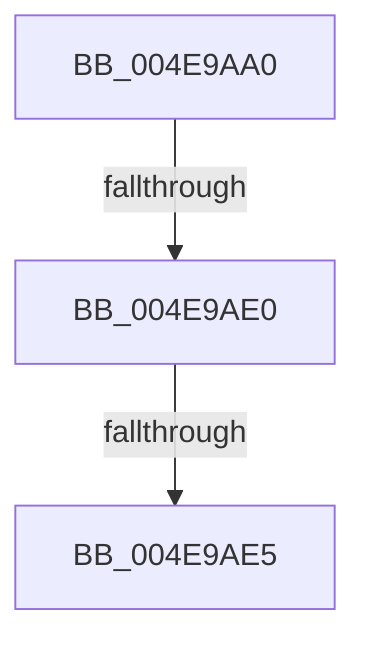

# SeAssignSecurityEx2

- RVA: `0x004E9AA0`–`0x004E9AEF` (길이 `79` bytes)
- VA: `0x00000001404E9AA0`
- 실행 섹션: `.text`
- PDB 이름 있음: `예`; PDB Function 태그: `아니요`
- unwind 정보 RVA: `0x000D10D4`
- 디코드: `23`개 명령, `79/79` bytes 표시
- 미해석 바이트: `0` (있으면 어셈블리에 `.byte`로 보존)

> 이 문서는 커널 이미지의 기계어와 PDB 기호를 분석해 생성했습니다. 4번과 5번은 함수 원형과 자료형을 바이너리 사용 방식에서 추정한 C 해석이며 원본 소스 복구 결과는 아닙니다.

## 1. Dependencies

- 직접 호출 지점: **0**; 고유 호출 대상: **0**
- 직접 호출자로 확인된 함수: **4**
- RIP 상대 이미지 참조: **0**

### Outgoing calls
- 직접 디코드된 call 명령이 없습니다.

### Direct callers
- [ObInsertObjectEx](../../page/8B/ObInsertObjectEx_function_008B97A0.md) at `0x008B9ACE`
- [sub_008BA0FD](../../page/8B/Unknown_function_008BA0FD.md) at `0x008BA182`
- [sub_008BA23A](../../page/8B/Unknown_function_008BA23A.md) at `0x008BA27F`
- [SeAssignSecurityEx](../../page/A3/SeAssignSecurityEx_function_00A3B270.md) at `0x00A3B2AF`

### Static image references
- 디코드된 RIP-relative 메모리 참조가 없습니다.

## 2. Other-region calls and transfers

- 다른 실행 섹션으로 향하는 call: **0**
- call이 아닌 외부 분기/꼬리 이동: **3**
  - `0x004E9ADE` → [sub_004E9AEF](Unknown_function_004E9AEF.md) (`tail-transfer`)
  - `0x004E9AE3` → [sub_004E9AEF](Unknown_function_004E9AEF.md) (`tail-transfer`)
  - `0x004E9AEA` → [sub_004E9BB0](Unknown_function_004E9BB0.md) (`tail-transfer`)

## 3. Assembly (complete function range)

```asm
004E9AA0  48 89 5C 24 10                  mov qword ptr [rsp + 0x10], rbx
004E9AA5  4C 89 4C 24 20                  mov qword ptr [rsp + 0x20], r9
004E9AAA  56                              push rsi
004E9AAB  57                              push rdi
004E9AAC  41 54                           push r12
004E9AAE  41 56                           push r14
004E9AB0  41 57                           push r15
004E9AB2  48 81 EC 80 00 00 00            sub rsp, 0x80
004E9AB9  48 8B B4 24 E0 00 00 00         mov rsi, qword ptr [rsp + 0xe0]
004E9AC1  33 DB                           xor ebx, ebx
004E9AC3  48 89 5C 24 60                  mov qword ptr [rsp + 0x60], rbx
004E9AC8  0F 57 C0                        xorps xmm0, xmm0
004E9ACB  4D 8B F0                        mov r14, r8
004E9ACE  4C 8B FA                        mov r15, rdx
004E9AD1  4C 8B E1                        mov r12, rcx
004E9AD4  8B FB                           mov edi, ebx
004E9AD6  0F 11 44 24 68                  movups xmmword ptr [rsp + 0x68], xmm0
004E9ADB  48 85 F6                        test rsi, rsi
004E9ADE  74 0F                           je 0x1404e9aef
004E9AE0  83 3E 08                        cmp dword ptr [rsi], 8
004E9AE3  74 0A                           je 0x1404e9aef
004E9AE5  B8 0D 00 00 C0                  mov eax, 0xc000000d
004E9AEA  E9 C1 00 00 00                  jmp 0x1404e9bb0
```

## 4. C-style interpretation (structured pseudocode)

```c
__int64 __fastcall SeAssignSecurityEx2(__int64 a1, __int64 a2, __int64 a3, __int64 a4, __int64 a5, __int64 a6, __int64 a7)
{
    __int64 v_rbx;
    __int64 v_rsp;
    unsigned __int64 v_stack_m40;
    unsigned __int64 v_stack_m48;
    unsigned __int64 v_stack_p10;
    unsigned __int64 v_stack_p20;

    v_stack_p10 = v_rbx;
    v_stack_p20 = a4;
    v_rsp = (v_rsp) - (128);
    v_rbx = 0;
    v_stack_m48 = 0;
    v_stack_m40 = v_xmm0;
}
```

## 5. (Beta) C Style

```c
int64_t SeAssignSecurityEx2(int64_t Arg1, int64_t Arg2, int64_t Arg3, int64_t Arg4, uint64_t Arg5, uint64_t Arg6, int64_t Arg7)
{
    int64_t local_rbx;
    int64_t local_rsp;
    uint64_t v_stack_m40;
    uint64_t v_stack_m48;
    uint64_t v_stack_p10;
    uint64_t v_stack_p20;

    v_stack_p10 = local_rbx;
    v_stack_p20 = Arg4;
    local_rsp = (local_rsp) - (128);
    local_rbx = 0;
    v_stack_m48 = 0;
    v_stack_m40 = v_xmm0;
}
```

## 6. Execution-region graph

[열기: 2D/3D 그래프와 함수 탐색 컨트롤 패널](../../../control-panel.html?section=text&rva=0x004E9AA0&view=graph)

- 2D 그래프는 위에서 아래로 흐르고, 3D 그래프는 빈 공간을 드래그해 회전합니다. Shift+드래그는 이동, 휠은 확대·축소, 함수 노드 선택은 대상 보고서 이동입니다.

### Static fallback


