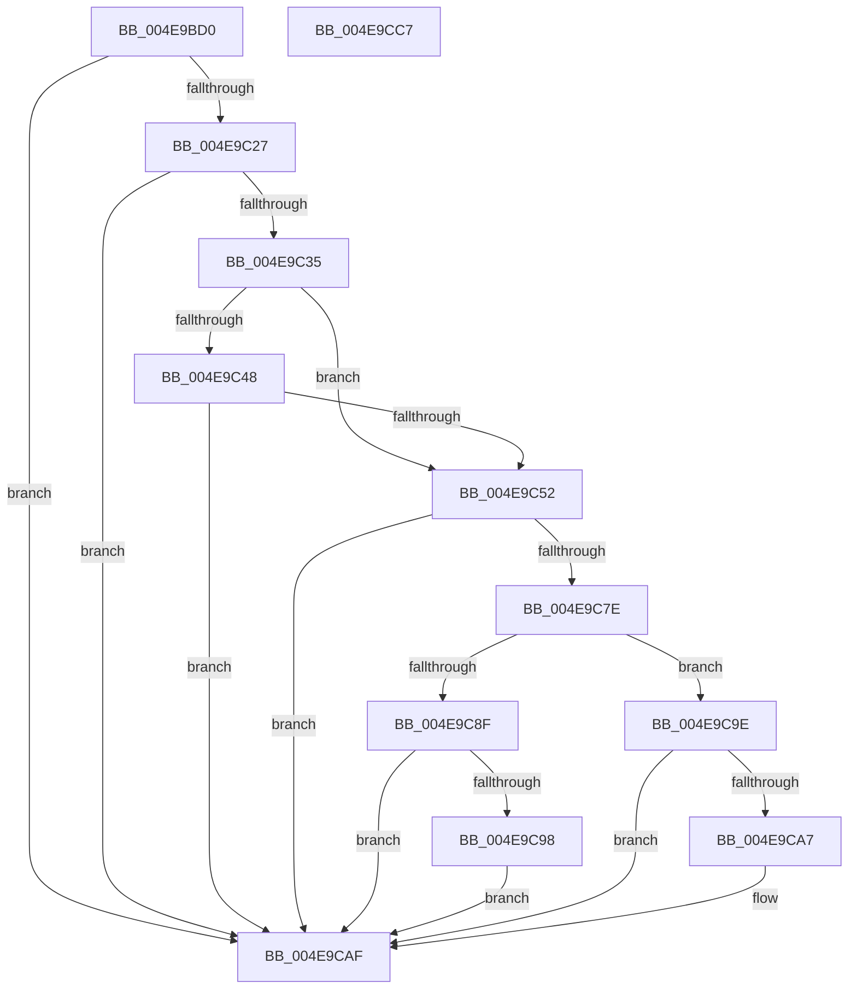

# SeCaptureAtomTableCallout

- RVA: `0x004E9BD0`–`0x004E9CC8` (길이 `248` bytes)
- VA: `0x00000001404E9BD0`
- 실행 섹션: `.text`
- PDB 이름 있음: `예`; PDB Function 태그: `아니요`
- unwind 정보 RVA: `0x000D14F8`
- 디코드: `64`개 명령, `248/248` bytes 표시
- 미해석 바이트: `0` (있으면 어셈블리에 `.byte`로 보존)

> 이 문서는 커널 이미지의 기계어와 PDB 기호를 분석해 생성했습니다. 4번과 5번은 함수 원형과 자료형을 바이너리 사용 방식에서 추정한 C 해석이며 원본 소스 복구 결과는 아닙니다.

## 1. Dependencies

- 직접 호출 지점: **6**; 고유 호출 대상: **5**
- 직접 호출자로 확인된 함수: **1**
- RIP 상대 이미지 참조: **0**

### Outgoing calls
- `0x004E9C0F` → [PsReferenceEffectiveToken](../../page/9A/PsReferenceEffectiveToken_function_009A2B40.md) (function, `0x009A2B40`)
- `0x004E9C6F` → [PsInvokeWin32Callout](../../page/91/PsInvokeWin32Callout_function_009133C0.md) (function, `0x009133C0`)
- `0x004E9C8F` → [Feature_829055289__private_IsEnabledDeviceUsageNoInline](../60/Feature_829055289__private_IsEnabledDeviceUsageNoInline_function_0060954C.md) (function, `0x0060954C`)
- `0x004E9C9E` → [Feature_829055289__private_IsEnabledDeviceUsageNoInline](../60/Feature_829055289__private_IsEnabledDeviceUsageNoInline_function_0060954C.md) (function, `0x0060954C`)
- `0x004E9CAA` → [RtlDestroyAtomTable](../../page/9C/RtlDestroyAtomTable_function_009C43F0.md) (function, `0x009C43F0`)
- `0x004E9CB7` → [ObfDereferenceObjectWithTag](../2F/ObfDereferenceObjectWithTag_function_002F78E0.md) (function, `0x002F78E0`)

### Direct callers
- [PsConvertToGuiThread](../../page/A2/PsConvertToGuiThread_function_00A2F8B0.md) at `0x00A2FB0B`

### Static image references
- 디코드된 RIP-relative 메모리 참조가 없습니다.

## 2. Other-region calls and transfers

- 다른 실행 섹션으로 향하는 call: **3**
  - `0x004E9C0F` → [PsReferenceEffectiveToken](../../page/9A/PsReferenceEffectiveToken_function_009A2B40.md) (`.text` → `PAGE`)
  - `0x004E9C6F` → [PsInvokeWin32Callout](../../page/91/PsInvokeWin32Callout_function_009133C0.md) (`.text` → `PAGE`)
  - `0x004E9CAA` → [RtlDestroyAtomTable](../../page/9C/RtlDestroyAtomTable_function_009C43F0.md) (`.text` → `PAGE`)
- 별도 외부 분기/꼬리 이동을 확인하지 못했습니다.

## 3. Assembly (complete function range)

```asm
004E9BD0  4C 8B DC                        mov r11, rsp
004E9BD3  49 89 5B 20                     mov qword ptr [r11 + 0x20], rbx
004E9BD7  57                              push rdi
004E9BD8  48 83 EC 50                     sub rsp, 0x50
004E9BDC  33 C0                           xor eax, eax
004E9BDE  4D 8D 4B 08                     lea r9, [r11 + 8]
004E9BE2  49 21 43 D0                     and qword ptr [r11 - 0x30], rax
004E9BE6  4D 8D 43 18                     lea r8, [r11 + 0x18]
004E9BEA  89 44 24 40                     mov dword ptr [rsp + 0x40], eax
004E9BEE  0F 57 C0                        xorps xmm0, xmm0
004E9BF1  0F 11 44 24 30                  movups xmmword ptr [rsp + 0x30], xmm0
004E9BF6  65 48 8B 1C 25 88 01 00 00      mov rbx, qword ptr gs:[0x188]
004E9BFF  49 8D 43 10                     lea rax, [r11 + 0x10]
004E9C03  48 8B CB                        mov rcx, rbx
004E9C06  49 89 43 C8                     mov qword ptr [r11 - 0x38], rax
004E9C0A  BA 53 68 72 74                  mov edx, 0x74726853
004E9C0F  E8 2C 8F 4B 00                  call 0x1409a2b40
004E9C14  48 8B F8                        mov rdi, rax
004E9C17  F7 80 C8 00 00 00 00 40 00 00   test dword ptr [rax + 0xc8], 0x4000
004E9C21  0F 84 88 00 00 00               je 0x1404e9caf
004E9C27  48 8B 88 38 04 00 00            mov rcx, qword ptr [rax + 0x438]
004E9C2E  48 83 79 30 00                  cmp qword ptr [rcx + 0x30], 0
004E9C33  75 7A                           jne 0x1404e9caf
004E9C35  48 8B 8B B8 00 00 00            mov rcx, qword ptr [rbx + 0xb8]
004E9C3C  48 8B 81 A0 02 00 00            mov rax, qword ptr [rcx + 0x2a0]
004E9C43  48 85 C0                        test rax, rax
004E9C46  74 0A                           je 0x1404e9c52
004E9C48  8B 80 20 02 00 00               mov eax, dword ptr [rax + 0x220]
004E9C4E  A8 20                           test al, 0x20
004E9C50  75 5D                           jne 0x1404e9caf
004E9C52  33 C0                           xor eax, eax
004E9C54  48 8D 54 24 30                  lea rdx, [rsp + 0x30]
004E9C59  0F 57 C0                        xorps xmm0, xmm0
004E9C5C  48 89 44 24 40                  mov qword ptr [rsp + 0x40], rax
004E9C61  45 33 C9                        xor r9d, r9d
004E9C64  45 33 C0                        xor r8d, r8d
004E9C67  0F 11 44 24 30                  movups xmmword ptr [rsp + 0x30], xmm0
004E9C6C  8D 48 02                        lea ecx, [rax + 2]
004E9C6F  E8 4C 97 42 00                  call 0x1409133c0
004E9C74  48 8B 5C 24 40                  mov rbx, qword ptr [rsp + 0x40]
004E9C79  48 85 DB                        test rbx, rbx
004E9C7C  74 31                           je 0x1404e9caf
004E9C7E  48 8B 8F 38 04 00 00            mov rcx, qword ptr [rdi + 0x438]
004E9C85  33 C0                           xor eax, eax
004E9C87  F0 48 0F B1 59 30               lock cmpxchg qword ptr [rcx + 0x30], rbx
004E9C8D  75 0F                           jne 0x1404e9c9e
004E9C8F  E8 B8 F8 11 00                  call 0x14060954c
004E9C94  85 C0                           test eax, eax
004E9C96  75 17                           jne 0x1404e9caf
004E9C98  F0 FF 43 04                     lock inc dword ptr [rbx + 4]
004E9C9C  EB 11                           jmp 0x1404e9caf
004E9C9E  E8 A9 F8 11 00                  call 0x14060954c
004E9CA3  85 C0                           test eax, eax
004E9CA5  74 08                           je 0x1404e9caf
004E9CA7  48 8B CB                        mov rcx, rbx
004E9CAA  E8 41 A7 4D 00                  call 0x1409c43f0
004E9CAF  BA 53 68 72 74                  mov edx, 0x74726853
004E9CB4  48 8B CF                        mov rcx, rdi
004E9CB7  E8 24 DC E0 FF                  call 0x1402f78e0
004E9CBC  48 8B 5C 24 78                  mov rbx, qword ptr [rsp + 0x78]
004E9CC1  48 83 C4 50                     add rsp, 0x50
004E9CC5  5F                              pop rdi
004E9CC6  C3                              ret
004E9CC7  CC                              int3
```

## 4. C-style interpretation (structured pseudocode)

```c
__int64 __fastcall SeCaptureAtomTableCallout(void)
{
    __int64 result;
    __int64 v_rsp;
    unsigned int v_stack_m18;
    unsigned __int64 v_stack_m28;
    unsigned __int64 v_stack_p20;

    *(unsigned __int64 *)(v_rsp + 32) = v_rbx;
    v_rsp = (v_rsp) - (80);
    result = 0;
    v_stack_m18 = 0;
    v_stack_m28 = v_xmm0;
    *(unsigned __int64 *)(v_rsp - 56) = v_rsp + 16;
    result = PsReferenceEffectiveToken(*(unsigned __int64 *)(gs_base + (0 + 392)), (unsigned int)(0x74726853ULL), v_rsp + 24, v_rsp + 8);
    if (((*(unsigned int *)(result + 200)) & (0x4000ULL)) == 0) goto loc_004E9CAF;
    if ((*(unsigned __int64 *)(*(unsigned __int64 *)(result + 1080) + 48)) != 0) goto loc_004E9CAF;
    if (*(unsigned __int64 *)(*(unsigned __int64 *)(*(unsigned __int64 *)(gs_base + (0 + 392)) + 184) + 672) == 0) goto loc_004E9C52;
    if ((((unsigned __int8)((unsigned int)(*(unsigned int *)(*(unsigned __int64 *)(*(unsigned __int64 *)(*(unsigned __int64 *)(gs_base + (0 + 392)) + 184) + 672) + 544)))) & (32)) != 0) goto loc_004E9CAF;
loc_004E9C52:
    result = 0;
    v_stack_m18 = 0;
    a4 = 0;
    a3 = 0;
    v_stack_m28 = v_xmm0;
    result = PsInvokeWin32Callout(result + 2, v_stack_m28, a3, a4);
    if (v_stack_m18 == 0) goto loc_004E9CAF;
    result = 0;
    if (condition_is_not_equal) goto loc_004E9C9E;
    result = Feature_829055289__private_IsEnabledDeviceUsageNoInline(*(unsigned __int64 *)(result + 1080), v_stack_m28, a3, a4);
    if ((unsigned int)(result) != 0) goto loc_004E9CAF;
    goto loc_004E9CAF;
loc_004E9C9E:
    result = Feature_829055289__private_IsEnabledDeviceUsageNoInline(*(unsigned __int64 *)(result + 1080), v_stack_m28, a3, a4);
    if ((unsigned int)(result) != 0) {
        a1 = v_stack_m18;
        result = RtlDestroyAtomTable(a1, v_stack_m28, a3, a4);
    }
    result = ObfDereferenceObjectWithTag(result, (unsigned int)(0x74726853ULL), a3, a4);
    v_rsp = (v_rsp) + (80);
    return result;
}
```

## 5. (Beta) C Style

```c
void SeCaptureAtomTableCallout(void)
{
    int64_t result;
    int64_t local_rsp;
    uint32_t v_stack_m18;
    uint64_t v_stack_m28;
    uint64_t v_stack_p20;

    *(uint64_t *)(local_rsp + 0x20) = local_rbx;
    local_rsp = (local_rsp) - (80);
    result = 0;
    v_stack_m18 = 0;
    v_stack_m28 = v_xmm0;
    *(uint64_t *)(local_rsp - 0x38) = local_rsp + 16;
    result = PsReferenceEffectiveToken(*(uint64_t *)(gs_base + (0 + 0x188)), (uint32_t)(0x74726853ULL), local_rsp + 24, local_rsp + 8);
    if (((*(uint32_t *)(result + 0xC8)) & (0x4000ULL)) == 0) goto loc_004E9CAF;
    if ((*(uint64_t *)(*(uint64_t *)(result + 0x438) + 0x30)) != 0) goto loc_004E9CAF;
    if (*(uint64_t *)(*(uint64_t *)(*(uint64_t *)(gs_base + (0 + 0x188)) + 0xB8) + 0x2A0) == 0) goto loc_004E9C52;
    if ((((uint8_t)((uint32_t)(*(uint32_t *)(*(uint64_t *)(*(uint64_t *)(*(uint64_t *)(gs_base + (0 + 0x188)) + 0xB8) + 0x2A0) + 0x220)))) & (32)) != 0) goto loc_004E9CAF;
loc_004E9C52:
    result = 0;
    v_stack_m18 = 0;
    a4 = 0;
    a3 = 0;
    v_stack_m28 = v_xmm0;
    result = PsInvokeWin32Callout(result + 2, v_stack_m28, a3, a4);
    if (v_stack_m18 == 0) goto loc_004E9CAF;
    result = 0;
    if (condition_is_not_equal) goto loc_004E9C9E;
    result = Feature_829055289__private_IsEnabledDeviceUsageNoInline(*(uint64_t *)(result + 0x438), v_stack_m28, a3, a4);
    if ((uint32_t)(result) != 0) goto loc_004E9CAF;
    goto loc_004E9CAF;
loc_004E9C9E:
    result = Feature_829055289__private_IsEnabledDeviceUsageNoInline(*(uint64_t *)(result + 0x438), v_stack_m28, a3, a4);
    if ((uint32_t)(result) != 0) {
        a1 = v_stack_m18;
        result = RtlDestroyAtomTable(a1, v_stack_m28, a3, a4);
    }
    result = ObfDereferenceObjectWithTag(result, (uint32_t)(0x74726853ULL), a3, a4);
    local_rsp = (local_rsp) + (80);
    return result;
}
```

## 6. Execution-region graph

[열기: 2D/3D 그래프와 함수 탐색 컨트롤 패널](../../../control-panel.html?section=text&rva=0x004E9BD0&view=graph)

- 2D 그래프는 위에서 아래로 흐르고, 3D 그래프는 빈 공간을 드래그해 회전합니다. Shift+드래그는 이동, 휠은 확대·축소, 함수 노드 선택은 대상 보고서 이동입니다.

### Static fallback


