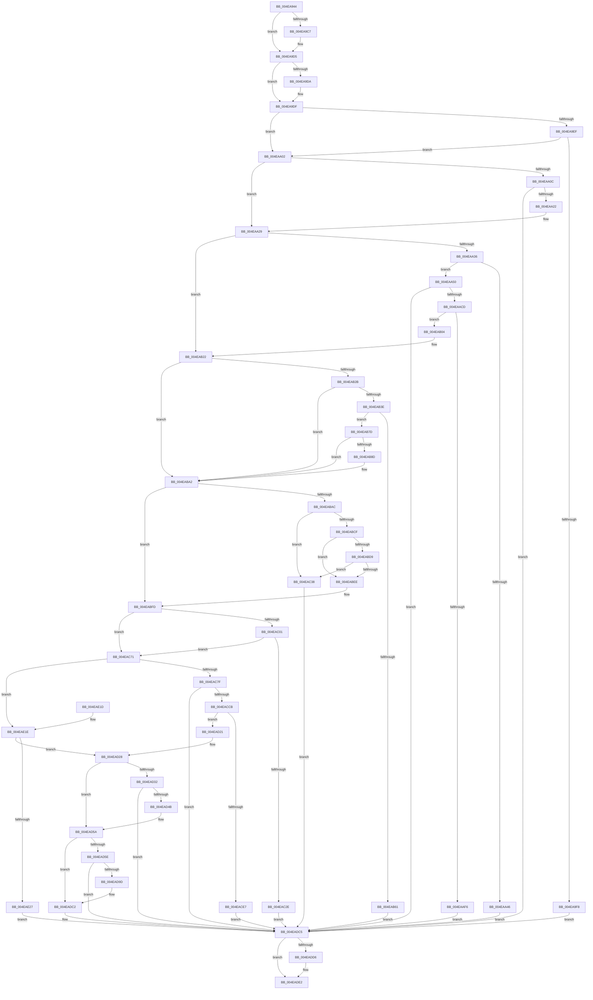

# SmFirstTimeInit

- RVA: `0x004EA944`–`0x004EAE2E` (길이 `1,258` bytes)
- VA: `0x00000001404EA944`
- 실행 섹션: `.text`
- PDB 이름 있음: `예`; PDB Function 태그: `아니요`
- unwind 정보 RVA: `0x000D1CF8`
- 디코드: `302`개 명령, `1,258/1,258` bytes 표시
- 미해석 바이트: `0` (있으면 어셈블리에 `.byte`로 보존)

> 이 문서는 커널 이미지의 기계어와 PDB 기호를 분석해 생성했습니다. 4번과 5번은 함수 원형과 자료형을 바이너리 사용 방식에서 추정한 C 해석이며 원본 소스 복구 결과는 아닙니다.

## 1. Dependencies

- 직접 호출 지점: **29**; 고유 호출 대상: **28**
- 직접 호출자로 확인된 함수: **1**
- RIP 상대 이미지 참조: **4**

### Outgoing calls
- `0x004EA9B7` → [KeAbPreAcquire](../21/KeAbPreAcquire_function_00210230.md) (function, `0x00210230`)
- `0x004EA9D0` → [ExfAcquirePushLockExclusiveEx](../20/ExfAcquirePushLockExclusiveEx_function_0020FC90.md) (function, `0x0020FC90`)
- `0x004EAA13` → [SmRegistrationCtxStart](../../page/AC/SmRegistrationCtxStart_function_00ACCA90.md) (function, `0x00ACCA90`)
- `0x004EAA3D` → [MmStoreCheckPagefiles](../../page/80/MmStoreCheckPagefiles_function_0080E694.md) (function, `0x0080E694`)
- `0x004EAA64` → [KiStackAttachProcess](../21/KiStackAttachProcess_function_00216820.md) (function, `0x00216820`)
- `0x004EAAB3` → [PsCreateMinimalProcess](../../page/78/PsCreateMinimalProcess_function_00786D14.md) (function, `0x00786D14`)
- `0x004EAAC0` → [KiUnstackDetachProcess](../21/KiUnstackDetachProcess_function_00217D30.md) (function, `0x00217D30`)
- `0x004EAAEB` → [ObReferenceObjectByHandle](../../page/86/ObReferenceObjectByHandle_function_00868DB0.md) (function, `0x00868DB0`)
- `0x004EAAFA` → [ZwClose](../6A/ZwClose_function_006AD2B0.md) (function, `0x006AD2B0`)
- `0x004EAB1D` → [PsDereferencePartition](../34/PsDereferencePartition_function_00342E70.md) (function, `0x00342E70`)
- `0x004EAB56` → [SmHwAcceleratorPartitionMgrStart](../../page/7A/SmHwAcceleratorPartitionMgrStart_function_007AB480.md) (function, `0x007AB480`)
- `0x004EAB6B` → [SmHwAcceleratorPartitionMgrCleanup](../../page/7A/SmHwAcceleratorPartitionMgrCleanup_function_007AB34C.md) (function, `0x007AB34C`)
- `0x004EAB73` → [SmHwAcceleratorPartitionMgrInitialize](../../page/7A/SmHwAcceleratorPartitionMgrInitialize_function_007AB464.md) (function, `0x007AB464`)
- `0x004EABC4` → [SMKM_STORE_MGR<SM_TRAITS>::SmStorePrepare](../60/SMKM_STORE_MGR_SM_TRAITS_SmStorePrepare_function_0060CC98.md) (function, `0x0060CC98`)
- `0x004EABE3` → [SMKM_STORE_MGR<SM_TRAITS>::SmCompressManagerStart](../60/SMKM_STORE_MGR_SM_TRAITS_SmCompressManagerStart_function_0060C418.md) (function, `0x0060C418`)
- `0x004EAC0D` → [MmStoreChargeResidentAvailableForRead](../28/MmStoreChargeResidentAvailableForRead_function_0028ACB0.md) (function, `0x0028ACB0`)
- `0x004EAC53` → [SMKM_STORE_MGR<SM_TRAITS>::SmCleanup](../60/SMKM_STORE_MGR_SM_TRAITS_SmCleanup_function_0060C214.md) (function, `0x0060C214`)
- `0x004EAC5F` → [SMKM_STORE_MGR<SM_TRAITS>::SmInitialize](../60/SMKM_STORE_MGR_SM_TRAITS_SmInitialize_function_0060C8CC.md) (function, `0x0060C8CC`)
- `0x004EAC67` → [SmTerminateStoreProcess](../60/SmTerminateStoreProcess_function_0060EB18.md) (function, `0x0060EB18`)
- `0x004EACBC` → [SmFpPreAllocate](../4C/SmFpPreAllocate_function_004CF32C.md) (function, `0x004CF32C`)
- `0x004EACDC` → [SmFpPreAllocate](../4C/SmFpPreAllocate_function_004CF32C.md) (function, `0x004CF32C`)
- `0x004EACEA` → [SmFpCleanup](../3B/SmFpCleanup_function_003B082C.md) (function, `0x003B082C`)
- `0x004EACF8` → [memset](../6C/memset_function_006C6C40.md) (function, `0x006C6C40`)
- `0x004EAD40` → [ExAllocatePrivateWorkerPool](../../page/70/ExAllocatePrivateWorkerPool_function_00705208.md) (function, `0x00705208`)
- `0x004EAD92` → [MmStoreRegister](../../page/80/MmStoreRegister_function_0080E6D8.md) (function, `0x0080E6D8`)
- `0x004EADDD` → [ExfTryToWakePushLock](../26/ExfTryToWakePushLock_function_00265DD0.md) (function, `0x00265DD0`)
- `0x004EADE9` → [KeAbPostRelease](../2E/KeAbPostRelease_function_002E1600.md) (function, `0x002E1600`)
- `0x004EADEE` → [KeLeaveCriticalRegion](../25/KeLeaveCriticalRegion_function_0025D8B0.md) (function, `0x0025D8B0`)
- `0x004EADFC` → [_security_check_cookie](../6A/_security_check_cookie_function_006AC640.md) (function, `0x006AC640`)

### Direct callers
- [SmProcessCreateRequest](../../page/A5/SmProcessCreateRequest_function_00A50DD0.md) at `0x00A5102C`

### Static image references
- `0x004EA962` → RVA `0x00E0A740` (`.data`; read)
- `0x004EA9DF` → RVA `0x00FC6EA0` (`ALMOSTRO`; read)
- `0x004EAA7B` → RVA `0x00E08EF0` (`.data`; read)
- `0x004EAB4F` → RVA `0x00E28388` (`.data`; read)

## 2. Other-region calls and transfers

- 다른 실행 섹션으로 향하는 call: **9**
  - `0x004EAA13` → [SmRegistrationCtxStart](../../page/AC/SmRegistrationCtxStart_function_00ACCA90.md) (`.text` → `PAGE`)
  - `0x004EAA3D` → [MmStoreCheckPagefiles](../../page/80/MmStoreCheckPagefiles_function_0080E694.md) (`.text` → `PAGE`)
  - `0x004EAAB3` → [PsCreateMinimalProcess](../../page/78/PsCreateMinimalProcess_function_00786D14.md) (`.text` → `PAGE`)
  - `0x004EAAEB` → [ObReferenceObjectByHandle](../../page/86/ObReferenceObjectByHandle_function_00868DB0.md) (`.text` → `PAGE`)
  - `0x004EAB56` → [SmHwAcceleratorPartitionMgrStart](../../page/7A/SmHwAcceleratorPartitionMgrStart_function_007AB480.md) (`.text` → `PAGE`)
  - `0x004EAB6B` → [SmHwAcceleratorPartitionMgrCleanup](../../page/7A/SmHwAcceleratorPartitionMgrCleanup_function_007AB34C.md) (`.text` → `PAGE`)
  - `0x004EAB73` → [SmHwAcceleratorPartitionMgrInitialize](../../page/7A/SmHwAcceleratorPartitionMgrInitialize_function_007AB464.md) (`.text` → `PAGE`)
  - `0x004EAD40` → [ExAllocatePrivateWorkerPool](../../page/70/ExAllocatePrivateWorkerPool_function_00705208.md) (`.text` → `PAGE`)
  - `0x004EAD92` → [MmStoreRegister](../../page/80/MmStoreRegister_function_0080E6D8.md) (`.text` → `PAGE`)
- 별도 외부 분기/꼬리 이동을 확인하지 못했습니다.

## 3. Assembly (complete function range)

```asm
004EA944  48 89 5C 24 10                  mov qword ptr [rsp + 0x10], rbx
004EA949  48 89 74 24 18                  mov qword ptr [rsp + 0x18], rsi
004EA94E  55                              push rbp
004EA94F  57                              push rdi
004EA950  41 54                           push r12
004EA952  41 56                           push r14
004EA954  41 57                           push r15
004EA956  48 8D 6C 24 C9                  lea rbp, [rsp - 0x37]
004EA95B  48 81 EC E0 00 00 00            sub rsp, 0xe0
004EA962  48 8B 05 D7 FD 91 00            mov rax, qword ptr [rip + 0x91fdd7]
004EA969  48 33 C4                        xor rax, rsp
004EA96C  48 89 45 27                     mov qword ptr [rbp + 0x27], rax
004EA970  0F 57 C0                        xorps xmm0, xmm0
004EA973  C7 45 1F 14 00 10 00            mov dword ptr [rbp + 0x1f], 0x100014
004EA97A  0F 11 45 E7                     movups xmmword ptr [rbp - 0x19], xmm0
004EA97E  48 8D B9 68 08 00 00            lea rdi, [rcx + 0x868]
004EA985  44 8B FA                        mov r15d, edx
004EA988  0F 11 45 F7                     movups xmmword ptr [rbp - 9], xmm0
004EA98C  48 8B F1                        mov rsi, rcx
004EA98F  45 33 E4                        xor r12d, r12d
004EA992  4C 89 65 B7                     mov qword ptr [rbp - 0x49], r12
004EA996  48 83 CB FF                     or rbx, 0xffffffffffffffff
004EA99A  0F 11 45 07                     movups xmmword ptr [rbp + 7], xmm0
004EA99E  65 48 8B 04 25 88 01 00 00      mov rax, qword ptr gs:[0x188]
004EA9A7  45 33 C0                        xor r8d, r8d
004EA9AA  33 D2                           xor edx, edx
004EA9AC  48 8B CF                        mov rcx, rdi
004EA9AF  66 01 98 E4 01 00 00            add word ptr [rax + 0x1e4], bx
004EA9B6  90                              nop
004EA9B7  E8 74 58 D2 FF                  call 0x140210230
004EA9BC  F0 48 0F BA 2F 00               lock bts qword ptr [rdi], 0
004EA9C2  4C 8B F0                        mov r14, rax
004EA9C5  73 0E                           jae 0x1404ea9d5
004EA9C7  4C 8B C7                        mov r8, rdi
004EA9CA  48 8B D0                        mov rdx, rax
004EA9CD  48 8B CF                        mov rcx, rdi
004EA9D0  E8 BB 52 D2 FF                  call 0x14020fc90
004EA9D5  4D 85 F6                        test r14, r14
004EA9D8  74 05                           je 0x1404ea9df
004EA9DA  41 C6 46 0A 01                  mov byte ptr [r14 + 0xa], 1
004EA9DF  48 8B 05 BA C4 AD 00            mov rax, qword ptr [rip + 0xadc4ba]
004EA9E6  48 39 86 30 08 00 00            cmp qword ptr [rsi + 0x830], rax
004EA9ED  74 13                           je 0x1404eaa02
004EA9EF  4C 39 A6 38 08 00 00            cmp qword ptr [rsi + 0x838], r12
004EA9F6  75 0A                           jne 0x1404eaa02
004EA9F8  BF AE 01 00 C0                  mov edi, 0xc00001ae
004EA9FD  E9 C3 03 00 00                  jmp 0x1404eadc5
004EAA02  8B 86 58 08 00 00               mov eax, dword ptr [rsi + 0x858]
004EAA08  A8 08                           test al, 8
004EAA0A  75 1D                           jne 0x1404eaa29
004EAA0C  48 8D 8E 20 0B 00 00            lea rcx, [rsi + 0xb20]
004EAA13  E8 78 20 5E 00                  call 0x140acca90
004EAA18  8B F8                           mov edi, eax
004EAA1A  85 C0                           test eax, eax
004EAA1C  0F 88 A3 03 00 00               js 0x1404eadc5
004EAA22  83 8E 58 08 00 00 08            or dword ptr [rsi + 0x858], 8
004EAA29  4C 39 A6 70 08 00 00            cmp qword ptr [rsi + 0x870], r12
004EAA30  0F 85 EC 00 00 00               jne 0x1404eab22
004EAA36  48 8B 8E 30 08 00 00            mov rcx, qword ptr [rsi + 0x830]
004EAA3D  E8 52 3C 32 00                  call 0x14080e694
004EAA42  85 C0                           test eax, eax
004EAA44  75 0A                           jne 0x1404eaa50
004EAA46  BF BB 00 00 C0                  mov edi, 0xc00000bb
004EAA4B  E9 75 03 00 00                  jmp 0x1404eadc5
004EAA50  4C 8B B6 30 08 00 00            mov r14, qword ptr [rsi + 0x830]
004EAA57  4C 8D 45 E7                     lea r8, [rbp - 0x19]
004EAA5B  33 D2                           xor edx, edx
004EAA5D  49 8B 7E 78                     mov rdi, qword ptr [r14 + 0x78]
004EAA61  48 8B CF                        mov rcx, rdi
004EAA64  E8 B7 BD D2 FF                  call 0x140216820
004EAA69  48 8B 86 38 08 00 00            mov rax, qword ptr [rsi + 0x838]
004EAA70  48 8D 4D B7                     lea rcx, [rbp - 0x49]
004EAA74  44 8A 8F FA 05 00 00            mov r9b, byte ptr [rdi + 0x5fa]
004EAA7B  48 8D 15 6E E4 91 00            lea rdx, [rip + 0x91e46e]
004EAA82  48 89 4C 24 58                  mov qword ptr [rsp + 0x58], rcx
004EAA87  45 33 C0                        xor r8d, r8d
004EAA8A  4C 89 64 24 50                  mov qword ptr [rsp + 0x50], r12
004EAA8F  48 8B CF                        mov rcx, rdi
004EAA92  4C 89 74 24 48                  mov qword ptr [rsp + 0x48], r14
004EAA97  48 89 44 24 40                  mov qword ptr [rsp + 0x40], rax
004EAA9C  4C 89 64 24 38                  mov qword ptr [rsp + 0x38], r12
004EAAA1  C7 44 24 30 10 00 00 00         mov dword ptr [rsp + 0x30], 0x10
004EAAA9  44 89 64 24 28                  mov dword ptr [rsp + 0x28], r12d
004EAAAE  4C 89 64 24 20                  mov qword ptr [rsp + 0x20], r12
004EAAB3  E8 5C C2 29 00                  call 0x140786d14
004EAAB8  33 D2                           xor edx, edx
004EAABA  48 8D 4D E7                     lea rcx, [rbp - 0x19]
004EAABE  8B F8                           mov edi, eax
004EAAC0  E8 6B D2 D2 FF                  call 0x140217d30
004EAAC5  85 FF                           test edi, edi
004EAAC7  0F 88 F8 02 00 00               js 0x1404eadc5
004EAACD  48 8B 4D B7                     mov rcx, qword ptr [rbp - 0x49]
004EAAD1  48 8D 45 C7                     lea rax, [rbp - 0x39]
004EAAD5  4C 89 64 24 28                  mov qword ptr [rsp + 0x28], r12
004EAADA  45 33 C9                        xor r9d, r9d
004EAADD  45 33 C0                        xor r8d, r8d
004EAAE0  48 89 44 24 20                  mov qword ptr [rsp + 0x20], rax
004EAAE5  33 D2                           xor edx, edx
004EAAE7  4C 89 65 C7                     mov qword ptr [rbp - 0x39], r12
004EAAEB  E8 C0 E2 37 00                  call 0x140868db0
004EAAF0  8B F8                           mov edi, eax
004EAAF2  85 C0                           test eax, eax
004EAAF4  79 0E                           jns 0x1404eab04
004EAAF6  48 8B 4D B7                     mov rcx, qword ptr [rbp - 0x49]
004EAAFA  E8 B1 27 1C 00                  call 0x1406ad2b0
004EAAFF  E9 C1 02 00 00                  jmp 0x1404eadc5
004EAB04  48 8B 45 B7                     mov rax, qword ptr [rbp - 0x49]
004EAB08  49 8B CE                        mov rcx, r14
004EAB0B  48 89 86 70 08 00 00            mov qword ptr [rsi + 0x870], rax
004EAB12  48 8B 45 C7                     mov rax, qword ptr [rbp - 0x39]
004EAB16  48 89 86 78 08 00 00            mov qword ptr [rsi + 0x878], rax
004EAB1D  E8 4E 83 E5 FF                  call 0x140342e70
004EAB22  83 BE 60 08 00 00 03            cmp dword ptr [rsi + 0x860], 3
004EAB29  75 77                           jne 0x1404eaba2
004EAB2B  F7 86 B0 08 00 00 00 10 00 00   test dword ptr [rsi + 0x8b0], 0x1000
004EAB35  44 89 A6 60 08 00 00            mov dword ptr [rsi + 0x860], r12d
004EAB3C  74 64                           je 0x1404eaba2
004EAB3E  4C 8B 86 78 08 00 00            mov r8, qword ptr [rsi + 0x878]
004EAB45  4C 8D B6 30 0C 00 00            lea r14, [rsi + 0xc30]
004EAB4C  49 8B CE                        mov rcx, r14
004EAB4F  48 8D 15 32 D8 93 00            lea rdx, [rip + 0x93d832]
004EAB56  E8 25 09 2C 00                  call 0x1407ab480
004EAB5B  8B F8                           mov edi, eax
004EAB5D  85 C0                           test eax, eax
004EAB5F  79 1C                           jns 0x1404eab7d
004EAB61  48 8B 96 78 08 00 00            mov rdx, qword ptr [rsi + 0x878]
004EAB68  49 8B CE                        mov rcx, r14
004EAB6B  E8 DC 07 2C 00                  call 0x1407ab34c
004EAB70  49 8B CE                        mov rcx, r14
004EAB73  E8 EC 08 2C 00                  call 0x1407ab464
004EAB78  E9 48 02 00 00                  jmp 0x1404eadc5
004EAB7D  83 8E 58 08 00 00 40            or dword ptr [rsi + 0x858], 0x40
004EAB84  44 39 A6 60 0C 00 00            cmp dword ptr [rsi + 0xc60], r12d
004EAB8B  74 15                           je 0x1404eaba2
004EAB8D  83 BE 78 0C 00 00 01            cmp dword ptr [rsi + 0xc78], 1
004EAB94  41 8B C4                        mov eax, r12d
004EAB97  0F 95 C0                        setne al
004EAB9A  FF C0                           inc eax
004EAB9C  89 86 60 08 00 00               mov dword ptr [rsi + 0x860], eax
004EABA2  8B 86 58 08 00 00               mov eax, dword ptr [rsi + 0x858]
004EABA8  A8 02                           test al, 2
004EABAA  75 51                           jne 0x1404eabfd
004EABAC  48 8B 86 70 08 00 00            mov rax, qword ptr [rsi + 0x870]
004EABB3  48 8B CE                        mov rcx, rsi
004EABB6  44 8B B6 60 08 00 00            mov r14d, dword ptr [rsi + 0x860]
004EABBD  48 89 86 E8 07 00 00            mov qword ptr [rsi + 0x7e8], rax
004EABC4  E8 CF 20 12 00                  call 0x14060cc98
004EABC9  8B F8                           mov edi, eax
004EABCB  85 C0                           test eax, eax
004EABCD  78 69                           js 0x1404eac38
004EABCF  8B 86 D0 07 00 00               mov eax, dword ptr [rsi + 0x7d0]
004EABD5  A8 20                           test al, 0x20
004EABD7  74 15                           je 0x1404eabee
004EABD9  48 8D 8E F0 04 00 00            lea rcx, [rsi + 0x4f0]
004EABE0  41 8B D6                        mov edx, r14d
004EABE3  E8 30 18 12 00                  call 0x14060c418
004EABE8  8B F8                           mov edi, eax
004EABEA  85 C0                           test eax, eax
004EABEC  78 4A                           js 0x1404eac38
004EABEE  8B 86 58 08 00 00               mov eax, dword ptr [rsi + 0x858]
004EABF4  83 C8 02                        or eax, 2
004EABF7  89 86 58 08 00 00               mov dword ptr [rsi + 0x858], eax
004EABFD  A8 10                           test al, 0x10
004EABFF  75 70                           jne 0x1404eac71
004EAC01  48 8B 8E 30 08 00 00            mov rcx, qword ptr [rsi + 0x830]
004EAC08  BA 01 00 00 00                  mov edx, 1
004EAC0D  E8 9E 00 DA FF                  call 0x14028acb0
004EAC12  8B 8E 58 08 00 00               mov ecx, dword ptr [rsi + 0x858]
004EAC18  8B D0                           mov edx, eax
004EAC1A  C1 E2 04                        shl edx, 4
004EAC1D  33 D1                           xor edx, ecx
004EAC1F  83 E2 10                        and edx, 0x10
004EAC22  33 D1                           xor edx, ecx
004EAC24  89 96 58 08 00 00               mov dword ptr [rsi + 0x858], edx
004EAC2A  A8 01                           test al, 1
004EAC2C  75 43                           jne 0x1404eac71
004EAC2E  BF 9A 00 00 C0                  mov edi, 0xc000009a
004EAC33  E9 8D 01 00 00                  jmp 0x1404eadc5
004EAC38  0F 10 86 D0 07 00 00            movups xmm0, xmmword ptr [rsi + 0x7d0]
004EAC3F  48 8B CE                        mov rcx, rsi
004EAC42  F2 0F 10 8E E0 07 00 00         movsd xmm1, qword ptr [rsi + 0x7e0]
004EAC4A  0F 11 45 CF                     movups xmmword ptr [rbp - 0x31], xmm0
004EAC4E  F2 0F 11 4D DF                  movsd qword ptr [rbp - 0x21], xmm1
004EAC53  E8 BC 15 12 00                  call 0x14060c214
004EAC58  48 8D 55 CF                     lea rdx, [rbp - 0x31]
004EAC5C  48 8B CE                        mov rcx, rsi
004EAC5F  E8 68 1C 12 00                  call 0x14060c8cc
004EAC64  48 8B CE                        mov rcx, rsi
004EAC67  E8 AC 3E 12 00                  call 0x14060eb18
004EAC6C  E9 54 01 00 00                  jmp 0x1404eadc5
004EAC71  8B 86 5C 08 00 00               mov eax, dword ptr [rsi + 0x85c]
004EAC77  85 C0                           test eax, eax
004EAC79  0F 85 9F 01 00 00               jne 0x1404eae1e
004EAC7F  41 8B CF                        mov ecx, r15d
004EAC82  4C 8D B6 40 0B 00 00            lea r14, [rsi + 0xb40]
004EAC89  C1 E9 08                        shr ecx, 8
004EAC8C  48 8D 55 17                     lea rdx, [rbp + 0x17]
004EAC90  81 E1 F0 FF 0F 00               and ecx, 0xffff0
004EAC96  41 B8 03 00 00 00               mov r8d, 3
004EAC9C  8B C1                           mov eax, ecx
004EAC9E  0D 03 00 10 00                  or eax, 0x100003
004EACA3  89 45 BF                        mov dword ptr [rbp - 0x41], eax
004EACA6  8B C1                           mov eax, ecx
004EACA8  81 C9 02 00 10 00               or ecx, 0x100002
004EACAE  0D 05 00 10 00                  or eax, 0x100005
004EACB3  89 4D 1B                        mov dword ptr [rbp + 0x1b], ecx
004EACB6  49 8B CE                        mov rcx, r14
004EACB9  89 45 17                        mov dword ptr [rbp + 0x17], eax
004EACBC  E8 6B 46 FE FF                  call 0x1404cf32c
004EACC1  8B F8                           mov edi, eax
004EACC3  85 C0                           test eax, eax
004EACC5  0F 88 FA 00 00 00               js 0x1404eadc5
004EACCB  48 8D 8E B8 0B 00 00            lea rcx, [rsi + 0xbb8]
004EACD2  41 B8 01 00 00 00               mov r8d, 1
004EACD8  48 8D 55 BF                     lea rdx, [rbp - 0x41]
004EACDC  E8 4B 46 FE FF                  call 0x1404cf32c
004EACE1  8B F8                           mov edi, eax
004EACE3  85 C0                           test eax, eax
004EACE5  79 3A                           jns 0x1404ead21
004EACE7  49 8B CE                        mov rcx, r14
004EACEA  E8 3D 5B EC FF                  call 0x1403b082c
004EACEF  33 D2                           xor edx, edx
004EACF1  49 8B CE                        mov rcx, r14
004EACF4  44 8D 42 78                     lea r8d, [rdx + 0x78]
004EACF8  E8 43 BF 1D 00                  call 0x1406c6c40
004EACFD  49 8D 46 10                     lea rax, [r14 + 0x10]
004EAD01  66 41 C7 46 08 01 00            mov word ptr [r14 + 8], 1
004EAD08  48 89 40 08                     mov qword ptr [rax + 8], rax
004EAD0C  48 89 00                        mov qword ptr [rax], rax
004EAD0F  41 C6 46 0A 06                  mov byte ptr [r14 + 0xa], 6
004EAD14  45 89 66 0C                     mov dword ptr [r14 + 0xc], r12d
004EAD18  49 89 76 20                     mov qword ptr [r14 + 0x20], rsi
004EAD1C  E9 A4 00 00 00                  jmp 0x1404eadc5
004EAD21  44 89 BE 5C 08 00 00            mov dword ptr [rsi + 0x85c], r15d
004EAD28  8B 86 58 08 00 00               mov eax, dword ptr [rsi + 0x858]
004EAD2E  A8 20                           test al, 0x20
004EAD30  75 28                           jne 0x1404ead5a
004EAD32  48 8B 96 30 08 00 00            mov rdx, qword ptr [rsi + 0x830]
004EAD39  48 8D 8E A0 08 00 00            lea rcx, [rsi + 0x8a0]
004EAD40  E8 C3 A4 21 00                  call 0x140705208
004EAD45  8B F8                           mov edi, eax
004EAD47  85 C0                           test eax, eax
004EAD49  78 7A                           js 0x1404eadc5
004EAD4B  8B 86 58 08 00 00               mov eax, dword ptr [rsi + 0x858]
004EAD51  83 C8 20                        or eax, 0x20
004EAD54  89 86 58 08 00 00               mov dword ptr [rsi + 0x858], eax
004EAD5A  A8 01                           test al, 1
004EAD5C  75 64                           jne 0x1404eadc2
004EAD5E  8B 8E B0 08 00 00               mov ecx, dword ptr [rsi + 0x8b0]
004EAD64  41 B8 00 0C 00 00               mov r8d, 0xc00
004EAD6A  4C 8B 8E 78 08 00 00            mov r9, qword ptr [rsi + 0x878]
004EAD71  8B D1                           mov edx, ecx
004EAD73  C1 EA 07                        shr edx, 7
004EAD76  41 23 C8                        and ecx, r8d
004EAD79  83 E2 01                        and edx, 1
004EAD7C  8B C2                           mov eax, edx
004EAD7E  83 C8 02                        or eax, 2
004EAD81  41 3B C8                        cmp ecx, r8d
004EAD84  48 8B 8E 30 08 00 00            mov rcx, qword ptr [rsi + 0x830]
004EAD8B  0F 45 C2                        cmovne eax, edx
004EAD8E  89 44 24 20                     mov dword ptr [rsp + 0x20], eax
004EAD92  E8 41 39 32 00                  call 0x14080e6d8
004EAD97  8B F8                           mov edi, eax
004EAD99  85 C0                           test eax, eax
004EAD9B  78 28                           js 0x1404eadc5
004EAD9D  8B 96 58 08 00 00               mov edx, dword ptr [rsi + 0x858]
004EADA3  48 8B 86 30 08 00 00            mov rax, qword ptr [rsi + 0x830]
004EADAA  83 CA 01                        or edx, 1
004EADAD  89 96 58 08 00 00               mov dword ptr [rsi + 0x858], edx
004EADB3  C1 EA 07                        shr edx, 7
004EADB6  83 E2 01                        and edx, 1
004EADB9  48 8B 08                        mov rcx, qword ptr [rax]
004EADBC  89 91 B0 06 00 00               mov dword ptr [rcx + 0x6b0], edx
004EADC2  41 8B FC                        mov edi, r12d
004EADC5  F0 48 0F C1 9E 68 08 00 00      lock xadd qword ptr [rsi + 0x868], rbx
004EADCE  80 E3 06                        and bl, 6
004EADD1  80 FB 02                        cmp bl, 2
004EADD4  75 0C                           jne 0x1404eade2
004EADD6  48 8D 8E 68 08 00 00            lea rcx, [rsi + 0x868]
004EADDD  E8 EE AF D7 FF                  call 0x140265dd0
004EADE2  48 8D 8E 68 08 00 00            lea rcx, [rsi + 0x868]
004EADE9  E8 12 68 DF FF                  call 0x1402e1600
004EADEE  E8 BD 2A D7 FF                  call 0x14025d8b0
004EADF3  8B C7                           mov eax, edi
004EADF5  48 8B 4D 27                     mov rcx, qword ptr [rbp + 0x27]
004EADF9  48 33 CC                        xor rcx, rsp
004EADFC  E8 3F 18 1C 00                  call 0x1406ac640
004EAE01  4C 8D 9C 24 E0 00 00 00         lea r11, [rsp + 0xe0]
004EAE09  49 8B 5B 38                     mov rbx, qword ptr [r11 + 0x38]
004EAE0D  49 8B 73 40                     mov rsi, qword ptr [r11 + 0x40]
004EAE11  49 8B E3                        mov rsp, r11
004EAE14  41 5F                           pop r15
004EAE16  41 5E                           pop r14
004EAE18  41 5C                           pop r12
004EAE1A  5F                              pop rdi
004EAE1B  5D                              pop rbp
004EAE1C  C3                              ret
004EAE1D  CC                              int3
004EAE1E  44 3B F8                        cmp r15d, eax
004EAE21  0F 84 01 FF FF FF               je 0x1404ead28
004EAE27  BF 18 00 00 C0                  mov edi, 0xc0000018
004EAE2C  EB 97                           jmp 0x1404eadc5
```

## 4. C-style interpretation (structured pseudocode)

```c
__int64 __fastcall SmFirstTimeInit(__int64 a1, int a2, int a3)
{
    __int64 result;
    __int64 v_r12;
    __int64 v_rbx;
    __int64 v_rsp;
    unsigned __int64 v_stack_m28;
    unsigned __int64 v_stack_m38;
    unsigned int v_stack_m40;
    unsigned int v_stack_m44;
    unsigned __int64 v_stack_m48;
    unsigned __int64 v_stack_m58;
    unsigned __int64 v_stack_m5F;
    unsigned __int64 v_stack_m68;
    unsigned __int64 v_stack_m78;
    unsigned __int64 v_stack_m80;
    unsigned __int64 v_stack_m90;
    unsigned __int64 v_stack_m98;
    unsigned int v_stack_mA0;
    unsigned __int64 v_stack_mA8;
    unsigned __int64 v_stack_mB0;
    unsigned __int64 v_stack_mB8;
    unsigned __int64 v_stack_mC0;
    unsigned __int64 v_stack_mC8;
    unsigned __int64 v_stack_mD0;
    unsigned int v_stack_mD8;
    unsigned int v_stack_mE0;
    unsigned __int64 v_stack_mE8;
    unsigned __int64 v_stack_p10;
    unsigned __int64 v_stack_p18;

    v_stack_p10 = v_rbx;
    v_stack_p18 = v_rsi;
    v_rsp = (v_rsp) - (224);
    result = (*(unsigned __int64 *)(v_rip + 9567703)) ^ (v_rsp);
    v_stack_m38 = result;
    v_stack_m40 = 0x100014ULL;
    v_stack_m78 = v_xmm0;
    v_stack_m68 = v_xmm0;
    v_r12 = 0;
    v_stack_mA8 = 0;
    v_rbx = (v_rbx) | (-1);
    v_stack_m58 = v_xmm0;
    a3 = 0;
    a2 = 0;
    result = KeAbPreAcquire(a1 + 2152, a2, a3, a4);
    if (!(condition_is_above_or_equal)) {
        a3 = a1 + 2152;
        a2 = result;
        a1 = a1 + 2152;
        result = ExfAcquirePushLockExclusiveEx(a1, a2, a3, a4);
    }
    if (result != 0) {
        *(unsigned __int8 *)(result + 10) = 1;
    }
    if ((*(unsigned __int64 *)(a1 + 2096)) == (*(unsigned __int64 *)(v_rip + 11388090))) goto loc_004EAA02;
    if ((*(unsigned __int64 *)(a1 + 2104)) != 0) goto loc_004EAA02;
    goto loc_004EADC5;
loc_004EAA02:
    if ((((unsigned __int8)((unsigned int)(*(unsigned int *)(a1 + 2136)))) & (8)) != 0) goto loc_004EAA29;
    result = SmRegistrationCtxStart(a1 + 2848, a2, a3, a4);
    if (sign_flag) goto loc_004EADC5;
loc_004EAA29:
    if ((*(unsigned __int64 *)(a1 + 2160)) != 0) goto loc_004EAB22;
    result = MmStoreCheckPagefiles(*(unsigned __int64 *)(a1 + 2096), a2, a3, a4);
    if ((unsigned int)(result) != 0) goto loc_004EAA50;
    goto loc_004EADC5;
loc_004EAA50:
    a2 = 0;
    result = KiStackAttachProcess(*(unsigned __int64 *)(*(unsigned __int64 *)(a1 + 2096) + 120), a2, v_stack_m78, a4);
    v_stack_mB0 = v_stack_mA8;
    a3 = 0;
    v_stack_mB8 = 0;
    v_stack_mC0 = *(unsigned __int64 *)(a1 + 2096);
    v_stack_mC8 = *(unsigned __int64 *)(a1 + 2104);
    v_stack_mD0 = 0;
    v_stack_mD8 = 16;
    v_stack_mE0 = 0;
    v_stack_mE8 = 0;
    result = PsCreateMinimalProcess(*(unsigned __int64 *)(*(unsigned __int64 *)(a1 + 2096) + 120), v_rip + 9561198, a3, *(unsigned __int8 *)(*(unsigned __int64 *)(*(unsigned __int64 *)(a1 + 2096) + 120) + 1530));
    a2 = 0;
    result = KiUnstackDetachProcess(v_stack_m78, a2, a3, *(unsigned __int8 *)(*(unsigned __int64 *)(*(unsigned __int64 *)(a1 + 2096) + 120) + 1530));
    if (sign_flag) goto loc_004EADC5;
    v_stack_mE0 = 0;
    a4 = 0;
    a3 = 0;
    v_stack_mE8 = v_stack_m98;
    a2 = 0;
    v_stack_m98 = 0;
    result = ObReferenceObjectByHandle(v_stack_mA8, a2, a3, a4);
    if (!sign_flag) goto loc_004EAB04;
    result = ZwClose(v_stack_mA8, a2, a3, a4);
    goto loc_004EADC5;
loc_004EAB04:
    *(unsigned __int64 *)(a1 + 2160) = v_stack_mA8;
    *(unsigned __int64 *)(a1 + 2168) = v_stack_m98;
    result = PsDereferencePartition(*(unsigned __int64 *)(a1 + 2096), a2, a3, a4);
loc_004EAB22:
    if ((*(unsigned int *)(a1 + 2144)) != 3) goto loc_004EABA2;
    *(unsigned int *)(a1 + 2144) = 0;
    if (((*(unsigned int *)(a1 + 2224)) & (0x1000ULL)) == 0) goto loc_004EABA2;
    result = SmHwAcceleratorPartitionMgrStart(a1 + 3120, v_rip + 9689138, *(unsigned __int64 *)(a1 + 2168), a4);
    if (!sign_flag) goto loc_004EAB7D;
    result = SmHwAcceleratorPartitionMgrCleanup(a1 + 3120, *(unsigned __int64 *)(a1 + 2168), *(unsigned __int64 *)(a1 + 2168), a4);
    result = SmHwAcceleratorPartitionMgrInitialize(a1 + 3120, *(unsigned __int64 *)(a1 + 2168), *(unsigned __int64 *)(a1 + 2168), a4);
    goto loc_004EADC5;
loc_004EAB7D:
    if ((*(unsigned int *)(a1 + 3168)) != 0) {
        result = 0;
        result = ((*(unsigned int *)(a1 + 3192)) != 1) ? 1 : 0;
        result = (unsigned int)((result) + 1);
        *(unsigned int *)(a1 + 2144) = (unsigned int)(result);
    }
    if ((((unsigned __int8)((unsigned int)(*(unsigned int *)(a1 + 2136)))) & (2)) != 0) goto loc_004EABFD;
    *(unsigned __int64 *)(a1 + 2024) = *(unsigned __int64 *)(a1 + 2160);
    result = SMKM_STORE_MGR_SM_TRAITS___SmStorePrepare(a1, *(unsigned __int64 *)(a1 + 2168), *(unsigned __int64 *)(a1 + 2168), a4);
    if (sign_flag) goto loc_004EAC38;
    if ((((unsigned __int8)((unsigned int)(*(unsigned int *)(a1 + 2000)))) & (32)) == 0) goto loc_004EABEE;
    result = SMKM_STORE_MGR_SM_TRAITS___SmCompressManagerStart(a1 + 1264, (unsigned int)((unsigned int)((unsigned int)(*(unsigned int *)(a1 + 2144)))), *(unsigned __int64 *)(a1 + 2168), a4);
    if (sign_flag) goto loc_004EAC38;
loc_004EABEE:
    result = (unsigned int)(((unsigned int)(*(unsigned int *)(a1 + 2136))) | (2));
    *(unsigned int *)(a1 + 2136) = (unsigned int)(result);
loc_004EABFD:
    if ((((unsigned __int8)(result)) & (16)) != 0) goto loc_004EAC71;
    result = MmStoreChargeResidentAvailableForRead(*(unsigned __int64 *)(a1 + 2096), 1, *(unsigned __int64 *)(a1 + 2168), a4);
    a2 = (unsigned int)(((unsigned int)((unsigned int)(result))) << (4));
    a2 = (unsigned int)((a2) ^ ((unsigned int)((unsigned int)(*(unsigned int *)(a1 + 2136)))));
    a2 = (unsigned int)((a2) & (16));
    a2 = (unsigned int)((a2) ^ ((unsigned int)((unsigned int)(*(unsigned int *)(a1 + 2136)))));
    *(unsigned int *)(a1 + 2136) = a2;
    if ((((unsigned __int8)(result)) & (1)) != 0) goto loc_004EAC71;
    goto loc_004EADC5;
loc_004EAC38:
    v_stack_m90 = v_xmm0;
    v_stack_m80 = v_xmm1;
    result = SMKM_STORE_MGR_SM_TRAITS___SmCleanup(a1, a2, *(unsigned __int64 *)(a1 + 2168), a4);
    result = SMKM_STORE_MGR_SM_TRAITS___SmInitialize(a1, v_stack_m90, *(unsigned __int64 *)(a1 + 2168), a4);
    result = SmTerminateStoreProcess(a1, v_stack_m90, *(unsigned __int64 *)(a1 + 2168), a4);
    goto loc_004EADC5;
loc_004EAC71:
    if ((unsigned int)((unsigned int)(*(unsigned int *)(a1 + 2140))) != 0) goto loc_004EAE1E;
    a1 = (unsigned int)(((unsigned int)((unsigned int)((unsigned int)(a2)))) >> (8));
    a1 = (unsigned int)((a1) & (0xFFFF0ULL));
    result = (unsigned int)(((unsigned int)((unsigned int)(a1))) | (0x100003ULL));
    v_stack_mA0 = (unsigned int)(result);
    a1 = (unsigned int)((a1) | (0x100002ULL));
    result = (unsigned int)(((unsigned int)((unsigned int)(a1))) | (0x100005ULL));
    v_stack_m44 = (unsigned int)(a1);
    v_stack_m48 = (unsigned int)(result);
    result = SmFpPreAllocate(a1 + 2880, v_stack_m48, 3, a4);
    if (sign_flag) goto loc_004EADC5;
    result = SmFpPreAllocate(a1 + 3000, v_stack_mA0, 1, a4);
    if (!sign_flag) goto loc_004EAD21;
    result = SmFpCleanup(a1 + 2880, v_stack_mA0, 1, a4);
    a2 = 0;
    result = memset(a1 + 2880, a2, a2 + 120, a4);
    *(unsigned __int16 *)(a1 + 2880 + 8) = 1;
    *(unsigned __int64 *)(a1 + 2880 + 16 + 8) = a1 + 2880 + 16;
    *(unsigned __int64 *)(a1 + 2880 + 16) = a1 + 2880 + 16;
    *(unsigned __int8 *)(a1 + 2880 + 10) = 6;
    *(unsigned int *)(a1 + 2880 + 12) = 0;
    *(unsigned __int64 *)(a1 + 2880 + 32) = a1;
    goto loc_004EADC5;
loc_004EAD21:
    *(unsigned int *)(a1 + 2140) = (unsigned int)((unsigned int)(a2));
loc_004EAD28:
    if ((((unsigned __int8)((unsigned int)(*(unsigned int *)(a1 + 2136)))) & (32)) != 0) goto loc_004EAD5A;
    result = ExAllocatePrivateWorkerPool(a1 + 2208, *(unsigned __int64 *)(a1 + 2096), a2 + 120, a4);
    if (sign_flag) goto loc_004EADC5;
    result = (unsigned int)(((unsigned int)(*(unsigned int *)(a1 + 2136))) | (32));
    *(unsigned int *)(a1 + 2136) = (unsigned int)(result);
loc_004EAD5A:
    if ((((unsigned __int8)(result)) & (1)) != 0) goto loc_004EADC2;
    a2 = (unsigned int)(((unsigned int)((unsigned int)((unsigned int)(*(unsigned int *)(a1 + 2224))))) >> (7));
    a1 = (unsigned int)(((unsigned int)(*(unsigned int *)(a1 + 2224))) & ((unsigned int)((unsigned int)(0xC00ULL))));
    a2 = (unsigned int)((a2) & (1));
    result = (unsigned int)(((unsigned int)(a2)) | (2));
    if (((unsigned int)(a1)) != ((unsigned int)((unsigned int)(0xC00ULL)))) { result = a2; }
    v_stack_mE8 = (unsigned int)(result);
    result = MmStoreRegister(*(unsigned __int64 *)(a1 + 2096), a2, (unsigned int)(0xC00ULL), *(unsigned __int64 *)(a1 + 2168));
    if (sign_flag) goto loc_004EADC5;
    a2 = (unsigned int)(((unsigned int)(*(unsigned int *)(a1 + 2136))) | (1));
    *(unsigned int *)(a1 + 2136) = a2;
    a2 = (unsigned int)((a2) >> (7));
    a2 = (unsigned int)((a2) & (1));
    *(unsigned int *)(*(unsigned __int64 *)(*(unsigned __int64 *)(a1 + 2096)) + 1712) = a2;
loc_004EADC2:
loc_004EADC5:
    v_rbx = (unsigned __int8)((v_rbx) & (6));
    result = *(unsigned __int64 *)(a1 + 2096);
    if (((unsigned __int8)(v_rbx)) == 2) {
        a1 = a1 + 2152;
        result = ExfTryToWakePushLock(a1, a2, (unsigned int)(0xC00ULL), *(unsigned __int64 *)(a1 + 2168));
    }
    result = KeAbPostRelease(a1 + 2152, a2, (unsigned int)(0xC00ULL), *(unsigned __int64 *)(a1 + 2168));
    result = KeLeaveCriticalRegion(a1 + 2152, a2, (unsigned int)(0xC00ULL), *(unsigned __int64 *)(a1 + 2168));
    a1 = (v_stack_m38) ^ (v_rsp);
    result = _security_check_cookie(a1, a2, (unsigned int)(0xC00ULL), *(unsigned __int64 *)(a1 + 2168));
    return result;
loc_004EAE1E:
    if (((unsigned int)((unsigned int)(a2))) == ((unsigned int)(result))) goto loc_004EAD28;
    goto loc_004EADC5;
}
```

## 5. (Beta) C Style

```c
int64_t SmFirstTimeInit(void *Arg1, int32_t Arg2, int32_t Arg3)
{
    uint8_t *arg1 = (uint8_t *)Arg1;

    int64_t result;
    int64_t local_r12;
    int64_t local_rbx;
    int64_t local_rsp;
    uint64_t v_stack_m28;
    uint64_t v_stack_m38;
    uint32_t v_stack_m40;
    uint32_t v_stack_m44;
    uint64_t v_stack_m48;
    uint64_t v_stack_m58;
    uint64_t v_stack_m5F;
    uint64_t v_stack_m68;
    uint64_t v_stack_m78;
    uint64_t v_stack_m80;
    uint64_t v_stack_m90;
    uint64_t v_stack_m98;
    uint32_t v_stack_mA0;
    uint64_t v_stack_mA8;
    uint64_t v_stack_mB0;
    uint64_t v_stack_mB8;
    uint64_t v_stack_mC0;
    uint64_t v_stack_mC8;
    uint64_t v_stack_mD0;
    uint32_t v_stack_mD8;
    uint32_t v_stack_mE0;
    uint64_t v_stack_mE8;
    uint64_t v_stack_p10;
    uint64_t v_stack_p18;

    v_stack_p10 = local_rbx;
    v_stack_p18 = local_rsi;
    local_rsp = (local_rsp) - (224);
    result = (*(uint64_t *)(v_rip + 0x91FDD7)) ^ (local_rsp);
    v_stack_m38 = result;
    v_stack_m40 = 0x100014ULL;
    v_stack_m78 = v_xmm0;
    v_stack_m68 = v_xmm0;
    local_r12 = 0;
    v_stack_mA8 = 0;
    local_rbx = (local_rbx) | (-1);
    v_stack_m58 = v_xmm0;
    Arg3 = 0;
    Arg2 = 0;
    result = KeAbPreAcquire(Arg1 + 2152, Arg2, Arg3, a4);
    if (!(condition_is_above_or_equal)) {
        Arg3 = Arg1 + 2152;
        Arg2 = result;
        Arg1 = Arg1 + 2152;
        result = ExfAcquirePushLockExclusiveEx(Arg1, Arg2, Arg3, a4);
    }
    if (result != 0) {
        *(uint8_t *)(result + 0xA) = 1;
    }
    if ((*(uint64_t *)(arg1 + 0x830)) == (*(uint64_t *)(v_rip + 0xADC4BA))) goto loc_004EAA02;
    if ((*(uint64_t *)(arg1 + 0x838)) != 0) goto loc_004EAA02;
    goto loc_004EADC5;
loc_004EAA02:
    if ((((uint8_t)((uint32_t)(*(uint32_t *)(arg1 + 0x858)))) & (8)) != 0) goto loc_004EAA29;
    result = SmRegistrationCtxStart(Arg1 + 2848, Arg2, Arg3, a4);
    if (sign_flag) goto loc_004EADC5;
loc_004EAA29:
    if ((*(uint64_t *)(arg1 + 0x870)) != 0) goto loc_004EAB22;
    result = MmStoreCheckPagefiles(*(uint64_t *)(arg1 + 0x830), Arg2, Arg3, a4);
    if ((uint32_t)(result) != 0) goto loc_004EAA50;
    goto loc_004EADC5;
loc_004EAA50:
    Arg2 = 0;
    result = KiStackAttachProcess(*(uint64_t *)(*(uint64_t *)(arg1 + 0x830) + 0x78), Arg2, v_stack_m78, a4);
    v_stack_mB0 = v_stack_mA8;
    Arg3 = 0;
    v_stack_mB8 = 0;
    v_stack_mC0 = *(uint64_t *)(arg1 + 0x830);
    v_stack_mC8 = *(uint64_t *)(arg1 + 0x838);
    v_stack_mD0 = 0;
    v_stack_mD8 = 16;
    v_stack_mE0 = 0;
    v_stack_mE8 = 0;
    result = PsCreateMinimalProcess(*(uint64_t *)(*(uint64_t *)(arg1 + 0x830) + 0x78), v_rip + 9561198, Arg3, *(uint8_t *)(*(uint64_t *)(*(uint64_t *)(arg1 + 0x830) + 0x78) + 0x5FA));
    Arg2 = 0;
    result = KiUnstackDetachProcess(v_stack_m78, Arg2, Arg3, *(uint8_t *)(*(uint64_t *)(*(uint64_t *)(arg1 + 0x830) + 0x78) + 0x5FA));
    if (sign_flag) goto loc_004EADC5;
    v_stack_mE0 = 0;
    a4 = 0;
    Arg3 = 0;
    v_stack_mE8 = v_stack_m98;
    Arg2 = 0;
    v_stack_m98 = 0;
    result = ObReferenceObjectByHandle(v_stack_mA8, Arg2, Arg3, a4);
    if (!sign_flag) goto loc_004EAB04;
    result = ZwClose(v_stack_mA8, Arg2, Arg3, a4);
    goto loc_004EADC5;
loc_004EAB04:
    *(uint64_t *)(arg1 + 0x870) = v_stack_mA8;
    *(uint64_t *)(arg1 + 0x878) = v_stack_m98;
    result = PsDereferencePartition(*(uint64_t *)(arg1 + 0x830), Arg2, Arg3, a4);
loc_004EAB22:
    if ((*(uint32_t *)(arg1 + 0x860)) != 3) goto loc_004EABA2;
    *(uint32_t *)(arg1 + 0x860) = 0;
    if (((*(uint32_t *)(arg1 + 0x8B0)) & (0x1000ULL)) == 0) goto loc_004EABA2;
    result = SmHwAcceleratorPartitionMgrStart(Arg1 + 3120, v_rip + 9689138, *(uint64_t *)(arg1 + 0x878), a4);
    if (!sign_flag) goto loc_004EAB7D;
    result = SmHwAcceleratorPartitionMgrCleanup(Arg1 + 3120, *(uint64_t *)(arg1 + 0x878), *(uint64_t *)(arg1 + 0x878), a4);
    result = SmHwAcceleratorPartitionMgrInitialize(Arg1 + 3120, *(uint64_t *)(arg1 + 0x878), *(uint64_t *)(arg1 + 0x878), a4);
    goto loc_004EADC5;
loc_004EAB7D:
    if ((*(uint32_t *)(arg1 + 0xC60)) != 0) {
        result = 0;
        result = ((*(uint32_t *)(arg1 + 0xC78)) != 1) ? 1 : 0;
        result = (uint32_t)((result) + 1);
        *(uint32_t *)(arg1 + 0x860) = (uint32_t)(result);
    }
    if ((((uint8_t)((uint32_t)(*(uint32_t *)(arg1 + 0x858)))) & (2)) != 0) goto loc_004EABFD;
    *(uint64_t *)(arg1 + 0x7E8) = *(uint64_t *)(arg1 + 0x870);
    result = SMKM_STORE_MGR_SM_TRAITS___SmStorePrepare(Arg1, *(uint64_t *)(arg1 + 0x878), *(uint64_t *)(arg1 + 0x878), a4);
    if (sign_flag) goto loc_004EAC38;
    if ((((uint8_t)((uint32_t)(*(uint32_t *)(arg1 + 0x7D0)))) & (32)) == 0) goto loc_004EABEE;
    result = SMKM_STORE_MGR_SM_TRAITS___SmCompressManagerStart(Arg1 + 1264, (uint32_t)((uint32_t)((uint32_t)(*(uint32_t *)(arg1 + 0x860)))), *(uint64_t *)(arg1 + 0x878), a4);
    if (sign_flag) goto loc_004EAC38;
loc_004EABEE:
    result = (uint32_t)(((uint32_t)(*(uint32_t *)(arg1 + 0x858))) | (2));
    *(uint32_t *)(arg1 + 0x858) = (uint32_t)(result);
loc_004EABFD:
    if ((((uint8_t)(result)) & (16)) != 0) goto loc_004EAC71;
    result = MmStoreChargeResidentAvailableForRead(*(uint64_t *)(arg1 + 0x830), 1, *(uint64_t *)(arg1 + 0x878), a4);
    Arg2 = (uint32_t)(((uint32_t)((uint32_t)(result))) << (4));
    Arg2 = (uint32_t)((Arg2) ^ ((uint32_t)((uint32_t)(*(uint32_t *)(arg1 + 0x858)))));
    Arg2 = (uint32_t)((Arg2) & (16));
    Arg2 = (uint32_t)((Arg2) ^ ((uint32_t)((uint32_t)(*(uint32_t *)(arg1 + 0x858)))));
    *(uint32_t *)(arg1 + 0x858) = Arg2;
    if ((((uint8_t)(result)) & (1)) != 0) goto loc_004EAC71;
    goto loc_004EADC5;
loc_004EAC38:
    v_stack_m90 = v_xmm0;
    v_stack_m80 = v_xmm1;
    result = SMKM_STORE_MGR_SM_TRAITS___SmCleanup(Arg1, Arg2, *(uint64_t *)(arg1 + 0x878), a4);
    result = SMKM_STORE_MGR_SM_TRAITS___SmInitialize(Arg1, v_stack_m90, *(uint64_t *)(arg1 + 0x878), a4);
    result = SmTerminateStoreProcess(Arg1, v_stack_m90, *(uint64_t *)(arg1 + 0x878), a4);
    goto loc_004EADC5;
loc_004EAC71:
    if ((uint32_t)((uint32_t)(*(uint32_t *)(arg1 + 0x85C))) != 0) goto loc_004EAE1E;
    Arg1 = (uint32_t)(((uint32_t)((uint32_t)((uint32_t)(Arg2)))) >> (8));
    Arg1 = (uint32_t)((Arg1) & (0xFFFF0ULL));
    result = (uint32_t)(((uint32_t)((uint32_t)(Arg1))) | (0x100003ULL));
    v_stack_mA0 = (uint32_t)(result);
    Arg1 = (uint32_t)((Arg1) | (0x100002ULL));
    result = (uint32_t)(((uint32_t)((uint32_t)(Arg1))) | (0x100005ULL));
    v_stack_m44 = (uint32_t)(Arg1);
    v_stack_m48 = (uint32_t)(result);
    result = SmFpPreAllocate(Arg1 + 2880, v_stack_m48, 3, a4);
    if (sign_flag) goto loc_004EADC5;
    result = SmFpPreAllocate(Arg1 + 3000, v_stack_mA0, 1, a4);
    if (!sign_flag) goto loc_004EAD21;
    result = SmFpCleanup(Arg1 + 2880, v_stack_mA0, 1, a4);
    Arg2 = 0;
    result = memset(Arg1 + 2880, Arg2, Arg2 + 120, a4);
    *(uint16_t *)(arg1 + 0xB40 + 0x8) = 1;
    *(void **)(arg1 + 0xB40 + 0x10 + 0x8) = Arg1 + 2880 + 16;
    *(void **)(arg1 + 0xB40 + 0x10) = Arg1 + 2880 + 16;
    *(uint8_t *)(arg1 + 0xB40 + 0xA) = 6;
    *(uint32_t *)(arg1 + 0xB40 + 0xC) = 0;
    *(void **)(arg1 + 0xB40 + 0x20) = Arg1;
    goto loc_004EADC5;
loc_004EAD21:
    *(uint32_t *)(arg1 + 0x85C) = (uint32_t)((uint32_t)(Arg2));
loc_004EAD28:
    if ((((uint8_t)((uint32_t)(*(uint32_t *)(arg1 + 0x858)))) & (32)) != 0) goto loc_004EAD5A;
    result = ExAllocatePrivateWorkerPool(Arg1 + 2208, *(uint64_t *)(arg1 + 0x830), Arg2 + 120, a4);
    if (sign_flag) goto loc_004EADC5;
    result = (uint32_t)(((uint32_t)(*(uint32_t *)(arg1 + 0x858))) | (32));
    *(uint32_t *)(arg1 + 0x858) = (uint32_t)(result);
loc_004EAD5A:
    if ((((uint8_t)(result)) & (1)) != 0) goto loc_004EADC2;
    Arg2 = (uint32_t)(((uint32_t)((uint32_t)((uint32_t)(*(uint32_t *)(arg1 + 0x8B0))))) >> (7));
    Arg1 = (uint32_t)(((uint32_t)(*(uint32_t *)(arg1 + 0x8B0))) & ((uint32_t)((uint32_t)(0xC00ULL))));
    Arg2 = (uint32_t)((Arg2) & (1));
    result = (uint32_t)(((uint32_t)(Arg2)) | (2));
    if (((uint32_t)(Arg1)) != ((uint32_t)((uint32_t)(0xC00ULL)))) { result = Arg2; }
    v_stack_mE8 = (uint32_t)(result);
    result = MmStoreRegister(*(uint64_t *)(arg1 + 0x830), Arg2, (uint32_t)(0xC00ULL), *(uint64_t *)(arg1 + 0x878));
    if (sign_flag) goto loc_004EADC5;
    Arg2 = (uint32_t)(((uint32_t)(*(uint32_t *)(arg1 + 0x858))) | (1));
    *(uint32_t *)(arg1 + 0x858) = Arg2;
    Arg2 = (uint32_t)((Arg2) >> (7));
    Arg2 = (uint32_t)((Arg2) & (1));
    *(uint32_t *)(*(uint64_t *)(*(uint64_t *)(arg1 + 0x830)) + 0x6B0) = Arg2;
loc_004EADC2:
loc_004EADC5:
    local_rbx = (uint8_t)((local_rbx) & (6));
    result = *(uint64_t *)(arg1 + 0x830);
    if (((uint8_t)(local_rbx)) == 2) {
        Arg1 = Arg1 + 2152;
        result = ExfTryToWakePushLock(Arg1, Arg2, (uint32_t)(0xC00ULL), *(uint64_t *)(arg1 + 0x878));
    }
    result = KeAbPostRelease(Arg1 + 2152, Arg2, (uint32_t)(0xC00ULL), *(uint64_t *)(arg1 + 0x878));
    result = KeLeaveCriticalRegion(Arg1 + 2152, Arg2, (uint32_t)(0xC00ULL), *(uint64_t *)(arg1 + 0x878));
    Arg1 = (v_stack_m38) ^ (local_rsp);
    result = _security_check_cookie(Arg1, Arg2, (uint32_t)(0xC00ULL), *(uint64_t *)(arg1 + 0x878));
    return result;
loc_004EAE1E:
    if (((uint32_t)((uint32_t)(Arg2))) == ((uint32_t)(result))) goto loc_004EAD28;
    goto loc_004EADC5;
}
```

### 관측된 메모리 오프셋

구조체 형식이 확인되지 않은 접근은 인자 기준의 오프셋으로만 기록했습니다.

| 기준 인자 | 오프셋 표현 | 폭 (bit) | 접근 |
|---|---:|---:|---|
| `Arg1` | `+ 0x0` | `64` | `R/W` |
| `Arg1` | `+ 0x0` | `64` | `W` |
| `Arg1` | `+ 0x8` | `16` | `W` |
| `Arg1` | `+ 0x8` | `64` | `W` |
| `Arg1` | `+ 0xA` | `8` | `W` |
| `Arg1` | `+ 0xC` | `32` | `W` |
| `Arg1` | `+ 0x10` | `64` | `R` |
| `Arg1` | `+ 0x20` | `64` | `W` |
| `Arg1` | `+ 0x4F0` | `64` | `R` |
| `Arg1` | `+ 0x7D0` | `32` | `R` |
| `Arg1` | `+ 0x7D0` | `128` | `R` |
| `Arg1` | `+ 0x7E0` | `64` | `R` |
| `Arg1` | `+ 0x7E8` | `64` | `W` |
| `Arg1` | `+ 0x830` | `64` | `R` |
| `Arg1` | `+ 0x838` | `64` | `R` |
| `Arg1` | `+ 0x858` | `32` | `R` |
| `Arg1` | `+ 0x858` | `32` | `R/W` |
| `Arg1` | `+ 0x858` | `32` | `W` |
| `Arg1` | `+ 0x85C` | `32` | `R` |
| `Arg1` | `+ 0x85C` | `32` | `W` |
| `Arg1` | `+ 0x860` | `32` | `R` |
| `Arg1` | `+ 0x860` | `32` | `W` |
| `Arg1` | `+ 0x868` | `64` | `R` |
| `Arg1` | `+ 0x868` | `64` | `R/W` |
| `Arg1` | `+ 0x870` | `64` | `R` |
| `Arg1` | `+ 0x870` | `64` | `W` |
| `Arg1` | `+ 0x878` | `64` | `R` |
| `Arg1` | `+ 0x878` | `64` | `W` |
| `Arg1` | `+ 0x8A0` | `64` | `R` |
| `Arg1` | `+ 0x8B0` | `32` | `R` |
| `Arg1` | `+ 0xB20` | `64` | `R` |
| `Arg1` | `+ 0xB40` | `64` | `R` |

추가 오프셋 4개는 표에서 생략했습니다.

## 6. Execution-region graph

[열기: 2D/3D 그래프와 함수 탐색 컨트롤 패널](../../../control-panel.html?section=text&rva=0x004EA944&view=graph)

- 2D 그래프는 위에서 아래로 흐르고, 3D 그래프는 빈 공간을 드래그해 회전합니다. Shift+드래그는 이동, 휠은 확대·축소, 함수 노드 선택은 대상 보고서 이동입니다.

### Static fallback


