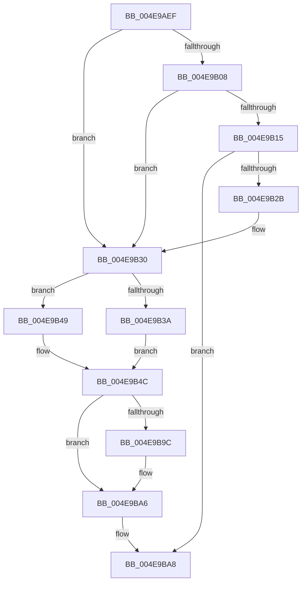

# sub_004E9AEF

- RVA: `0x004E9AEF`–`0x004E9BB0` (길이 `193` bytes)
- VA: `0x00000001404E9AEF`
- 실행 섹션: `.text`
- PDB 이름 있음: `아니요`; PDB Function 태그: `아니요`
- unwind 정보 RVA: `0x000D10E8`
- 디코드: `43`개 명령, `193/193` bytes 표시
- 미해석 바이트: `0` (있으면 어셈블리에 `.byte`로 보존)

> 이 문서는 커널 이미지의 기계어와 PDB 기호를 분석해 생성했습니다. 4번과 5번은 함수 원형과 자료형을 바이너리 사용 방식에서 추정한 C 해석이며 원본 소스 복구 결과는 아닙니다.

## 1. Dependencies

- 직접 호출 지점: **5**; 고유 호출 대상: **4**
- 직접 호출자로 확인된 함수: **0**
- RIP 상대 이미지 참조: **0**

### Outgoing calls
- `0x004E9AF7` → [Feature_OutsideInProtection__private_IsEnabledDeviceUsageNoInline](../5C/Feature_OutsideInProtection__private_IsEnabledDeviceUsageNoInline_function_005CD968.md) (function, `0x005CD968`)
- `0x004E9B22` → [SepGetMandatoryAccessControlList](../../page/79/SepGetMandatoryAccessControlList_function_0079D5EC.md) (function, `0x0079D5EC`)
- `0x004E9B8C` → [RtlpNewSecurityObject](../../page/92/RtlpNewSecurityObject_function_0092AB50.md) (function, `0x0092AB50`)
- `0x004E9B93` → [Feature_OutsideInProtection__private_IsEnabledDeviceUsageNoInline](../5C/Feature_OutsideInProtection__private_IsEnabledDeviceUsageNoInline_function_005CD968.md) (function, `0x005CD968`)
- `0x004E9BA1` → [SepReleaseMandatoryAccessControlList](../../page/79/SepReleaseMandatoryAccessControlList_function_0079D974.md) (function, `0x0079D974`)

### Direct callers
- 이 함수 시작 RVA로 연결되는 직접 call은 확인되지 않았습니다. 간접 호출은 완전히 역산할 수 없습니다.

### Static image references
- 디코드된 RIP-relative 메모리 참조가 없습니다.

## 2. Other-region calls and transfers

- 다른 실행 섹션으로 향하는 call: **3**
  - `0x004E9B22` → [SepGetMandatoryAccessControlList](../../page/79/SepGetMandatoryAccessControlList_function_0079D5EC.md) (`.text` → `PAGE`)
  - `0x004E9B8C` → [RtlpNewSecurityObject](../../page/92/RtlpNewSecurityObject_function_0092AB50.md) (`.text` → `PAGE`)
  - `0x004E9BA1` → [SepReleaseMandatoryAccessControlList](../../page/79/SepReleaseMandatoryAccessControlList_function_0079D974.md) (`.text` → `PAGE`)
- 별도 외부 분기/꼬리 이동을 확인하지 못했습니다.

## 3. Assembly (complete function range)

```asm
004E9AEF  48 89 AC 24 B0 00 00 00         mov qword ptr [rsp + 0xb0], rbp
004E9AF7  E8 6C 3E 0E 00                  call 0x1405cd968
004E9AFC  48 8B AC 24 E8 00 00 00         mov rbp, qword ptr [rsp + 0xe8]
004E9B04  85 C0                           test eax, eax
004E9B06  74 28                           je 0x1404e9b30
004E9B08  48 8B 94 24 00 01 00 00         mov rdx, qword ptr [rsp + 0x100]
004E9B10  48 85 D2                        test rdx, rdx
004E9B13  74 1B                           je 0x1404e9b30
004E9B15  4C 8D 4C 24 68                  lea r9, [rsp + 0x68]
004E9B1A  48 8B CD                        mov rcx, rbp
004E9B1D  4C 8D 44 24 60                  lea r8, [rsp + 0x60]
004E9B22  E8 C5 3A 2B 00                  call 0x14079d5ec
004E9B27  85 C0                           test eax, eax
004E9B29  78 7D                           js 0x1404e9ba8
004E9B2B  48 8B 7C 24 60                  mov rdi, qword ptr [rsp + 0x60]
004E9B30  48 39 9C 24 C8 00 00 00         cmp qword ptr [rsp + 0xc8], rbx
004E9B38  74 0F                           je 0x1404e9b49
004E9B3A  BB 01 00 00 00                  mov ebx, 1
004E9B3F  4C 8D 8C 24 C8 00 00 00         lea r9, [rsp + 0xc8]
004E9B47  EB 03                           jmp 0x1404e9b4c
004E9B49  4C 8B CB                        mov r9, rbx
004E9B4C  48 8B 84 24 F0 00 00 00         mov rax, qword ptr [rsp + 0xf0]
004E9B54  4D 8B C6                        mov r8, r14
004E9B57  48 89 7C 24 50                  mov qword ptr [rsp + 0x50], rdi
004E9B5C  49 8B D7                        mov rdx, r15
004E9B5F  48 89 74 24 48                  mov qword ptr [rsp + 0x48], rsi
004E9B64  49 8B CC                        mov rcx, r12
004E9B67  48 89 44 24 40                  mov qword ptr [rsp + 0x40], rax
004E9B6C  8B 84 24 D8 00 00 00            mov eax, dword ptr [rsp + 0xd8]
004E9B73  48 89 6C 24 38                  mov qword ptr [rsp + 0x38], rbp
004E9B78  89 44 24 30                     mov dword ptr [rsp + 0x30], eax
004E9B7C  0F B6 84 24 D0 00 00 00         movzx eax, byte ptr [rsp + 0xd0]
004E9B84  88 44 24 28                     mov byte ptr [rsp + 0x28], al
004E9B88  89 5C 24 20                     mov dword ptr [rsp + 0x20], ebx
004E9B8C  E8 BF 0F 44 00                  call 0x14092ab50
004E9B91  8B D8                           mov ebx, eax
004E9B93  E8 D0 3D 0E 00                  call 0x1405cd968
004E9B98  85 C0                           test eax, eax
004E9B9A  74 0A                           je 0x1404e9ba6
004E9B9C  48 8D 4C 24 68                  lea rcx, [rsp + 0x68]
004E9BA1  E8 CE 3D 2B 00                  call 0x14079d974
004E9BA6  8B C3                           mov eax, ebx
004E9BA8  48 8B AC 24 B0 00 00 00         mov rbp, qword ptr [rsp + 0xb0]
```

## 4. C-style interpretation (structured pseudocode)

```c
__int64 __fastcall sub_004E9AEF(__int64 a1, __int64 a2, __int64 a3, __int64 a4, __int64 a5, __int64 a6, __int64 a7, __int64 a8, __int64 a9, __int64 a10, __int64 a11, __int64 a12, __int64 a13, __int64 a14, __int64 a15, __int64 a16, __int64 a17, __int64 a18, __int64 a19, __int64 a20, __int64 a21, __int64 a22, __int64 a23, __int64 a24, __int64 a25, unsigned __int8 a26, unsigned int a27, __int64 a28, __int64 a29, __int64 a30, __int64 a31, __int64 a32)
{
    __int64 result;
    unsigned int v_stack_p20;
    unsigned __int8 v_stack_p28;
    unsigned int v_stack_p30;
    unsigned __int64 v_stack_p38;
    unsigned __int64 v_stack_p40;
    unsigned __int64 v_stack_p48;
    unsigned __int64 v_stack_p50;
    unsigned __int64 v_stack_pB0;

    v_stack_pB0 = v_rbp;
    result = Feature_OutsideInProtection__private_IsEnabledDeviceUsageNoInline(a1, a2, a3, a4);
    if ((unsigned int)(result) == 0) goto loc_004E9B30;
    if (a32 == 0) goto loc_004E9B30;
    result = SepGetMandatoryAccessControlList(a29, a32, a12, a13);
    if (sign_flag) goto loc_004E9BA8;
loc_004E9B30:
    if (a25 == v_rbx) goto loc_004E9B49;
    goto loc_004E9B4C;
loc_004E9B49:
loc_004E9B4C:
    v_stack_p50 = a12;
    v_stack_p48 = v_rsi;
    v_stack_p40 = a30;
    v_stack_p38 = a29;
    v_stack_p30 = (unsigned int)((unsigned int)(a27));
    v_stack_p28 = a26;
    v_stack_p20 = 1;
    result = RtlpNewSecurityObject(v_r12, v_r15, v_r14, 1);
    result = Feature_OutsideInProtection__private_IsEnabledDeviceUsageNoInline(v_r12, v_r15, v_r14, 1);
    if ((unsigned int)(result) != 0) {
        a1 = a13;
        result = SepReleaseMandatoryAccessControlList(a1, v_r15, v_r14, 1);
    }
loc_004E9BA8:
    return (unsigned int)((unsigned int)((unsigned int)((unsigned int)(result))));
}
```

## 5. (Beta) C Style

```c
int64_t sub_004E9AEF(int64_t Arg1, int64_t Arg2, int64_t Arg3, int64_t Arg4, uint64_t Arg5, uint64_t Arg6, uint64_t Arg7, uint64_t Arg8, uint64_t Arg9, uint64_t Arg10, uint64_t Arg11, int64_t Arg12, int64_t Arg13, uint64_t Arg14, uint64_t Arg15, uint64_t Arg16, uint64_t Arg17, uint64_t Arg18, uint64_t Arg19, uint64_t Arg20, uint64_t Arg21, int64_t Arg22, uint64_t Arg23, uint64_t Arg24, int64_t Arg25, uint8_t Arg26, uint32_t Arg27, uint64_t Arg28, int64_t Arg29, int64_t Arg30, uint64_t Arg31, int64_t Arg32)
{
    int64_t result;
    uint32_t v_stack_p20;
    uint8_t v_stack_p28;
    uint32_t v_stack_p30;
    uint64_t v_stack_p38;
    uint64_t v_stack_p40;
    uint64_t v_stack_p48;
    uint64_t v_stack_p50;
    uint64_t v_stack_pB0;

    v_stack_pB0 = local_rbp;
    result = Feature_OutsideInProtection__private_IsEnabledDeviceUsageNoInline(Arg1, Arg2, Arg3, Arg4);
    if ((uint32_t)(result) == 0) goto loc_004E9B30;
    if (Arg32 == 0) goto loc_004E9B30;
    result = SepGetMandatoryAccessControlList(Arg29, Arg32, Arg12, Arg13);
    if (sign_flag) goto loc_004E9BA8;
loc_004E9B30:
    if (Arg25 == local_rbx) goto loc_004E9B49;
    goto loc_004E9B4C;
loc_004E9B49:
loc_004E9B4C:
    v_stack_p50 = Arg12;
    v_stack_p48 = local_rsi;
    v_stack_p40 = Arg30;
    v_stack_p38 = Arg29;
    v_stack_p30 = (uint32_t)((uint32_t)(Arg27));
    v_stack_p28 = Arg26;
    v_stack_p20 = 1;
    result = RtlpNewSecurityObject(local_r12, local_r15, local_r14, 1);
    result = Feature_OutsideInProtection__private_IsEnabledDeviceUsageNoInline(local_r12, local_r15, local_r14, 1);
    if ((uint32_t)(result) != 0) {
        Arg1 = Arg13;
        result = SepReleaseMandatoryAccessControlList(Arg1, local_r15, local_r14, 1);
    }
loc_004E9BA8:
    return (uint32_t)((uint32_t)((uint32_t)((uint32_t)(result))));
}
```

## 6. Execution-region graph

[열기: 2D/3D 그래프와 함수 탐색 컨트롤 패널](../../../control-panel.html?section=text&rva=0x004E9AEF&view=graph)

- 2D 그래프는 위에서 아래로 흐르고, 3D 그래프는 빈 공간을 드래그해 회전합니다. Shift+드래그는 이동, 휠은 확대·축소, 함수 노드 선택은 대상 보고서 이동입니다.

### Static fallback


