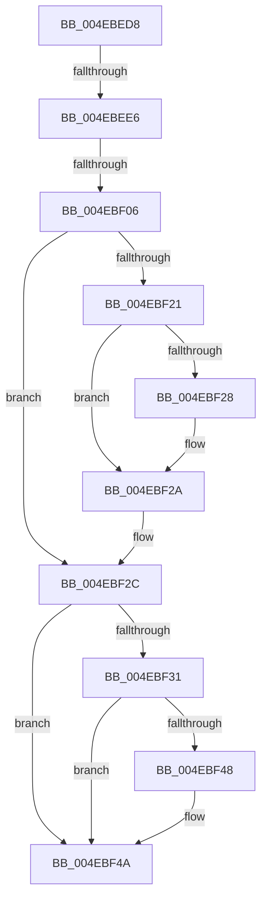

# sub_004EBED8

- RVA: `0x004EBED8`–`0x004EBF54` (길이 `124` bytes)
- VA: `0x00000001404EBED8`
- 실행 섹션: `.text`
- PDB 이름 있음: `아니요`; PDB Function 태그: `아니요`
- unwind 정보 RVA: `0x000D18D8`
- 디코드: `32`개 명령, `124/124` bytes 표시
- 미해석 바이트: `0` (있으면 어셈블리에 `.byte`로 보존)

> 이 문서는 커널 이미지의 기계어와 PDB 기호를 분석해 생성했습니다. 4번과 5번은 함수 원형과 자료형을 바이너리 사용 방식에서 추정한 C 해석이며 원본 소스 복구 결과는 아닙니다.

## 1. Dependencies

- 직접 호출 지점: **3**; 고유 호출 대상: **3**
- 직접 호출자로 확인된 함수: **0**
- RIP 상대 이미지 참조: **0**

### Outgoing calls
- `0x004EBEF8` → [B_TREE<unsigned long,ST_STORE<SM_TRAITS>::_ST_HASH_ENTRY,4096,NP_CONTEXT,ST_STORE<SM_TRAITS>::ST_HASH_ENTRY_COMPARATOR>::BTreeSearchKey](../3A/B_TREE_unsigned_long_ST_STORE_SM_TRAITS__ST_HASH_ENTRY_4096_NP_CONTEXT_ST_STORE_SM_TRAITS_ST_HASH_EN_function_003ADDB0.md) (function, `0x003ADDB0`)
- `0x004EBF18` → [B_TREE<unsigned long,ST_STORE<SM_TRAITS>::_ST_REGION_ENTRY,4096,NP_CONTEXT,ST_STORE<SM_TRAITS>::ST_REGION_ENTRY_COMPARATOR>::BTreeDeleteEx](../3A/B_TREE_unsigned_long_ST_STORE_SM_TRAITS__ST_REGION_ENTRY_4096_NP_CONTEXT_ST_STORE_SM_TRAITS_ST_REGIO_function_003ADAF0.md) (function, `0x003ADAF0`)
- `0x004EBF3F` → [B_TREE<unsigned long,ST_STORE<SM_TRAITS>::_ST_HASH_ENTRY,4096,NP_CONTEXT,ST_STORE<SM_TRAITS>::ST_HASH_ENTRY_COMPARATOR>::BTreeDeleteEx](../3A/B_TREE_unsigned_long_ST_STORE_SM_TRAITS__ST_HASH_ENTRY_4096_NP_CONTEXT_ST_STORE_SM_TRAITS_ST_HASH_EN_function_003AE410.md) (function, `0x003AE410`)

### Direct callers
- 이 함수 시작 RVA로 연결되는 직접 call은 확인되지 않았습니다. 간접 호출은 완전히 역산할 수 없습니다.

### Static image references
- 디코드된 RIP-relative 메모리 참조가 없습니다.

## 2. Other-region calls and transfers

- 다른 실행 섹션으로 향하는 call: **0**
- call이 아닌 외부 분기/꼬리 이동: **2**
  - `0x004EBEE0` → [sub_004EBF65 + 0x1F](Unknown_function_004EBF65.md) (`tail-transfer`)
  - `0x004EBF04` → [sub_004EBF65](Unknown_function_004EBF65.md) (`tail-transfer`)

## 3. Assembly (complete function range)

```asm
004EBED8  48 89 B4 24 A8 00 00 00         mov qword ptr [rsp + 0xa8], rsi
004EBEE0  0F 84 9E 00 00 00               je 0x1404ebf84
004EBEE6  4C 8B C5                        mov r8, rbp
004EBEE9  44 89 7C 24 40                  mov dword ptr [rsp + 0x40], r15d
004EBEEE  41 8B D7                        mov edx, r15d
004EBEF1  48 8D 8F 80 00 00 00            lea rcx, [rdi + 0x80]
004EBEF8  E8 B3 1E EC FF                  call 0x1403addb0
004EBEFD  8B F0                           mov esi, eax
004EBEFF  3D 25 02 00 C0                  cmp eax, 0xc0000225
004EBF04  74 5F                           je 0x1404ebf65
004EBF06  85 F6                           test esi, esi
004EBF08  B8 54 01 00 C0                  mov eax, 0xc0000154
004EBF0D  0F 49 F0                        cmovns esi, eax
004EBF10  48 8D 57 58                     lea rdx, [rdi + 0x58]
004EBF14  48 8D 4F 40                     lea rcx, [rdi + 0x40]
004EBF18  E8 D3 1B EC FF                  call 0x1403adaf0
004EBF1D  85 C0                           test eax, eax
004EBF1F  79 0B                           jns 0x1404ebf2c
004EBF21  3D 06 00 00 C0                  cmp eax, 0xc0000006
004EBF26  74 02                           je 0x1404ebf2a
004EBF28  CD 2C                           int 0x2c
004EBF2A  8B F0                           mov esi, eax
004EBF2C  83 FB 04                        cmp ebx, 4
004EBF2F  72 19                           jb 0x1404ebf4a
004EBF31  48 8D 97 98 00 00 00            lea rdx, [rdi + 0x98]
004EBF38  48 8D 8F 80 00 00 00            lea rcx, [rdi + 0x80]
004EBF3F  E8 CC 24 EC FF                  call 0x1403ae410
004EBF44  85 C0                           test eax, eax
004EBF46  79 02                           jns 0x1404ebf4a
004EBF48  CD 2C                           int 0x2c
004EBF4A  8B C6                           mov eax, esi
004EBF4C  48 8B B4 24 A8 00 00 00         mov rsi, qword ptr [rsp + 0xa8]
```

## 4. C-style interpretation (structured pseudocode)

```c
__int64 __fastcall sub_004EBED8(__int64 a1, __int64 a2, __int64 a3, __int64 a4, __int64 a5, __int64 a6, __int64 a7, __int64 a8, __int64 a9, __int64 a10, __int64 a11, __int64 a12, __int64 a13, __int64 a14, __int64 a15, __int64 a16, __int64 a17, __int64 a18, __int64 a19, __int64 a20, __int64 a21)
{
    __int64 result;
    __int64 v_rsi;
    unsigned int v_stack_p40;
    unsigned __int64 v_stack_pA8;

    v_stack_pA8 = v_rsi;
    v_stack_p40 = (unsigned int)(v_r15);
    result = B_TREE_unsigned_long_ST_STORE_SM_TRAITS____ST_HASH_ENTRY_4096_NP_CONTEXT_ST_STORE_SM_TRAITS___ST_HAS(v_rdi + 128, (unsigned int)((unsigned int)(v_r15)), v_rbp, a4);
    v_rsi = (unsigned int)((unsigned int)(result));
    if (!sign_flag) { v_rsi = (unsigned int)((unsigned int)(0xC0000154ULL)); }
    result = B_TREE_unsigned_long_ST_STORE_SM_TRAITS____ST_REGION_ENTRY_4096_NP_CONTEXT_ST_STORE_SM_TRAITS___ST_R(v_rdi + 64, v_rdi + 88, v_rbp, a4);
    if (!sign_flag) goto loc_004EBF2C;
    if (((unsigned int)(result)) != 0xC0000006ULL) {
    }
loc_004EBF2C:
    if (((unsigned int)(v_rbx)) < 4) goto loc_004EBF4A;
    result = B_TREE_unsigned_long_ST_STORE_SM_TRAITS____ST_HASH_ENTRY_4096_NP_CONTEXT_ST_STORE_SM_TRAITS___ST_HAS(v_rdi + 128, v_rdi + 152, v_rbp, a4);
    if (sign_flag) {
    }
    return (unsigned int)((unsigned int)((unsigned int)((unsigned int)(result))));
}
```

## 5. (Beta) C Style

```c
int64_t sub_004EBED8(int64_t Arg1, int64_t Arg2, int64_t Arg3, int64_t Arg4, uint64_t Arg5, uint64_t Arg6, uint64_t Arg7, uint64_t Arg8, uint64_t Arg9, uint64_t Arg10, uint64_t Arg11, uint64_t Arg12, uint64_t Arg13, uint64_t Arg14, uint64_t Arg15, uint64_t Arg16, uint64_t Arg17, uint64_t Arg18, uint64_t Arg19, uint64_t Arg20, int64_t Arg21)
{
    int64_t result;
    int64_t local_rsi;
    uint32_t v_stack_p40;
    uint64_t v_stack_pA8;

    v_stack_pA8 = local_rsi;
    v_stack_p40 = (uint32_t)(local_r15);
    result = B_TREE_unsigned_long_ST_STORE_SM_TRAITS____ST_HASH_ENTRY_4096_NP_CONTEXT_ST_STORE_SM_TRAITS___ST_HAS(local_rdi + 128, (uint32_t)((uint32_t)(local_r15)), local_rbp, Arg4);
    local_rsi = (uint32_t)((uint32_t)(result));
    if (!sign_flag) { local_rsi = (uint32_t)((uint32_t)(0xC0000154ULL)); }
    result = B_TREE_unsigned_long_ST_STORE_SM_TRAITS____ST_REGION_ENTRY_4096_NP_CONTEXT_ST_STORE_SM_TRAITS___ST_R(local_rdi + 64, local_rdi + 88, local_rbp, Arg4);
    if (!sign_flag) goto loc_004EBF2C;
    if (((uint32_t)(result)) != 0xC0000006ULL) {
    }
loc_004EBF2C:
    if (((uint32_t)(local_rbx)) < 4) goto loc_004EBF4A;
    result = B_TREE_unsigned_long_ST_STORE_SM_TRAITS____ST_HASH_ENTRY_4096_NP_CONTEXT_ST_STORE_SM_TRAITS___ST_HAS(local_rdi + 128, local_rdi + 152, local_rbp, Arg4);
    if (sign_flag) {
    }
    return (uint32_t)((uint32_t)((uint32_t)((uint32_t)(result))));
}
```

## 6. Execution-region graph

[열기: 2D/3D 그래프와 함수 탐색 컨트롤 패널](../../../control-panel.html?section=text&rva=0x004EBED8&view=graph)

- 2D 그래프는 위에서 아래로 흐르고, 3D 그래프는 빈 공간을 드래그해 회전합니다. Shift+드래그는 이동, 휠은 확대·축소, 함수 노드 선택은 대상 보고서 이동입니다.

### Static fallback


