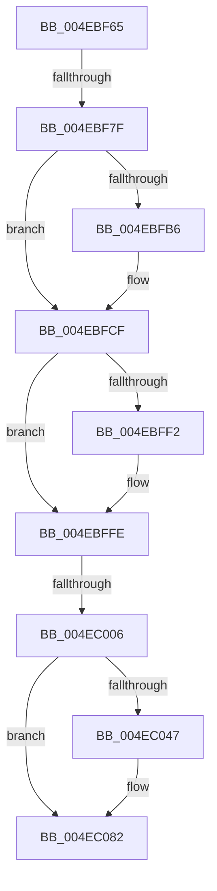

# sub_004EBF65

- RVA: `0x004EBF65`–`0x004EC089` (길이 `292` bytes)
- VA: `0x00000001404EBF65`
- 실행 섹션: `.text`
- PDB 이름 있음: `아니요`; PDB Function 태그: `아니요`
- unwind 정보 RVA: `0x000D1900`
- 디코드: `66`개 명령, `292/292` bytes 표시
- 미해석 바이트: `0` (있으면 어셈블리에 `.byte`로 보존)

> 이 문서는 커널 이미지의 기계어와 PDB 기호를 분석해 생성했습니다. 4번과 5번은 함수 원형과 자료형을 바이너리 사용 방식에서 추정한 C 해석이며 원본 소스 복구 결과는 아닙니다.

## 1. Dependencies

- 직접 호출 지점: **7**; 고유 호출 대상: **7**
- 직접 호출자로 확인된 함수: **0**
- RIP 상대 이미지 참조: **2**

### Outgoing calls
- `0x004EBF74` → [B_TREE<unsigned long,ST_STORE<SM_TRAITS>::_ST_HASH_ENTRY,4096,NP_CONTEXT,ST_STORE<SM_TRAITS>::ST_HASH_ENTRY_COMPARATOR>::BTreeInsertEx](../3A/B_TREE_unsigned_long_ST_STORE_SM_TRAITS__ST_HASH_ENTRY_4096_NP_CONTEXT_ST_STORE_SM_TRAITS_ST_HASH_EN_function_003AE6D0.md) (function, `0x003AE6D0`)
- `0x004EBFA1` → [B_TREE<_SM_PAGE_KEY,ST_STORE<SM_TRAITS>::_ST_PAGE_ENTRY,4096,NP_CONTEXT,B_TREE_KEY_COMPARATOR<_SM_PAGE_KEY> >::BTreeSearchKey](../3A/B_TREE__SM_PAGE_KEY_ST_STORE_SM_TRAITS__ST_PAGE_ENTRY_4096_NP_CONTEXT_B_TREE_KEY_COMPARATOR__SM_PAGE_function_003AC3C0.md) (function, `0x003AC3C0`)
- `0x004EBFBD` → [StLockAcquireExclusive](../26/StLockAcquireExclusive_function_00266FF0.md) (function, `0x00266FF0`)
- `0x004EBFDB` → [B_TREE<_SM_PAGE_KEY,ST_STORE<SM_TRAITS>::_ST_PAGE_ENTRY,4096,NP_CONTEXT,B_TREE_KEY_COMPARATOR<_SM_PAGE_KEY> >::BTreeInsertEx](../3A/B_TREE__SM_PAGE_KEY_ST_STORE_SM_TRAITS__ST_PAGE_ENTRY_4096_NP_CONTEXT_B_TREE_KEY_COMPARATOR__SM_PAGE_function_003AB810.md) (function, `0x003AB810`)
- `0x004EBFF9` → [StLockReleaseExclusive](../26/StLockReleaseExclusive_function_00267050.md) (function, `0x00267050`)
- `0x004EC038` → [ST_STORE<SM_TRAITS>::StDmpUpdateRegionState](../3A/ST_STORE_SM_TRAITS_StDmpUpdateRegionState_function_003AEFE0.md) (function, `0x003AEFE0`)
- `0x004EC07D` → [SmEtwLogStoreOp](../60/SmEtwLogStoreOp_function_0060F584.md) (function, `0x0060F584`)

### Direct callers
- 이 함수 시작 RVA로 연결되는 직접 call은 확인되지 않았습니다. 간접 호출은 완전히 역산할 수 없습니다.

### Static image references
- `0x004EC03D` → RVA `0x00E288DC` (`.data`; read)
- `0x004EC076` → RVA `0x00E288D0` (`.data`; read)

## 2. Other-region calls and transfers

- 다른 실행 섹션으로 향하는 call: **0**
- call이 아닌 외부 분기/꼬리 이동: **3**
  - `0x004EBF7D` → [sub_004EBED8 + 0x38](Unknown_function_004EBED8.md) (`tail-transfer`)
  - `0x004EC000` → [sub_004EBED8 + 0x38](Unknown_function_004EBED8.md) (`tail-transfer`)
  - `0x004EC084` → [sub_004EBED8 + 0x74](Unknown_function_004EBED8.md) (`tail-transfer`)

## 3. Assembly (complete function range)

```asm
004EBF65  4C 8D 44 24 40                  lea r8, [rsp + 0x40]
004EBF6A  48 8B D5                        mov rdx, rbp
004EBF6D  48 8D 8F 80 00 00 00            lea rcx, [rdi + 0x80]
004EBF74  E8 57 27 EC FF                  call 0x1403ae6d0
004EBF79  8B F0                           mov esi, eax
004EBF7B  85 C0                           test eax, eax
004EBF7D  78 91                           js 0x1404ebf10
004EBF7F  BB 06 00 00 00                  mov ebx, 6
004EBF84  41 8B 55 10                     mov edx, dword ptr [r13 + 0x10]
004EBF88  4C 8D 47 18                     lea r8, [rdi + 0x18]
004EBF8C  48 C7 44 24 48 00 00 00 00      mov qword ptr [rsp + 0x48], 0
004EBF95  48 8B CF                        mov rcx, rdi
004EBF98  89 54 24 48                     mov dword ptr [rsp + 0x48], edx
004EBF9C  44 89 7C 24 4C                  mov dword ptr [rsp + 0x4c], r15d
004EBFA1  E8 1A 04 EC FF                  call 0x1403ac3c0
004EBFA6  48 8B B7 20 03 00 00            mov rsi, qword ptr [rdi + 0x320]
004EBFAD  F6 86 95 1A 00 00 04            test byte ptr [rsi + 0x1a95], 4
004EBFB4  74 19                           je 0x1404ebfcf
004EBFB6  48 8D 8E B0 1A 00 00            lea rcx, [rsi + 0x1ab0]
004EBFBD  E8 2E B0 D7 FF                  call 0x140266ff0
004EBFC2  48 FF 86 C0 1A 00 00            inc qword ptr [rsi + 0x1ac0]
004EBFC9  89 86 B8 1A 00 00               mov dword ptr [rsi + 0x1ab8], eax
004EBFCF  48 8D 57 18                     lea rdx, [rdi + 0x18]
004EBFD3  48 8B CF                        mov rcx, rdi
004EBFD6  4C 8D 44 24 48                  lea r8, [rsp + 0x48]
004EBFDB  E8 30 F8 EB FF                  call 0x1403ab810
004EBFE0  48 8B 8F 20 03 00 00            mov rcx, qword ptr [rdi + 0x320]
004EBFE7  8B F0                           mov esi, eax
004EBFE9  F6 81 95 1A 00 00 04            test byte ptr [rcx + 0x1a95], 4
004EBFF0  74 0C                           je 0x1404ebffe
004EBFF2  48 81 C1 B0 1A 00 00            add rcx, 0x1ab0
004EBFF9  E8 52 B0 D7 FF                  call 0x140267050
004EBFFE  85 F6                           test esi, esi
004EC000  0F 88 0A FF FF FF               js 0x1404ebf10
004EC006  8B 8F 2C 03 00 00               mov ecx, dword ptr [rdi + 0x32c]
004EC00C  41 B8 00 10 00 00               mov r8d, 0x1000
004EC012  41 8B 16                        mov edx, dword ptr [r14]
004EC015  41 8B 46 04                     mov eax, dword ptr [r14 + 4]
004EC019  D3 EA                           shr edx, cl
004EC01B  48 8B CF                        mov rcx, rdi
004EC01E  41 23 C4                        and eax, r12d
004EC021  44 0F 47 C0                     cmova r8d, eax
004EC025  8B 87 38 03 00 00               mov eax, dword ptr [rdi + 0x338]
004EC02B  83 C0 0F                        add eax, 0xf
004EC02E  45 33 C9                        xor r9d, r9d
004EC031  44 03 C0                        add r8d, eax
004EC034  41 C1 E8 04                     shr r8d, 4
004EC038  E8 A3 2F EC FF                  call 0x1403aefe0
004EC03D  8B 05 99 C8 93 00               mov eax, dword ptr [rip + 0x93c899]
004EC043  A8 10                           test al, 0x10
004EC045  74 3B                           je 0x1404ec082
004EC047  41 0F B7 4E 04                  movzx ecx, word ptr [r14 + 4]
004EC04C  4C 8D 44 24 48                  lea r8, [rsp + 0x48]
004EC051  41 0F B7 55 00                  movzx edx, word ptr [r13]
004EC056  66 41 23 CC                     and cx, r12w
004EC05A  66 83 E2 07                     and dx, 7
004EC05E  66 89 54 24 38                  mov word ptr [rsp + 0x38], dx
004EC063  33 D2                           xor edx, edx
004EC065  66 89 4C 24 30                  mov word ptr [rsp + 0x30], cx
004EC06A  41 8B 0E                        mov ecx, dword ptr [r14]
004EC06D  48 89 7C 24 28                  mov qword ptr [rsp + 0x28], rdi
004EC072  89 4C 24 20                     mov dword ptr [rsp + 0x20], ecx
004EC076  48 8D 0D 53 C8 93 00            lea rcx, [rip + 0x93c853]
004EC07D  E8 02 35 12 00                  call 0x14060f584
004EC082  33 C0                           xor eax, eax
004EC084  E9 C3 FE FF FF                  jmp 0x1404ebf4c
```

## 4. C-style interpretation (structured pseudocode)

```c
__int64 __fastcall sub_004EBF65(__int64 a1, __int64 a2, __int64 a3, int a4, __int64 a5, __int64 a6, __int64 a7, __int64 a8, __int64 a9)
{
    __int64 result;
    unsigned int v_stack_p20;
    unsigned __int64 v_stack_p28;
    unsigned __int16 v_stack_p30;
    unsigned __int16 v_stack_p38;
    unsigned __int64 v_stack_p48;
    unsigned int v_stack_p4C;

    result = B_TREE_unsigned_long_ST_STORE_SM_TRAITS____ST_HASH_ENTRY_4096_NP_CONTEXT_ST_STORE_SM_TRAITS___ST_HAS(v_rdi + 128, v_rbp, a8, a4);
    v_stack_p48 = 0;
    v_stack_p48 = (unsigned int)((unsigned int)(*(unsigned int *)(v_r13 + 16)));
    v_stack_p4C = (unsigned int)(v_r15);
    result = B_TREE__SM_PAGE_KEY_ST_STORE_SM_TRAITS____ST_PAGE_ENTRY_4096_NP_CONTEXT_B_TREE_KEY_COMPARATOR__SM_PA(v_rdi, (unsigned int)(*(unsigned int *)(v_r13 + 16)), v_rdi + 24, a4);
    if (((*(unsigned __int8 *)(*(unsigned __int64 *)(v_rdi + 800) + 6805)) & (4)) != 0) {
        a1 = *(unsigned __int64 *)(v_rdi + 800) + 6832;
        result = StLockAcquireExclusive(a1, (unsigned int)(*(unsigned int *)(v_r13 + 16)), v_rdi + 24, a4);
        *(unsigned int *)(*(unsigned __int64 *)(v_rdi + 800) + 6840) = (unsigned int)(result);
    }
    result = B_TREE__SM_PAGE_KEY_ST_STORE_SM_TRAITS____ST_PAGE_ENTRY_4096_NP_CONTEXT_B_TREE_KEY_COMPARATOR__SM_PA(v_rdi, v_rdi + 24, a9, a4);
    if (((*(unsigned __int8 *)(*(unsigned __int64 *)(v_rdi + 800) + 6805)) & (4)) != 0) {
        a1 = (*(unsigned __int64 *)(v_rdi + 800)) + (0x1AB0ULL);
        result = StLockReleaseExclusive(a1, v_rdi + 24, a9, a4);
    }
    a2 = (unsigned int)(((unsigned int)(*(unsigned int *)(v_r14))) >> ((unsigned __int8)((unsigned int)(*(unsigned int *)(v_rdi + 812)))));
    result = (unsigned int)(((unsigned int)(*(unsigned int *)(v_r14 + 4))) & ((unsigned int)(v_r12)));
    a3 = (unsigned int)(0x1000ULL);
    if (condition_is_above) { a3 = (unsigned int)(result); }
    result = (unsigned int)(((unsigned int)(*(unsigned int *)(v_rdi + 824))) + (15));
    a4 = 0;
    a3 = (unsigned int)((a3) + ((unsigned int)(result)));
    a3 = (unsigned int)((a3) >> (4));
    result = ST_STORE_SM_TRAITS___StDmpUpdateRegionState(v_rdi, a2, a3, a4);
    result = (unsigned int)(*(unsigned int *)(v_rip + 9685145));
    if ((((unsigned __int8)((unsigned int)(*(unsigned int *)(v_rip + 9685145)))) & (16)) != 0) {
        a1 = *(unsigned __int16 *)(v_r14 + 4);
        a3 = a9;
        a2 = *(unsigned __int16 *)(v_r13);
        a1 = (unsigned __int16)((a1) & ((unsigned __int16)(v_r12)));
        a2 = (unsigned __int16)((a2) & (7));
        v_stack_p38 = (unsigned __int16)(a2);
        a2 = 0;
        v_stack_p30 = (unsigned __int16)(a1);
        a1 = *(unsigned int *)(v_r14);
        v_stack_p28 = v_rdi;
        v_stack_p20 = (unsigned int)(a1);
        a1 = v_rip + 9685075;
        result = SmEtwLogStoreOp(a1, a2, a3, a4);
    }
    result = 0;
}
```

## 5. (Beta) C Style

```c
int64_t sub_004EBF65(int64_t Arg1, int64_t Arg2, int64_t Arg3, int32_t Arg4, uint64_t Arg5, uint64_t Arg6, uint64_t Arg7, int64_t Arg8, int64_t Arg9)
{
    int64_t result;
    uint32_t v_stack_p20;
    uint64_t v_stack_p28;
    uint16_t v_stack_p30;
    uint16_t v_stack_p38;
    uint64_t v_stack_p48;
    uint32_t v_stack_p4C;

    result = B_TREE_unsigned_long_ST_STORE_SM_TRAITS____ST_HASH_ENTRY_4096_NP_CONTEXT_ST_STORE_SM_TRAITS___ST_HAS(local_rdi + 128, local_rbp, Arg8, Arg4);
    v_stack_p48 = 0;
    v_stack_p48 = (uint32_t)((uint32_t)(*(uint32_t *)(local_r13 + 0x10)));
    v_stack_p4C = (uint32_t)(local_r15);
    result = B_TREE__SM_PAGE_KEY_ST_STORE_SM_TRAITS____ST_PAGE_ENTRY_4096_NP_CONTEXT_B_TREE_KEY_COMPARATOR__SM_PA(local_rdi, (uint32_t)(*(uint32_t *)(local_r13 + 0x10)), local_rdi + 24, Arg4);
    if (((*(uint8_t *)(*(uint64_t *)(local_rdi + 0x320) + 0x1A95)) & (4)) != 0) {
        Arg1 = *(uint64_t *)(local_rdi + 0x320) + 6832;
        result = StLockAcquireExclusive(Arg1, (uint32_t)(*(uint32_t *)(local_r13 + 0x10)), local_rdi + 24, Arg4);
        *(uint32_t *)(*(uint64_t *)(local_rdi + 0x320) + 0x1AB8) = (uint32_t)(result);
    }
    result = B_TREE__SM_PAGE_KEY_ST_STORE_SM_TRAITS____ST_PAGE_ENTRY_4096_NP_CONTEXT_B_TREE_KEY_COMPARATOR__SM_PA(local_rdi, local_rdi + 24, Arg9, Arg4);
    if (((*(uint8_t *)(*(uint64_t *)(local_rdi + 0x320) + 0x1A95)) & (4)) != 0) {
        Arg1 = (*(uint64_t *)(local_rdi + 0x320)) + (0x1AB0ULL);
        result = StLockReleaseExclusive(Arg1, local_rdi + 24, Arg9, Arg4);
    }
    Arg2 = (uint32_t)(((uint32_t)(*(uint32_t *)(local_r14))) >> ((uint8_t)((uint32_t)(*(uint32_t *)(local_rdi + 0x32C)))));
    result = (uint32_t)(((uint32_t)(*(uint32_t *)(local_r14 + 0x4))) & ((uint32_t)(local_r12)));
    Arg3 = (uint32_t)(0x1000ULL);
    if (condition_is_above) { Arg3 = (uint32_t)(result); }
    result = (uint32_t)(((uint32_t)(*(uint32_t *)(local_rdi + 0x338))) + (15));
    Arg4 = 0;
    Arg3 = (uint32_t)((Arg3) + ((uint32_t)(result)));
    Arg3 = (uint32_t)((Arg3) >> (4));
    result = ST_STORE_SM_TRAITS___StDmpUpdateRegionState(local_rdi, Arg2, Arg3, Arg4);
    result = (uint32_t)(*(uint32_t *)(v_rip + 0x93C899));
    if ((((uint8_t)((uint32_t)(*(uint32_t *)(v_rip + 0x93C899)))) & (16)) != 0) {
        Arg1 = *(uint16_t *)(local_r14 + 0x4);
        Arg3 = Arg9;
        Arg2 = *(uint16_t *)(local_r13);
        Arg1 = (uint16_t)((Arg1) & ((uint16_t)(local_r12)));
        Arg2 = (uint16_t)((Arg2) & (7));
        v_stack_p38 = (uint16_t)(Arg2);
        Arg2 = 0;
        v_stack_p30 = (uint16_t)(Arg1);
        Arg1 = *(uint32_t *)(local_r14);
        v_stack_p28 = local_rdi;
        v_stack_p20 = (uint32_t)(Arg1);
        Arg1 = v_rip + 9685075;
        result = SmEtwLogStoreOp(Arg1, Arg2, Arg3, Arg4);
    }
    result = 0;
}
```

## 6. Execution-region graph

[열기: 2D/3D 그래프와 함수 탐색 컨트롤 패널](../../../control-panel.html?section=text&rva=0x004EBF65&view=graph)

- 2D 그래프는 위에서 아래로 흐르고, 3D 그래프는 빈 공간을 드래그해 회전합니다. Shift+드래그는 이동, 휠은 확대·축소, 함수 노드 선택은 대상 보고서 이동입니다.

### Static fallback


