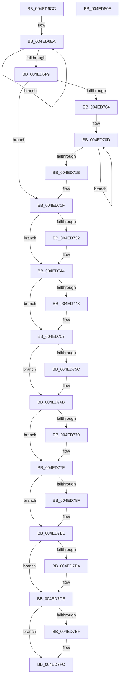

# wil_details_RecordCachedUsage

- RVA: `0x004ED6CC`–`0x004ED80F` (길이 `323` bytes)
- VA: `0x00000001404ED6CC`
- 실행 섹션: `.text`
- PDB 이름 있음: `예`; PDB Function 태그: `아니요`
- unwind 정보 RVA: `0x00080A9C`
- 디코드: `89`개 명령, `323/323` bytes 표시
- 미해석 바이트: `0` (있으면 어셈블리에 `.byte`로 보존)

> 이 문서는 커널 이미지의 기계어와 PDB 기호를 분석해 생성했습니다. 4번과 5번은 함수 원형과 자료형을 바이너리 사용 방식에서 추정한 C 해석이며 원본 소스 복구 결과는 아닙니다.

## 1. Dependencies

- 직접 호출 지점: **2**; 고유 호출 대상: **2**
- 직접 호출자로 확인된 함수: **1**
- RIP 상대 이미지 참조: **1**

### Outgoing calls
- `0x004ED7F7` → [RtlRecordFeatureUsage](../49/RtlRecordFeatureUsage_function_0049C790.md) (function, `0x0049C790`)
- `0x004ED804` → [_security_check_cookie](../6A/_security_check_cookie_function_006AC640.md) (function, `0x006AC640`)

### Direct callers
- [wil_details_OnFeatureUsageProviderFlushNotification](../../page/7E/wil_details_OnFeatureUsageProviderFlushNotification_function_007E5FD0.md) at `0x007E6001`

### Static image references
- `0x004ED6D0` → RVA `0x00E0A740` (`.data`; read)

## 2. Other-region calls and transfers

- 다른 실행 섹션으로 향하는 call: **0**
- 별도 외부 분기/꼬리 이동을 확인하지 못했습니다.

## 3. Assembly (complete function range)

```asm
004ED6CC  48 83 EC 68                     sub rsp, 0x68
004ED6D0  48 8B 05 69 D0 91 00            mov rax, qword ptr [rip + 0x91d069]
004ED6D7  48 33 C4                        xor rax, rsp
004ED6DA  48 89 44 24 58                  mov qword ptr [rsp + 0x58], rax
004ED6DF  4C 8B CA                        mov r9, rdx
004ED6E2  44 8B D1                        mov r10d, ecx
004ED6E5  0F 0D 0A                        prefetchw byte ptr [rdx]
004ED6E8  8B 02                           mov eax, dword ptr [rdx]
004ED6EA  8B D0                           mov edx, eax
004ED6EC  81 E2 1E 40 C0 FF               and edx, 0xffc0401e
004ED6F2  F0 41 0F B1 11                  lock cmpxchg dword ptr [r9], edx
004ED6F7  75 F1                           jne 0x1404ed6ea
004ED6F9  8B C8                           mov ecx, eax
004ED6FB  8B D0                           mov edx, eax
004ED6FD  D1 E9                           shr ecx, 1
004ED6FF  83 E1 0F                        and ecx, 0xf
004ED702  74 1B                           je 0x1404ed71f
004ED704  41 0F 0D 49 04                  prefetchw byte ptr [r9 + 4]
004ED709  41 8B 41 04                     mov eax, dword ptr [r9 + 4]
004ED70D  44 8B C0                        mov r8d, eax
004ED710  44 0B C1                        or r8d, ecx
004ED713  F0 45 0F B1 41 04               lock cmpxchg dword ptr [r9 + 4], r8d
004ED719  75 F2                           jne 0x1404ed70d
004ED71B  F7 D0                           not eax
004ED71D  23 C8                           and ecx, eax
004ED71F  B8 02 00 00 00                  mov eax, 2
004ED724  4C 8D 44 24 28                  lea r8, [rsp + 0x28]
004ED729  44 8D 48 FF                     lea r9d, [rax - 1]
004ED72D  41 84 C9                        test r9b, cl
004ED730  74 12                           je 0x1404ed744
004ED732  44 89 54 24 28                  mov dword ptr [rsp + 0x28], r10d
004ED737  4C 8D 44 24 30                  lea r8, [rsp + 0x30]
004ED73C  C7 44 24 2C 02 00 01 00         mov dword ptr [rsp + 0x2c], 0x10002
004ED744  84 C8                           test al, cl
004ED746  74 0F                           je 0x1404ed757
004ED748  45 89 10                        mov dword ptr [r8], r10d
004ED74B  41 C7 40 04 06 00 01 00         mov dword ptr [r8 + 4], 0x10006
004ED753  49 83 C0 08                     add r8, 8
004ED757  F6 C1 04                        test cl, 4
004ED75A  74 0F                           je 0x1404ed76b
004ED75C  45 89 10                        mov dword ptr [r8], r10d
004ED75F  41 C7 40 04 03 00 01 00         mov dword ptr [r8 + 4], 0x10003
004ED767  49 83 C0 08                     add r8, 8
004ED76B  83 F9 08                        cmp ecx, 8
004ED76E  72 0F                           jb 0x1404ed77f
004ED770  45 89 10                        mov dword ptr [r8], r10d
004ED773  41 C7 40 04 07 00 01 00         mov dword ptr [r8 + 4], 0x10007
004ED77B  49 83 C0 08                     add r8, 8
004ED77F  8B CA                           mov ecx, edx
004ED781  41 BB FF 01 00 00               mov r11d, 0x1ff
004ED787  C1 E9 05                        shr ecx, 5
004ED78A  41 85 CB                        test r11d, ecx
004ED78D  74 22                           je 0x1404ed7b1
004ED78F  66 41 23 CB                     and cx, r11w
004ED793  45 89 10                        mov dword ptr [r8], r10d
004ED796  8B C2                           mov eax, edx
004ED798  66 41 89 48 06                  mov word ptr [r8 + 6], cx
004ED79D  C1 E8 0E                        shr eax, 0xe
004ED7A0  66 41 23 C1                     and ax, r9w
004ED7A4  66 C1 E0 02                     shl ax, 2
004ED7A8  66 41 89 40 04                  mov word ptr [r8 + 4], ax
004ED7AD  49 83 C0 08                     add r8, 8
004ED7B1  8B C2                           mov eax, edx
004ED7B3  C1 E8 0F                        shr eax, 0xf
004ED7B6  A8 7F                           test al, 0x7f
004ED7B8  74 24                           je 0x1404ed7de
004ED7BA  C1 EA 16                        shr edx, 0x16
004ED7BD  66 83 E0 7F                     and ax, 0x7f
004ED7C1  66 41 23 D1                     and dx, r9w
004ED7C5  45 89 10                        mov dword ptr [r8], r10d
004ED7C8  66 C1 E2 02                     shl dx, 2
004ED7CC  66 41 03 D1                     add dx, r9w
004ED7D0  66 41 89 40 06                  mov word ptr [r8 + 6], ax
004ED7D5  66 41 89 50 04                  mov word ptr [r8 + 4], dx
004ED7DA  49 83 C0 08                     add r8, 8
004ED7DE  48 8D 44 24 28                  lea rax, [rsp + 0x28]
004ED7E3  4C 2B C0                        sub r8, rax
004ED7E6  49 C1 F8 03                     sar r8, 3
004ED7EA  4D 85 C0                        test r8, r8
004ED7ED  7E 0D                           jle 0x1404ed7fc
004ED7EF  49 8B D0                        mov rdx, r8
004ED7F2  48 8D 4C 24 28                  lea rcx, [rsp + 0x28]
004ED7F7  E8 94 EF FA FF                  call 0x14049c790
004ED7FC  48 8B 4C 24 58                  mov rcx, qword ptr [rsp + 0x58]
004ED801  48 33 CC                        xor rcx, rsp
004ED804  E8 37 EE 1B 00                  call 0x1406ac640
004ED809  48 83 C4 68                     add rsp, 0x68
004ED80D  C3                              ret
004ED80E  CC                              int3
```

## 4. C-style interpretation (structured pseudocode)

```c
__int64 __fastcall wil_details_RecordCachedUsage(int a1, __int64 a2)
{
    __int64 result;
    __int64 v_rsp;
    unsigned __int64 v_stack_m10;
    unsigned __int64 v_stack_m38;
    unsigned int v_stack_m3C;
    unsigned __int64 v_stack_m40;

    v_rsp = (v_rsp) - (104);
    result = (*(unsigned __int64 *)(v_rip + 9556073)) ^ (v_rsp);
    v_stack_m10 = result;
loc_004ED6EA:
    a2 = (unsigned int)(((unsigned int)((unsigned int)((unsigned int)(*(unsigned int *)(a2))))) & (0xFFC0401EULL));
    if (condition_is_not_equal) goto loc_004ED6EA;
    a1 = (unsigned int)(((unsigned int)((unsigned int)((unsigned int)(*(unsigned int *)(a2))))) >> (1));
    a1 = (unsigned int)((a1) & (15));
    if (condition_is_equal) goto loc_004ED71F;
loc_004ED70D:
    a3 = (unsigned int)(((unsigned int)((unsigned int)((unsigned int)(*(unsigned int *)(a2 + 4))))) | (a1));
    if (condition_is_not_equal) goto loc_004ED70D;
    result = (unsigned int)(~((unsigned int)(*(unsigned int *)(a2 + 4))));
    a1 = (unsigned int)((a1) & ((unsigned int)(result)));
loc_004ED71F:
    if ((((unsigned __int8)(2 - 1)) & ((unsigned __int8)(a1))) != 0) {
        v_stack_m40 = (unsigned int)((unsigned int)(a1));
        a3 = v_stack_m38;
        v_stack_m3C = 0x10002ULL;
    }
    if (((2) & ((unsigned __int8)(a1))) != 0) {
        *(unsigned int *)(a3) = (unsigned int)((unsigned int)(a1));
        *(unsigned int *)(a3 + 4) = 0x10006ULL;
        a3 = (a3) + (8);
    }
    if ((((unsigned __int8)(a1)) & (4)) != 0) {
        *(unsigned int *)(a3) = (unsigned int)((unsigned int)(a1));
        *(unsigned int *)(a3 + 4) = 0x10003ULL;
        a3 = (a3) + (8);
    }
    if (a1 >= 8) {
        *(unsigned int *)(a3) = (unsigned int)((unsigned int)(a1));
        *(unsigned int *)(a3 + 4) = 0x10007ULL;
        a3 = (a3) + (8);
    }
    a1 = (unsigned int)(((unsigned int)((unsigned int)((unsigned int)((unsigned int)((unsigned int)(*(unsigned int *)(a2))))))) >> (5));
    result = 2;
    if (((511) & (a1)) != 0) {
        a1 = (unsigned __int16)((a1) & (511));
        *(unsigned int *)(a3) = (unsigned int)((unsigned int)(a1));
        result = (unsigned int)((unsigned int)((unsigned int)((unsigned int)(*(unsigned int *)(a2)))));
        *(unsigned __int16 *)(a3 + 6) = (unsigned __int16)(a1);
        result = (unsigned int)((result) >> (14));
        result = (unsigned __int16)((result) & ((unsigned __int16)(2 - 1)));
        result = (unsigned __int16)((result) << (2));
        *(unsigned __int16 *)(a3 + 4) = (unsigned __int16)(result);
        a3 = (a3) + (8);
    }
    result = (unsigned int)(((unsigned int)((unsigned int)((unsigned int)((unsigned int)((unsigned int)(*(unsigned int *)(a2))))))) >> (15));
    if ((((unsigned __int8)(result)) & (127)) != 0) {
        a2 = (unsigned int)(((unsigned int)((unsigned int)((unsigned int)(*(unsigned int *)(a2))))) >> (22));
        result = (unsigned __int16)((result) & (127));
        a2 = (unsigned __int16)((a2) & ((unsigned __int16)(2 - 1)));
        *(unsigned int *)(a3) = (unsigned int)((unsigned int)(a1));
        a2 = (unsigned __int16)((a2) << (2));
        a2 = (unsigned __int16)((a2) + ((unsigned __int16)(2 - 1)));
        *(unsigned __int16 *)(a3 + 6) = (unsigned __int16)(result);
        *(unsigned __int16 *)(a3 + 4) = (unsigned __int16)(a2);
        a3 = (a3) + (8);
    }
    a3 = (a3) - (v_stack_m40);
    a3 = (a3) >> (3);
    result = v_stack_m40;
    if (!(condition_is_less_or_equal)) {
        a2 = a3;
        a1 = v_stack_m40;
        result = RtlRecordFeatureUsage(a1, a2, a3, 2 - 1);
    }
    a1 = (v_stack_m10) ^ (v_rsp);
    result = _security_check_cookie(a1, a2, a3, 2 - 1);
    v_rsp = (v_rsp) + (104);
    return result;
}
```

## 5. (Beta) C Style

```c
int64_t wil_details_RecordCachedUsage(int32_t Arg1, void *Arg2)
{
    uint8_t *arg2 = (uint8_t *)Arg2;

    int64_t result;
    int64_t local_rsp;
    uint64_t v_stack_m10;
    uint64_t v_stack_m38;
    uint32_t v_stack_m3C;
    uint64_t v_stack_m40;

    local_rsp = (local_rsp) - (104);
    result = (*(uint64_t *)(v_rip + 0x91D069)) ^ (local_rsp);
    v_stack_m10 = result;
loc_004ED6EA:
    Arg2 = (uint32_t)(((uint32_t)((uint32_t)((uint32_t)(*(uint32_t *)(arg2))))) & (0xFFC0401EULL));
    if (condition_is_not_equal) goto loc_004ED6EA;
    Arg1 = (uint32_t)(((uint32_t)((uint32_t)((uint32_t)(*(uint32_t *)(arg2))))) >> (1));
    Arg1 = (uint32_t)((Arg1) & (15));
    if (condition_is_equal) goto loc_004ED71F;
loc_004ED70D:
    a3 = (uint32_t)(((uint32_t)((uint32_t)((uint32_t)(*(uint32_t *)(arg2 + 0x4))))) | (Arg1));
    if (condition_is_not_equal) goto loc_004ED70D;
    result = (uint32_t)(~((uint32_t)(*(uint32_t *)(arg2 + 0x4))));
    Arg1 = (uint32_t)((Arg1) & ((uint32_t)(result)));
loc_004ED71F:
    if ((((uint8_t)(2 - 1)) & ((uint8_t)(Arg1))) != 0) {
        v_stack_m40 = (uint32_t)((uint32_t)(Arg1));
        a3 = v_stack_m38;
        v_stack_m3C = 0x10002ULL;
    }
    if (((2) & ((uint8_t)(Arg1))) != 0) {
        *(uint32_t *)(a3) = (uint32_t)((uint32_t)(Arg1));
        *(uint32_t *)(a3 + 0x4) = 0x10006ULL;
        a3 = (a3) + (8);
    }
    if ((((uint8_t)(Arg1)) & (4)) != 0) {
        *(uint32_t *)(a3) = (uint32_t)((uint32_t)(Arg1));
        *(uint32_t *)(a3 + 0x4) = 0x10003ULL;
        a3 = (a3) + (8);
    }
    if (Arg1 >= 8) {
        *(uint32_t *)(a3) = (uint32_t)((uint32_t)(Arg1));
        *(uint32_t *)(a3 + 0x4) = 0x10007ULL;
        a3 = (a3) + (8);
    }
    Arg1 = (uint32_t)(((uint32_t)((uint32_t)((uint32_t)((uint32_t)((uint32_t)(*(uint32_t *)(arg2))))))) >> (5));
    result = 2;
    if (((511) & (Arg1)) != 0) {
        Arg1 = (uint16_t)((Arg1) & (511));
        *(uint32_t *)(a3) = (uint32_t)((uint32_t)(Arg1));
        result = (uint32_t)((uint32_t)((uint32_t)((uint32_t)(*(uint32_t *)(arg2)))));
        *(uint16_t *)(a3 + 0x6) = (uint16_t)(Arg1);
        result = (uint32_t)((result) >> (14));
        result = (uint16_t)((result) & ((uint16_t)(2 - 1)));
        result = (uint16_t)((result) << (2));
        *(uint16_t *)(a3 + 0x4) = (uint16_t)(result);
        a3 = (a3) + (8);
    }
    result = (uint32_t)(((uint32_t)((uint32_t)((uint32_t)((uint32_t)((uint32_t)(*(uint32_t *)(arg2))))))) >> (15));
    if ((((uint8_t)(result)) & (127)) != 0) {
        Arg2 = (uint32_t)(((uint32_t)((uint32_t)((uint32_t)(*(uint32_t *)(arg2))))) >> (22));
        result = (uint16_t)((result) & (127));
        Arg2 = (uint16_t)((Arg2) & ((uint16_t)(2 - 1)));
        *(uint32_t *)(a3) = (uint32_t)((uint32_t)(Arg1));
        Arg2 = (uint16_t)((Arg2) << (2));
        Arg2 = (uint16_t)((Arg2) + ((uint16_t)(2 - 1)));
        *(uint16_t *)(a3 + 0x6) = (uint16_t)(result);
        *(uint16_t *)(a3 + 0x4) = (uint16_t)(Arg2);
        a3 = (a3) + (8);
    }
    a3 = (a3) - (v_stack_m40);
    a3 = (a3) >> (3);
    result = v_stack_m40;
    if (!(condition_is_less_or_equal)) {
        Arg2 = a3;
        Arg1 = v_stack_m40;
        result = RtlRecordFeatureUsage(Arg1, Arg2, a3, 2 - 1);
    }
    Arg1 = (v_stack_m10) ^ (local_rsp);
    result = _security_check_cookie(Arg1, Arg2, a3, 2 - 1);
    local_rsp = (local_rsp) + (104);
    return result;
}
```

### 관측된 메모리 오프셋

구조체 형식이 확인되지 않은 접근은 인자 기준의 오프셋으로만 기록했습니다.

| 기준 인자 | 오프셋 표현 | 폭 (bit) | 접근 |
|---|---:|---:|---|
| `Arg2` | `+ 0x0` | `8` | `R` |
| `Arg2` | `+ 0x0` | `32` | `R` |
| `Arg2` | `+ 0x4` | `8` | `R` |
| `Arg2` | `+ 0x4` | `32` | `R` |

## 6. Execution-region graph

[열기: 2D/3D 그래프와 함수 탐색 컨트롤 패널](../../../control-panel.html?section=text&rva=0x004ED6CC&view=graph)

- 2D 그래프는 위에서 아래로 흐르고, 3D 그래프는 빈 공간을 드래그해 회전합니다. Shift+드래그는 이동, 휠은 확대·축소, 함수 노드 선택은 대상 보고서 이동입니다.

### Static fallback


