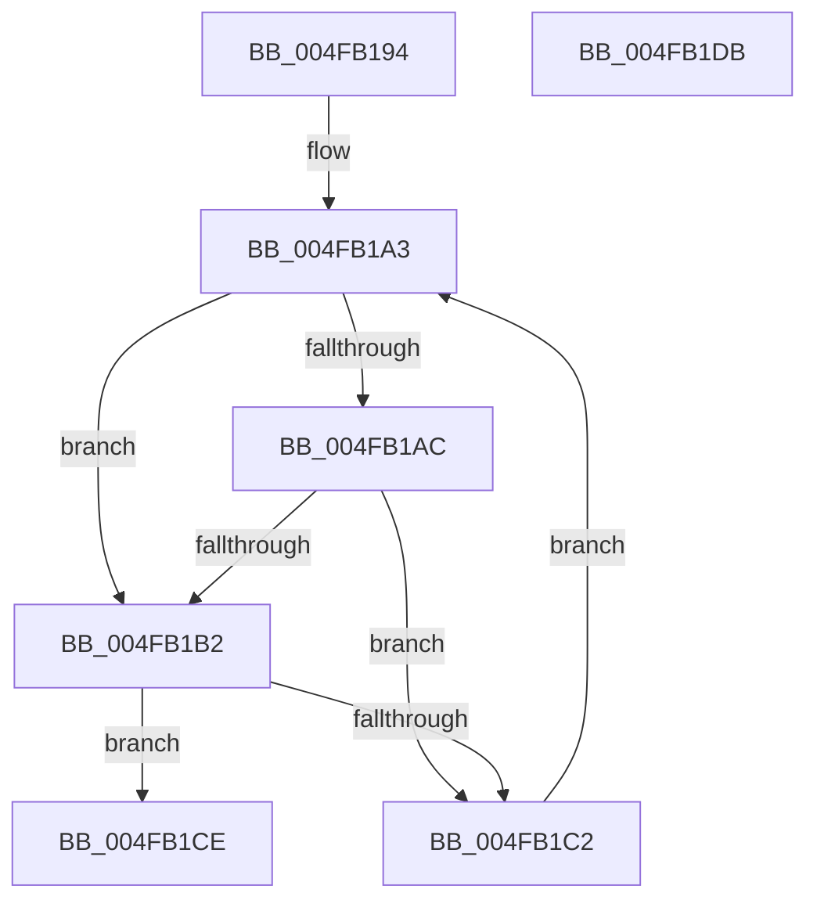

# AccelpWaitForCompletionBusySpin

- RVA: `0x004FB194`–`0x004FB1DC` (길이 `72` bytes)
- VA: `0x00000001404FB194`
- 실행 섹션: `.text`
- PDB 이름 있음: `예`; PDB Function 태그: `아니요`
- unwind 정보 RVA: `0x00068D5C`
- 디코드: `25`개 명령, `72/72` bytes 표시
- 미해석 바이트: `0` (있으면 어셈블리에 `.byte`로 보존)

> 이 문서는 커널 이미지의 기계어와 PDB 기호를 분석해 생성했습니다. 4번과 5번은 함수 원형과 자료형을 바이너리 사용 방식에서 추정한 C 해석이며 원본 소스 복구 결과는 아닙니다.

## 1. Dependencies

- 직접 호출 지점: **1**; 고유 호출 대상: **1**
- 직접 호출자로 확인된 함수: **1**
- RIP 상대 이미지 참조: **0**

### Outgoing calls
- `0x004FB1C7` → [KeStallExecutionProcessor](../44/KeStallExecutionProcessor_function_0044F620.md) (function, `0x0044F620`)

### Direct callers
- [AccelpSiovInternalOperationHandler](../2C/AccelpSiovInternalOperationHandler_function_002C7DDC.md) at `0x002C7ECD`

### Static image references
- 디코드된 RIP-relative 메모리 참조가 없습니다.

## 2. Other-region calls and transfers

- 다른 실행 섹션으로 향하는 call: **0**
- 별도 외부 분기/꼬리 이동을 확인하지 못했습니다.

## 3. Assembly (complete function range)

```asm
004FB194  48 89 5C 24 10                  mov qword ptr [rsp + 0x10], rbx
004FB199  57                              push rdi
004FB19A  48 83 EC 20                     sub rsp, 0x20
004FB19E  48 8B FA                        mov rdi, rdx
004FB1A1  8B D9                           mov ebx, ecx
004FB1A3  44 8B C3                        mov r8d, ebx
004FB1A6  41 83 E8 01                     sub r8d, 1
004FB1AA  74 06                           je 0x1404fb1b2
004FB1AC  41 83 F8 01                     cmp r8d, 1
004FB1B0  75 10                           jne 0x1404fb1c2
004FB1B2  8A 07                           mov al, byte ptr [rdi]
004FB1B4  24 3F                           and al, 0x3f
004FB1B6  88 44 24 30                     mov byte ptr [rsp + 0x30], al
004FB1BA  8A 44 24 30                     mov al, byte ptr [rsp + 0x30]
004FB1BE  84 C0                           test al, al
004FB1C0  75 0C                           jne 0x1404fb1ce
004FB1C2  B9 14 00 00 00                  mov ecx, 0x14
004FB1C7  E8 54 44 F5 FF                  call 0x14044f620
004FB1CC  EB D5                           jmp 0x1404fb1a3
004FB1CE  48 8B 5C 24 38                  mov rbx, qword ptr [rsp + 0x38]
004FB1D3  33 C0                           xor eax, eax
004FB1D5  48 83 C4 20                     add rsp, 0x20
004FB1D9  5F                              pop rdi
004FB1DA  C3                              ret
004FB1DB  CC                              int3
```

## 4. C-style interpretation (structured pseudocode)

```c
__int64 __fastcall AccelpWaitForCompletionBusySpin(int a1, __int64 a2)
{
    __int64 result;
    __int64 v_rsp;
    unsigned __int64 v_stack_p10;
    unsigned __int8 v_stack_p8;

    v_stack_p10 = v_rbx;
    v_rsp = (v_rsp) - (32);
loc_004FB1A3:
    a3 = (unsigned int)(((unsigned int)((unsigned int)((unsigned int)(a1)))) - (1));
    if (condition_is_equal) goto loc_004FB1B2;
    if (((unsigned int)(a3)) != 1) goto loc_004FB1C2;
loc_004FB1B2:
    result = (unsigned __int8)((*(unsigned __int8 *)(a2)) & (63));
    v_stack_p8 = (unsigned __int8)(result);
    if ((unsigned __int8)(v_stack_p8) != 0) goto loc_004FB1CE;
loc_004FB1C2:
    result = KeStallExecutionProcessor(20, a2, a3, a4);
    goto loc_004FB1A3;
loc_004FB1CE:
    result = 0;
    v_rsp = (v_rsp) + (32);
    return result;
}
```

## 5. (Beta) C Style

```c
int64_t AccelpWaitForCompletionBusySpin(int32_t Arg1, void *Arg2)
{
    uint8_t *arg2 = (uint8_t *)Arg2;

    int64_t result;
    int64_t local_rsp;
    uint64_t v_stack_p10;
    uint8_t v_stack_p8;

    v_stack_p10 = local_rbx;
    local_rsp = (local_rsp) - (32);
loc_004FB1A3:
    a3 = (uint32_t)(((uint32_t)((uint32_t)((uint32_t)(Arg1)))) - (1));
    if (condition_is_equal) goto loc_004FB1B2;
    if (((uint32_t)(a3)) != 1) goto loc_004FB1C2;
loc_004FB1B2:
    result = (uint8_t)((*(uint8_t *)(arg2)) & (63));
    v_stack_p8 = (uint8_t)(result);
    if ((uint8_t)(v_stack_p8) != 0) goto loc_004FB1CE;
loc_004FB1C2:
    result = KeStallExecutionProcessor(20, Arg2, a3, a4);
    goto loc_004FB1A3;
loc_004FB1CE:
    result = 0;
    local_rsp = (local_rsp) + (32);
    return result;
}
```

### 관측된 메모리 오프셋

구조체 형식이 확인되지 않은 접근은 인자 기준의 오프셋으로만 기록했습니다.

| 기준 인자 | 오프셋 표현 | 폭 (bit) | 접근 |
|---|---:|---:|---|
| `Arg2` | `+ 0x0` | `8` | `R` |

## 6. Execution-region graph

[열기: 2D/3D 그래프와 함수 탐색 컨트롤 패널](../../../control-panel.html?section=text&rva=0x004FB194&view=graph)

- 2D 그래프는 위에서 아래로 흐르고, 3D 그래프는 빈 공간을 드래그해 회전합니다. Shift+드래그는 이동, 휠은 확대·축소, 함수 노드 선택은 대상 보고서 이동입니다.

### Static fallback


