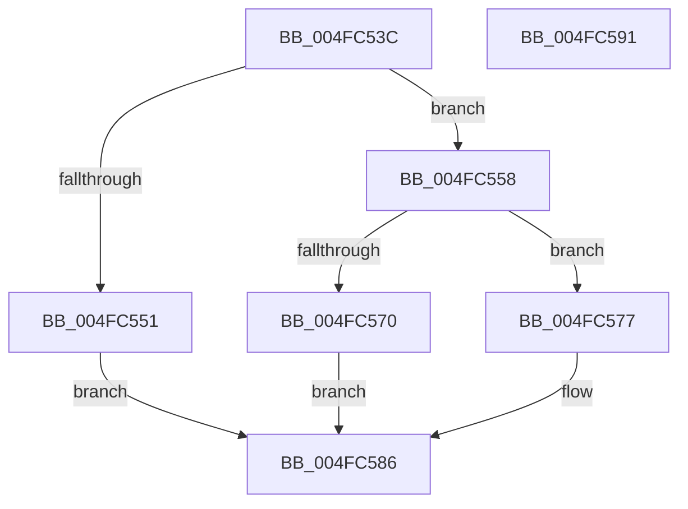

# AllocateZeroMemory

- RVA: `0x004FC53C`–`0x004FC592` (길이 `86` bytes)
- VA: `0x00000001404FC53C`
- 실행 섹션: `.text`
- PDB 이름 있음: `예`; PDB Function 태그: `예`
- unwind 정보 RVA: `0x0005CAAC`
- 디코드: `27`개 명령, `86/86` bytes 표시
- 미해석 바이트: `0` (있으면 어셈블리에 `.byte`로 보존)

> 이 문서는 커널 이미지의 기계어와 PDB 기호를 분석해 생성했습니다. 4번과 5번은 함수 원형과 자료형을 바이너리 사용 방식에서 추정한 C 해석이며 원본 소스 복구 결과는 아닙니다.

## 1. Dependencies

- 직접 호출 지점: **2**; 고유 호출 대상: **2**
- 직접 호출자로 확인된 함수: **1**
- RIP 상대 이미지 참조: **0**

### Outgoing calls
- `0x004FC563` → [ExAllocatePool2](../../poolcode/B8/ExAllocatePool2_function_00B820F0.md) (function, `0x00B820F0`)
- `0x004FC57F` → [memset](../6C/memset_function_006C6C40.md) (function, `0x006C6C40`)

### Direct callers
- [FsepPropagateGovernedFeatureEffectiveState](../../page/83/FsepPropagateGovernedFeatureEffectiveState_function_0083A89C.md) at `0x0083A8E2`

### Static image references
- 디코드된 RIP-relative 메모리 참조가 없습니다.

## 2. Other-region calls and transfers

- 다른 실행 섹션으로 향하는 call: **1**
  - `0x004FC563` → [ExAllocatePool2](../../poolcode/B8/ExAllocatePool2_function_00B820F0.md) (`.text` → `POOLCODE`)
- 별도 외부 분기/꼬리 이동을 확인하지 못했습니다.

## 3. Assembly (complete function range)

```asm
004FC53C  48 89 5C 24 08                  mov qword ptr [rsp + 8], rbx
004FC541  57                              push rdi
004FC542  48 83 EC 20                     sub rsp, 0x20
004FC546  48 8B DA                        mov rbx, rdx
004FC549  48 8B F9                        mov rdi, rcx
004FC54C  48 85 C9                        test rcx, rcx
004FC54F  75 07                           jne 0x1404fc558
004FC551  B8 0D 00 00 C0                  mov eax, 0xc000000d
004FC556  EB 2E                           jmp 0x1404fc586
004FC558  B9 00 01 00 00                  mov ecx, 0x100
004FC55D  41 B8 46 63 50 6C               mov r8d, 0x6c506346
004FC563  E8 88 5B 68 00                  call 0x140b820f0
004FC568  48 89 07                        mov qword ptr [rdi], rax
004FC56B  48 85 C0                        test rax, rax
004FC56E  75 07                           jne 0x1404fc577
004FC570  B8 17 00 00 C0                  mov eax, 0xc0000017
004FC575  EB 0F                           jmp 0x1404fc586
004FC577  4C 8B C3                        mov r8, rbx
004FC57A  33 D2                           xor edx, edx
004FC57C  48 8B C8                        mov rcx, rax
004FC57F  E8 BC A6 1C 00                  call 0x1406c6c40
004FC584  33 C0                           xor eax, eax
004FC586  48 8B 5C 24 30                  mov rbx, qword ptr [rsp + 0x30]
004FC58B  48 83 C4 20                     add rsp, 0x20
004FC58F  5F                              pop rdi
004FC590  C3                              ret
004FC591  CC                              int3
```

## 4. C-style interpretation (structured pseudocode)

```c
__int64 __fastcall AllocateZeroMemory(__int64 a1, __int64 a2)
{
    __int64 result;
    __int64 v_rsp;
    unsigned __int64 v_stack_p8;

    v_stack_p8 = v_rbx;
    v_rsp = (v_rsp) - (32);
    if (a1 != 0) goto loc_004FC558;
    goto loc_004FC586;
loc_004FC558:
    result = ExAllocatePool2(256, a2, (unsigned int)(0x6C506346ULL), a4);
    *(unsigned __int64 *)(a1) = result;
    if (result != 0) goto loc_004FC577;
    goto loc_004FC586;
loc_004FC577:
    a2 = 0;
    result = memset((unsigned int)(0xC0000017ULL), a2, a2, a4);
    result = 0;
loc_004FC586:
    v_rsp = (v_rsp) + (32);
    return result;
}
```

## 5. (Beta) C Style

```c
int64_t AllocateZeroMemory(void *Arg1, int64_t Arg2)
{
    uint8_t *arg1 = (uint8_t *)Arg1;

    int64_t result;
    int64_t local_rsp;
    uint64_t v_stack_p8;

    v_stack_p8 = local_rbx;
    local_rsp = (local_rsp) - (32);
    if (Arg1 != NULL) goto loc_004FC558;
    goto loc_004FC586;
loc_004FC558:
    result = ExAllocatePool2(256, Arg2, (uint32_t)(0x6C506346ULL), a4);
    *(uint64_t *)(arg1) = result;
    if (result != 0) goto loc_004FC577;
    goto loc_004FC586;
loc_004FC577:
    Arg2 = 0;
    result = memset((uint32_t)(0xC0000017ULL), Arg2, Arg2, a4);
    result = 0;
loc_004FC586:
    local_rsp = (local_rsp) + (32);
    return result;
}
```

### 관측된 메모리 오프셋

구조체 형식이 확인되지 않은 접근은 인자 기준의 오프셋으로만 기록했습니다.

| 기준 인자 | 오프셋 표현 | 폭 (bit) | 접근 |
|---|---:|---:|---|
| `Arg1` | `+ 0x0` | `64` | `W` |

## 6. Execution-region graph

[열기: 2D/3D 그래프와 함수 탐색 컨트롤 패널](../../../control-panel.html?section=text&rva=0x004FC53C&view=graph)

- 2D 그래프는 위에서 아래로 흐르고, 3D 그래프는 빈 공간을 드래그해 회전합니다. Shift+드래그는 이동, 휠은 확대·축소, 함수 노드 선택은 대상 보고서 이동입니다.

### Static fallback


