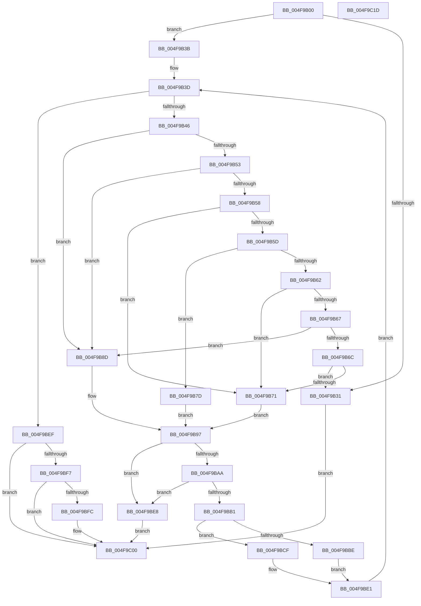

# AuthzBasepDeleteSecurityAttributeValues

- RVA: `0x004F9B00`–`0x004F9C1E` (길이 `286` bytes)
- VA: `0x00000001404F9B00`
- 실행 섹션: `.text`
- PDB 이름 있음: `예`; PDB Function 태그: `아니요`
- unwind 정보 RVA: `0x0005E6B4`
- 디코드: `91`개 명령, `286/286` bytes 표시
- 미해석 바이트: `0` (있으면 어셈블리에 `.byte`로 보존)

> 이 문서는 커널 이미지의 기계어와 PDB 기호를 분석해 생성했습니다. 4번과 5번은 함수 원형과 자료형을 바이너리 사용 방식에서 추정한 C 해석이며 원본 소스 복구 결과는 아닙니다.

## 1. Dependencies

- 직접 호출 지점: **4**; 고유 호출 대상: **4**
- 직접 호출자로 확인된 함수: **1**
- RIP 상대 이미지 참조: **0**

### Outgoing calls
- `0x004F9B9D` → [AuthzBasepFindSecurityAttributeValue](../30/AuthzBasepFindSecurityAttributeValue_function_00302B2C.md) (function, `0x00302B2C`)
- `0x004F9BBE` → [AuthzBasepRemoveSecurityAttributeValueFromLists](../30/AuthzBasepRemoveSecurityAttributeValueFromLists_function_00302E00.md) (function, `0x00302E00`)
- `0x004F9BC8` → [ExFreePoolWithTag](../../poolcode/B8/ExFreePoolWithTag_function_00B82870.md) (function, `0x00B82870`)
- `0x004F9BD9` → [AuthzBasepAddSecurityAttributeValueToLists](../43/AuthzBasepAddSecurityAttributeValueToLists_function_00437BC0.md) (function, `0x00437BC0`)

### Direct callers
- [AuthzBasepDeleteSecurityAttribute](../3A/AuthzBasepDeleteSecurityAttribute_function_003A8AA8.md) at `0x003A8B9A`

### Static image references
- 디코드된 RIP-relative 메모리 참조가 없습니다.

## 2. Other-region calls and transfers

- 다른 실행 섹션으로 향하는 call: **1**
  - `0x004F9BC8` → [ExFreePoolWithTag](../../poolcode/B8/ExFreePoolWithTag_function_00B82870.md) (`.text` → `POOLCODE`)
- 별도 외부 분기/꼬리 이동을 확인하지 못했습니다.

## 3. Assembly (complete function range)

```asm
004F9B00  48 8B C4                        mov rax, rsp
004F9B03  48 89 58 08                     mov qword ptr [rax + 8], rbx
004F9B07  48 89 68 10                     mov qword ptr [rax + 0x10], rbp
004F9B0B  48 89 70 18                     mov qword ptr [rax + 0x18], rsi
004F9B0F  48 89 78 20                     mov qword ptr [rax + 0x20], rdi
004F9B13  41 56                           push r14
004F9B15  48 83 EC 20                     sub rsp, 0x20
004F9B19  0F B7 42 10                     movzx eax, word ptr [rdx + 0x10]
004F9B1D  33 FF                           xor edi, edi
004F9B1F  4D 8B F0                        mov r14, r8
004F9B22  48 8B EA                        mov rbp, rdx
004F9B25  48 8B D9                        mov rbx, rcx
004F9B28  41 88 38                        mov byte ptr [r8], dil
004F9B2B  66 39 41 30                     cmp word ptr [rcx + 0x30], ax
004F9B2F  74 0A                           je 0x1404f9b3b
004F9B31  BF 0D 00 00 C0                  mov edi, 0xc000000d
004F9B36  E9 C5 00 00 00                  jmp 0x1404f9c00
004F9B3B  8B F7                           mov esi, edi
004F9B3D  3B 75 18                        cmp esi, dword ptr [rbp + 0x18]
004F9B40  0F 83 A9 00 00 00               jae 0x1404f9bef
004F9B46  44 0F B7 43 30                  movzx r8d, word ptr [rbx + 0x30]
004F9B4B  41 8B C8                        mov ecx, r8d
004F9B4E  83 E9 01                        sub ecx, 1
004F9B51  74 3A                           je 0x1404f9b8d
004F9B53  83 E9 01                        sub ecx, 1
004F9B56  74 35                           je 0x1404f9b8d
004F9B58  83 E9 01                        sub ecx, 1
004F9B5B  74 14                           je 0x1404f9b71
004F9B5D  83 E9 01                        sub ecx, 1
004F9B60  74 1B                           je 0x1404f9b7d
004F9B62  83 E9 01                        sub ecx, 1
004F9B65  74 0A                           je 0x1404f9b71
004F9B67  83 E9 01                        sub ecx, 1
004F9B6A  74 21                           je 0x1404f9b8d
004F9B6C  83 F9 0A                        cmp ecx, 0xa
004F9B6F  75 C0                           jne 0x1404f9b31
004F9B71  8B D6                           mov edx, esi
004F9B73  48 C1 E2 04                     shl rdx, 4
004F9B77  48 03 55 20                     add rdx, qword ptr [rbp + 0x20]
004F9B7B  EB 1A                           jmp 0x1404f9b97
004F9B7D  8B C6                           mov eax, esi
004F9B7F  48 8D 0C 40                     lea rcx, [rax + rax*2]
004F9B83  48 8B 45 20                     mov rax, qword ptr [rbp + 0x20]
004F9B87  48 8D 14 C8                     lea rdx, [rax + rcx*8]
004F9B8B  EB 0A                           jmp 0x1404f9b97
004F9B8D  48 8B 45 20                     mov rax, qword ptr [rbp + 0x20]
004F9B91  8B D6                           mov edx, esi
004F9B93  48 8B 14 D0                     mov rdx, qword ptr [rax + rdx*8]
004F9B97  4C 8B CB                        mov r9, rbx
004F9B9A  48 8B CB                        mov rcx, rbx
004F9B9D  E8 8A 8F E0 FF                  call 0x140302b2c
004F9BA2  4C 8B D8                        mov r11, rax
004F9BA5  48 85 C0                        test rax, rax
004F9BA8  74 3E                           je 0x1404f9be8
004F9BAA  8B 40 20                        mov eax, dword ptr [rax + 0x20]
004F9BAD  A8 04                           test al, 4
004F9BAF  75 37                           jne 0x1404f9be8
004F9BB1  45 33 C0                        xor r8d, r8d
004F9BB4  49 8B D3                        mov rdx, r11
004F9BB7  48 8B CB                        mov rcx, rbx
004F9BBA  A8 01                           test al, 1
004F9BBC  75 11                           jne 0x1404f9bcf
004F9BBE  E8 3D 92 E0 FF                  call 0x140302e00
004F9BC3  49 8B CB                        mov rcx, r11
004F9BC6  33 D2                           xor edx, edx
004F9BC8  E8 A3 8C 68 00                  call 0x140b82870
004F9BCD  EB 12                           jmp 0x1404f9be1
004F9BCF  83 C8 04                        or eax, 4
004F9BD2  41 B1 01                        mov r9b, 1
004F9BD5  41 89 43 20                     mov dword ptr [r11 + 0x20], eax
004F9BD9  E8 E2 DF F3 FF                  call 0x140437bc0
004F9BDE  FF 43 40                        inc dword ptr [rbx + 0x40]
004F9BE1  FF C6                           inc esi
004F9BE3  E9 55 FF FF FF                  jmp 0x1404f9b3d
004F9BE8  BF 25 02 00 C0                  mov edi, 0xc0000225
004F9BED  EB 11                           jmp 0x1404f9c00
004F9BEF  8B 4B 3C                        mov ecx, dword ptr [rbx + 0x3c]
004F9BF2  3B 4B 40                        cmp ecx, dword ptr [rbx + 0x40]
004F9BF5  75 09                           jne 0x1404f9c00
004F9BF7  39 4B 58                        cmp dword ptr [rbx + 0x58], ecx
004F9BFA  77 04                           ja 0x1404f9c00
004F9BFC  41 C6 06 01                     mov byte ptr [r14], 1
004F9C00  48 8B 5C 24 30                  mov rbx, qword ptr [rsp + 0x30]
004F9C05  8B C7                           mov eax, edi
004F9C07  48 8B 7C 24 48                  mov rdi, qword ptr [rsp + 0x48]
004F9C0C  48 8B 6C 24 38                  mov rbp, qword ptr [rsp + 0x38]
004F9C11  48 8B 74 24 40                  mov rsi, qword ptr [rsp + 0x40]
004F9C16  48 83 C4 20                     add rsp, 0x20
004F9C1A  41 5E                           pop r14
004F9C1C  C3                              ret
004F9C1D  CC                              int3
```

## 4. C-style interpretation (structured pseudocode)

```c
__int64 __fastcall AuthzBasepDeleteSecurityAttributeValues(__int64 a1, __int64 a2, __int64 a3)
{
    __int64 result;
    __int64 v_rdi;
    __int64 v_rsi;
    __int64 v_rsp;
    unsigned __int64 v_stack_p10;
    unsigned __int64 v_stack_p18;
    unsigned __int64 v_stack_p20;
    unsigned __int64 v_stack_p8;

    *(unsigned __int64 *)(v_rsp + 8) = v_rbx;
    *(unsigned __int64 *)(v_rsp + 16) = v_rbp;
    *(unsigned __int64 *)(v_rsp + 24) = v_rsi;
    *(unsigned __int64 *)(v_rsp + 32) = v_rdi;
    v_rsp = (v_rsp) - (32);
    v_rdi = 0;
    *(unsigned __int8 *)(a3) = 0;
    if ((*(unsigned __int16 *)(a1 + 48)) == ((unsigned __int16)(*(unsigned __int16 *)(a2 + 16)))) goto loc_004F9B3B;
loc_004F9B31:
    goto loc_004F9C00;
loc_004F9B3B:
loc_004F9B3D:
    if (((unsigned int)((unsigned int)((unsigned int)((unsigned int)(0xC000000DULL))))) >= (*(unsigned int *)(a2 + 24))) goto loc_004F9BEF;
    a1 = (unsigned int)(((unsigned int)((unsigned int)(*(unsigned __int16 *)(a1 + 48)))) - (1));
    if (condition_is_equal) goto loc_004F9B8D;
    a1 = (unsigned int)((a1) - (1));
    if (condition_is_equal) goto loc_004F9B8D;
    a1 = (unsigned int)((a1) - (1));
    if (condition_is_equal) goto loc_004F9B71;
    a1 = (unsigned int)((a1) - (1));
    if (condition_is_equal) goto loc_004F9B7D;
    a1 = (unsigned int)((a1) - (1));
    if (condition_is_equal) goto loc_004F9B71;
    a1 = (unsigned int)((a1) - (1));
    if (condition_is_equal) goto loc_004F9B8D;
    if (((unsigned int)(a1)) != 10) goto loc_004F9B31;
loc_004F9B71:
    a2 = ((unsigned int)((unsigned int)((unsigned int)((unsigned int)((unsigned int)(0xC000000DULL)))))) << (4);
    a2 = (a2) + (*(unsigned __int64 *)(a2 + 32));
    goto loc_004F9B97;
loc_004F9B7D:
    goto loc_004F9B97;
loc_004F9B8D:
loc_004F9B97:
    result = AuthzBasepFindSecurityAttributeValue(a1, *(unsigned __int64 *)(*(unsigned __int64 *)(a2 + 32) + (unsigned int)((unsigned int)((unsigned int)((unsigned int)((unsigned int)(0xC000000DULL))))) * 8), *(unsigned __int16 *)(a1 + 48), a1);
    if (result == 0) goto loc_004F9BE8;
    if ((((unsigned __int8)((unsigned int)(*(unsigned int *)(result + 32)))) & (4)) != 0) goto loc_004F9BE8;
    a3 = 0;
    if ((((unsigned __int8)((unsigned int)(*(unsigned int *)(result + 32)))) & (1)) != 0) goto loc_004F9BCF;
    result = AuthzBasepRemoveSecurityAttributeValueFromLists(a1, result, a3, a1);
    a2 = 0;
    result = ExFreePoolWithTag(result, a2, a3, a1);
    goto loc_004F9BE1;
loc_004F9BCF:
    result = (unsigned int)((result) | (4));
    *(unsigned int *)(result + 32) = (unsigned int)(result);
    result = AuthzBasepAddSecurityAttributeValueToLists(result, a2, a3, 1);
loc_004F9BE1:
    v_rsi = (unsigned int)(((unsigned int)((unsigned int)((unsigned int)(0xC000000DULL)))) + 1);
    goto loc_004F9B3D;
loc_004F9BE8:
    goto loc_004F9C00;
loc_004F9BEF:
    if (((unsigned int)((unsigned int)(*(unsigned int *)(a1 + 60)))) != (*(unsigned int *)(a1 + 64))) goto loc_004F9C00;
    if ((*(unsigned int *)(a1 + 88)) <= ((unsigned int)((unsigned int)(*(unsigned int *)(a1 + 60))))) {
        *(unsigned __int8 *)(a3) = 1;
    }
    v_rsp = (v_rsp) + (32);
    return (unsigned int)((unsigned int)((unsigned int)(0xC0000225ULL)));
}
```

## 5. (Beta) C Style

```c
int64_t AuthzBasepDeleteSecurityAttributeValues(void *Arg1, void *Arg2, void *Arg3)
{
    uint8_t *arg1 = (uint8_t *)Arg1;
    uint8_t *arg2 = (uint8_t *)Arg2;
    uint8_t *arg3 = (uint8_t *)Arg3;

    int64_t result;
    int64_t local_rdi;
    int64_t local_rsi;
    int64_t local_rsp;
    uint64_t v_stack_p10;
    uint64_t v_stack_p18;
    uint64_t v_stack_p20;
    uint64_t v_stack_p8;

    *(uint64_t *)(local_rsp + 0x8) = local_rbx;
    *(uint64_t *)(local_rsp + 0x10) = local_rbp;
    *(uint64_t *)(local_rsp + 0x18) = local_rsi;
    *(uint64_t *)(local_rsp + 0x20) = local_rdi;
    local_rsp = (local_rsp) - (32);
    local_rdi = 0;
    *(uint8_t *)(arg3) = 0;
    if ((*(uint16_t *)(arg1 + 0x30)) == ((uint16_t)(*(uint16_t *)(arg2 + 0x10)))) goto loc_004F9B3B;
loc_004F9B31:
    goto loc_004F9C00;
loc_004F9B3B:
loc_004F9B3D:
    if (((uint32_t)((uint32_t)((uint32_t)((uint32_t)(0xC000000DULL))))) >= (*(uint32_t *)(arg2 + 0x18))) goto loc_004F9BEF;
    Arg1 = (uint32_t)(((uint32_t)((uint32_t)(*(uint16_t *)(arg1 + 0x30)))) - (1));
    if (condition_is_equal) goto loc_004F9B8D;
    Arg1 = (uint32_t)((Arg1) - (1));
    if (condition_is_equal) goto loc_004F9B8D;
    Arg1 = (uint32_t)((Arg1) - (1));
    if (condition_is_equal) goto loc_004F9B71;
    Arg1 = (uint32_t)((Arg1) - (1));
    if (condition_is_equal) goto loc_004F9B7D;
    Arg1 = (uint32_t)((Arg1) - (1));
    if (condition_is_equal) goto loc_004F9B71;
    Arg1 = (uint32_t)((Arg1) - (1));
    if (condition_is_equal) goto loc_004F9B8D;
    if (((uint32_t)(Arg1)) != 10) goto loc_004F9B31;
loc_004F9B71:
    Arg2 = ((uint32_t)((uint32_t)((uint32_t)((uint32_t)((uint32_t)(0xC000000DULL)))))) << (4);
    Arg2 = (Arg2) + (*(uint64_t *)(arg2 + 0x20));
    goto loc_004F9B97;
loc_004F9B7D:
    goto loc_004F9B97;
loc_004F9B8D:
loc_004F9B97:
    result = AuthzBasepFindSecurityAttributeValue(Arg1, *(uint64_t *)(*(uint64_t *)(arg2 + 0x20) + (uint32_t)((uint32_t)((uint32_t)((uint32_t)((uint32_t)(0xC000000DULL))))) * 8), *(uint16_t *)(arg1 + 0x30), Arg1);
    if (result == 0) goto loc_004F9BE8;
    if ((((uint8_t)((uint32_t)(*(uint32_t *)(result + 0x20)))) & (4)) != 0) goto loc_004F9BE8;
    Arg3 = 0;
    if ((((uint8_t)((uint32_t)(*(uint32_t *)(result + 0x20)))) & (1)) != 0) goto loc_004F9BCF;
    result = AuthzBasepRemoveSecurityAttributeValueFromLists(Arg1, result, Arg3, Arg1);
    Arg2 = 0;
    result = ExFreePoolWithTag(result, Arg2, Arg3, Arg1);
    goto loc_004F9BE1;
loc_004F9BCF:
    result = (uint32_t)((result) | (4));
    *(uint32_t *)(result + 0x20) = (uint32_t)(result);
    result = AuthzBasepAddSecurityAttributeValueToLists(result, Arg2, Arg3, 1);
loc_004F9BE1:
    local_rsi = (uint32_t)(((uint32_t)((uint32_t)((uint32_t)(0xC000000DULL)))) + 1);
    goto loc_004F9B3D;
loc_004F9BE8:
    goto loc_004F9C00;
loc_004F9BEF:
    if (((uint32_t)((uint32_t)(*(uint32_t *)(arg1 + 0x3C)))) != (*(uint32_t *)(arg1 + 0x40))) goto loc_004F9C00;
    if ((*(uint32_t *)(arg1 + 0x58)) <= ((uint32_t)((uint32_t)(*(uint32_t *)(arg1 + 0x3C))))) {
        *(uint8_t *)(arg3) = 1;
    }
    local_rsp = (local_rsp) + (32);
    return (uint32_t)((uint32_t)((uint32_t)(0xC0000225ULL)));
}
```

### 관측된 메모리 오프셋

구조체 형식이 확인되지 않은 접근은 인자 기준의 오프셋으로만 기록했습니다.

| 기준 인자 | 오프셋 표현 | 폭 (bit) | 접근 |
|---|---:|---:|---|
| `Arg1` | `+ 0x30` | `16` | `R` |
| `Arg1` | `+ 0x3C` | `32` | `R` |
| `Arg1` | `+ 0x40` | `32` | `R` |
| `Arg1` | `+ 0x40` | `32` | `R/W` |
| `Arg1` | `+ 0x58` | `32` | `R` |
| `Arg2` | `+ 0x10` | `16` | `R` |
| `Arg2` | `+ 0x18` | `32` | `R` |
| `Arg2` | `+ 0x20` | `64` | `R` |
| `Arg3` | `+ 0x0` | `8` | `W` |

## 6. Execution-region graph

[열기: 2D/3D 그래프와 함수 탐색 컨트롤 패널](../../../control-panel.html?section=text&rva=0x004F9B00&view=graph)

- 2D 그래프는 위에서 아래로 흐르고, 3D 그래프는 빈 공간을 드래그해 회전합니다. Shift+드래그는 이동, 휠은 확대·축소, 함수 노드 선택은 대상 보고서 이동입니다.

### Static fallback


