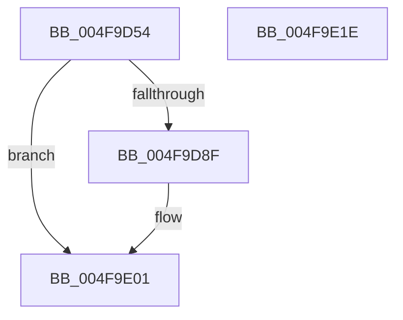

# BCryptEncrypt

- RVA: `0x004F9D54`–`0x004F9E1F` (길이 `203` bytes)
- VA: `0x00000001404F9D54`
- 실행 섹션: `.text`
- PDB 이름 있음: `예`; PDB Function 태그: `아니요`
- unwind 정보 RVA: `0x000BF908`
- 디코드: `49`개 명령, `203/203` bytes 표시
- 미해석 바이트: `0` (있으면 어셈블리에 `.byte`로 보존)

> 이 문서는 커널 이미지의 기계어와 PDB 기호를 분석해 생성했습니다. 4번과 5번은 함수 원형과 자료형을 바이너리 사용 방식에서 추정한 C 해석이며 원본 소스 복구 결과는 아닙니다.

## 1. Dependencies

- 직접 호출 지점: **3**; 고유 호출 대상: **3**
- 직접 호출자로 확인된 함수: **3**
- RIP 상대 이미지 참조: **1**

### Outgoing calls
- `0x004F9D85` → [ExGetExtensionTable](../42/ExGetExtensionTable_function_00428814.md) (function, `0x00428814`)
- `0x004F9DEA` → [guard_dispatch_icall](../6B/guard_dispatch_icall_function_006BAAD0.md) (function, `0x006BAAD0`)
- `0x004F9DFC` → [ExReleaseRundownProtection](../34/ExReleaseRundownProtection_function_00349E80.md) (function, `0x00349E80`)

### Direct callers
- [SmCrAuthEncrypt](../4D/SmCrAuthEncrypt_function_004D02A4.md) at `0x004D030C`
- [SecureDump_EncryptSymmetricKeyWithPublicKey](../5A/SecureDump_EncryptSymmetricKeyWithPublicKey_function_005A27A4.md) at `0x005A2951`
- [SecureDump_EncryptSymmetricKeyWithPublicKey](../5A/SecureDump_EncryptSymmetricKeyWithPublicKey_function_005A27A4.md) at `0x005A29BA`
- [SecureDump_Encrypt_DmpData](../5A/SecureDump_Encrypt_DmpData_function_005A2A10.md) at `0x005A2AF2`

### Static image references
- `0x004F9D73` → RVA `0x00F04E30` (`.data`; read)

## 2. Other-region calls and transfers

- 다른 실행 섹션으로 향하는 call: **0**
- 별도 외부 분기/꼬리 이동을 확인하지 못했습니다.

## 3. Assembly (complete function range)

```asm
004F9D54  48 8B C4                        mov rax, rsp
004F9D57  48 89 58 08                     mov qword ptr [rax + 8], rbx
004F9D5B  48 89 68 10                     mov qword ptr [rax + 0x10], rbp
004F9D5F  48 89 70 18                     mov qword ptr [rax + 0x18], rsi
004F9D63  48 89 78 20                     mov qword ptr [rax + 0x20], rdi
004F9D67  41 56                           push r14
004F9D69  48 83 EC 60                     sub rsp, 0x60
004F9D6D  4C 8B F1                        mov r14, rcx
004F9D70  49 8B F9                        mov rdi, r9
004F9D73  48 8B 0D B6 B0 A0 00            mov rcx, qword ptr [rip + 0xa0b0b6]
004F9D7A  41 8B F0                        mov esi, r8d
004F9D7D  48 8B EA                        mov rbp, rdx
004F9D80  BB 02 00 00 C0                  mov ebx, 0xc0000002
004F9D85  E8 8A EA F2 FF                  call 0x140428814
004F9D8A  48 85 C0                        test rax, rax
004F9D8D  74 72                           je 0x1404f9e01
004F9D8F  4C 8B 50 58                     mov r10, qword ptr [rax + 0x58]
004F9D93  4C 8B CF                        mov r9, rdi
004F9D96  8B 84 24 B8 00 00 00            mov eax, dword ptr [rsp + 0xb8]
004F9D9D  44 8B C6                        mov r8d, esi
004F9DA0  89 44 24 48                     mov dword ptr [rsp + 0x48], eax
004F9DA4  48 8B D5                        mov rdx, rbp
004F9DA7  48 8B 84 24 B0 00 00 00         mov rax, qword ptr [rsp + 0xb0]
004F9DAF  49 8B CE                        mov rcx, r14
004F9DB2  48 89 44 24 40                  mov qword ptr [rsp + 0x40], rax
004F9DB7  8B 84 24 A8 00 00 00            mov eax, dword ptr [rsp + 0xa8]
004F9DBE  89 44 24 38                     mov dword ptr [rsp + 0x38], eax
004F9DC2  48 8B 84 24 A0 00 00 00         mov rax, qword ptr [rsp + 0xa0]
004F9DCA  48 89 44 24 30                  mov qword ptr [rsp + 0x30], rax
004F9DCF  8B 84 24 98 00 00 00            mov eax, dword ptr [rsp + 0x98]
004F9DD6  89 44 24 28                     mov dword ptr [rsp + 0x28], eax
004F9DDA  48 8B 84 24 90 00 00 00         mov rax, qword ptr [rsp + 0x90]
004F9DE2  48 89 44 24 20                  mov qword ptr [rsp + 0x20], rax
004F9DE7  49 8B C2                        mov rax, r10
004F9DEA  E8 E1 0C 1C 00                  call 0x1406baad0
004F9DEF  48 8B 0D 3A B0 A0 00            mov rcx, qword ptr [rip + 0xa0b03a]
004F9DF6  8B D8                           mov ebx, eax
004F9DF8  48 83 C1 58                     add rcx, 0x58
004F9DFC  E8 7F 00 E5 FF                  call 0x140349e80
004F9E01  4C 8D 5C 24 60                  lea r11, [rsp + 0x60]
004F9E06  8B C3                           mov eax, ebx
004F9E08  49 8B 5B 10                     mov rbx, qword ptr [r11 + 0x10]
004F9E0C  49 8B 6B 18                     mov rbp, qword ptr [r11 + 0x18]
004F9E10  49 8B 73 20                     mov rsi, qword ptr [r11 + 0x20]
004F9E14  49 8B 7B 28                     mov rdi, qword ptr [r11 + 0x28]
004F9E18  49 8B E3                        mov rsp, r11
004F9E1B  41 5E                           pop r14
004F9E1D  C3                              ret
004F9E1E  CC                              int3
```

## 4. C-style interpretation (structured pseudocode)

```c
__int64 __fastcall BCryptEncrypt(__int64 a1, __int64 a2, int a3, __int64 a4, __int64 a5, unsigned int a6, __int64 a7, unsigned int a8, __int64 a9, unsigned int a10)
{
    __int64 result;
    __int64 v_r10;
    __int64 v_rbx;
    __int64 v_rsp;
    unsigned int v_stack_m20;
    unsigned __int64 v_stack_m28;
    unsigned int v_stack_m30;
    unsigned __int64 v_stack_m38;
    unsigned int v_stack_m40;
    unsigned __int64 v_stack_m48;
    unsigned __int64 v_stack_m8;

    *(unsigned __int64 *)(v_rsp + 8) = v_rbx;
    *(unsigned __int64 *)(v_rsp + 16) = v_rbp;
    *(unsigned __int64 *)(v_rsp + 24) = v_rsi;
    *(unsigned __int64 *)(v_rsp + 32) = v_rdi;
    v_rsp = (v_rsp) - (96);
    result = ExGetExtensionTable(*(unsigned __int64 *)(v_rip + 10530998), a2, a3, a4);
    v_rbx = (unsigned int)(0xC0000002ULL);
    if (result != 0) {
        v_r10 = *(unsigned __int64 *)(result + 88);
        a4 = a4;
        result = a10;
        a3 = (unsigned int)((unsigned int)(a3));
        v_stack_m20 = (unsigned int)(result);
        a2 = a2;
        result = a9;
        a1 = a1;
        v_stack_m28 = result;
        result = a8;
        v_stack_m30 = (unsigned int)(result);
        result = a7;
        v_stack_m38 = result;
        result = a6;
        v_stack_m40 = (unsigned int)(result);
        result = a5;
        v_stack_m48 = result;
        result = v_r10;
        result = guard_dispatch_icall(a1, a2, a3, a4);
        a1 = *(unsigned __int64 *)(v_rip + 10530874);
        v_rbx = (unsigned int)(result);
        a1 = (a1) + (88);
        result = ExReleaseRundownProtection(a1, a2, a3, a4);
    }
    return (unsigned int)((unsigned int)(v_rbx));
}
```

## 5. (Beta) C Style

```c
int64_t BCryptEncrypt(int64_t Arg1, int64_t Arg2, int32_t Arg3, int64_t Arg4, int64_t Arg5, uint32_t Arg6, int64_t Arg7, uint32_t Arg8, int64_t Arg9, uint32_t Arg10)
{
    int64_t result;
    int64_t local_r10;
    int64_t local_rbx;
    int64_t local_rsp;
    uint32_t v_stack_m20;
    uint64_t v_stack_m28;
    uint32_t v_stack_m30;
    uint64_t v_stack_m38;
    uint32_t v_stack_m40;
    uint64_t v_stack_m48;
    uint64_t v_stack_m8;

    *(uint64_t *)(local_rsp + 0x8) = local_rbx;
    *(uint64_t *)(local_rsp + 0x10) = local_rbp;
    *(uint64_t *)(local_rsp + 0x18) = local_rsi;
    *(uint64_t *)(local_rsp + 0x20) = local_rdi;
    local_rsp = (local_rsp) - (96);
    result = ExGetExtensionTable(*(uint64_t *)(v_rip + 0xA0B0B6), Arg2, Arg3, Arg4);
    local_rbx = (uint32_t)(0xC0000002ULL);
    if (result != 0) {
        local_r10 = *(uint64_t *)(result + 0x58);
        Arg4 = Arg4;
        result = Arg10;
        Arg3 = (uint32_t)((uint32_t)(Arg3));
        v_stack_m20 = (uint32_t)(result);
        Arg2 = Arg2;
        result = Arg9;
        Arg1 = Arg1;
        v_stack_m28 = result;
        result = Arg8;
        v_stack_m30 = (uint32_t)(result);
        result = Arg7;
        v_stack_m38 = result;
        result = Arg6;
        v_stack_m40 = (uint32_t)(result);
        result = Arg5;
        v_stack_m48 = result;
        result = local_r10;
        result = guard_dispatch_icall(Arg1, Arg2, Arg3, Arg4);
        Arg1 = *(uint64_t *)(v_rip + 0xA0B03A);
        local_rbx = (uint32_t)(result);
        Arg1 = (Arg1) + (88);
        result = ExReleaseRundownProtection(Arg1, Arg2, Arg3, Arg4);
    }
    return (uint32_t)((uint32_t)(local_rbx));
}
```

## 6. Execution-region graph

[열기: 2D/3D 그래프와 함수 탐색 컨트롤 패널](../../../control-panel.html?section=text&rva=0x004F9D54&view=graph)

- 2D 그래프는 위에서 아래로 흐르고, 3D 그래프는 빈 공간을 드래그해 회전합니다. Shift+드래그는 이동, 휠은 확대·축소, 함수 노드 선택은 대상 보고서 이동입니다.

### Static fallback


