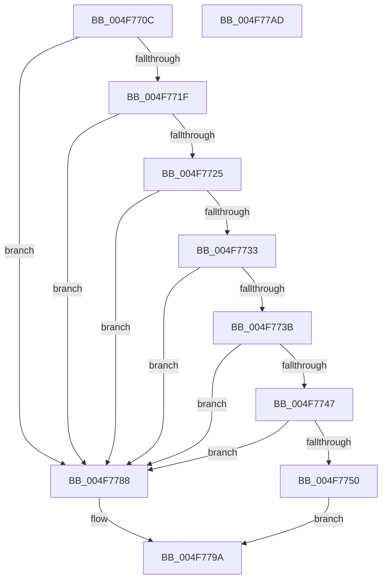

# BapdpParseEventParts

- RVA: `0x004F770C`–`0x004F77AE` (길이 `162` bytes)
- VA: `0x00000001404F770C`
- 실행 섹션: `.text`
- PDB 이름 있음: `예`; PDB Function 태그: `아니요`
- unwind 정보 RVA: `0x000950EC`
- 디코드: `46`개 명령, `162/162` bytes 표시
- 미해석 바이트: `0` (있으면 어셈블리에 `.byte`로 보존)

> 이 문서는 커널 이미지의 기계어와 PDB 기호를 분석해 생성했습니다. 4번과 5번은 함수 원형과 자료형을 바이너리 사용 방식에서 추정한 C 해석이며 원본 소스 복구 결과는 아닙니다.

## 1. Dependencies

- 직접 호출 지점: **0**; 고유 호출 대상: **0**
- 직접 호출자로 확인된 함수: **1**
- RIP 상대 이미지 참조: **0**

### Outgoing calls
- 직접 디코드된 call 명령이 없습니다.

### Direct callers
- [BapdWriteEtwEvents](../4A/BapdWriteEtwEvents_function_004AE884.md) at `0x004AE98E`

### Static image references
- 디코드된 RIP-relative 메모리 참조가 없습니다.

## 2. Other-region calls and transfers

- 다른 실행 섹션으로 향하는 call: **0**
- 별도 외부 분기/꼬리 이동을 확인하지 못했습니다.

## 3. Assembly (complete function range)

```asm
004F770C  48 89 5C 24 08                  mov qword ptr [rsp + 8], rbx
004F7711  48 89 7C 24 10                  mov qword ptr [rsp + 0x10], rdi
004F7716  80 79 03 0B                     cmp byte ptr [rcx + 3], 0xb
004F771A  4C 8B DA                        mov r11, rdx
004F771D  75 69                           jne 0x1404f7788
004F771F  41 83 F8 07                     cmp r8d, 7
004F7723  72 63                           jb 0x1404f7788
004F7725  0F B7 0A                        movzx ecx, word ptr [rdx]
004F7728  41 BA 03 00 00 00               mov r10d, 3
004F772E  41 3B CA                        cmp ecx, r10d
004F7731  72 55                           jb 0x1404f7788
004F7733  41 8D 40 FC                     lea eax, [r8 - 4]
004F7737  3B C8                           cmp ecx, eax
004F7739  77 4D                           ja 0x1404f7788
004F773B  48 8D 3C 0A                     lea rdi, [rdx + rcx]
004F773F  0F B7 1F                        movzx ebx, word ptr [rdi]
004F7742  83 FB 04                        cmp ebx, 4
004F7745  72 41                           jb 0x1404f7788
004F7747  41 8B D0                        mov edx, r8d
004F774A  2B D1                           sub edx, ecx
004F774C  3B DA                           cmp ebx, edx
004F774E  77 38                           ja 0x1404f7788
004F7750  41 83 61 0C 00                  and dword ptr [r9 + 0xc], 0
004F7755  48 8D 04 1F                     lea rax, [rdi + rbx]
004F7759  4D 89 19                        mov qword ptr [r9], r11
004F775C  2B D3                           sub edx, ebx
004F775E  41 89 49 08                     mov dword ptr [r9 + 8], ecx
004F7762  41 C6 41 0C 02                  mov byte ptr [r9 + 0xc], 2
004F7767  41 83 61 1C 00                  and dword ptr [r9 + 0x1c], 0
004F776C  49 89 79 10                     mov qword ptr [r9 + 0x10], rdi
004F7770  41 89 59 18                     mov dword ptr [r9 + 0x18], ebx
004F7774  41 C6 41 1C 01                  mov byte ptr [r9 + 0x1c], 1
004F7779  41 83 61 2C 00                  and dword ptr [r9 + 0x2c], 0
004F777E  49 89 41 20                     mov qword ptr [r9 + 0x20], rax
004F7782  41 89 51 28                     mov dword ptr [r9 + 0x28], edx
004F7786  EB 12                           jmp 0x1404f779a
004F7788  41 83 61 0C 00                  and dword ptr [r9 + 0xc], 0
004F778D  41 BA 01 00 00 00               mov r10d, 1
004F7793  4D 89 19                        mov qword ptr [r9], r11
004F7796  45 89 41 08                     mov dword ptr [r9 + 8], r8d
004F779A  48 8B 44 24 28                  mov rax, qword ptr [rsp + 0x28]
004F779F  44 89 10                        mov dword ptr [rax], r10d
004F77A2  48 8B 5C 24 08                  mov rbx, qword ptr [rsp + 8]
004F77A7  48 8B 7C 24 10                  mov rdi, qword ptr [rsp + 0x10]
004F77AC  C3                              ret
004F77AD  CC                              int3
```

## 4. C-style interpretation (structured pseudocode)

```c
__int64 __fastcall BapdpParseEventParts(__int64 a1, __int64 a2, __int64 a3, __int64 a4, __int64 a5)
{
    unsigned __int64 v_stack_p10;
    unsigned __int64 v_stack_p8;

    v_stack_p8 = v_rbx;
    v_stack_p10 = v_rdi;
    if ((*(unsigned __int8 *)(a1 + 3)) != 11) goto loc_004F7788;
    if (((unsigned int)(a3)) < 7) goto loc_004F7788;
    if (((unsigned int)(*(unsigned __int16 *)(a2))) < 3) goto loc_004F7788;
    if (((unsigned int)(*(unsigned __int16 *)(a2))) > ((unsigned int)(a3 - 4))) goto loc_004F7788;
    if (((unsigned int)(*(unsigned __int16 *)(a2 + *(unsigned __int16 *)(a2) * 1))) < 4) goto loc_004F7788;
    a2 = (unsigned int)(((unsigned int)((unsigned int)(a3))) - ((unsigned int)(*(unsigned __int16 *)(a2))));
    if (((unsigned int)(*(unsigned __int16 *)(a2 + *(unsigned __int16 *)(a2) * 1))) > ((unsigned int)(a2))) goto loc_004F7788;
    *(unsigned __int64 *)(a4) = a2;
    a2 = (unsigned int)((a2) - ((unsigned int)(*(unsigned __int16 *)(a2 + *(unsigned __int16 *)(a2) * 1))));
    *(unsigned int *)(a4 + 8) = (unsigned int)(*(unsigned __int16 *)(a2));
    *(unsigned __int8 *)(a4 + 12) = 2;
    *(unsigned __int64 *)(a4 + 16) = a2 + *(unsigned __int16 *)(a2) * 1;
    *(unsigned int *)(a4 + 24) = (unsigned int)(*(unsigned __int16 *)(a2 + *(unsigned __int16 *)(a2) * 1));
    *(unsigned __int8 *)(a4 + 28) = 1;
    *(unsigned __int64 *)(a4 + 32) = a2 + *(unsigned __int16 *)(a2) * 1 + *(unsigned __int16 *)(a2 + *(unsigned __int16 *)(a2) * 1) * 1;
    *(unsigned int *)(a4 + 40) = (unsigned int)(a2);
    goto loc_004F779A;
loc_004F7788:
    *(unsigned __int64 *)(a4) = a2;
    *(unsigned int *)(a4 + 8) = (unsigned int)(a3);
loc_004F779A:
    *(unsigned int *)(a5) = 1;
    return a5;
}
```

## 5. (Beta) C Style

```c
void *BapdpParseEventParts(void *Arg1, void *Arg2, int64_t Arg3, void *Arg4, void *Arg5)
{
    uint8_t *arg1 = (uint8_t *)Arg1;
    uint8_t *arg2 = (uint8_t *)Arg2;
    uint8_t *arg4 = (uint8_t *)Arg4;
    uint8_t *arg5 = (uint8_t *)Arg5;

    uint64_t v_stack_p10;
    uint64_t v_stack_p8;

    v_stack_p8 = local_rbx;
    v_stack_p10 = local_rdi;
    if ((*(uint8_t *)(arg1 + 0x3)) != 11) goto loc_004F7788;
    if (((uint32_t)(Arg3)) < 7) goto loc_004F7788;
    if (((uint32_t)(*(uint16_t *)(arg2))) < 3) goto loc_004F7788;
    if (((uint32_t)(*(uint16_t *)(arg2))) > ((uint32_t)(Arg3 - 4))) goto loc_004F7788;
    if (((uint32_t)(*(uint16_t *)(arg2 + *(uint16_t *)(arg2) * 1))) < 4) goto loc_004F7788;
    Arg2 = (uint32_t)(((uint32_t)((uint32_t)(Arg3))) - ((uint32_t)(*(uint16_t *)(arg2))));
    if (((uint32_t)(*(uint16_t *)(arg2 + *(uint16_t *)(arg2) * 1))) > ((uint32_t)(Arg2))) goto loc_004F7788;
    *(void **)(arg4) = Arg2;
    Arg2 = (uint32_t)((Arg2) - ((uint32_t)(*(uint16_t *)(arg2 + *(uint16_t *)(arg2) * 1))));
    *(uint32_t *)(arg4 + 0x8) = (uint32_t)(*(uint16_t *)(arg2));
    *(uint8_t *)(arg4 + 0xC) = 2;
    *(void **)(arg4 + 0x10) = Arg2 + *(uint16_t *)(arg2) * 1;
    *(uint32_t *)(arg4 + 0x18) = (uint32_t)(*(uint16_t *)(arg2 + *(uint16_t *)(arg2) * 1));
    *(uint8_t *)(arg4 + 0x1C) = 1;
    *(void **)(arg4 + 0x20) = Arg2 + *(uint16_t *)(arg2) * 1 + *(uint16_t *)(arg2 + *(uint16_t *)(arg2) * 1) * 1;
    *(uint32_t *)(arg4 + 0x28) = (uint32_t)(Arg2);
    goto loc_004F779A;
loc_004F7788:
    *(void **)(arg4) = Arg2;
    *(uint32_t *)(arg4 + 0x8) = (uint32_t)(Arg3);
loc_004F779A:
    *(uint32_t *)(arg5) = 1;
    return Arg5;
}
```

### 관측된 메모리 오프셋

구조체 형식이 확인되지 않은 접근은 인자 기준의 오프셋으로만 기록했습니다.

| 기준 인자 | 오프셋 표현 | 폭 (bit) | 접근 |
|---|---:|---:|---|
| `Arg1` | `+ 0x3` | `8` | `R` |
| `Arg2` | `+ 0x0` | `16` | `R` |
| `Arg2` | `+ 0x0 + rbx*1` | `64` | `R` |
| `Arg2` | `+ 0x0 + rcx*1` | `64` | `R` |
| `Arg4` | `+ 0x0` | `64` | `W` |
| `Arg4` | `+ 0x8` | `32` | `W` |
| `Arg4` | `+ 0xC` | `8` | `W` |
| `Arg4` | `+ 0xC` | `32` | `R/W` |
| `Arg4` | `+ 0x10` | `64` | `W` |
| `Arg4` | `+ 0x18` | `32` | `W` |
| `Arg4` | `+ 0x1C` | `8` | `W` |
| `Arg4` | `+ 0x1C` | `32` | `R/W` |
| `Arg4` | `+ 0x20` | `64` | `W` |
| `Arg4` | `+ 0x28` | `32` | `W` |
| `Arg4` | `+ 0x2C` | `32` | `R/W` |
| `Arg5` | `+ 0x0` | `32` | `W` |

## 6. Execution-region graph

[열기: 2D/3D 그래프와 함수 탐색 컨트롤 패널](../../../control-panel.html?section=text&rva=0x004F770C&view=graph)

- 2D 그래프는 위에서 아래로 흐르고, 3D 그래프는 빈 공간을 드래그해 회전합니다. Shift+드래그는 이동, 휠은 확대·축소, 함수 노드 선택은 대상 보고서 이동입니다.

### Static fallback


