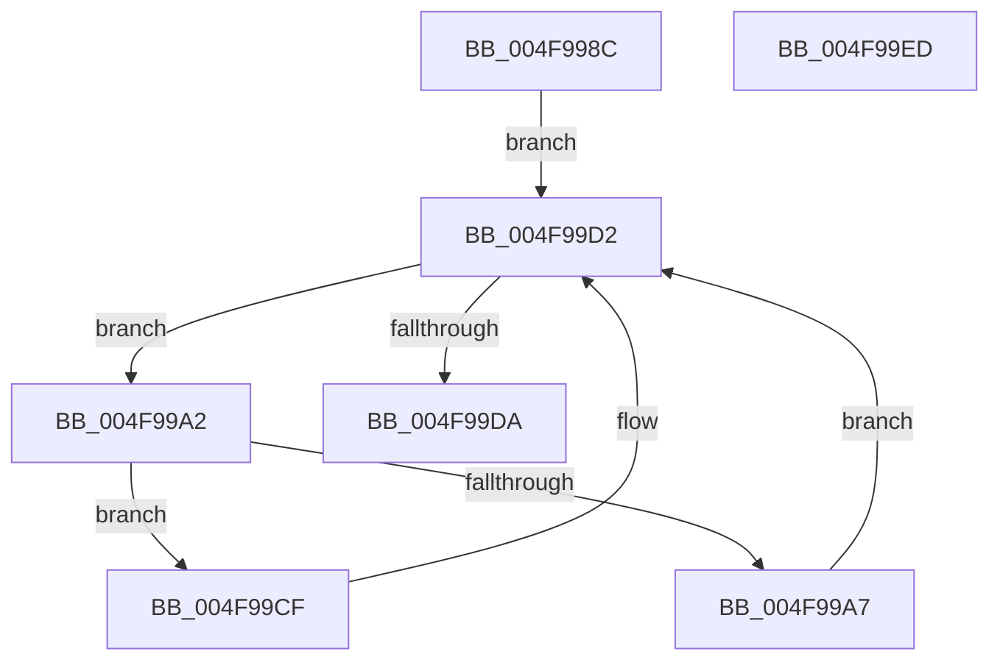

# CcCancelMmWaitForUninitializeCacheMap

- RVA: `0x004F998C`–`0x004F99EE` (길이 `98` bytes)
- VA: `0x00000001404F998C`
- 실행 섹션: `.text`
- PDB 이름 있음: `예`; PDB Function 태그: `아니요`
- unwind 정보 RVA: `0x0005CAAC`
- 디코드: `28`개 명령, `98/98` bytes 표시
- 미해석 바이트: `0` (있으면 어셈블리에 `.byte`로 보존)

> 이 문서는 커널 이미지의 기계어와 PDB 기호를 분석해 생성했습니다. 4번과 5번은 함수 원형과 자료형을 바이너리 사용 방식에서 추정한 C 해석이며 원본 소스 복구 결과는 아닙니다.

## 1. Dependencies

- 직접 호출 지점: **1**; 고유 호출 대상: **1**
- 직접 호출자로 확인된 함수: **3**
- RIP 상대 이미지 참조: **1**

### Outgoing calls
- `0x004F99BA` → [KeSetEvent](../33/KeSetEvent_function_0033F310.md) (function, `0x0033F310`)

### Direct callers
- [CcWriteBehindPreProcess](../35/CcWriteBehindPreProcess_function_00357784.md) at `0x00357B5F`
- [CcWriteBehindPostProcess](../35/CcWriteBehindPostProcess_function_00357BB4.md) at `0x00357EFD`
- [sub_006E2B2A](../6E/Unknown_function_006E2B2A.md) at `0x006E2B39`

### Static image references
- `0x004F99BF` → RVA `0x00F8F5FC` (`.data`; read/write)

## 2. Other-region calls and transfers

- 다른 실행 섹션으로 향하는 call: **0**
- 별도 외부 분기/꼬리 이동을 확인하지 못했습니다.

## 3. Assembly (complete function range)

```asm
004F998C  48 89 5C 24 08                  mov qword ptr [rsp + 8], rbx
004F9991  57                              push rdi
004F9992  48 83 EC 20                     sub rsp, 0x20
004F9996  48 8B D9                        mov rbx, rcx
004F9999  48 8D B9 18 01 00 00            lea rdi, [rcx + 0x118]
004F99A0  EB 30                           jmp 0x1404f99d2
004F99A2  F6 C2 01                        test dl, 1
004F99A5  74 28                           je 0x1404f99cf
004F99A7  48 83 E2 FE                     and rdx, 0xfffffffffffffffe
004F99AB  45 33 C0                        xor r8d, r8d
004F99AE  48 8B 02                        mov rax, qword ptr [rdx]
004F99B1  48 8D 4A 08                     lea rcx, [rdx + 8]
004F99B5  33 D2                           xor edx, edx
004F99B7  48 89 07                        mov qword ptr [rdi], rax
004F99BA  E8 51 59 E4 FF                  call 0x14033f310
004F99BF  FF 05 37 5C A9 00               inc dword ptr [rip + 0xa95c37]
004F99C5  0F BA AB 98 00 00 00 0F         bts dword ptr [rbx + 0x98], 0xf
004F99CD  EB 03                           jmp 0x1404f99d2
004F99CF  48 8B FA                        mov rdi, rdx
004F99D2  48 8B 17                        mov rdx, qword ptr [rdi]
004F99D5  48 85 D2                        test rdx, rdx
004F99D8  75 C8                           jne 0x1404f99a2
004F99DA  0F BA B3 98 00 00 00 10         btr dword ptr [rbx + 0x98], 0x10
004F99E2  48 8B 5C 24 30                  mov rbx, qword ptr [rsp + 0x30]
004F99E7  48 83 C4 20                     add rsp, 0x20
004F99EB  5F                              pop rdi
004F99EC  C3                              ret
004F99ED  CC                              int3
```

## 4. C-style interpretation (structured pseudocode)

```c
__int64 __fastcall CcCancelMmWaitForUninitializeCacheMap(__int64 a1, __int64 a2, int a3)
{
    __int64 result;
    __int64 v_rsp;
    unsigned __int64 v_stack_p8;

    v_stack_p8 = v_rbx;
    v_rsp = (v_rsp) - (32);
    goto loc_004F99D2;
loc_004F99A2:
    if ((((unsigned __int8)(a2)) & (1)) == 0) goto loc_004F99CF;
    a2 = (a2) & (-2);
    a3 = 0;
    a2 = 0;
    *(unsigned __int64 *)(a1 + 280) = *(unsigned __int64 *)(a2);
    result = KeSetEvent(a2 + 8, a2, a3, a4);
    goto loc_004F99D2;
loc_004F99CF:
loc_004F99D2:
    if (*(unsigned __int64 *)(0) != 0) goto loc_004F99A2;
    v_rsp = (v_rsp) + (32);
    return result;
}
```

## 5. (Beta) C Style

```c
int64_t CcCancelMmWaitForUninitializeCacheMap(void *Arg1, int64_t Arg2, int32_t Arg3)
{
    uint8_t *arg1 = (uint8_t *)Arg1;

    int64_t result;
    int64_t local_rsp;
    uint64_t v_stack_p8;

    v_stack_p8 = local_rbx;
    local_rsp = (local_rsp) - (32);
    goto loc_004F99D2;
loc_004F99A2:
    if ((((uint8_t)(Arg2)) & (1)) == 0) goto loc_004F99CF;
    Arg2 = (Arg2) & (-2);
    Arg3 = 0;
    Arg2 = 0;
    *(uint64_t *)(arg1 + 0x118) = *(uint64_t *)(Arg2);
    result = KeSetEvent(Arg2 + 8, Arg2, Arg3, a4);
    goto loc_004F99D2;
loc_004F99CF:
loc_004F99D2:
    if (*(uint64_t *)(0) != 0) goto loc_004F99A2;
    local_rsp = (local_rsp) + (32);
    return result;
}
```

### 관측된 메모리 오프셋

구조체 형식이 확인되지 않은 접근은 인자 기준의 오프셋으로만 기록했습니다.

| 기준 인자 | 오프셋 표현 | 폭 (bit) | 접근 |
|---|---:|---:|---|
| `Arg1` | `+ 0x98` | `32` | `R/W` |
| `Arg1` | `+ 0x118` | `64` | `R` |

## 6. Execution-region graph

[열기: 2D/3D 그래프와 함수 탐색 컨트롤 패널](../../../control-panel.html?section=text&rva=0x004F998C&view=graph)

- 2D 그래프는 위에서 아래로 흐르고, 3D 그래프는 빈 공간을 드래그해 회전합니다. Shift+드래그는 이동, 휠은 확대·축소, 함수 노드 선택은 대상 보고서 이동입니다.

### Static fallback


