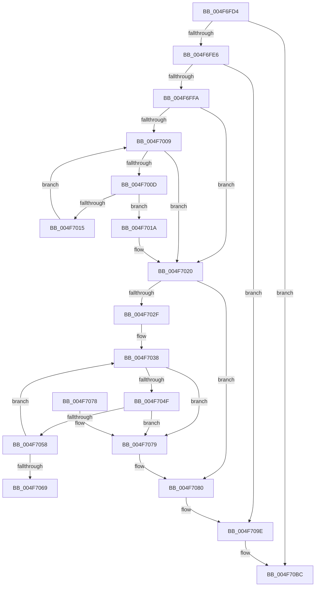

# CcRemoveVacbArray

- RVA: `0x004F6FD4`–`0x004F70DA` (길이 `262` bytes)
- VA: `0x00000001404F6FD4`
- 실행 섹션: `.text`
- PDB 이름 있음: `예`; PDB Function 태그: `아니요`
- unwind 정보 RVA: `0x000BF4CC`
- 디코드: `69`개 명령, `262/262` bytes 표시
- 미해석 바이트: `0` (있으면 어셈블리에 `.byte`로 보존)

> 이 문서는 커널 이미지의 기계어와 PDB 기호를 분석해 생성했습니다. 4번과 5번은 함수 원형과 자료형을 바이너리 사용 방식에서 추정한 C 해석이며 원본 소스 복구 결과는 아닙니다.

## 1. Dependencies

- 직접 호출 지점: **3**; 고유 호출 대상: **1**
- 직접 호출자로 확인된 함수: **1**
- RIP 상대 이미지 참조: **6**

### Outgoing calls
- `0x004F7098` → [KeBugCheckEx](KeBugCheckEx_function_004FD660.md) (function, `0x004FD660`)
- `0x004F70B6` → [KeBugCheckEx](KeBugCheckEx_function_004FD660.md) (function, `0x004FD660`)
- `0x004F70D4` → [KeBugCheckEx](KeBugCheckEx_function_004FD660.md) (function, `0x004FD660`)

### Direct callers
- [CcDereferenceVacbArray](../44/CcDereferenceVacbArray_function_004427B0.md) at `0x00442835`

### Static image references
- `0x004F6FE9` → RVA `0x00F8F4A0` (`.data`; read)
- `0x004F6FFA` → RVA `0x00E65BB0` (`.data`; read)
- `0x004F701A` → RVA `0x00E65BB0` (`.data`; write)
- `0x004F7020` → RVA `0x00F8F4B4` (`.data`; read)
- `0x004F7032` → RVA `0x00F8F4B4` (`.data`; write)
- `0x004F7069` → RVA `0x00F8F4A8` (`.data`; read/write)

## 2. Other-region calls and transfers

- 다른 실행 섹션으로 향하는 call: **0**
- 별도 외부 분기/꼬리 이동을 확인하지 못했습니다.

## 3. Assembly (complete function range)

```asm
004F6FD4  48 83 EC 38                     sub rsp, 0x38
004F6FD8  33 D2                           xor edx, edx
004F6FDA  4C 8B C1                        mov r8, rcx
004F6FDD  39 51 04                        cmp dword ptr [rcx + 4], edx
004F6FE0  0F 85 D6 00 00 00               jne 0x1404f70bc
004F6FE6  44 8B 09                        mov r9d, dword ptr [rcx]
004F6FE9  4C 8B 15 B0 84 A9 00            mov r10, qword ptr [rip + 0xa984b0]
004F6FF0  4B 39 0C CA                     cmp qword ptr [r10 + r9*8], rcx
004F6FF4  0F 85 A4 00 00 00               jne 0x1404f709e
004F6FFA  8B 0D B0 EB 96 00               mov ecx, dword ptr [rip + 0x96ebb0]
004F7000  41 83 CB FF                     or r11d, 0xffffffff
004F7004  44 3B C9                        cmp r9d, ecx
004F7007  75 17                           jne 0x1404f7020
004F7009  85 C9                           test ecx, ecx
004F700B  74 13                           je 0x1404f7020
004F700D  8B C1                           mov eax, ecx
004F700F  49 39 14 C2                     cmp qword ptr [r10 + rax*8], rdx
004F7013  75 05                           jne 0x1404f701a
004F7015  41 03 CB                        add ecx, r11d
004F7018  EB EF                           jmp 0x1404f7009
004F701A  89 0D 90 EB 96 00               mov dword ptr [rip + 0x96eb90], ecx
004F7020  8B 05 8E 84 A9 00               mov eax, dword ptr [rip + 0xa9848e]
004F7026  4B 89 14 CA                     mov qword ptr [r10 + r9*8], rdx
004F702A  83 F8 01                        cmp eax, 1
004F702D  72 51                           jb 0x1404f7080
004F702F  41 03 C3                        add eax, r11d
004F7032  89 05 7C 84 A9 00               mov dword ptr [rip + 0xa9847c], eax
004F7038  8B C2                           mov eax, edx
004F703A  48 8D 48 01                     lea rcx, [rax + 1]
004F703E  48 8D 0C 88                     lea rcx, [rax + rcx*4]
004F7042  4D 8D 0C C8                     lea r9, [r8 + rcx*8]
004F7046  49 8B 09                        mov rcx, qword ptr [r9]
004F7049  4C 39 49 08                     cmp qword ptr [rcx + 8], r9
004F704D  75 2A                           jne 0x1404f7079
004F704F  49 8B 41 08                     mov rax, qword ptr [r9 + 8]
004F7053  4C 39 08                        cmp qword ptr [rax], r9
004F7056  75 21                           jne 0x1404f7079
004F7058  FF C2                           inc edx
004F705A  48 89 08                        mov qword ptr [rax], rcx
004F705D  48 89 41 08                     mov qword ptr [rcx + 8], rax
004F7061  81 FA CC 0C 00 00               cmp edx, 0xccc
004F7067  72 CF                           jb 0x1404f7038
004F7069  81 05 35 84 A9 00 34 F3 FF FF   add dword ptr [rip + 0xa98435], 0xfffff334
004F7073  48 83 C4 38                     add rsp, 0x38
004F7077  C3                              ret
004F7078  CC                              int3
004F7079  B9 03 00 00 00                  mov ecx, 3
004F707E  CD 29                           int 0x29
004F7080  45 33 C9                        xor r9d, r9d
004F7083  48 89 54 24 20                  mov qword ptr [rsp + 0x20], rdx
004F7088  BA 66 02 00 00                  mov edx, 0x266
004F708D  49 C7 C0 20 04 00 C0            mov r8, 0xffffffffc0000420
004F7094  41 8D 49 34                     lea ecx, [r9 + 0x34]
004F7098  E8 C3 65 00 00                  call 0x1404fd660
004F709D  CC                              int3
004F709E  45 33 C9                        xor r9d, r9d
004F70A1  48 89 54 24 20                  mov qword ptr [rsp + 0x20], rdx
004F70A6  BA 4A 02 00 00                  mov edx, 0x24a
004F70AB  49 C7 C0 20 04 00 C0            mov r8, 0xffffffffc0000420
004F70B2  41 8D 49 34                     lea ecx, [r9 + 0x34]
004F70B6  E8 A5 65 00 00                  call 0x1404fd660
004F70BB  CC                              int3
004F70BC  45 33 C9                        xor r9d, r9d
004F70BF  48 89 54 24 20                  mov qword ptr [rsp + 0x20], rdx
004F70C4  BA 44 02 00 00                  mov edx, 0x244
004F70C9  49 C7 C0 20 04 00 C0            mov r8, 0xffffffffc0000420
004F70D0  41 8D 49 34                     lea ecx, [r9 + 0x34]
004F70D4  E8 87 65 00 00                  call 0x1404fd660
004F70D9  CC                              int3
```

## 4. C-style interpretation (structured pseudocode)

```c
__int64 __fastcall CcRemoveVacbArray(__int64 a1, int a2)
{
    __int64 result;
    __int64 v_r11;
    __int64 v_rsp;
    unsigned __int64 v_stack_p20;

    v_rsp = (v_rsp) - (56);
    a2 = 0;
    if ((*(unsigned int *)(a1 + 4)) != 0) goto loc_004F70BC;
    if ((*(unsigned __int64 *)(*(unsigned __int64 *)(v_rip + 11109552) + (unsigned int)(*(unsigned int *)(a1)) * 8)) != a1) goto loc_004F709E;
    v_r11 = (unsigned int)((v_r11) | (0xFFFFFFFFULL));
    if (((unsigned int)((unsigned int)(*(unsigned int *)(a1)))) != ((unsigned int)((unsigned int)(*(unsigned int *)(v_rip + 9890736))))) goto loc_004F7020;
loc_004F7009:
    if ((unsigned int)((unsigned int)(*(unsigned int *)(v_rip + 9890736))) == 0) goto loc_004F7020;
    if ((*(unsigned __int64 *)(*(unsigned __int64 *)(v_rip + 11109552) + (unsigned int)((unsigned int)((unsigned int)(*(unsigned int *)(v_rip + 9890736)))) * 8)) != 0) goto loc_004F701A;
    a1 = (unsigned int)(((unsigned int)(*(unsigned int *)(v_rip + 9890736))) + ((unsigned int)(v_r11)));
    goto loc_004F7009;
loc_004F701A:
    *(unsigned int *)(v_rip + 9890704) = (unsigned int)(a1);
loc_004F7020:
    *(unsigned __int64 *)(*(unsigned __int64 *)(v_rip + 11109552) + (unsigned int)(*(unsigned int *)(a1)) * 8) = 0;
    if (((unsigned int)((unsigned int)(*(unsigned int *)(v_rip + 11109518)))) < 1) goto loc_004F7080;
    result = (unsigned int)(((unsigned int)(*(unsigned int *)(v_rip + 11109518))) + ((unsigned int)(v_r11)));
    *(unsigned int *)(v_rip + 11109500) = (unsigned int)(result);
loc_004F7038:
    if ((*(unsigned __int64 *)(*(unsigned __int64 *)(a1 + 0 + 0 + 1 * 4 * 8) + 8)) != (a1 + 0 + 0 + 1 * 4 * 8)) goto loc_004F7079;
    if ((*(unsigned __int64 *)(*(unsigned __int64 *)(a1 + 0 + 0 + 1 * 4 * 8 + 8))) != (a1 + 0 + 0 + 1 * 4 * 8)) goto loc_004F7079;
    a2 = (unsigned int)((a2) + 1);
    *(unsigned __int64 *)(*(unsigned __int64 *)(a1 + 0 + 0 + 1 * 4 * 8 + 8)) = *(unsigned __int64 *)(a1 + 0 + 0 + 1 * 4 * 8);
    *(unsigned __int64 *)(*(unsigned __int64 *)(a1 + 0 + 0 + 1 * 4 * 8) + 8) = *(unsigned __int64 *)(a1 + 0 + 0 + 1 * 4 * 8 + 8);
    if (a2 < 0xCCCULL) goto loc_004F7038;
    v_rsp = (v_rsp) + (56);
    return *(unsigned __int64 *)(a1 + 0 + 0 + 1 * 4 * 8 + 8);
loc_004F7079:
loc_004F7080:
    a4 = 0;
    v_stack_p20 = a2;
    result = KeBugCheckEx(a4 + 52, 614, 0xFFFFFFFFC0000420ULL, a4);
loc_004F709E:
    a4 = 0;
    v_stack_p20 = 614;
    result = KeBugCheckEx(a4 + 52, 586, 0xFFFFFFFFC0000420ULL, a4);
loc_004F70BC:
    a4 = 0;
    v_stack_p20 = 586;
    result = KeBugCheckEx(a4 + 52, 580, 0xFFFFFFFFC0000420ULL, a4);
    return result;
}
```

## 5. (Beta) C Style

```c
int64_t CcRemoveVacbArray(void *Arg1, int32_t Arg2)
{
    uint8_t *arg1 = (uint8_t *)Arg1;

    int64_t result;
    int64_t local_r11;
    int64_t local_rsp;
    uint64_t v_stack_p20;

    local_rsp = (local_rsp) - (56);
    Arg2 = 0;
    if ((*(uint32_t *)(arg1 + 0x4)) != 0) goto loc_004F70BC;
    if ((*(uint64_t *)(*(uint64_t *)(v_rip + 0xA984B0) + (uint32_t)(*(uint32_t *)(arg1)) * 8)) != Arg1) goto loc_004F709E;
    local_r11 = (uint32_t)((local_r11) | (0xFFFFFFFFULL));
    if (((uint32_t)((uint32_t)(*(uint32_t *)(arg1)))) != ((uint32_t)((uint32_t)(*(uint32_t *)(v_rip + 0x96EBB0))))) goto loc_004F7020;
loc_004F7009:
    if ((uint32_t)((uint32_t)(*(uint32_t *)(v_rip + 0x96EBB0))) == 0) goto loc_004F7020;
    if ((*(uint64_t *)(*(uint64_t *)(v_rip + 0xA984B0) + (uint32_t)((uint32_t)((uint32_t)(*(uint32_t *)(v_rip + 0x96EBB0)))) * 8)) != 0) goto loc_004F701A;
    Arg1 = (uint32_t)(((uint32_t)(*(uint32_t *)(v_rip + 0x96EBB0))) + ((uint32_t)(local_r11)));
    goto loc_004F7009;
loc_004F701A:
    *(uint32_t *)(v_rip + 0x96EB90) = (uint32_t)(Arg1);
loc_004F7020:
    *(uint64_t *)(*(uint64_t *)(v_rip + 0xA984B0) + (uint32_t)(*(uint32_t *)(arg1)) * 8) = 0;
    if (((uint32_t)((uint32_t)(*(uint32_t *)(v_rip + 0xA9848E)))) < 1) goto loc_004F7080;
    result = (uint32_t)(((uint32_t)(*(uint32_t *)(v_rip + 0xA9848E))) + ((uint32_t)(local_r11)));
    *(uint32_t *)(v_rip + 0xA9847C) = (uint32_t)(result);
loc_004F7038:
    if ((*(uint64_t *)(*(uint64_t *)(arg1 + 0x0 + 0x0 + 0x1 * 4 * 8) + 0x8)) != (Arg1 + 0 + 0 + 1 * 4 * 8)) goto loc_004F7079;
    if ((*(uint64_t *)(*(uint64_t *)(arg1 + 0x0 + 0x0 + 0x1 * 4 * 8 + 0x8))) != (Arg1 + 0 + 0 + 1 * 4 * 8)) goto loc_004F7079;
    Arg2 = (uint32_t)((Arg2) + 1);
    *(uint64_t *)(*(uint64_t *)(arg1 + 0x0 + 0x0 + 0x1 * 4 * 8 + 0x8)) = *(uint64_t *)(arg1 + 0x0 + 0x0 + 0x1 * 4 * 8);
    *(uint64_t *)(*(uint64_t *)(arg1 + 0x0 + 0x0 + 0x1 * 4 * 8) + 0x8) = *(uint64_t *)(arg1 + 0x0 + 0x0 + 0x1 * 4 * 8 + 0x8);
    if (Arg2 < 0xCCCULL) goto loc_004F7038;
    local_rsp = (local_rsp) + (56);
    return *(uint64_t *)(arg1 + 0x0 + 0x0 + 0x1 * 4 * 8 + 0x8);
loc_004F7079:
loc_004F7080:
    a4 = 0;
    v_stack_p20 = Arg2;
    result = KeBugCheckEx(a4 + 52, 614, 0xFFFFFFFFC0000420ULL, a4);
loc_004F709E:
    a4 = 0;
    v_stack_p20 = 614;
    result = KeBugCheckEx(a4 + 52, 586, 0xFFFFFFFFC0000420ULL, a4);
loc_004F70BC:
    a4 = 0;
    v_stack_p20 = 586;
    result = KeBugCheckEx(a4 + 52, 580, 0xFFFFFFFFC0000420ULL, a4);
    return result;
}
```

### 관측된 메모리 오프셋

구조체 형식이 확인되지 않은 접근은 인자 기준의 오프셋으로만 기록했습니다.

| 기준 인자 | 오프셋 표현 | 폭 (bit) | 접근 |
|---|---:|---:|---|
| `Arg1` | `+ 0x0` | `32` | `R` |
| `Arg1` | `+ 0x0` | `64` | `R` |
| `Arg1` | `+ 0x0 + rcx*8` | `64` | `R` |
| `Arg1` | `+ 0x4` | `32` | `R` |
| `Arg1` | `+ 0x8` | `64` | `R` |

## 6. Execution-region graph

[열기: 2D/3D 그래프와 함수 탐색 컨트롤 패널](../../../control-panel.html?section=text&rva=0x004F6FD4&view=graph)

- 2D 그래프는 위에서 아래로 흐르고, 3D 그래프는 빈 공간을 드래그해 회전합니다. Shift+드래그는 이동, 휠은 확대·축소, 함수 노드 선택은 대상 보고서 이동입니다.

### Static fallback


