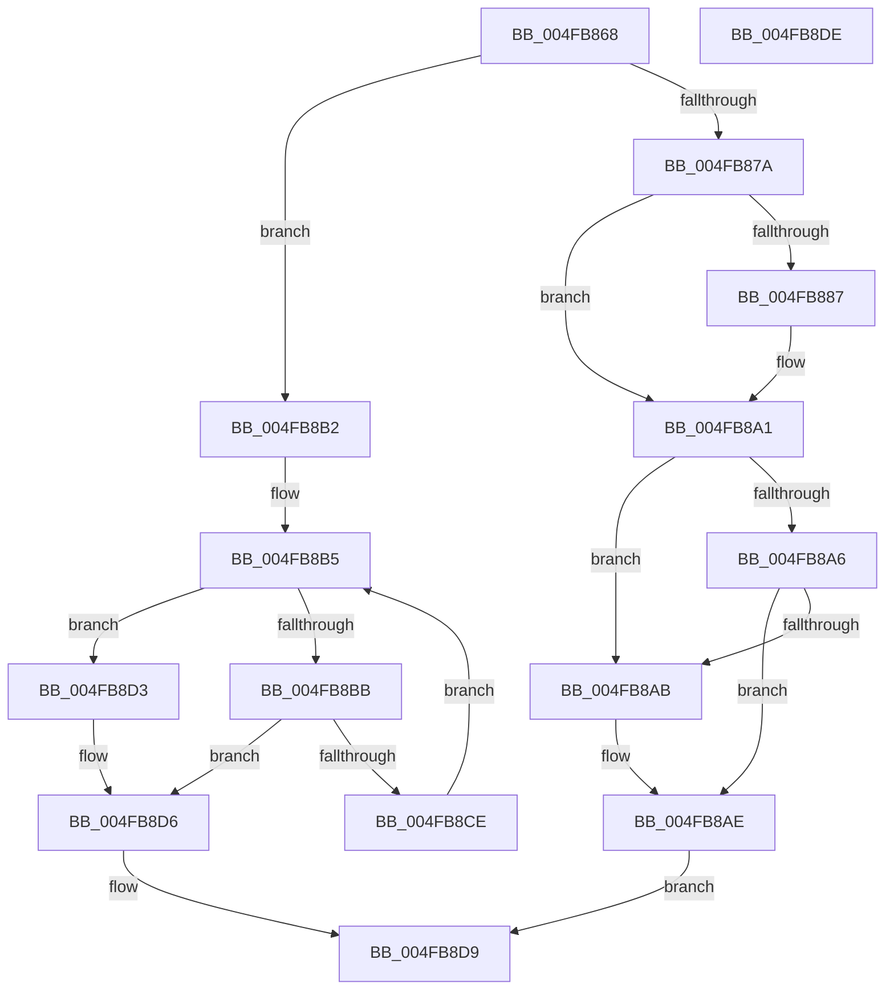

# CmpIsRegistryLockContended

- RVA: `0x004FB868`–`0x004FB8DF` (길이 `119` bytes)
- VA: `0x00000001404FB868`
- 실행 섹션: `.text`
- PDB 이름 있음: `예`; PDB Function 태그: `아니요`
- unwind 정보 RVA: `0x0005D2F4`
- 디코드: `37`개 명령, `119/119` bytes 표시
- 미해석 바이트: `0` (있으면 어셈블리에 `.byte`로 보존)

> 이 문서는 커널 이미지의 기계어와 PDB 기호를 분석해 생성했습니다. 4번과 5번은 함수 원형과 자료형을 바이너리 사용 방식에서 추정한 C 해석이며 원본 소스 복구 결과는 아닙니다.

## 1. Dependencies

- 직접 호출 지점: **1**; 고유 호출 대상: **1**
- 직접 호출자로 확인된 함수: **1**
- RIP 상대 이미지 참조: **2**

### Outgoing calls
- `0x004FB89B` → [KeBugCheckEx](KeBugCheckEx_function_004FD660.md) (function, `0x004FD660`)

### Direct callers
- [CmpEnumerateLayeredKey](../../page/94/CmpEnumerateLayeredKey_function_00945E58.md) at `0x0094604F`

### Static image references
- `0x004FB86E` → RVA `0x00EF7108` (`.data`; read)
- `0x004FB87A` → RVA `0x00EF7110` (`.data`; read)

## 2. Other-region calls and transfers

- 다른 실행 섹션으로 향하는 call: **0**
- 별도 외부 분기/꼬리 이동을 확인하지 못했습니다.

## 3. Assembly (complete function range)

```asm
004FB868  48 83 EC 38                     sub rsp, 0x38
004FB86C  33 D2                           xor edx, edx
004FB86E  39 15 94 B8 9F 00               cmp dword ptr [rip + 0x9fb894], edx
004FB874  44 8D 4A 01                     lea r9d, [rdx + 1]
004FB878  75 38                           jne 0x1404fb8b2
004FB87A  48 8B 0D 8F B8 9F 00            mov rcx, qword ptr [rip + 0x9fb88f]
004FB881  44 84 49 1A                     test byte ptr [rcx + 0x1a], r9b
004FB885  74 1A                           je 0x1404fb8a1
004FB887  45 33 C9                        xor r9d, r9d
004FB88A  48 89 54 24 20                  mov qword ptr [rsp + 0x20], rdx
004FB88F  4C 8B C1                        mov r8, rcx
004FB892  B9 C6 01 00 00                  mov ecx, 0x1c6
004FB897  41 8D 51 0E                     lea edx, [r9 + 0xe]
004FB89B  E8 C0 1D 00 00                  call 0x1404fd660
004FB8A0  CC                              int3
004FB8A1  39 51 48                        cmp dword ptr [rcx + 0x48], edx
004FB8A4  75 05                           jne 0x1404fb8ab
004FB8A6  39 51 4C                        cmp dword ptr [rcx + 0x4c], edx
004FB8A9  74 03                           je 0x1404fb8ae
004FB8AB  41 8A D1                        mov dl, r9b
004FB8AE  8A C2                           mov al, dl
004FB8B0  EB 27                           jmp 0x1404fb8d9
004FB8B2  44 8B C2                        mov r8d, edx
004FB8B5  41 83 F8 20                     cmp r8d, 0x20
004FB8B9  73 18                           jae 0x1404fb8d3
004FB8BB  48 8B 05 4E B8 9F 00            mov rax, qword ptr [rip + 0x9fb84e]
004FB8C2  41 8B C8                        mov ecx, r8d
004FB8C5  48 8B 0C C8                     mov rcx, qword ptr [rax + rcx*8]
004FB8C9  F6 01 02                        test byte ptr [rcx], 2
004FB8CC  75 08                           jne 0x1404fb8d6
004FB8CE  45 03 C1                        add r8d, r9d
004FB8D1  EB E2                           jmp 0x1404fb8b5
004FB8D3  44 8A CA                        mov r9b, dl
004FB8D6  41 8A C1                        mov al, r9b
004FB8D9  48 83 C4 38                     add rsp, 0x38
004FB8DD  C3                              ret
004FB8DE  CC                              int3
```

## 4. C-style interpretation (structured pseudocode)

```c
__int64 __fastcall CmpIsRegistryLockContended(__int64 a1, int a2)
{
    __int64 result;
    __int64 v_rsp;
    unsigned __int64 v_stack_m18;

    v_rsp = (v_rsp) - (56);
    a2 = 0;
    if ((*(unsigned int *)(v_rip + 10467476)) != 0) goto loc_004FB8B2;
    if (((*(unsigned __int8 *)(*(unsigned __int64 *)(v_rip + 10467471) + 26)) & ((unsigned __int8)(a2 + 1))) != 0) {
        a4 = 0;
        v_stack_m18 = 0;
        a3 = *(unsigned __int64 *)(v_rip + 10467471);
        a1 = 454;
        a2 = a4 + 14;
        result = KeBugCheckEx(a1, a2, a3, a4);
    }
    if ((*(unsigned int *)(a1 + 72)) != a2) goto loc_004FB8AB;
    if ((*(unsigned int *)(a1 + 76)) != a2) {
        a2 = 0;
    }
    goto loc_004FB8D9;
loc_004FB8B2:
loc_004FB8B5:
    if (((unsigned int)((unsigned int)(a2))) >= 32) goto loc_004FB8D3;
    if (((*(unsigned __int8 *)(*(unsigned __int64 *)(*(unsigned __int64 *)(v_rip + 10467406) + (unsigned int)((unsigned int)((unsigned int)(a2))) * 8))) & (2)) != 0) goto loc_004FB8D6;
    a3 = (unsigned int)(((unsigned int)(a2)) + (0));
    goto loc_004FB8B5;
loc_004FB8D3:
loc_004FB8D6:
loc_004FB8D9:
    v_rsp = (v_rsp) + (56);
    return (unsigned __int8)((unsigned __int8)(a2));
}
```

## 5. (Beta) C Style

```c
int64_t CmpIsRegistryLockContended(int64_t Arg1, int32_t Arg2)
{
    int64_t result;
    int64_t local_rsp;
    uint64_t v_stack_m18;

    local_rsp = (local_rsp) - (56);
    Arg2 = 0;
    if ((*(uint32_t *)(v_rip + 0x9FB894)) != 0) goto loc_004FB8B2;
    if (((*(uint8_t *)(*(uint64_t *)(v_rip + 0x9FB88F) + 0x1A)) & ((uint8_t)(Arg2 + 1))) != 0) {
        a4 = 0;
        v_stack_m18 = 0;
        a3 = *(uint64_t *)(v_rip + 0x9FB88F);
        Arg1 = 454;
        Arg2 = a4 + 14;
        result = KeBugCheckEx(Arg1, Arg2, a3, a4);
    }
    if ((*(uint32_t *)(Arg1 + 0x48)) != Arg2) goto loc_004FB8AB;
    if ((*(uint32_t *)(Arg1 + 0x4C)) != Arg2) {
        Arg2 = 0;
    }
    goto loc_004FB8D9;
loc_004FB8B2:
loc_004FB8B5:
    if (((uint32_t)((uint32_t)(Arg2))) >= 32) goto loc_004FB8D3;
    if (((*(uint8_t *)(*(uint64_t *)(*(uint64_t *)(v_rip + 0x9FB84E) + (uint32_t)((uint32_t)((uint32_t)(Arg2))) * 8))) & (2)) != 0) goto loc_004FB8D6;
    a3 = (uint32_t)(((uint32_t)(Arg2)) + (0));
    goto loc_004FB8B5;
loc_004FB8D3:
loc_004FB8D6:
loc_004FB8D9:
    local_rsp = (local_rsp) + (56);
    return (uint8_t)((uint8_t)(Arg2));
}
```

## 6. Execution-region graph

[열기: 2D/3D 그래프와 함수 탐색 컨트롤 패널](../../../control-panel.html?section=text&rva=0x004FB868&view=graph)

- 2D 그래프는 위에서 아래로 흐르고, 3D 그래프는 빈 공간을 드래그해 회전합니다. Shift+드래그는 이동, 휠은 확대·축소, 함수 노드 선택은 대상 보고서 이동입니다.

### Static fallback


