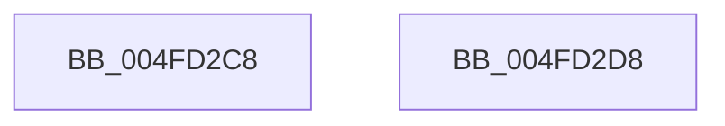

# CvmDebugLog

- RVA: `0x004FD2C8`–`0x004FD2D9` (길이 `17` bytes)
- VA: `0x00000001404FD2C8`
- 실행 섹션: `.text`
- PDB 이름 있음: `예`; PDB Function 태그: `아니요`
- unwind 정보 RVA: `0x000DB714`
- 디코드: `5`개 명령, `17/17` bytes 표시
- 미해석 바이트: `0` (있으면 어셈블리에 `.byte`로 보존)

> 이 문서는 커널 이미지의 기계어와 PDB 기호를 분석해 생성했습니다. 4번과 5번은 함수 원형과 자료형을 바이너리 사용 방식에서 추정한 C 해석이며 원본 소스 복구 결과는 아닙니다.

## 1. Dependencies

- 직접 호출 지점: **0**; 고유 호출 대상: **0**
- 직접 호출자로 확인된 함수: **2**
- RIP 상대 이미지 참조: **0**

### Outgoing calls
- 직접 디코드된 call 명령이 없습니다.

### Direct callers
- [HalpAllocateDomainCommonBufferInternal](../3E/HalpAllocateDomainCommonBufferInternal_function_003E8B64.md) at `0x003E8D71`
- [HalpDmaFreeChildAdapter](../55/HalpDmaFreeChildAdapter_function_00550E30.md) at `0x00550FA5`
- [HalpDmaFreeChildAdapter](../55/HalpDmaFreeChildAdapter_function_00550E30.md) at `0x0055107B`

### Static image references
- 디코드된 RIP-relative 메모리 참조가 없습니다.

## 2. Other-region calls and transfers

- 다른 실행 섹션으로 향하는 call: **0**
- 별도 외부 분기/꼬리 이동을 확인하지 못했습니다.

## 3. Assembly (complete function range)

```asm
004FD2C8  48 89 54 24 10                  mov qword ptr [rsp + 0x10], rdx
004FD2CD  4C 89 44 24 18                  mov qword ptr [rsp + 0x18], r8
004FD2D2  4C 89 4C 24 20                  mov qword ptr [rsp + 0x20], r9
004FD2D7  C3                              ret
004FD2D8  CC                              int3
```

## 4. C-style interpretation (structured pseudocode)

```c
void __fastcall CvmDebugLog(__int64 a1, __int64 a2, __int64 a3, __int64 a4)
{
    unsigned __int64 v_stack_p10;
    unsigned __int64 v_stack_p18;
    unsigned __int64 v_stack_p20;

    v_stack_p10 = a2;
    v_stack_p18 = a3;
    v_stack_p20 = a4;
    return;
}
```

## 5. (Beta) C Style

```c
void CvmDebugLog(int64_t Arg1, int64_t Arg2, int64_t Arg3, int64_t Arg4)
{
    uint64_t v_stack_p10;
    uint64_t v_stack_p18;
    uint64_t v_stack_p20;

    v_stack_p10 = Arg2;
    v_stack_p18 = Arg3;
    v_stack_p20 = Arg4;
    return;
}
```

## 6. Execution-region graph

[열기: 2D/3D 그래프와 함수 탐색 컨트롤 패널](../../../control-panel.html?section=text&rva=0x004FD2C8&view=graph)

- 2D 그래프는 위에서 아래로 흐르고, 3D 그래프는 빈 공간을 드래그해 회전합니다. Shift+드래그는 이동, 휠은 확대·축소, 함수 노드 선택은 대상 보고서 이동입니다.

### Static fallback


