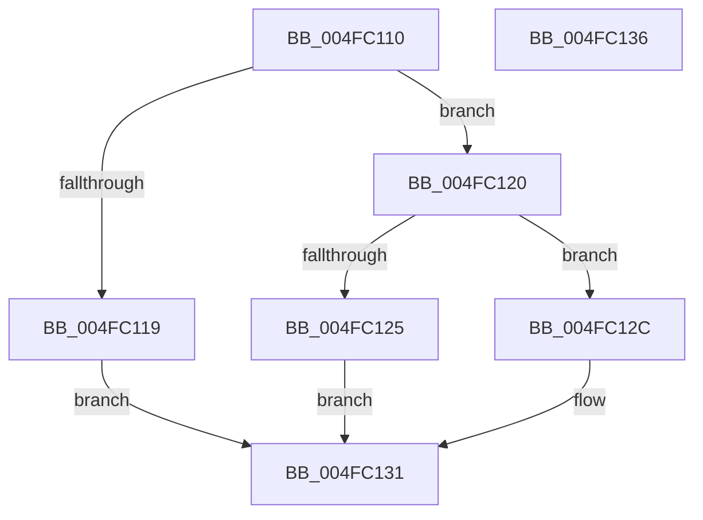

# DbgSetDebugPrintCallback

- RVA: `0x004FC110`–`0x004FC137` (길이 `39` bytes)
- VA: `0x00000001404FC110`
- 실행 섹션: `.text`
- PDB 이름 있음: `예`; PDB Function 태그: `아니요`
- unwind 정보 RVA: `0x0005C788`
- 디코드: `13`개 명령, `39/39` bytes 표시
- 미해석 바이트: `0` (있으면 어셈블리에 `.byte`로 보존)

> 이 문서는 커널 이미지의 기계어와 PDB 기호를 분석해 생성했습니다. 4번과 5번은 함수 원형과 자료형을 바이너리 사용 방식에서 추정한 C 해석이며 원본 소스 복구 결과는 아닙니다.

## 1. Dependencies

- 직접 호출 지점: **2**; 고유 호출 대상: **2**
- 직접 호출자로 확인된 함수: **2**
- RIP 상대 이미지 참조: **0**

### Outgoing calls
- `0x004FC125` → [DbgpInsertDebugPrintCallback](../5E/DbgpInsertDebugPrintCallback_function_005E5908.md) (function, `0x005E5908`)
- `0x004FC12C` → [DbgpRemoveDebugPrintCallback](../5E/DbgpRemoveDebugPrintCallback_function_005E59E4.md) (function, `0x005E59E4`)

### Direct callers
- [EtwpDisableKernelTrace](../../page/A4/EtwpDisableKernelTrace_function_00A4F7D8.md) at `0x00A4FB31`
- [EtwpEnableKernelTrace](../../page/A4/EtwpEnableKernelTrace_function_00A4FBCC.md) at `0x00A4FF1E`

### Static image references
- 디코드된 RIP-relative 메모리 참조가 없습니다.

## 2. Other-region calls and transfers

- 다른 실행 섹션으로 향하는 call: **0**
- 별도 외부 분기/꼬리 이동을 확인하지 못했습니다.

## 3. Assembly (complete function range)

```asm
004FC110  48 83 EC 28                     sub rsp, 0x28
004FC114  48 85 C9                        test rcx, rcx
004FC117  75 07                           jne 0x1404fc120
004FC119  B8 0D 00 00 C0                  mov eax, 0xc000000d
004FC11E  EB 11                           jmp 0x1404fc131
004FC120  80 FA 01                        cmp dl, 1
004FC123  75 07                           jne 0x1404fc12c
004FC125  E8 DE 97 0E 00                  call 0x1405e5908
004FC12A  EB 05                           jmp 0x1404fc131
004FC12C  E8 B3 98 0E 00                  call 0x1405e59e4
004FC131  48 83 C4 28                     add rsp, 0x28
004FC135  C3                              ret
004FC136  CC                              int3
```

## 4. C-style interpretation (structured pseudocode)

```c
__int64 __fastcall DbgSetDebugPrintCallback(__int64 a1, unsigned __int8 a2)
{
    __int64 result;
    __int64 v_rsp;

    v_rsp = (v_rsp) - (40);
    if (a1 != 0) goto loc_004FC120;
    goto loc_004FC131;
loc_004FC120:
    if (a2 != 1) goto loc_004FC12C;
    result = DbgpInsertDebugPrintCallback(a1, a2, a3, a4);
    goto loc_004FC131;
loc_004FC12C:
    result = DbgpRemoveDebugPrintCallback(a1, a2, a3, a4);
loc_004FC131:
    v_rsp = (v_rsp) + (40);
    return result;
}
```

## 5. (Beta) C Style

```c
int64_t DbgSetDebugPrintCallback(int64_t Arg1, uint8_t Arg2)
{
    int64_t result;
    int64_t local_rsp;

    local_rsp = (local_rsp) - (40);
    if (Arg1 != 0) goto loc_004FC120;
    goto loc_004FC131;
loc_004FC120:
    if (Arg2 != 1) goto loc_004FC12C;
    result = DbgpInsertDebugPrintCallback(Arg1, Arg2, a3, a4);
    goto loc_004FC131;
loc_004FC12C:
    result = DbgpRemoveDebugPrintCallback(Arg1, Arg2, a3, a4);
loc_004FC131:
    local_rsp = (local_rsp) + (40);
    return result;
}
```

## 6. Execution-region graph

[열기: 2D/3D 그래프와 함수 탐색 컨트롤 패널](../../../control-panel.html?section=text&rva=0x004FC110&view=graph)

- 2D 그래프는 위에서 아래로 흐르고, 3D 그래프는 빈 공간을 드래그해 회전합니다. Shift+드래그는 이동, 휠은 확대·축소, 함수 노드 선택은 대상 보고서 이동입니다.

### Static fallback


