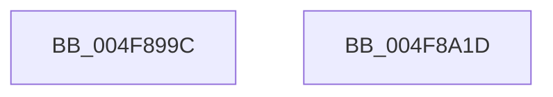

# EtwTraceScbRankChange

- RVA: `0x004F899C`–`0x004F8A1E` (길이 `130` bytes)
- VA: `0x00000001404F899C`
- 실행 섹션: `.text`
- PDB 이름 있음: `예`; PDB Function 태그: `아니요`
- unwind 정보 RVA: `0x000BE484`
- 디코드: `31`개 명령, `130/130` bytes 표시
- 미해석 바이트: `0` (있으면 어셈블리에 `.byte`로 보존)

> 이 문서는 커널 이미지의 기계어와 PDB 기호를 분석해 생성했습니다. 4번과 5번은 함수 원형과 자료형을 바이너리 사용 방식에서 추정한 C 해석이며 원본 소스 복구 결과는 아닙니다.

## 1. Dependencies

- 직접 호출 지점: **2**; 고유 호출 대상: **2**
- 직접 호출자로 확인된 함수: **5**
- RIP 상대 이미지 참조: **1**

### Outgoing calls
- `0x004F8A06` → [EtwTraceKernelEvent](../23/EtwTraceKernelEvent_function_00235350.md) (function, `0x00235350`)
- `0x004F8A13` → [_security_check_cookie](../6A/_security_check_cookie_function_006AC640.md) (function, `0x006AC640`)

### Direct callers
- [KiQueueReadyThread](../21/KiQueueReadyThread_function_0021C7B0.md) at `0x0021D0C1`
- [KiQueueReadyThread](../21/KiQueueReadyThread_function_0021C7B0.md) at `0x0021D1BB`
- [KiProcessScbTracingList](../45/KiProcessScbTracingList_function_0045A500.md) at `0x0045A553`
- [KiUpdateCpuTargetByRate](../46/KiUpdateCpuTargetByRate_function_0046D7E4.md) at `0x0046D9D9`
- [KiUpdateCpuTargetByWeight](../46/KiUpdateCpuTargetByWeight_function_0046E0E0.md) at `0x0046E354`
- [sub_006F340E](../6F/Unknown_function_006F340E.md) at `0x006F349A`

### Static image references
- `0x004F89A3` → RVA `0x00E0A740` (`.data`; read)

## 2. Other-region calls and transfers

- 다른 실행 섹션으로 향하는 call: **0**
- 별도 외부 분기/꼬리 이동을 확인하지 못했습니다.

## 3. Assembly (complete function range)

```asm
004F899C  4C 8B DC                        mov r11, rsp
004F899F  48 83 EC 68                     sub rsp, 0x68
004F89A3  48 8B 05 96 1D 91 00            mov rax, qword ptr [rip + 0x911d96]
004F89AA  48 33 C4                        xor rax, rsp
004F89AD  48 89 44 24 58                  mov qword ptr [rsp + 0x58], rax
004F89B2  49 83 63 E8 00                  and qword ptr [r11 - 0x18], 0
004F89B7  33 C0                           xor eax, eax
004F89B9  49 89 4B D8                     mov qword ptr [r11 - 0x28], rcx
004F89BD  83 E0 FE                        and eax, 0xfffffffe
004F89C0  41 0F B6 C9                     movzx ecx, r9b
004F89C4  41 B9 67 05 00 00               mov r9d, 0x567
004F89CA  89 54 24 48                     mov dword ptr [rsp + 0x48], edx
004F89CE  BA 01 00 00 00                  mov edx, 1
004F89D3  23 CA                           and ecx, edx
004F89D5  45 89 43 E4                     mov dword ptr [r11 - 0x1c], r8d
004F89D9  0B C8                           or ecx, eax
004F89DB  C7 44 24 20 02 0F 60 00         mov dword ptr [rsp + 0x20], 0x600f02
004F89E3  49 8D 43 D8                     lea rax, [r11 - 0x28]
004F89E7  89 4C 24 50                     mov dword ptr [rsp + 0x50], ecx
004F89EB  49 89 43 C8                     mov qword ptr [r11 - 0x38], rax
004F89EF  49 8D 4B C8                     lea rcx, [r11 - 0x38]
004F89F3  83 64 24 3C 00                  and dword ptr [rsp + 0x3c], 0
004F89F8  41 B8 00 40 00 A0               mov r8d, 0xa0004000
004F89FE  C7 44 24 38 18 00 00 00         mov dword ptr [rsp + 0x38], 0x18
004F8A06  E8 45 C9 D3 FF                  call 0x140235350
004F8A0B  48 8B 4C 24 58                  mov rcx, qword ptr [rsp + 0x58]
004F8A10  48 33 CC                        xor rcx, rsp
004F8A13  E8 28 3C 1B 00                  call 0x1406ac640
004F8A18  48 83 C4 68                     add rsp, 0x68
004F8A1C  C3                              ret
004F8A1D  CC                              int3
```

## 4. C-style interpretation (structured pseudocode)

```c
__int64 __fastcall EtwTraceScbRankChange(__int64 a1, int a2, int a3, unsigned __int8 a4)
{
    __int64 result;
    __int64 v_rsp;
    unsigned __int64 v_stack_m10;
    unsigned int v_stack_m18;
    unsigned int v_stack_m20;
    unsigned int v_stack_m2C;
    unsigned int v_stack_m30;
    unsigned int v_stack_m48;

    v_rsp = (v_rsp) - (104);
    result = (*(unsigned __int64 *)(v_rip + 9510294)) ^ (v_rsp);
    v_stack_m10 = result;
    result = 0;
    *(unsigned __int64 *)(v_rsp - 40) = a1;
    result = (unsigned int)((result) & (0xFFFFFFFEULL));
    v_stack_m20 = a2;
    a1 = (unsigned int)((a4) & (1));
    *(unsigned int *)(v_rsp - 28) = a3;
    a1 = (unsigned int)((a1) | ((unsigned int)(result)));
    v_stack_m48 = 0x600F02ULL;
    v_stack_m18 = (unsigned int)(a1);
    *(unsigned __int64 *)(v_rsp - 56) = v_rsp - 40;
    v_stack_m30 = 24;
    result = EtwTraceKernelEvent(v_rsp - 56, 1, (unsigned int)(0xA0004000ULL), (unsigned int)(0x567ULL));
    a1 = (v_stack_m10) ^ (v_rsp);
    result = _security_check_cookie(a1, 1, (unsigned int)(0xA0004000ULL), (unsigned int)(0x567ULL));
    v_rsp = (v_rsp) + (104);
    return result;
}
```

## 5. (Beta) C Style

```c
int64_t EtwTraceScbRankChange(int64_t Arg1, int32_t Arg2, int32_t Arg3, uint8_t Arg4)
{
    int64_t result;
    int64_t local_rsp;
    uint64_t v_stack_m10;
    uint32_t v_stack_m18;
    uint32_t v_stack_m20;
    uint32_t v_stack_m2C;
    uint32_t v_stack_m30;
    uint32_t v_stack_m48;

    local_rsp = (local_rsp) - (104);
    result = (*(uint64_t *)(v_rip + 0x911D96)) ^ (local_rsp);
    v_stack_m10 = result;
    result = 0;
    *(uint64_t *)(local_rsp - 0x28) = Arg1;
    result = (uint32_t)((result) & (0xFFFFFFFEULL));
    v_stack_m20 = Arg2;
    Arg1 = (uint32_t)((Arg4) & (1));
    *(uint32_t *)(local_rsp - 0x1C) = Arg3;
    Arg1 = (uint32_t)((Arg1) | ((uint32_t)(result)));
    v_stack_m48 = 0x600F02ULL;
    v_stack_m18 = (uint32_t)(Arg1);
    *(uint64_t *)(local_rsp - 0x38) = local_rsp - 40;
    v_stack_m30 = 24;
    result = EtwTraceKernelEvent(local_rsp - 56, 1, (uint32_t)(0xA0004000ULL), (uint32_t)(0x567ULL));
    Arg1 = (v_stack_m10) ^ (local_rsp);
    result = _security_check_cookie(Arg1, 1, (uint32_t)(0xA0004000ULL), (uint32_t)(0x567ULL));
    local_rsp = (local_rsp) + (104);
    return result;
}
```

## 6. Execution-region graph

[열기: 2D/3D 그래프와 함수 탐색 컨트롤 패널](../../../control-panel.html?section=text&rva=0x004F899C&view=graph)

- 2D 그래프는 위에서 아래로 흐르고, 3D 그래프는 빈 공간을 드래그해 회전합니다. Shift+드래그는 이동, 휠은 확대·축소, 함수 노드 선택은 대상 보고서 이동입니다.

### Static fallback


