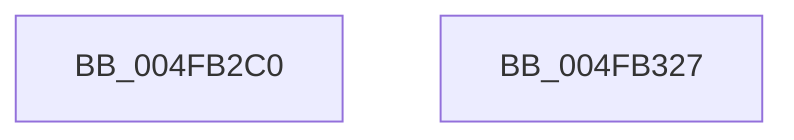

# EtwTraceXSchedulerPriorityKickSend

- RVA: `0x004FB2C0`–`0x004FB328` (길이 `104` bytes)
- VA: `0x00000001404FB2C0`
- 실행 섹션: `.text`
- PDB 이름 있음: `예`; PDB Function 태그: `아니요`
- unwind 정보 RVA: `0x000B3A94`
- 디코드: `22`개 명령, `104/104` bytes 표시
- 미해석 바이트: `0` (있으면 어셈블리에 `.byte`로 보존)

> 이 문서는 커널 이미지의 기계어와 PDB 기호를 분석해 생성했습니다. 4번과 5번은 함수 원형과 자료형을 바이너리 사용 방식에서 추정한 C 해석이며 원본 소스 복구 결과는 아닙니다.

## 1. Dependencies

- 직접 호출 지점: **2**; 고유 호출 대상: **2**
- 직접 호출자로 확인된 함수: **14**
- RIP 상대 이미지 참조: **1**

### Outgoing calls
- `0x004FB310` → [EtwTraceKernelEvent](../23/EtwTraceKernelEvent_function_00235350.md) (function, `0x00235350`)
- `0x004FB31D` → [_security_check_cookie](../6A/_security_check_cookie_function_006AC640.md) (function, `0x006AC640`)

### Direct callers
- [KiDeferGroupSchedulingPreemption](../20/KiDeferGroupSchedulingPreemption_function_0020076C.md) at `0x00200DA5`
- [sub_00207D3E](../20/Unknown_function_00207D3E.md) at `0x00208351`
- [sub_0021D7F8](../21/Unknown_function_0021D7F8.md) at `0x0021E800`
- [sub_0025308F](../25/Unknown_function_0025308F.md) at `0x00253FC9`
- [KiAttemptToScheduleThreadToBusyIsolationUnit](../25/KiAttemptToScheduleThreadToBusyIsolationUnit_function_00259B00.md) at `0x0025A116`
- [KiExecuteAllDpcs](../25/KiExecuteAllDpcs_function_0025B740.md) at `0x0025C377`
- [KiRemoveSystemWorkPriorityKick](../26/KiRemoveSystemWorkPriorityKick_function_002631D0.md) at `0x002632BA`
- [KiGroupSchedulingGenerationEnd](../30/KiGroupSchedulingGenerationEnd_function_0030A9B4.md) at `0x0030AE9A`
- [KiSoftParkElectionUnparkProcessor](../30/KiSoftParkElectionUnparkProcessor_function_0030B818.md) at `0x0030BBD3`
- [KiRescheduleThreadAfterAffinityChange](../30/KiRescheduleThreadAfterAffinityChange_function_0030C9E8.md) at `0x0030CE35`
- [KiSearchForNewThreadsOnTarget](../30/KiSearchForNewThreadsOnTarget_function_0030F500.md) at `0x0031034C`
- [KiSearchForNewThreadsOnTarget](../30/KiSearchForNewThreadsOnTarget_function_0030F500.md) at `0x003106B7`
- [KiSearchForNewThreadsOnTarget](../30/KiSearchForNewThreadsOnTarget_function_0030F500.md) at `0x00310D50`
- [sub_00356427](../35/Unknown_function_00356427.md) at `0x003564A0`
- [KiSetSystemAffinityThread](../39/KiSetSystemAffinityThread_function_003993E0.md) at `0x003999BB`
- [KiHvEnlightenedGuestPriorityKick](../44/KiHvEnlightenedGuestPriorityKick_function_00443880.md) at `0x00443919`

### Static image references
- `0x004FB2C4` → RVA `0x00E0A740` (`.data`; read)

## 2. Other-region calls and transfers

- 다른 실행 섹션으로 향하는 call: **0**
- 별도 외부 분기/꼬리 이동을 확인하지 못했습니다.

## 3. Assembly (complete function range)

```asm
004FB2C0  48 83 EC 58                     sub rsp, 0x58
004FB2C4  48 8B 05 75 F4 90 00            mov rax, qword ptr [rip + 0x90f475]
004FB2CB  48 33 C4                        xor rax, rsp
004FB2CE  48 89 44 24 48                  mov qword ptr [rsp + 0x48], rax
004FB2D3  83 64 24 44 00                  and dword ptr [rsp + 0x44], 0
004FB2D8  48 8D 44 24 30                  lea rax, [rsp + 0x30]
004FB2DD  89 4C 24 30                     mov dword ptr [rsp + 0x30], ecx
004FB2E1  41 B9 75 0F 00 00               mov r9d, 0xf75
004FB2E7  89 54 24 34                     mov dword ptr [rsp + 0x34], edx
004FB2EB  48 8D 4C 24 38                  lea rcx, [rsp + 0x38]
004FB2F0  BA 01 00 00 00                  mov edx, 1
004FB2F5  48 89 44 24 38                  mov qword ptr [rsp + 0x38], rax
004FB2FA  41 B8 20 00 00 A0               mov r8d, 0xa0000020
004FB300  C7 44 24 40 08 00 00 00         mov dword ptr [rsp + 0x40], 8
004FB308  C7 44 24 20 02 0A 50 00         mov dword ptr [rsp + 0x20], 0x500a02
004FB310  E8 3B A0 D3 FF                  call 0x140235350
004FB315  48 8B 4C 24 48                  mov rcx, qword ptr [rsp + 0x48]
004FB31A  48 33 CC                        xor rcx, rsp
004FB31D  E8 1E 13 1B 00                  call 0x1406ac640
004FB322  48 83 C4 58                     add rsp, 0x58
004FB326  C3                              ret
004FB327  CC                              int3
```

## 4. C-style interpretation (structured pseudocode)

```c
__int64 __fastcall EtwTraceXSchedulerPriorityKickSend(int a1, int a2)
{
    __int64 result;
    __int64 v_rsp;
    unsigned __int64 v_stack_m10;
    unsigned int v_stack_m14;
    unsigned int v_stack_m18;
    unsigned __int64 v_stack_m20;
    unsigned int v_stack_m24;
    unsigned __int64 v_stack_m28;
    unsigned int v_stack_m38;

    v_rsp = (v_rsp) - (88);
    result = (*(unsigned __int64 *)(v_rip + 9499765)) ^ (v_rsp);
    v_stack_m10 = result;
    v_stack_m28 = a1;
    v_stack_m24 = a2;
    v_stack_m20 = v_stack_m28;
    v_stack_m18 = 8;
    v_stack_m38 = 0x500A02ULL;
    result = EtwTraceKernelEvent(v_stack_m20, 1, (unsigned int)(0xA0000020ULL), (unsigned int)(0xF75ULL));
    a1 = (v_stack_m10) ^ (v_rsp);
    result = _security_check_cookie(a1, 1, (unsigned int)(0xA0000020ULL), (unsigned int)(0xF75ULL));
    v_rsp = (v_rsp) + (88);
    return result;
}
```

## 5. (Beta) C Style

```c
int64_t EtwTraceXSchedulerPriorityKickSend(int32_t Arg1, int32_t Arg2)
{
    int64_t result;
    int64_t local_rsp;
    uint64_t v_stack_m10;
    uint32_t v_stack_m14;
    uint32_t v_stack_m18;
    uint64_t v_stack_m20;
    uint32_t v_stack_m24;
    uint64_t v_stack_m28;
    uint32_t v_stack_m38;

    local_rsp = (local_rsp) - (88);
    result = (*(uint64_t *)(v_rip + 0x90F475)) ^ (local_rsp);
    v_stack_m10 = result;
    v_stack_m28 = Arg1;
    v_stack_m24 = Arg2;
    v_stack_m20 = v_stack_m28;
    v_stack_m18 = 8;
    v_stack_m38 = 0x500A02ULL;
    result = EtwTraceKernelEvent(v_stack_m20, 1, (uint32_t)(0xA0000020ULL), (uint32_t)(0xF75ULL));
    Arg1 = (v_stack_m10) ^ (local_rsp);
    result = _security_check_cookie(Arg1, 1, (uint32_t)(0xA0000020ULL), (uint32_t)(0xF75ULL));
    local_rsp = (local_rsp) + (88);
    return result;
}
```

## 6. Execution-region graph

[열기: 2D/3D 그래프와 함수 탐색 컨트롤 패널](../../../control-panel.html?section=text&rva=0x004FB2C0&view=graph)

- 2D 그래프는 위에서 아래로 흐르고, 3D 그래프는 빈 공간을 드래그해 회전합니다. Shift+드래그는 이동, 휠은 확대·축소, 함수 노드 선택은 대상 보고서 이동입니다.

### Static fallback


