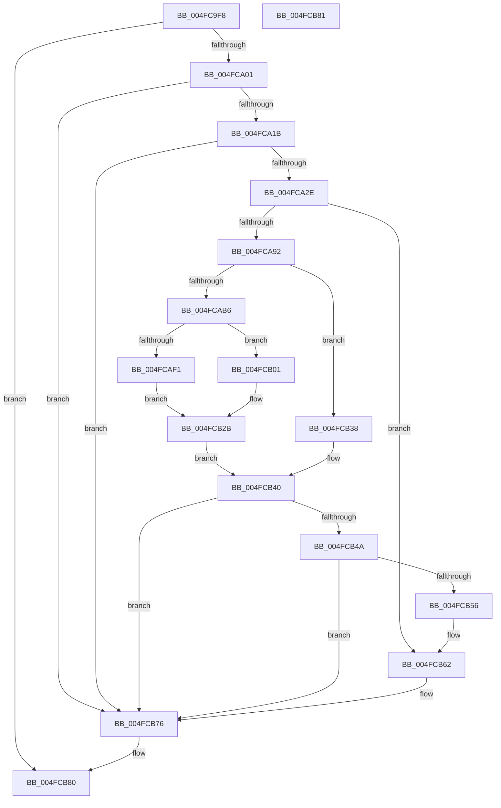

# EtwpCoverageSamplerContextSwap

- RVA: `0x004FC9F8`–`0x004FCB82` (길이 `394` bytes)
- VA: `0x00000001404FC9F8`
- 실행 섹션: `.text`
- PDB 이름 있음: `예`; PDB Function 태그: `아니요`
- unwind 정보 RVA: `0x000BFAB0`
- 디코드: `100`개 명령, `394/394` bytes 표시
- 미해석 바이트: `0` (있으면 어셈블리에 `.byte`로 보존)

> 이 문서는 커널 이미지의 기계어와 PDB 기호를 분석해 생성했습니다. 4번과 5번은 함수 원형과 자료형을 바이너리 사용 방식에서 추정한 C 해석이며 원본 소스 복구 결과는 아닙니다.

## 1. Dependencies

- 직접 호출 지점: **1**; 고유 호출 대상: **1**
- 직접 호출자로 확인된 함수: **2**
- RIP 상대 이미지 참조: **1**

### Outgoing calls
- `0x004FCB71` → [EtwpCovSampCaptureSample](../65/EtwpCovSampCaptureSample_function_00653F24.md) (function, `0x00653F24`)

### Direct callers
- [KiSwapThread](../35/KiSwapThread_function_00355640.md) at `0x00355ABC`
- [EtwTraceContextSwap](../41/EtwTraceContextSwap_function_004174A0.md) at `0x0041753F`

### Static image references
- `0x004FCA0B` → RVA `0x00EFF1E8` (`.data`; read)

## 2. Other-region calls and transfers

- 다른 실행 섹션으로 향하는 call: **0**
- 별도 외부 분기/꼬리 이동을 확인하지 못했습니다.

## 3. Assembly (complete function range)

```asm
004FC9F8  48 85 C9                        test rcx, rcx
004FC9FB  0F 84 7F 01 00 00               je 0x1404fcb80
004FCA01  48 89 5C 24 10                  mov qword ptr [rsp + 0x10], rbx
004FCA06  57                              push rdi
004FCA07  48 83 EC 20                     sub rsp, 0x20
004FCA0B  48 8B 15 D6 27 A0 00            mov rdx, qword ptr [rip + 0xa027d6]
004FCA12  48 3B 0A                        cmp rcx, qword ptr [rdx]
004FCA15  0F 84 5B 01 00 00               je 0x1404fcb76
004FCA1B  65 48 8B 04 25 20 00 00 00      mov rax, qword ptr gs:[0x20]
004FCA24  48 3B 48 18                     cmp rcx, qword ptr [rax + 0x18]
004FCA28  0F 84 48 01 00 00               je 0x1404fcb76
004FCA2E  48 8B 42 08                     mov rax, qword ptr [rdx + 8]
004FCA32  BA 01 00 00 00                  mov edx, 1
004FCA37  65 4C 8B 04 25 20 00 00 00      mov r8, qword ptr gs:[0x20]
004FCA40  44 8B C8                        mov r9d, eax
004FCA43  C1 E8 0D                        shr eax, 0xd
004FCA46  25 FF FF 03 00                  and eax, 0x3ffff
004FCA4B  49 C1 E9 04                     shr r9, 4
004FCA4F  0F BD C8                        bsr ecx, eax
004FCA52  41 81 E1 FF 01 00 00            and r9d, 0x1ff
004FCA59  D3 E2                           shl edx, cl
004FCA5B  83 C1 FE                        add ecx, -2
004FCA5E  33 D0                           xor edx, eax
004FCA60  89 4C 24 30                     mov dword ptr [rsp + 0x30], ecx
004FCA64  49 8B 80 B0 8B 00 00            mov rax, qword ptr [r8 + 0x8bb0]
004FCA6B  4E 8D 1C CD 0F 00 00 00         lea r11, [r9*8 + 0xf]
004FCA73  48 8B 04 C8                     mov rax, qword ptr [rax + rcx*8]
004FCA77  4C 03 5C D0 08                  add r11, qword ptr [rax + rdx*8 + 8]
004FCA7C  49 83 E3 F0                     and r11, 0xfffffffffffffff0
004FCA80  4D 8D 83 B8 00 00 00            lea r8, [r11 + 0xb8]
004FCA87  41 8B 38                        mov edi, dword ptr [r8]
004FCA8A  85 FF                           test edi, edi
004FCA8C  0F 84 D0 00 00 00               je 0x1404fcb62
004FCA92  45 8B 48 14                     mov r9d, dword ptr [r8 + 0x14]
004FCA96  48 BB 20 03 00 00 80 F7 FF FF   movabs rbx, 0xfffff78000000320
004FCAA0  8B 1B                           mov ebx, dword ptr [rbx]
004FCAA2  8B C3                           mov eax, ebx
004FCAA4  41 8B 50 04                     mov edx, dword ptr [r8 + 4]
004FCAA8  2B C2                           sub eax, edx
004FCAAA  41 8B 48 08                     mov ecx, dword ptr [r8 + 8]
004FCAAE  3B C1                           cmp eax, ecx
004FCAB0  0F 86 82 00 00 00               jbe 0x1404fcb38
004FCAB6  41 89 58 04                     mov dword ptr [r8 + 4], ebx
004FCABA  44 03 CF                        add r9d, edi
004FCABD  41 8B 40 0C                     mov eax, dword ptr [r8 + 0xc]
004FCAC1  44 3B C8                        cmp r9d, eax
004FCAC4  41 0F 4E C1                     cmovle eax, r9d
004FCAC8  41 89 40 14                     mov dword ptr [r8 + 0x14], eax
004FCACC  44 8B C8                        mov r9d, eax
004FCACF  41 8B 48 1C                     mov ecx, dword ptr [r8 + 0x1c]
004FCAD3  8D 04 3F                        lea eax, [rdi + rdi]
004FCAD6  45 8B 50 10                     mov r10d, dword ptr [r8 + 0x10]
004FCADA  44 03 D1                        add r10d, ecx
004FCADD  41 D1 EA                        shr r10d, 1
004FCAE0  45 89 50 1C                     mov dword ptr [r8 + 0x1c], r10d
004FCAE4  41 C7 40 10 00 00 00 00         mov dword ptr [r8 + 0x10], 0
004FCAEC  44 3B D0                        cmp r10d, eax
004FCAEF  73 10                           jae 0x1404fcb01
004FCAF1  41 BA 01 00 00 00               mov r10d, 1
004FCAF7  45 89 50 20                     mov dword ptr [r8 + 0x20], r10d
004FCAFB  45 89 50 18                     mov dword ptr [r8 + 0x18], r10d
004FCAFF  EB 2A                           jmp 0x1404fcb2b
004FCB01  33 D2                           xor edx, edx
004FCB03  8D 4F 01                        lea ecx, [rdi + 1]
004FCB06  41 8B C2                        mov eax, r10d
004FCB09  F7 F1                           div ecx
004FCB0B  41 89 40 20                     mov dword ptr [r8 + 0x20], eax
004FCB0F  44 8B D0                        mov r10d, eax
004FCB12  41 8B 48 24                     mov ecx, dword ptr [r8 + 0x24]
004FCB16  33 CB                           xor ecx, ebx
004FCB18  69 D1 93 01 00 01               imul edx, ecx, 0x1000193
004FCB1E  8D 0C 00                        lea ecx, [rax + rax]
004FCB21  23 CA                           and ecx, edx
004FCB23  41 89 50 24                     mov dword ptr [r8 + 0x24], edx
004FCB27  41 89 48 18                     mov dword ptr [r8 + 0x18], ecx
004FCB2B  B8 18 00 00 00                  mov eax, 0x18
004FCB30  49 8B C8                        mov rcx, r8
004FCB33  48 03 C8                        add rcx, rax
004FCB36  EB 08                           jmp 0x1404fcb40
004FCB38  45 8B 50 20                     mov r10d, dword ptr [r8 + 0x20]
004FCB3C  49 8D 48 18                     lea rcx, [r8 + 0x18]
004FCB40  F0 41 FF 40 10                  lock inc dword ptr [r8 + 0x10]
004FCB45  45 85 C9                        test r9d, r9d
004FCB48  7E 2C                           jle 0x1404fcb76
004FCB4A  83 C8 FF                        or eax, 0xffffffff
004FCB4D  F0 0F C1 01                     lock xadd dword ptr [rcx], eax
004FCB51  83 E8 01                        sub eax, 1
004FCB54  7F 20                           jg 0x1404fcb76
004FCB56  41 8D 41 FF                     lea eax, [r9 - 1]
004FCB5A  41 89 40 14                     mov dword ptr [r8 + 0x14], eax
004FCB5E  45 89 50 18                     mov dword ptr [r8 + 0x18], r10d
004FCB62  F0 41 FF 83 44 01 00 00         lock inc dword ptr [r11 + 0x144]
004FCB6A  BA 04 00 00 50                  mov edx, 0x50000004
004FCB6F  33 C9                           xor ecx, ecx
004FCB71  E8 AE 73 15 00                  call 0x140653f24
004FCB76  48 8B 5C 24 38                  mov rbx, qword ptr [rsp + 0x38]
004FCB7B  48 83 C4 20                     add rsp, 0x20
004FCB7F  5F                              pop rdi
004FCB80  C3                              ret
004FCB81  CC                              int3
```

## 4. C-style interpretation (structured pseudocode)

```c
__int64 __fastcall EtwpCoverageSamplerContextSwap(__int64 a1)
{
    __int64 result;
    __int64 v_r10;
    __int64 v_r11;
    __int64 v_rsp;
    unsigned __int64 v_stack_p10;
    unsigned int v_stack_p8;

    if (a1 == 0) goto loc_004FCB80;
    v_stack_p10 = v_rbx;
    v_rsp = (v_rsp) - (32);
    if (a1 == (*(unsigned __int64 *)(*(unsigned __int64 *)(v_rip + 10495958)))) goto loc_004FCB76;
    if (a1 == (*(unsigned __int64 *)(*(unsigned __int64 *)(gs_base + (0 + 32)) + 24))) goto loc_004FCB76;
    result = (unsigned int)((*(unsigned __int64 *)(*(unsigned __int64 *)(v_rip + 10495958) + 8)) >> (13));
    result = (unsigned int)((result) & (0x3FFFFULL));
    a4 = ((unsigned int)((unsigned int)(*(unsigned __int64 *)(*(unsigned __int64 *)(v_rip + 10495958) + 8)))) >> (4);
    a4 = (unsigned int)((a4) & (511));
    a2 = (unsigned int)((1) << ((unsigned __int8)(a1)));
    a1 = (unsigned int)((a1) + (-2));
    a2 = (unsigned int)((a2) ^ ((unsigned int)(result)));
    v_stack_p8 = (unsigned int)(a1);
    v_r11 = (a4 * 8 + 15) + (*(unsigned __int64 *)(*(unsigned __int64 *)(*(unsigned __int64 *)(*(unsigned __int64 *)(gs_base + (0 + 32)) + 35760) + a1 * 8) + a2 * 8 + 8));
    v_r11 = (v_r11) & (-16);
    if ((unsigned int)((unsigned int)(*(unsigned int *)(v_r11 + 184))) == 0) goto loc_004FCB62;
    result = (unsigned int)(((unsigned int)((unsigned int)((unsigned int)(*(unsigned int *)(v_rbx))))) - ((unsigned int)((unsigned int)(*(unsigned int *)(v_r11 + 184 + 4)))));
    if (((unsigned int)(result)) <= ((unsigned int)((unsigned int)(*(unsigned int *)(v_r11 + 184 + 8))))) goto loc_004FCB38;
    *(unsigned int *)(v_r11 + 184 + 4) = (unsigned int)((unsigned int)(*(unsigned int *)(v_rbx)));
    a4 = (unsigned int)(((unsigned int)(*(unsigned int *)(v_r11 + 184 + 20))) + ((unsigned int)((unsigned int)(*(unsigned int *)(v_r11 + 184)))));
    result = (unsigned int)(*(unsigned int *)(v_r11 + 184 + 12));
    if (((unsigned int)(a4)) <= ((unsigned int)((unsigned int)(*(unsigned int *)(v_r11 + 184 + 12))))) { result = (unsigned int)(a4); }
    *(unsigned int *)(v_r11 + 184 + 20) = (unsigned int)(result);
    v_r10 = (unsigned int)(((unsigned int)(*(unsigned int *)(v_r11 + 184 + 16))) + ((unsigned int)((unsigned int)(*(unsigned int *)(v_r11 + 184 + 28)))));
    v_r10 = (unsigned int)((v_r10) >> (1));
    *(unsigned int *)(v_r11 + 184 + 28) = (unsigned int)(v_r10);
    *(unsigned int *)(v_r11 + 184 + 16) = 0;
    if (((unsigned int)(v_r10)) >= ((unsigned int)((unsigned int)(*(unsigned int *)(v_r11 + 184)) + (unsigned int)(*(unsigned int *)(v_r11 + 184)) * 1))) goto loc_004FCB01;
    *(unsigned int *)(v_r11 + 184 + 32) = 1;
    *(unsigned int *)(v_r11 + 184 + 24) = 1;
    goto loc_004FCB2B;
loc_004FCB01:
    a2 = 0;
    *(unsigned int *)(v_r11 + 184 + 32) = 1;
    a1 = (unsigned int)(((unsigned int)(*(unsigned int *)(v_r11 + 184 + 36))) ^ ((unsigned int)((unsigned int)(*(unsigned int *)(v_rbx)))));
    a2 = (unsigned int)((a2) * ((unsigned int)(a1)));
    a1 = (unsigned int)((1 + 1 * 1) & ((unsigned int)(a2)));
    *(unsigned int *)(v_r11 + 184 + 36) = (unsigned int)(a2);
    *(unsigned int *)(v_r11 + 184 + 24) = (unsigned int)(a1);
loc_004FCB2B:
    a1 = (v_r11 + 184) + (24);
    goto loc_004FCB40;
loc_004FCB38:
loc_004FCB40:
    if (condition_is_less_or_equal) goto loc_004FCB76;
    result = (unsigned int)((24) | (0xFFFFFFFFULL));
    result = (unsigned int)((result) - (1));
    if (condition_is_greater) goto loc_004FCB76;
    *(unsigned int *)(v_r11 + 184 + 20) = (unsigned int)((unsigned int)((unsigned int)(result)) - 1);
    *(unsigned int *)(v_r11 + 184 + 24) = (unsigned int)((unsigned int)(*(unsigned int *)(v_r11 + 184 + 32)));
loc_004FCB62:
    a1 = 0;
    result = EtwpCovSampCaptureSample(a1, (unsigned int)(0x50000004ULL), v_r11 + 184, (unsigned int)((unsigned int)(result)));
loc_004FCB76:
    v_rsp = (v_rsp) + (32);
loc_004FCB80:
    return result;
}
```

## 5. (Beta) C Style

```c
int64_t EtwpCoverageSamplerContextSwap(int64_t Arg1)
{
    int64_t result;
    int64_t local_r10;
    int64_t local_r11;
    int64_t local_rsp;
    uint64_t v_stack_p10;
    uint32_t v_stack_p8;

    if (Arg1 == 0) goto loc_004FCB80;
    v_stack_p10 = local_rbx;
    local_rsp = (local_rsp) - (32);
    if (Arg1 == (*(uint64_t *)(*(uint64_t *)(v_rip + 0xA027D6)))) goto loc_004FCB76;
    if (Arg1 == (*(uint64_t *)(*(uint64_t *)(gs_base + (0 + 0x20)) + 0x18))) goto loc_004FCB76;
    result = (uint32_t)((*(uint64_t *)(*(uint64_t *)(v_rip + 0xA027D6) + 0x8)) >> (13));
    result = (uint32_t)((result) & (0x3FFFFULL));
    a4 = ((uint32_t)((uint32_t)(*(uint64_t *)(*(uint64_t *)(v_rip + 0xA027D6) + 0x8)))) >> (4);
    a4 = (uint32_t)((a4) & (511));
    a2 = (uint32_t)((1) << ((uint8_t)(Arg1)));
    Arg1 = (uint32_t)((Arg1) + (-2));
    a2 = (uint32_t)((a2) ^ ((uint32_t)(result)));
    v_stack_p8 = (uint32_t)(Arg1);
    local_r11 = (a4 * 8 + 15) + (*(uint64_t *)(*(uint64_t *)(*(uint64_t *)(*(uint64_t *)(gs_base + (0 + 0x20)) + 0x8BB0) + Arg1 * 8) + a2 * 8 + 0x8));
    local_r11 = (local_r11) & (-16);
    if ((uint32_t)((uint32_t)(*(uint32_t *)(local_r11 + 0xB8))) == 0) goto loc_004FCB62;
    result = (uint32_t)(((uint32_t)((uint32_t)((uint32_t)(*(uint32_t *)(local_rbx))))) - ((uint32_t)((uint32_t)(*(uint32_t *)(local_r11 + 0xB8 + 0x4)))));
    if (((uint32_t)(result)) <= ((uint32_t)((uint32_t)(*(uint32_t *)(local_r11 + 0xB8 + 0x8))))) goto loc_004FCB38;
    *(uint32_t *)(local_r11 + 0xB8 + 0x4) = (uint32_t)((uint32_t)(*(uint32_t *)(local_rbx)));
    a4 = (uint32_t)(((uint32_t)(*(uint32_t *)(local_r11 + 0xB8 + 0x14))) + ((uint32_t)((uint32_t)(*(uint32_t *)(local_r11 + 0xB8)))));
    result = (uint32_t)(*(uint32_t *)(local_r11 + 0xB8 + 0xC));
    if (((uint32_t)(a4)) <= ((uint32_t)((uint32_t)(*(uint32_t *)(local_r11 + 0xB8 + 0xC))))) { result = (uint32_t)(a4); }
    *(uint32_t *)(local_r11 + 0xB8 + 0x14) = (uint32_t)(result);
    local_r10 = (uint32_t)(((uint32_t)(*(uint32_t *)(local_r11 + 0xB8 + 0x10))) + ((uint32_t)((uint32_t)(*(uint32_t *)(local_r11 + 0xB8 + 0x1C)))));
    local_r10 = (uint32_t)((local_r10) >> (1));
    *(uint32_t *)(local_r11 + 0xB8 + 0x1C) = (uint32_t)(local_r10);
    *(uint32_t *)(local_r11 + 0xB8 + 0x10) = 0;
    if (((uint32_t)(local_r10)) >= ((uint32_t)((uint32_t)(*(uint32_t *)(local_r11 + 0xB8)) + (uint32_t)(*(uint32_t *)(local_r11 + 0xB8)) * 1))) goto loc_004FCB01;
    *(uint32_t *)(local_r11 + 0xB8 + 0x20) = 1;
    *(uint32_t *)(local_r11 + 0xB8 + 0x18) = 1;
    goto loc_004FCB2B;
loc_004FCB01:
    a2 = 0;
    *(uint32_t *)(local_r11 + 0xB8 + 0x20) = 1;
    Arg1 = (uint32_t)(((uint32_t)(*(uint32_t *)(local_r11 + 0xB8 + 0x24))) ^ ((uint32_t)((uint32_t)(*(uint32_t *)(local_rbx)))));
    a2 = (uint32_t)((a2) * ((uint32_t)(Arg1)));
    Arg1 = (uint32_t)((1 + 1 * 1) & ((uint32_t)(a2)));
    *(uint32_t *)(local_r11 + 0xB8 + 0x24) = (uint32_t)(a2);
    *(uint32_t *)(local_r11 + 0xB8 + 0x18) = (uint32_t)(Arg1);
loc_004FCB2B:
    Arg1 = (local_r11 + 184) + (24);
    goto loc_004FCB40;
loc_004FCB38:
loc_004FCB40:
    if (condition_is_less_or_equal) goto loc_004FCB76;
    result = (uint32_t)((24) | (0xFFFFFFFFULL));
    result = (uint32_t)((result) - (1));
    if (condition_is_greater) goto loc_004FCB76;
    *(uint32_t *)(local_r11 + 0xB8 + 0x14) = (uint32_t)((uint32_t)((uint32_t)(result)) - 1);
    *(uint32_t *)(local_r11 + 0xB8 + 0x18) = (uint32_t)((uint32_t)(*(uint32_t *)(local_r11 + 0xB8 + 0x20)));
loc_004FCB62:
    Arg1 = 0;
    result = EtwpCovSampCaptureSample(Arg1, (uint32_t)(0x50000004ULL), local_r11 + 184, (uint32_t)((uint32_t)(result)));
loc_004FCB76:
    local_rsp = (local_rsp) + (32);
loc_004FCB80:
    return result;
}
```

## 6. Execution-region graph

[열기: 2D/3D 그래프와 함수 탐색 컨트롤 패널](../../../control-panel.html?section=text&rva=0x004FC9F8&view=graph)

- 2D 그래프는 위에서 아래로 흐르고, 3D 그래프는 빈 공간을 드래그해 회전합니다. Shift+드래그는 이동, 휠은 확대·축소, 함수 노드 선택은 대상 보고서 이동입니다.

### Static fallback


