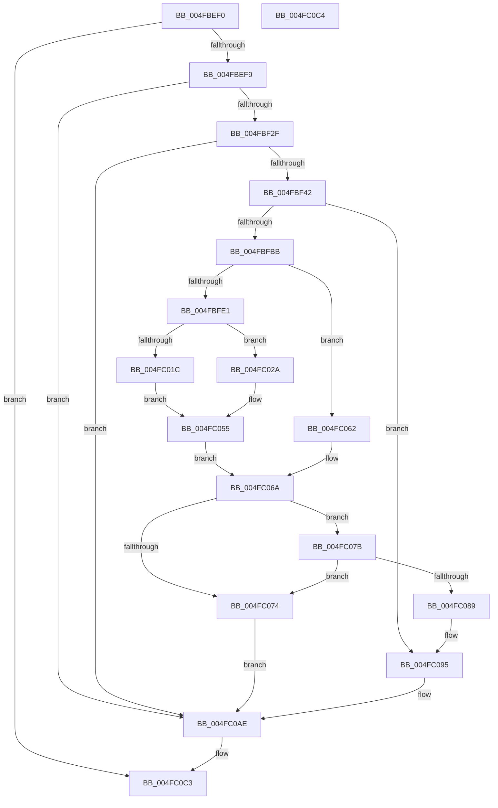

# EtwpCoverageSamplerPageFault

- RVA: `0x004FBEF0`–`0x004FC0C5` (길이 `469` bytes)
- VA: `0x00000001404FBEF0`
- 실행 섹션: `.text`
- PDB 이름 있음: `예`; PDB Function 태그: `아니요`
- unwind 정보 RVA: `0x000BFA40`
- 디코드: `115`개 명령, `469/469` bytes 표시
- 미해석 바이트: `0` (있으면 어셈블리에 `.byte`로 보존)

> 이 문서는 커널 이미지의 기계어와 PDB 기호를 분석해 생성했습니다. 4번과 5번은 함수 원형과 자료형을 바이너리 사용 방식에서 추정한 C 해석이며 원본 소스 복구 결과는 아닙니다.

## 1. Dependencies

- 직접 호출 지점: **3**; 고유 호출 대상: **2**
- 직접 호출자로 확인된 함수: **1**
- RIP 상대 이미지 참조: **1**

### Outgoing calls
- `0x004FC074` → [KeLeaveGuardedRegion](../2E/KeLeaveGuardedRegion_function_002E2C40.md) (function, `0x002E2C40`)
- `0x004FC095` → [KeLeaveGuardedRegion](../2E/KeLeaveGuardedRegion_function_002E2C40.md) (function, `0x002E2C40`)
- `0x004FC0A9` → [EtwpCovSampCaptureSample](../65/EtwpCovSampCaptureSample_function_00653F24.md) (function, `0x00653F24`)

### Direct callers
- [EtwTracePageFault](../2A/EtwTracePageFault_function_002A2E74.md) at `0x002A2FE5`

### Static image references
- `0x004FBF1B` → RVA `0x00EFF1E8` (`.data`; read)

## 2. Other-region calls and transfers

- 다른 실행 섹션으로 향하는 call: **0**
- 별도 외부 분기/꼬리 이동을 확인하지 못했습니다.

## 3. Assembly (complete function range)

```asm
004FBEF0  45 84 C0                        test r8b, r8b
004FBEF3  0F 84 CA 01 00 00               je 0x1404fc0c3
004FBEF9  48 89 5C 24 08                  mov qword ptr [rsp + 8], rbx
004FBEFE  48 89 74 24 10                  mov qword ptr [rsp + 0x10], rsi
004FBF03  48 89 7C 24 20                  mov qword ptr [rsp + 0x20], rdi
004FBF08  41 56                           push r14
004FBF0A  48 83 EC 20                     sub rsp, 0x20
004FBF0E  48 8B D9                        mov rbx, rcx
004FBF11  49 B8 FE FF FF FF FF 7F FF FF   movabs r8, 0xffff7ffffffffffe
004FBF1B  48 8B 0D C6 32 A0 00            mov rcx, qword ptr [rip + 0xa032c6]
004FBF22  48 8D 43 FF                     lea rax, [rbx - 1]
004FBF26  49 3B C0                        cmp rax, r8
004FBF29  0F 87 7F 01 00 00               ja 0x1404fc0ae
004FBF2F  48 B8 00 00 00 00 00 80 FF FF   movabs rax, 0xffff800000000000
004FBF39  48 3B D0                        cmp rdx, rax
004FBF3C  0F 83 6C 01 00 00               jae 0x1404fc0ae
004FBF42  65 48 8B 04 25 88 01 00 00      mov rax, qword ptr gs:[0x188]
004FBF4B  41 83 CE FF                     or r14d, 0xffffffff
004FBF4F  66 44 01 B0 E6 01 00 00         add word ptr [rax + 0x1e6], r14w
004FBF57  41 8D 56 02                     lea edx, [r14 + 2]
004FBF5B  90                              nop
004FBF5C  65 4C 8B 04 25 20 00 00 00      mov r8, qword ptr gs:[0x20]
004FBF65  48 8B 41 08                     mov rax, qword ptr [rcx + 8]
004FBF69  44 8B C8                        mov r9d, eax
004FBF6C  C1 E8 0D                        shr eax, 0xd
004FBF6F  25 FF FF 03 00                  and eax, 0x3ffff
004FBF74  49 C1 E9 04                     shr r9, 4
004FBF78  0F BD C8                        bsr ecx, eax
004FBF7B  41 81 E1 FF 01 00 00            and r9d, 0x1ff
004FBF82  D3 E2                           shl edx, cl
004FBF84  83 C1 FE                        add ecx, -2
004FBF87  33 D0                           xor edx, eax
004FBF89  89 4C 24 40                     mov dword ptr [rsp + 0x40], ecx
004FBF8D  49 8B 80 B0 8B 00 00            mov rax, qword ptr [r8 + 0x8bb0]
004FBF94  4A 8D 3C CD 0F 00 00 00         lea rdi, [r9*8 + 0xf]
004FBF9C  48 8B 04 C8                     mov rax, qword ptr [rax + rcx*8]
004FBFA0  48 03 7C D0 08                  add rdi, qword ptr [rax + rdx*8 + 8]
004FBFA5  48 83 E7 F0                     and rdi, 0xfffffffffffffff0
004FBFA9  4C 8D 87 08 01 00 00            lea r8, [rdi + 0x108]
004FBFB0  41 8B 30                        mov esi, dword ptr [r8]
004FBFB3  85 F6                           test esi, esi
004FBFB5  0F 84 DA 00 00 00               je 0x1404fc095
004FBFBB  45 8B 48 14                     mov r9d, dword ptr [r8 + 0x14]
004FBFBF  49 BB 20 03 00 00 80 F7 FF FF   movabs r11, 0xfffff78000000320
004FBFC9  45 8B 1B                        mov r11d, dword ptr [r11]
004FBFCC  41 8B C3                        mov eax, r11d
004FBFCF  41 8B 50 04                     mov edx, dword ptr [r8 + 4]
004FBFD3  2B C2                           sub eax, edx
004FBFD5  41 8B 48 08                     mov ecx, dword ptr [r8 + 8]
004FBFD9  3B C1                           cmp eax, ecx
004FBFDB  0F 86 81 00 00 00               jbe 0x1404fc062
004FBFE1  45 89 58 04                     mov dword ptr [r8 + 4], r11d
004FBFE5  44 03 CE                        add r9d, esi
004FBFE8  41 8B 40 0C                     mov eax, dword ptr [r8 + 0xc]
004FBFEC  44 3B C8                        cmp r9d, eax
004FBFEF  41 0F 4E C1                     cmovle eax, r9d
004FBFF3  41 89 40 14                     mov dword ptr [r8 + 0x14], eax
004FBFF7  44 8B C8                        mov r9d, eax
004FBFFA  41 8B 48 1C                     mov ecx, dword ptr [r8 + 0x1c]
004FBFFE  8D 04 36                        lea eax, [rsi + rsi]
004FC001  45 8B 50 10                     mov r10d, dword ptr [r8 + 0x10]
004FC005  44 03 D1                        add r10d, ecx
004FC008  41 D1 EA                        shr r10d, 1
004FC00B  45 89 50 1C                     mov dword ptr [r8 + 0x1c], r10d
004FC00F  41 C7 40 10 00 00 00 00         mov dword ptr [r8 + 0x10], 0
004FC017  44 3B D0                        cmp r10d, eax
004FC01A  73 0E                           jae 0x1404fc02a
004FC01C  45 8D 56 02                     lea r10d, [r14 + 2]
004FC020  45 89 50 20                     mov dword ptr [r8 + 0x20], r10d
004FC024  45 89 50 18                     mov dword ptr [r8 + 0x18], r10d
004FC028  EB 2B                           jmp 0x1404fc055
004FC02A  33 D2                           xor edx, edx
004FC02C  8D 4E 01                        lea ecx, [rsi + 1]
004FC02F  41 8B C2                        mov eax, r10d
004FC032  F7 F1                           div ecx
004FC034  41 89 40 20                     mov dword ptr [r8 + 0x20], eax
004FC038  44 8B D0                        mov r10d, eax
004FC03B  41 8B 48 24                     mov ecx, dword ptr [r8 + 0x24]
004FC03F  41 33 CB                        xor ecx, r11d
004FC042  69 D1 93 01 00 01               imul edx, ecx, 0x1000193
004FC048  8D 0C 00                        lea ecx, [rax + rax]
004FC04B  23 CA                           and ecx, edx
004FC04D  41 89 50 24                     mov dword ptr [r8 + 0x24], edx
004FC051  41 89 48 18                     mov dword ptr [r8 + 0x18], ecx
004FC055  B8 18 00 00 00                  mov eax, 0x18
004FC05A  49 8B C8                        mov rcx, r8
004FC05D  48 03 C8                        add rcx, rax
004FC060  EB 08                           jmp 0x1404fc06a
004FC062  45 8B 50 20                     mov r10d, dword ptr [r8 + 0x20]
004FC066  49 8D 48 18                     lea rcx, [r8 + 0x18]
004FC06A  F0 41 FF 40 10                  lock inc dword ptr [r8 + 0x10]
004FC06F  45 85 C9                        test r9d, r9d
004FC072  7F 07                           jg 0x1404fc07b
004FC074  E8 C7 6B DE FF                  call 0x1402e2c40
004FC079  EB 33                           jmp 0x1404fc0ae
004FC07B  41 8B C6                        mov eax, r14d
004FC07E  F0 0F C1 01                     lock xadd dword ptr [rcx], eax
004FC082  41 03 C6                        add eax, r14d
004FC085  85 C0                           test eax, eax
004FC087  7F EB                           jg 0x1404fc074
004FC089  41 8D 41 FF                     lea eax, [r9 - 1]
004FC08D  41 89 40 14                     mov dword ptr [r8 + 0x14], eax
004FC091  45 89 50 18                     mov dword ptr [r8 + 0x18], r10d
004FC095  E8 A6 6B DE FF                  call 0x1402e2c40
004FC09A  F0 FF 87 4C 01 00 00            lock inc dword ptr [rdi + 0x14c]
004FC0A1  BA 10 00 00 50                  mov edx, 0x50000010
004FC0A6  48 8B CB                        mov rcx, rbx
004FC0A9  E8 76 7E 15 00                  call 0x140653f24
004FC0AE  48 8B 5C 24 30                  mov rbx, qword ptr [rsp + 0x30]
004FC0B3  48 8B 74 24 38                  mov rsi, qword ptr [rsp + 0x38]
004FC0B8  48 8B 7C 24 48                  mov rdi, qword ptr [rsp + 0x48]
004FC0BD  48 83 C4 20                     add rsp, 0x20
004FC0C1  41 5E                           pop r14
004FC0C3  C3                              ret
004FC0C4  CC                              int3
```

## 4. C-style interpretation (structured pseudocode)

```c
__int64 __fastcall EtwpCoverageSamplerPageFault(__int64 a1, __int64 a2, unsigned __int8 a3)
{
    __int64 result;
    __int64 v_r10;
    __int64 v_r14;
    __int64 v_rdi;
    __int64 v_rsp;
    unsigned __int64 v_stack_p10;
    unsigned int v_stack_p18;
    unsigned __int64 v_stack_p20;
    unsigned __int64 v_stack_p8;

    if (a3 == 0) goto loc_004FC0C3;
    v_stack_p8 = v_rbx;
    v_stack_p10 = v_rsi;
    v_stack_p20 = v_rdi;
    v_rsp = (v_rsp) - (32);
    if ((a1 - 1) > a3) goto loc_004FC0AE;
    if (a2 >= (a1 - 1)) goto loc_004FC0AE;
    v_r14 = (unsigned int)((v_r14) | (0xFFFFFFFFULL));
    result = (unsigned int)((*(unsigned __int64 *)(*(unsigned __int64 *)(v_rip + 10498758) + 8)) >> (13));
    result = (unsigned int)((result) & (0x3FFFFULL));
    a4 = ((unsigned int)((unsigned int)(*(unsigned __int64 *)(*(unsigned __int64 *)(v_rip + 10498758) + 8)))) >> (4);
    a4 = (unsigned int)((a4) & (511));
    a2 = (unsigned int)((v_r14 + 2) << ((unsigned __int8)(*(unsigned __int64 *)(v_rip + 10498758))));
    a1 = (unsigned int)((*(unsigned __int64 *)(v_rip + 10498758)) + (-2));
    a2 = (unsigned int)((a2) ^ ((unsigned int)(result)));
    v_stack_p18 = (unsigned int)(a1);
    v_rdi = (a4 * 8 + 15) + (*(unsigned __int64 *)(*(unsigned __int64 *)(*(unsigned __int64 *)(*(unsigned __int64 *)(gs_base + (0 + 32)) + 35760) + a1 * 8) + a2 * 8 + 8));
    v_rdi = (v_rdi) & (-16);
    if ((unsigned int)((unsigned int)(*(unsigned int *)(v_rdi + 264))) == 0) goto loc_004FC095;
    result = (unsigned int)(((unsigned int)((unsigned int)((unsigned int)(*(unsigned int *)(v_r11))))) - ((unsigned int)((unsigned int)(*(unsigned int *)(v_rdi + 264 + 4)))));
    if (((unsigned int)(result)) <= ((unsigned int)((unsigned int)(*(unsigned int *)(v_rdi + 264 + 8))))) goto loc_004FC062;
    *(unsigned int *)(v_rdi + 264 + 4) = (unsigned int)((unsigned int)(*(unsigned int *)(v_r11)));
    a4 = (unsigned int)(((unsigned int)(*(unsigned int *)(v_rdi + 264 + 20))) + ((unsigned int)((unsigned int)(*(unsigned int *)(v_rdi + 264)))));
    result = (unsigned int)(*(unsigned int *)(v_rdi + 264 + 12));
    if (((unsigned int)(a4)) <= ((unsigned int)((unsigned int)(*(unsigned int *)(v_rdi + 264 + 12))))) { result = (unsigned int)(a4); }
    *(unsigned int *)(v_rdi + 264 + 20) = (unsigned int)(result);
    v_r10 = (unsigned int)(((unsigned int)(*(unsigned int *)(v_rdi + 264 + 16))) + ((unsigned int)((unsigned int)(*(unsigned int *)(v_rdi + 264 + 28)))));
    v_r10 = (unsigned int)((v_r10) >> (1));
    *(unsigned int *)(v_rdi + 264 + 28) = (unsigned int)(v_r10);
    *(unsigned int *)(v_rdi + 264 + 16) = 0;
    if (((unsigned int)(v_r10)) >= ((unsigned int)((unsigned int)(*(unsigned int *)(v_rdi + 264)) + (unsigned int)(*(unsigned int *)(v_rdi + 264)) * 1))) goto loc_004FC02A;
    *(unsigned int *)(v_rdi + 264 + 32) = (unsigned int)(v_r14 + 2);
    *(unsigned int *)(v_rdi + 264 + 24) = (unsigned int)(v_r14 + 2);
    goto loc_004FC055;
loc_004FC02A:
    a2 = 0;
    *(unsigned int *)(v_rdi + 264 + 32) = (unsigned int)((unsigned int)((unsigned int)(v_r14 + 2)));
    a1 = (unsigned int)(((unsigned int)(*(unsigned int *)(v_rdi + 264 + 36))) ^ ((unsigned int)((unsigned int)(*(unsigned int *)(v_r11)))));
    a2 = (unsigned int)((a2) * ((unsigned int)(a1)));
    a1 = (unsigned int)(((unsigned int)((unsigned int)(v_r14 + 2)) + (unsigned int)((unsigned int)(v_r14 + 2)) * 1) & ((unsigned int)(a2)));
    *(unsigned int *)(v_rdi + 264 + 36) = (unsigned int)(a2);
    *(unsigned int *)(v_rdi + 264 + 24) = (unsigned int)(a1);
loc_004FC055:
    a1 = (v_rdi + 264) + (24);
    goto loc_004FC06A;
loc_004FC062:
loc_004FC06A:
    if (condition_is_greater) goto loc_004FC07B;
loc_004FC074:
    result = KeLeaveGuardedRegion(v_rdi + 264 + 24, a2, v_rdi + 264, (unsigned int)((unsigned int)(result)));
    goto loc_004FC0AE;
loc_004FC07B:
    result = (unsigned int)(((unsigned int)((unsigned int)(v_r14))) + ((unsigned int)(v_r14)));
    if (condition_is_greater) goto loc_004FC074;
    *(unsigned int *)(v_rdi + 264 + 20) = (unsigned int)((unsigned int)((unsigned int)(result)) - 1);
    *(unsigned int *)(v_rdi + 264 + 24) = (unsigned int)((unsigned int)(*(unsigned int *)(v_rdi + 264 + 32)));
loc_004FC095:
    result = KeLeaveGuardedRegion(v_rdi + 264 + 24, a2, v_rdi + 264, (unsigned int)((unsigned int)(result)));
    result = EtwpCovSampCaptureSample(a1, (unsigned int)(0x50000010ULL), v_rdi + 264, (unsigned int)((unsigned int)(result)));
loc_004FC0AE:
    v_rsp = (v_rsp) + (32);
loc_004FC0C3:
    return result;
}
```

## 5. (Beta) C Style

```c
int64_t EtwpCoverageSamplerPageFault(void *Arg1, int64_t Arg2, uint8_t Arg3)
{
    uint8_t *arg1 = (uint8_t *)Arg1;

    int64_t result;
    int64_t local_r10;
    int64_t local_r14;
    int64_t local_rdi;
    int64_t local_rsp;
    uint64_t v_stack_p10;
    uint32_t v_stack_p18;
    uint64_t v_stack_p20;
    uint64_t v_stack_p8;

    if (Arg3 == 0) goto loc_004FC0C3;
    v_stack_p8 = local_rbx;
    v_stack_p10 = local_rsi;
    v_stack_p20 = local_rdi;
    local_rsp = (local_rsp) - (32);
    if ((Arg1 - 1) > Arg3) goto loc_004FC0AE;
    if (Arg2 >= (Arg1 - 1)) goto loc_004FC0AE;
    local_r14 = (uint32_t)((local_r14) | (0xFFFFFFFFULL));
    result = (uint32_t)((*(uint64_t *)(*(uint64_t *)(v_rip + 0xA032C6) + 0x8)) >> (13));
    result = (uint32_t)((result) & (0x3FFFFULL));
    a4 = ((uint32_t)((uint32_t)(*(uint64_t *)(*(uint64_t *)(v_rip + 0xA032C6) + 0x8)))) >> (4);
    a4 = (uint32_t)((a4) & (511));
    Arg2 = (uint32_t)((local_r14 + 2) << ((uint8_t)(*(uint64_t *)(v_rip + 0xA032C6))));
    Arg1 = (uint32_t)((*(uint64_t *)(v_rip + 0xA032C6)) + (-2));
    Arg2 = (uint32_t)((Arg2) ^ ((uint32_t)(result)));
    v_stack_p18 = (uint32_t)(Arg1);
    local_rdi = (a4 * 8 + 15) + (*(uint64_t *)(*(uint64_t *)(*(uint64_t *)(*(uint64_t *)(gs_base + (0 + 0x20)) + 0x8BB0) + arg1 * 8) + Arg2 * 8 + 0x8));
    local_rdi = (local_rdi) & (-16);
    if ((uint32_t)((uint32_t)(*(uint32_t *)(local_rdi + 0x108))) == 0) goto loc_004FC095;
    result = (uint32_t)(((uint32_t)((uint32_t)((uint32_t)(*(uint32_t *)(local_r11))))) - ((uint32_t)((uint32_t)(*(uint32_t *)(local_rdi + 0x108 + 0x4)))));
    if (((uint32_t)(result)) <= ((uint32_t)((uint32_t)(*(uint32_t *)(local_rdi + 0x108 + 0x8))))) goto loc_004FC062;
    *(uint32_t *)(local_rdi + 0x108 + 0x4) = (uint32_t)((uint32_t)(*(uint32_t *)(local_r11)));
    a4 = (uint32_t)(((uint32_t)(*(uint32_t *)(local_rdi + 0x108 + 0x14))) + ((uint32_t)((uint32_t)(*(uint32_t *)(local_rdi + 0x108)))));
    result = (uint32_t)(*(uint32_t *)(local_rdi + 0x108 + 0xC));
    if (((uint32_t)(a4)) <= ((uint32_t)((uint32_t)(*(uint32_t *)(local_rdi + 0x108 + 0xC))))) { result = (uint32_t)(a4); }
    *(uint32_t *)(local_rdi + 0x108 + 0x14) = (uint32_t)(result);
    local_r10 = (uint32_t)(((uint32_t)(*(uint32_t *)(local_rdi + 0x108 + 0x10))) + ((uint32_t)((uint32_t)(*(uint32_t *)(local_rdi + 0x108 + 0x1C)))));
    local_r10 = (uint32_t)((local_r10) >> (1));
    *(uint32_t *)(local_rdi + 0x108 + 0x1C) = (uint32_t)(local_r10);
    *(uint32_t *)(local_rdi + 0x108 + 0x10) = 0;
    if (((uint32_t)(local_r10)) >= ((uint32_t)((uint32_t)(*(uint32_t *)(local_rdi + 0x108)) + (uint32_t)(*(uint32_t *)(local_rdi + 0x108)) * 1))) goto loc_004FC02A;
    *(uint32_t *)(local_rdi + 0x108 + 0x20) = (uint32_t)(local_r14 + 2);
    *(uint32_t *)(local_rdi + 0x108 + 0x18) = (uint32_t)(local_r14 + 2);
    goto loc_004FC055;
loc_004FC02A:
    Arg2 = 0;
    *(uint32_t *)(local_rdi + 0x108 + 0x20) = (uint32_t)((uint32_t)((uint32_t)(local_r14 + 2)));
    Arg1 = (uint32_t)(((uint32_t)(*(uint32_t *)(local_rdi + 0x108 + 0x24))) ^ ((uint32_t)((uint32_t)(*(uint32_t *)(local_r11)))));
    Arg2 = (uint32_t)((Arg2) * ((uint32_t)(Arg1)));
    Arg1 = (uint32_t)(((uint32_t)((uint32_t)(local_r14 + 2)) + (uint32_t)((uint32_t)(local_r14 + 2)) * 1) & ((uint32_t)(Arg2)));
    *(uint32_t *)(local_rdi + 0x108 + 0x24) = (uint32_t)(Arg2);
    *(uint32_t *)(local_rdi + 0x108 + 0x18) = (uint32_t)(Arg1);
loc_004FC055:
    Arg1 = (local_rdi + 264) + (24);
    goto loc_004FC06A;
loc_004FC062:
loc_004FC06A:
    if (condition_is_greater) goto loc_004FC07B;
loc_004FC074:
    result = KeLeaveGuardedRegion(local_rdi + 264 + 24, Arg2, local_rdi + 264, (uint32_t)((uint32_t)(result)));
    goto loc_004FC0AE;
loc_004FC07B:
    result = (uint32_t)(((uint32_t)((uint32_t)(local_r14))) + ((uint32_t)(local_r14)));
    if (condition_is_greater) goto loc_004FC074;
    *(uint32_t *)(local_rdi + 0x108 + 0x14) = (uint32_t)((uint32_t)((uint32_t)(result)) - 1);
    *(uint32_t *)(local_rdi + 0x108 + 0x18) = (uint32_t)((uint32_t)(*(uint32_t *)(local_rdi + 0x108 + 0x20)));
loc_004FC095:
    result = KeLeaveGuardedRegion(local_rdi + 264 + 24, Arg2, local_rdi + 264, (uint32_t)((uint32_t)(result)));
    result = EtwpCovSampCaptureSample(Arg1, (uint32_t)(0x50000010ULL), local_rdi + 264, (uint32_t)((uint32_t)(result)));
loc_004FC0AE:
    local_rsp = (local_rsp) + (32);
loc_004FC0C3:
    return result;
}
```

### 관측된 메모리 오프셋

구조체 형식이 확인되지 않은 접근은 인자 기준의 오프셋으로만 기록했습니다.

| 기준 인자 | 오프셋 표현 | 폭 (bit) | 접근 |
|---|---:|---:|---|
| `Arg1` | `- 0x1` | `64` | `R` |

## 6. Execution-region graph

[열기: 2D/3D 그래프와 함수 탐색 컨트롤 패널](../../../control-panel.html?section=text&rva=0x004FBEF0&view=graph)

- 2D 그래프는 위에서 아래로 흐르고, 3D 그래프는 빈 공간을 드래그해 회전합니다. Shift+드래그는 이동, 휠은 확대·축소, 함수 노드 선택은 대상 보고서 이동입니다.

### Static fallback


