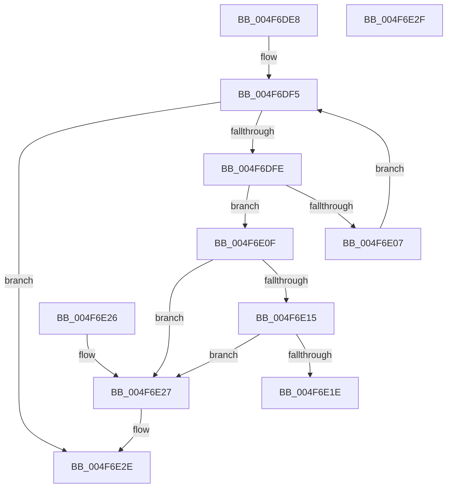

# EtwpRemoveBufferFromGlobalList

- RVA: `0x004F6DE8`–`0x004F6E30` (길이 `72` bytes)
- VA: `0x00000001404F6DE8`
- 실행 섹션: `.text`
- PDB 이름 있음: `예`; PDB Function 태그: `아니요`
- unwind 정보 RVA: `0x000DB714`
- 디코드: `26`개 명령, `72/72` bytes 표시
- 미해석 바이트: `0` (있으면 어셈블리에 `.byte`로 보존)

> 이 문서는 커널 이미지의 기계어와 PDB 기호를 분석해 생성했습니다. 4번과 5번은 함수 원형과 자료형을 바이너리 사용 방식에서 추정한 C 해석이며 원본 소스 복구 결과는 아닙니다.

## 1. Dependencies

- 직접 호출 지점: **0**; 고유 호출 대상: **0**
- 직접 호출자로 확인된 함수: **1**
- RIP 상대 이미지 참조: **0**

### Outgoing calls
- 직접 디코드된 call 명령이 없습니다.

### Direct callers
- [EtwpAdjustSiloTraceBuffers](../3E/EtwpAdjustSiloTraceBuffers_function_003EB720.md) at `0x003EB827`

### Static image references
- 디코드된 RIP-relative 메모리 참조가 없습니다.

## 2. Other-region calls and transfers

- 다른 실행 섹션으로 향하는 call: **0**
- 별도 외부 분기/꼬리 이동을 확인하지 못했습니다.

## 3. Assembly (complete function range)

```asm
004F6DE8  4C 8D 41 50                     lea r8, [rcx + 0x50]
004F6DEC  45 33 C9                        xor r9d, r9d
004F6DEF  49 8B 00                        mov rax, qword ptr [r8]
004F6DF2  49 3B C0                        cmp rax, r8
004F6DF5  49 0F 44 C1                     cmove rax, r9
004F6DF9  48 85 C0                        test rax, rax
004F6DFC  74 30                           je 0x1404f6e2e
004F6DFE  48 8B 08                        mov rcx, qword ptr [rax]
004F6E01  48 39 50 10                     cmp qword ptr [rax + 0x10], rdx
004F6E05  74 08                           je 0x1404f6e0f
004F6E07  48 8B C1                        mov rax, rcx
004F6E0A  49 3B C8                        cmp rcx, r8
004F6E0D  EB E6                           jmp 0x1404f6df5
004F6E0F  48 39 41 08                     cmp qword ptr [rcx + 8], rax
004F6E13  75 12                           jne 0x1404f6e27
004F6E15  48 8B 50 08                     mov rdx, qword ptr [rax + 8]
004F6E19  48 39 02                        cmp qword ptr [rdx], rax
004F6E1C  75 09                           jne 0x1404f6e27
004F6E1E  48 89 0A                        mov qword ptr [rdx], rcx
004F6E21  48 89 51 08                     mov qword ptr [rcx + 8], rdx
004F6E25  C3                              ret
004F6E26  CC                              int3
004F6E27  B9 03 00 00 00                  mov ecx, 3
004F6E2C  CD 29                           int 0x29
004F6E2E  C3                              ret
004F6E2F  CC                              int3
```

## 4. C-style interpretation (structured pseudocode)

```c
__int64 __fastcall EtwpRemoveBufferFromGlobalList(__int64 a1, __int64 a2, __int64 a3, int a4)
{
    __int64 result;

    a4 = 0;
loc_004F6DF5:
    result = *(unsigned __int64 *)(a1 + 80);
    if ((*(unsigned __int64 *)(a1 + 80)) == (a1 + 80)) { result = 0; }
    if (result == 0) goto loc_004F6E2E;
    if ((*(unsigned __int64 *)(result + 16)) == a2) goto loc_004F6E0F;
    goto loc_004F6DF5;
loc_004F6E0F:
    if ((*(unsigned __int64 *)(*(unsigned __int64 *)(result) + 8)) != (*(unsigned __int64 *)(result))) goto loc_004F6E27;
    if ((*(unsigned __int64 *)(*(unsigned __int64 *)(*(unsigned __int64 *)(result) + 8))) != (*(unsigned __int64 *)(result))) goto loc_004F6E27;
    *(unsigned __int64 *)(*(unsigned __int64 *)(*(unsigned __int64 *)(result) + 8)) = *(unsigned __int64 *)(result);
    *(unsigned __int64 *)(*(unsigned __int64 *)(result) + 8) = *(unsigned __int64 *)(*(unsigned __int64 *)(result) + 8);
    return *(unsigned __int64 *)(result);
loc_004F6E27:
loc_004F6E2E:
    return *(unsigned __int64 *)(result);
}
```

## 5. (Beta) C Style

```c
int64_t EtwpRemoveBufferFromGlobalList(void *Arg1, int64_t Arg2, int64_t Arg3, int32_t Arg4)
{
    uint8_t *arg1 = (uint8_t *)Arg1;

    int64_t result;

    Arg4 = 0;
loc_004F6DF5:
    result = *(uint64_t *)(arg1 + 0x50);
    if ((*(uint64_t *)(arg1 + 0x50)) == (Arg1 + 80)) { result = 0; }
    if (result == 0) goto loc_004F6E2E;
    if ((*(uint64_t *)(result + 0x10)) == Arg2) goto loc_004F6E0F;
    goto loc_004F6DF5;
loc_004F6E0F:
    if ((*(uint64_t *)(*(uint64_t *)(result) + 0x8)) != (*(uint64_t *)(result))) goto loc_004F6E27;
    if ((*(uint64_t *)(*(uint64_t *)(*(uint64_t *)(result) + 0x8))) != (*(uint64_t *)(result))) goto loc_004F6E27;
    *(uint64_t *)(*(uint64_t *)(*(uint64_t *)(result) + 0x8)) = *(uint64_t *)(result);
    *(uint64_t *)(*(uint64_t *)(result) + 0x8) = *(uint64_t *)(*(uint64_t *)(result) + 0x8);
    return *(uint64_t *)(result);
loc_004F6E27:
loc_004F6E2E:
    return *(uint64_t *)(result);
}
```

### 관측된 메모리 오프셋

구조체 형식이 확인되지 않은 접근은 인자 기준의 오프셋으로만 기록했습니다.

| 기준 인자 | 오프셋 표현 | 폭 (bit) | 접근 |
|---|---:|---:|---|
| `Arg1` | `+ 0x0` | `64` | `R` |
| `Arg1` | `+ 0x50` | `64` | `R` |

## 6. Execution-region graph

[열기: 2D/3D 그래프와 함수 탐색 컨트롤 패널](../../../control-panel.html?section=text&rva=0x004F6DE8&view=graph)

- 2D 그래프는 위에서 아래로 흐르고, 3D 그래프는 빈 공간을 드래그해 회전합니다. Shift+드래그는 이동, 휠은 확대·축소, 함수 노드 선택은 대상 보고서 이동입니다.

### Static fallback


