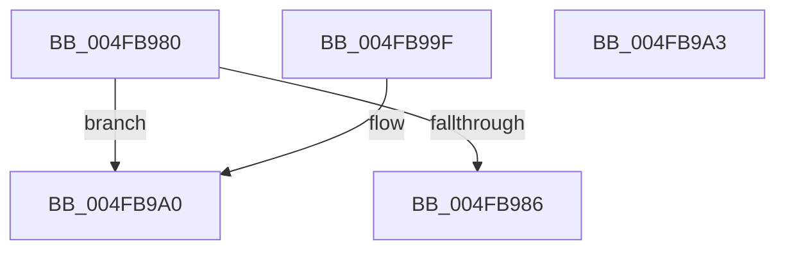

# ExCheckValidIRTimerId

- RVA: `0x004FB980`–`0x004FB9A4` (길이 `36` bytes)
- VA: `0x00000001404FB980`
- 실행 섹션: `.text`
- PDB 이름 있음: `예`; PDB Function 태그: `아니요`
- unwind 정보 RVA: `0x000DB714`
- 디코드: `13`개 명령, `36/36` bytes 표시
- 미해석 바이트: `0` (있으면 어셈블리에 `.byte`로 보존)

> 이 문서는 커널 이미지의 기계어와 PDB 기호를 분석해 생성했습니다. 4번과 5번은 함수 원형과 자료형을 바이너리 사용 방식에서 추정한 C 해석이며 원본 소스 복구 결과는 아닙니다.

## 1. Dependencies

- 직접 호출 지점: **0**; 고유 호출 대상: **0**
- 직접 호출자로 확인된 함수: **1**
- RIP 상대 이미지 참조: **1**

### Outgoing calls
- 직접 디코드된 call 명령이 없습니다.

### Direct callers
- [ExpCheckIRTimerAccess](../../page/A2/ExpCheckIRTimerAccess_function_00A2C83C.md) at `0x00A2C8B5`
- [ExpCheckIRTimerAccess](../../page/A2/ExpCheckIRTimerAccess_function_00A2C83C.md) at `0x00A2C8DA`

### Static image references
- `0x004FB98D` → RVA `0x00E093D0` (`.data`; read)

## 2. Other-region calls and transfers

- 다른 실행 섹션으로 향하는 call: **0**
- 별도 외부 분기/꼬리 이동을 확인하지 못했습니다.

## 3. Assembly (complete function range)

```asm
004FB980  66 83 F9 14                     cmp cx, 0x14
004FB984  73 1A                           jae 0x1404fb9a0
004FB986  0F B7 C1                        movzx eax, cx
004FB989  48 8D 0C 40                     lea rcx, [rax + rax*2]
004FB98D  48 8D 05 3C DA 90 00            lea rax, [rip + 0x90da3c]
004FB994  0F B6 04 C8                     movzx eax, byte ptr [rax + rcx*8]
004FB998  66 3B D0                        cmp dx, ax
004FB99B  0F 92 C0                        setb al
004FB99E  C3                              ret
004FB99F  CC                              int3
004FB9A0  32 C0                           xor al, al
004FB9A2  C3                              ret
004FB9A3  CC                              int3
```

## 4. C-style interpretation (structured pseudocode)

```c
__int64 __fastcall ExCheckValidIRTimerId(unsigned __int16 a1, unsigned __int16 a2)
{
    __int64 result;

    if (a1 >= 20) goto loc_004FB9A0;
    result = (a2 < ((unsigned __int16)(*(unsigned __int8 *)(v_rip + 9493052 + a1 + a1 * 2 * 8)))) ? 1 : 0;
    return result;
loc_004FB9A0:
    result = 0;
    return result;
}
```

## 5. (Beta) C Style

```c
int64_t ExCheckValidIRTimerId(uint16_t Arg1, uint16_t Arg2)
{
    int64_t result;

    if (Arg1 >= 20) goto loc_004FB9A0;
    result = (Arg2 < ((uint16_t)(*(uint8_t *)(v_rip + 0x90DA3C + Arg1 + Arg1 * 2 * 8)))) ? 1 : 0;
    return result;
loc_004FB9A0:
    result = 0;
    return result;
}
```

## 6. Execution-region graph

[열기: 2D/3D 그래프와 함수 탐색 컨트롤 패널](../../../control-panel.html?section=text&rva=0x004FB980&view=graph)

- 2D 그래프는 위에서 아래로 흐르고, 3D 그래프는 빈 공간을 드래그해 회전합니다. Shift+드래그는 이동, 휠은 확대·축소, 함수 노드 선택은 대상 보고서 이동입니다.

### Static fallback


