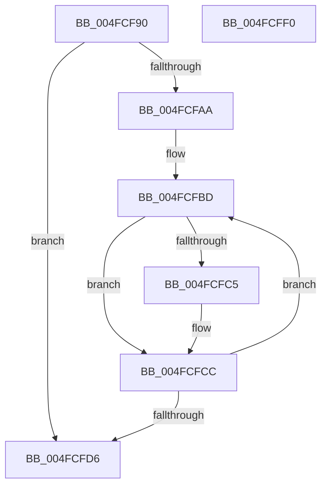

# ExFreeCacheAwarePushLock

- RVA: `0x004FCF90`–`0x004FCFF1` (길이 `97` bytes)
- VA: `0x00000001404FCF90`
- 실행 섹션: `.text`
- PDB 이름 있음: `예`; PDB Function 태그: `아니요`
- unwind 정보 RVA: `0x00060BC4`
- 디코드: `31`개 명령, `97/97` bytes 표시
- 미해석 바이트: `0` (있으면 어셈블리에 `.byte`로 보존)

> 이 문서는 커널 이미지의 기계어와 PDB 기호를 분석해 생성했습니다. 4번과 5번은 함수 원형과 자료형을 바이너리 사용 방식에서 추정한 C 해석이며 원본 소스 복구 결과는 아닙니다.

## 1. Dependencies

- 직접 호출 지점: **2**; 고유 호출 대상: **1**
- 직접 호출자로 확인된 함수: **1**
- RIP 상대 이미지 참조: **0**

### Outgoing calls
- `0x004FCFC7` → [ExFreePoolWithTag](../../poolcode/B8/ExFreePoolWithTag_function_00B82870.md) (function, `0x00B82870`)
- `0x004FCFDB` → [ExFreePoolWithTag](../../poolcode/B8/ExFreePoolWithTag_function_00B82870.md) (function, `0x00B82870`)

### Direct callers
- [ExAllocateCacheAwarePushLock](../4C/ExAllocateCacheAwarePushLock_function_004C68C0.md) at `0x004C6A7A`

### Static image references
- 디코드된 RIP-relative 메모리 참조가 없습니다.

## 2. Other-region calls and transfers

- 다른 실행 섹션으로 향하는 call: **2**
  - `0x004FCFC7` → [ExFreePoolWithTag](../../poolcode/B8/ExFreePoolWithTag_function_00B82870.md) (`.text` → `POOLCODE`)
  - `0x004FCFDB` → [ExFreePoolWithTag](../../poolcode/B8/ExFreePoolWithTag_function_00B82870.md) (`.text` → `POOLCODE`)
- 별도 외부 분기/꼬리 이동을 확인하지 못했습니다.

## 3. Assembly (complete function range)

```asm
004FCF90  48 89 5C 24 08                  mov qword ptr [rsp + 8], rbx
004FCF95  48 89 74 24 10                  mov qword ptr [rsp + 0x10], rsi
004FCF9A  57                              push rdi
004FCF9B  48 83 EC 20                     sub rsp, 0x20
004FCF9F  48 8B 01                        mov rax, qword ptr [rcx]
004FCFA2  48 8B F9                        mov rdi, rcx
004FCFA5  48 85 C0                        test rax, rax
004FCFA8  74 2C                           je 0x1404fcfd6
004FCFAA  8A 40 08                        mov al, byte ptr [rax + 8]
004FCFAD  48 8B F1                        mov rsi, rcx
004FCFB0  F6 D8                           neg al
004FCFB2  48 1B DB                        sbb rbx, rbx
004FCFB5  48 83 E3 E1                     and rbx, 0xffffffffffffffe1
004FCFB9  48 83 C3 20                     add rbx, 0x20
004FCFBD  48 8B 0E                        mov rcx, qword ptr [rsi]
004FCFC0  48 85 C9                        test rcx, rcx
004FCFC3  74 07                           je 0x1404fcfcc
004FCFC5  33 D2                           xor edx, edx
004FCFC7  E8 A4 58 68 00                  call 0x140b82870
004FCFCC  48 83 C6 08                     add rsi, 8
004FCFD0  48 83 EB 01                     sub rbx, 1
004FCFD4  75 E7                           jne 0x1404fcfbd
004FCFD6  33 D2                           xor edx, edx
004FCFD8  48 8B CF                        mov rcx, rdi
004FCFDB  E8 90 58 68 00                  call 0x140b82870
004FCFE0  48 8B 5C 24 30                  mov rbx, qword ptr [rsp + 0x30]
004FCFE5  48 8B 74 24 38                  mov rsi, qword ptr [rsp + 0x38]
004FCFEA  48 83 C4 20                     add rsp, 0x20
004FCFEE  5F                              pop rdi
004FCFEF  C3                              ret
004FCFF0  CC                              int3
```

## 4. C-style interpretation (structured pseudocode)

```c
__int64 __fastcall ExFreeCacheAwarePushLock(__int64 a1, int a2)
{
    __int64 result;
    __int64 v_rbx;
    __int64 v_rsi;
    __int64 v_rsp;
    unsigned __int64 v_stack_p10;
    unsigned __int64 v_stack_p8;

    v_stack_p8 = v_rbx;
    v_stack_p10 = v_rsi;
    v_rsp = (v_rsp) - (32);
    if (*(unsigned __int64 *)(a1) == 0) goto loc_004FCFD6;
    result = (unsigned __int8)(-(*(unsigned __int8 *)(*(unsigned __int64 *)(a1) + 8)));
    v_rbx = (v_rbx) & (-31);
    v_rbx = (v_rbx) + (32);
loc_004FCFBD:
    if (*(unsigned __int64 *)(a1) != 0) {
        a2 = 0;
        result = ExFreePoolWithTag(*(unsigned __int64 *)(a1), a2, a3, a4);
    }
    v_rsi = (a1) + (8);
    v_rbx = (v_rbx) - (1);
    if (condition_is_not_equal) goto loc_004FCFBD;
loc_004FCFD6:
    a2 = 0;
    result = ExFreePoolWithTag(a1, a2, a3, a4);
    v_rsp = (v_rsp) + (32);
    return result;
}
```

## 5. (Beta) C Style

```c
int64_t ExFreeCacheAwarePushLock(void *Arg1, int32_t Arg2)
{
    uint8_t *arg1 = (uint8_t *)Arg1;

    int64_t result;
    int64_t local_rbx;
    int64_t local_rsi;
    int64_t local_rsp;
    uint64_t v_stack_p10;
    uint64_t v_stack_p8;

    v_stack_p8 = local_rbx;
    v_stack_p10 = local_rsi;
    local_rsp = (local_rsp) - (32);
    if (*(uint64_t *)(arg1) == 0) goto loc_004FCFD6;
    result = (uint8_t)(-(*(uint8_t *)(*(uint64_t *)(arg1) + 0x8)));
    local_rbx = (local_rbx) & (-31);
    local_rbx = (local_rbx) + (32);
loc_004FCFBD:
    if (*(uint64_t *)(arg1) != 0) {
        Arg2 = 0;
        result = ExFreePoolWithTag(*(uint64_t *)(arg1), Arg2, a3, a4);
    }
    local_rsi = (Arg1) + (8);
    local_rbx = (local_rbx) - (1);
    if (condition_is_not_equal) goto loc_004FCFBD;
loc_004FCFD6:
    Arg2 = 0;
    result = ExFreePoolWithTag(Arg1, Arg2, a3, a4);
    local_rsp = (local_rsp) + (32);
    return result;
}
```

### 관측된 메모리 오프셋

구조체 형식이 확인되지 않은 접근은 인자 기준의 오프셋으로만 기록했습니다.

| 기준 인자 | 오프셋 표현 | 폭 (bit) | 접근 |
|---|---:|---:|---|
| `Arg1` | `+ 0x0` | `64` | `R` |

## 6. Execution-region graph

[열기: 2D/3D 그래프와 함수 탐색 컨트롤 패널](../../../control-panel.html?section=text&rva=0x004FCF90&view=graph)

- 2D 그래프는 위에서 아래로 흐르고, 3D 그래프는 빈 공간을 드래그해 회전합니다. Shift+드래그는 이동, 휠은 확대·축소, 함수 노드 선택은 대상 보고서 이동입니다.

### Static fallback


