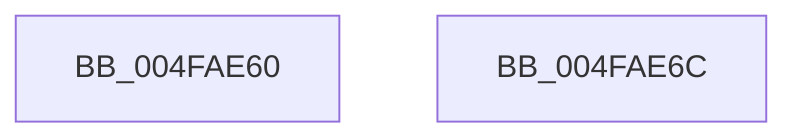

# ExIsSoftBoot

- RVA: `0x004FAE60`–`0x004FAE6D` (길이 `13` bytes)
- VA: `0x00000001404FAE60`
- 실행 섹션: `.text`
- PDB 이름 있음: `예`; PDB Function 태그: `아니요`
- unwind 정보 RVA: `0x000DB714`
- 디코드: `5`개 명령, `13/13` bytes 표시
- 미해석 바이트: `0` (있으면 어셈블리에 `.byte`로 보존)

> 이 문서는 커널 이미지의 기계어와 PDB 기호를 분석해 생성했습니다. 4번과 5번은 함수 원형과 자료형을 바이너리 사용 방식에서 추정한 C 해석이며 원본 소스 복구 결과는 아닙니다.

## 1. Dependencies

- 직접 호출 지점: **0**; 고유 호출 대상: **0**
- 직접 호출자로 확인된 함수: **7**
- RIP 상대 이미지 참조: **1**

### Outgoing calls
- 직접 디코드된 call 명령이 없습니다.

### Direct callers
- [PoInitHiberServices](../../page/75/PoInitHiberServices_function_007537C4.md) at `0x0075384A`
- [PoClearTransitionMarker](../../page/75/PoClearTransitionMarker_function_00753C88.md) at `0x00753D0F`
- [EtwpSavePersistedLoggers](../../page/7B/EtwpSavePersistedLoggers_function_007BF910.md) at `0x007BF914`
- [CmpLoadHiveThread](../../page/7D/CmpLoadHiveThread_function_007DB040.md) at `0x007DB9C2`
- [CmpMountPreloadedHives](../../page/7D/CmpMountPreloadedHives_function_007DBE18.md) at `0x007DC3B9`
- [CmpReorganizeHive](../../page/87/CmpReorganizeHive_function_0087B92C.md) at `0x0087BA76`
- [BapdRecordFirmwareBootStats](../../pagelk/B7/BapdRecordFirmwareBootStats_function_00B72474.md) at `0x00B724F5`

### Static image references
- `0x004FAE60` → RVA `0x00EFF058` (`.data`; read)

## 2. Other-region calls and transfers

- 다른 실행 섹션으로 향하는 call: **0**
- 별도 외부 분기/꼬리 이동을 확인하지 못했습니다.

## 3. Assembly (complete function range)

```asm
004FAE60  8A 05 F2 41 A0 00               mov al, byte ptr [rip + 0xa041f2]
004FAE66  C0 E8 02                        shr al, 2
004FAE69  24 01                           and al, 1
004FAE6B  C3                              ret
004FAE6C  CC                              int3
```

## 4. C-style interpretation (structured pseudocode)

```c
__int64 __fastcall ExIsSoftBoot(void)
{
    __int64 result;

    result = (unsigned __int8)((*(unsigned __int8 *)(v_rip + 10502642)) >> (2));
    result = (unsigned __int8)((result) & (1));
    return result;
}
```

## 5. (Beta) C Style

```c
void ExIsSoftBoot(void)
{
    int64_t result;

    result = (uint8_t)((*(uint8_t *)(v_rip + 0xA041F2)) >> (2));
    result = (uint8_t)((result) & (1));
    return result;
}
```

## 6. Execution-region graph

[열기: 2D/3D 그래프와 함수 탐색 컨트롤 패널](../../../control-panel.html?section=text&rva=0x004FAE60&view=graph)

- 2D 그래프는 위에서 아래로 흐르고, 3D 그래프는 빈 공간을 드래그해 회전합니다. Shift+드래그는 이동, 휠은 확대·축소, 함수 노드 선택은 대상 보고서 이동입니다.

### Static fallback


