# ExReleaseFastResourceShared

- RVA: `0x004F59C0`–`0x004F5AFF` (길이 `319` bytes)
- VA: `0x00000001404F59C0`
- 실행 섹션: `.text`
- PDB 이름 있음: `예`; PDB Function 태그: `아니요`
- unwind 정보 RVA: `0x0005D2F4`
- 디코드: `89`개 명령, `319/319` bytes 표시
- 미해석 바이트: `0` (있으면 어셈블리에 `.byte`로 보존)

> 이 문서는 커널 이미지의 기계어와 PDB 기호를 분석해 생성했습니다. 4번과 5번은 함수 원형과 자료형을 바이너리 사용 방식에서 추정한 C 해석이며 원본 소스 복구 결과는 아닙니다.

## 1. Dependencies

- 직접 호출 지점: **9**; 고유 호출 대상: **3**
- 직접 호출자로 확인된 함수: **1**
- RIP 상대 이미지 참조: **0**

### Outgoing calls
- `0x004F59E3` → [KeBugCheckEx](KeBugCheckEx_function_004FD660.md) (function, `0x004FD660`)
- `0x004F5A0E` → [KeBugCheckEx](KeBugCheckEx_function_004FD660.md) (function, `0x004FD660`)
- `0x004F5A3F` → [KeBugCheckEx](KeBugCheckEx_function_004FD660.md) (function, `0x004FD660`)
- `0x004F5A64` → [KeBugCheckEx](KeBugCheckEx_function_004FD660.md) (function, `0x004FD660`)
- `0x004F5A9B` → [KeBugCheckEx](KeBugCheckEx_function_004FD660.md) (function, `0x004FD660`)
- `0x004F5AB8` → [KeBugCheckEx](KeBugCheckEx_function_004FD660.md) (function, `0x004FD660`)
- `0x004F5ADD` → [KeBugCheckEx](KeBugCheckEx_function_004FD660.md) (function, `0x004FD660`)
- `0x004F5AED` → [ExpReleaseFastResourceShared](../26/ExpReleaseFastResourceShared_function_00261BF0.md) (function, `0x00261BF0`)
- `0x004F5AF4` → [ExpReleaseFastResourceExclusive](../26/ExpReleaseFastResourceExclusive_function_00262C00.md) (function, `0x00262C00`)

### Direct callers
- [DifExReleaseFastResourceSharedWrapper](../62/DifExReleaseFastResourceSharedWrapper_function_00622870.md) at `0x00622947`

### Static image references
- 디코드된 RIP-relative 메모리 참조가 없습니다.

## 2. Other-region calls and transfers

- 다른 실행 섹션으로 향하는 call: **0**
- 별도 외부 분기/꼬리 이동을 확인하지 못했습니다.

## 3. Assembly (complete function range)

```asm
004F59C0  48 83 EC 38                     sub rsp, 0x38
004F59C4  4C 8B C2                        mov r8, rdx
004F59C7  33 D2                           xor edx, edx
004F59C9  F6 41 1A 01                     test byte ptr [rcx + 0x1a], 1
004F59CD  75 1A                           jne 0x1404f59e9
004F59CF  45 33 C9                        xor r9d, r9d
004F59D2  48 89 54 24 20                  mov qword ptr [rsp + 0x20], rdx
004F59D7  4C 8B C1                        mov r8, rcx
004F59DA  B9 C6 01 00 00                  mov ecx, 0x1c6
004F59DF  41 8D 51 03                     lea edx, [r9 + 3]
004F59E3  E8 78 7C 00 00                  call 0x1404fd660
004F59E8  CC                              int3
004F59E9  44 0F 20 C0                     mov rax, cr8
004F59ED  65 4C 8B 14 25 88 01 00 00      mov r10, qword ptr gs:[0x188]
004F59F6  3C 02                           cmp al, 2
004F59F8  76 1A                           jbe 0x1404f5a14
004F59FA  44 0F B6 C0                     movzx r8d, al
004F59FE  B9 C6 01 00 00                  mov ecx, 0x1c6
004F5A03  41 B9 02 00 00 00               mov r9d, 2
004F5A09  48 89 54 24 20                  mov qword ptr [rsp + 0x20], rdx
004F5A0E  E8 4D 7C 00 00                  call 0x1404fd660
004F5A13  CC                              int3
004F5A14  3C 01                           cmp al, 1
004F5A16  73 2D                           jae 0x1404f5a45
004F5A18  41 F7 42 74 00 04 00 00         test dword ptr [r10 + 0x74], 0x400
004F5A20  75 23                           jne 0x1404f5a45
004F5A22  41 39 92 E4 01 00 00            cmp dword ptr [r10 + 0x1e4], edx
004F5A29  75 1A                           jne 0x1404f5a45
004F5A2B  45 33 C9                        xor r9d, r9d
004F5A2E  48 89 54 24 20                  mov qword ptr [rsp + 0x20], rdx
004F5A33  45 33 C0                        xor r8d, r8d
004F5A36  B9 C6 01 00 00                  mov ecx, 0x1c6
004F5A3B  41 8D 51 07                     lea edx, [r9 + 7]
004F5A3F  E8 1C 7C 00 00                  call 0x1404fd660
004F5A44  CC                              int3
004F5A45  4D 8B 58 10                     mov r11, qword ptr [r8 + 0x10]
004F5A49  4D 8B CB                        mov r9, r11
004F5A4C  49 83 E1 FE                     and r9, 0xfffffffffffffffe
004F5A50  4D 3B CA                        cmp r9, r10
004F5A53  74 15                           je 0x1404f5a6a
004F5A55  48 89 54 24 20                  mov qword ptr [rsp + 0x20], rdx
004F5A5A  B9 C6 01 00 00                  mov ecx, 0x1c6
004F5A5F  BA 09 00 00 00                  mov edx, 9
004F5A64  E8 F7 7B 00 00                  call 0x1404fd660
004F5A69  CC                              int3
004F5A6A  45 0F B6 50 25                  movzx r10d, byte ptr [r8 + 0x25]
004F5A6F  45 8A CA                        mov r9b, r10b
004F5A72  41 80 E1 02                     and r9b, 2
004F5A76  75 29                           jne 0x1404f5aa1
004F5A78  49 8B 40 18                     mov rax, qword ptr [r8 + 0x18]
004F5A7C  48 3B C1                        cmp rax, rcx
004F5A7F  74 20                           je 0x1404f5aa1
004F5A81  48 85 C0                        test rax, rax
004F5A84  74 1B                           je 0x1404f5aa1
004F5A86  4D 8B C8                        mov r9, r8
004F5A89  48 89 44 24 20                  mov qword ptr [rsp + 0x20], rax
004F5A8E  4C 8B C1                        mov r8, rcx
004F5A91  BA 08 00 00 00                  mov edx, 8
004F5A96  B9 C6 01 00 00                  mov ecx, 0x1c6
004F5A9B  E8 C0 7B 00 00                  call 0x1404fd660
004F5AA0  CC                              int3
004F5AA1  41 F6 C3 01                     test r11b, 1
004F5AA5  74 17                           je 0x1404f5abe
004F5AA7  45 33 C9                        xor r9d, r9d
004F5AAA  48 89 54 24 20                  mov qword ptr [rsp + 0x20], rdx
004F5AAF  B9 C6 01 00 00                  mov ecx, 0x1c6
004F5AB4  41 8D 51 0A                     lea edx, [r9 + 0xa]
004F5AB8  E8 A3 7B 00 00                  call 0x1404fd660
004F5ABD  CC                              int3
004F5ABE  45 84 C9                        test r9b, r9b
004F5AC1  74 20                           je 0x1404f5ae3
004F5AC3  4D 8B CA                        mov r9, r10
004F5AC6  48 89 54 24 20                  mov qword ptr [rsp + 0x20], rdx
004F5ACB  41 83 E1 02                     and r9d, 2
004F5ACF  BA 0B 00 00 00                  mov edx, 0xb
004F5AD4  49 C1 E1 0F                     shl r9, 0xf
004F5AD8  B9 C6 01 00 00                  mov ecx, 0x1c6
004F5ADD  E8 7E 7B 00 00                  call 0x1404fd660
004F5AE2  CC                              int3
004F5AE3  48 8B 01                        mov rax, qword ptr [rcx]
004F5AE6  A8 01                           test al, 1
004F5AE8  75 0A                           jne 0x1404f5af4
004F5AEA  49 8B D0                        mov rdx, r8
004F5AED  E8 FE C0 D6 FF                  call 0x140261bf0
004F5AF2  EB 05                           jmp 0x1404f5af9
004F5AF4  E8 07 D1 D6 FF                  call 0x140262c00
004F5AF9  48 83 C4 38                     add rsp, 0x38
004F5AFD  C3                              ret
004F5AFE  CC                              int3
```

## 4. C-style interpretation (structured pseudocode)

```c
__int64 __fastcall ExReleaseFastResourceShared(__int64 a1, __int64 a2, __int64 a3, int a4)
{
    __int64 result;
    __int64 v_rsp;
    unsigned __int64 v_stack_m18;

    v_rsp = (v_rsp) - (56);
    a2 = 0;
    if (((*(unsigned __int8 *)(a1 + 26)) & (1)) == 0) {
        a4 = 0;
        v_stack_m18 = 0;
        a3 = a1;
        a1 = 454;
        a2 = a4 + 3;
        result = KeBugCheckEx(a1, a2, a3, a4);
    }
    result = v_cr8;
    if (((unsigned __int8)(v_cr8)) >= = 2) {
        a3 = (unsigned __int8)(v_cr8);
        a1 = 454;
        a4 = 2;
        v_stack_m18 = a2;
        result = KeBugCheckEx(a1, a2, a3, a4);
    }
    if (((unsigned __int8)(result)) >= 1) goto loc_004F5A45;
    if (((*(unsigned int *)(*(unsigned __int64 *)(gs_base + (0 + 392)) + 116)) & (0x400ULL)) != 0) goto loc_004F5A45;
    if ((*(unsigned int *)(*(unsigned __int64 *)(gs_base + (0 + 392)) + 484)) == ((unsigned int)(a2))) {
        a4 = 0;
        v_stack_m18 = a2;
        a3 = 0;
        a1 = 454;
        a2 = a4 + 7;
        result = KeBugCheckEx(a1, a2, a3, a4);
    }
    a4 = (*(unsigned __int64 *)(a3 + 16)) & (-2);
    if (a4 != (*(unsigned __int64 *)(gs_base + (0 + 392)))) {
        v_stack_m18 = a2;
        a1 = 454;
        a2 = 9;
        result = KeBugCheckEx(a1, a2, a3, a4);
    }
    a4 = (unsigned __int8)(((unsigned __int8)(*(unsigned __int8 *)(a3 + 37))) & (2));
    if (condition_is_not_equal) goto loc_004F5AA1;
    if ((*(unsigned __int64 *)(a3 + 24)) == a1) goto loc_004F5AA1;
    result = *(unsigned __int64 *)(a3 + 24);
    if (*(unsigned __int64 *)(a3 + 24) != 0) {
        a4 = 0;
        v_stack_m18 = *(unsigned __int64 *)(a3 + 24);
        a3 = a1;
        a2 = 8;
        a1 = 454;
        result = KeBugCheckEx(a1, a2, a3, a4);
    }
    if ((((unsigned __int8)(*(unsigned __int64 *)(a3 + 16))) & (1)) != 0) {
        a4 = 0;
        v_stack_m18 = a2;
        a1 = 454;
        a2 = a4 + 10;
        result = KeBugCheckEx(a1, a2, a3, a4);
    }
    if (0 != 0) {
        a4 = *(unsigned __int8 *)(a3 + 37);
        v_stack_m18 = a2;
        a4 = (unsigned int)((a4) & (2));
        a2 = 11;
        a4 = (a4) << (15);
        a1 = 454;
        result = KeBugCheckEx(a1, a2, a3, a4);
    }
    if ((((unsigned __int8)(*(unsigned __int64 *)(a1))) & (1)) != 0) goto loc_004F5AF4;
    result = ExpReleaseFastResourceShared(a1, a3, a3, a4);
    goto loc_004F5AF9;
loc_004F5AF4:
    result = ExpReleaseFastResourceExclusive(a1, a3, a3, a4);
loc_004F5AF9:
    v_rsp = (v_rsp) + (56);
    return result;
}
```

## 5. (Beta) C Style

```c
int64_t ExReleaseFastResourceShared(void *Arg1, int64_t Arg2, int64_t Arg3, int32_t Arg4)
{
    uint8_t *arg1 = (uint8_t *)Arg1;

    int64_t result;
    int64_t local_rsp;
    uint64_t v_stack_m18;

    local_rsp = (local_rsp) - (56);
    Arg2 = 0;
    if (((*(uint8_t *)(arg1 + 0x1A)) & (1)) == 0) {
        Arg4 = 0;
        v_stack_m18 = 0;
        Arg3 = Arg1;
        Arg1 = 454;
        Arg2 = Arg4 + 3;
        result = KeBugCheckEx(Arg1, Arg2, Arg3, Arg4);
    }
    result = v_cr8;
    if (((uint8_t)(v_cr8)) >= = 2) {
        Arg3 = (uint8_t)(v_cr8);
        Arg1 = 454;
        Arg4 = 2;
        v_stack_m18 = Arg2;
        result = KeBugCheckEx(Arg1, Arg2, Arg3, Arg4);
    }
    if (((uint8_t)(result)) >= 1) goto loc_004F5A45;
    if (((*(uint32_t *)(*(uint64_t *)(gs_base + (0 + 0x188)) + 0x74)) & (0x400ULL)) != 0) goto loc_004F5A45;
    if ((*(uint32_t *)(*(uint64_t *)(gs_base + (0 + 0x188)) + 0x1E4)) == ((uint32_t)(Arg2))) {
        Arg4 = 0;
        v_stack_m18 = Arg2;
        Arg3 = 0;
        Arg1 = 454;
        Arg2 = Arg4 + 7;
        result = KeBugCheckEx(Arg1, Arg2, Arg3, Arg4);
    }
    Arg4 = (*(uint64_t *)(Arg3 + 0x10)) & (-2);
    if (Arg4 != (*(uint64_t *)(gs_base + (0 + 0x188)))) {
        v_stack_m18 = Arg2;
        Arg1 = 454;
        Arg2 = 9;
        result = KeBugCheckEx(Arg1, Arg2, Arg3, Arg4);
    }
    Arg4 = (uint8_t)(((uint8_t)(*(uint8_t *)(Arg3 + 0x25))) & (2));
    if (condition_is_not_equal) goto loc_004F5AA1;
    if ((*(uint64_t *)(Arg3 + 0x18)) == Arg1) goto loc_004F5AA1;
    result = *(uint64_t *)(Arg3 + 0x18);
    if (*(uint64_t *)(Arg3 + 0x18) != 0) {
        Arg4 = 0;
        v_stack_m18 = *(uint64_t *)(Arg3 + 0x18);
        Arg3 = Arg1;
        Arg2 = 8;
        Arg1 = 454;
        result = KeBugCheckEx(Arg1, Arg2, Arg3, Arg4);
    }
    if ((((uint8_t)(*(uint64_t *)(Arg3 + 0x10))) & (1)) != 0) {
        Arg4 = 0;
        v_stack_m18 = Arg2;
        Arg1 = 454;
        Arg2 = Arg4 + 10;
        result = KeBugCheckEx(Arg1, Arg2, Arg3, Arg4);
    }
    if (0 != 0) {
        Arg4 = *(uint8_t *)(Arg3 + 0x25);
        v_stack_m18 = Arg2;
        Arg4 = (uint32_t)((Arg4) & (2));
        Arg2 = 11;
        Arg4 = (Arg4) << (15);
        Arg1 = 454;
        result = KeBugCheckEx(Arg1, Arg2, Arg3, Arg4);
    }
    if ((((uint8_t)(*(uint64_t *)(arg1))) & (1)) != 0) goto loc_004F5AF4;
    result = ExpReleaseFastResourceShared(Arg1, Arg3, Arg3, Arg4);
    goto loc_004F5AF9;
loc_004F5AF4:
    result = ExpReleaseFastResourceExclusive(Arg1, Arg3, Arg3, Arg4);
loc_004F5AF9:
    local_rsp = (local_rsp) + (56);
    return result;
}
```

### 관측된 메모리 오프셋

구조체 형식이 확인되지 않은 접근은 인자 기준의 오프셋으로만 기록했습니다.

| 기준 인자 | 오프셋 표현 | 폭 (bit) | 접근 |
|---|---:|---:|---|
| `Arg1` | `+ 0x1A` | `8` | `R` |

## 6. Execution-region graph

[열기: 2D/3D 그래프와 함수 탐색 컨트롤 패널](../../../control-panel.html?section=text&rva=0x004F59C0&view=graph)

- 2D 그래프는 위에서 아래로 흐르고, 3D 그래프는 빈 공간을 드래그해 회전합니다. Shift+드래그는 이동, 휠은 확대·축소, 함수 노드 선택은 대상 보고서 이동입니다.

### Static fallback

```mermaid
flowchart TD
  bb_004F59C0[BB_004F59C0]
  bb_004F59CF[BB_004F59CF]
  bb_004F59E9[BB_004F59E9]
  bb_004F59FA[BB_004F59FA]
  bb_004F5A14[BB_004F5A14]
  bb_004F5A18[BB_004F5A18]
  bb_004F5A22[BB_004F5A22]
  bb_004F5A2B[BB_004F5A2B]
  bb_004F5A45[BB_004F5A45]
  bb_004F5A55[BB_004F5A55]
  bb_004F5A6A[BB_004F5A6A]
  bb_004F5A78[BB_004F5A78]
  bb_004F5A81[BB_004F5A81]
  bb_004F5A86[BB_004F5A86]
  bb_004F5AA1[BB_004F5AA1]
  bb_004F5AA7[BB_004F5AA7]
  bb_004F5ABE[BB_004F5ABE]
  bb_004F5AC3[BB_004F5AC3]
  bb_004F5AE3[BB_004F5AE3]
  bb_004F5AEA[BB_004F5AEA]
  bb_004F5AF4[BB_004F5AF4]
  bb_004F5AF9[BB_004F5AF9]
  bb_004F5AFE[BB_004F5AFE]
  bb_004F59C0 -->|branch| bb_004F59E9
  bb_004F59C0 -->|fallthrough| bb_004F59CF
  bb_004F59CF -->|flow| bb_004F59E9
  bb_004F59E9 -->|branch| bb_004F5A14
  bb_004F59E9 -->|fallthrough| bb_004F59FA
  bb_004F59FA -->|flow| bb_004F5A14
  bb_004F5A14 -->|branch| bb_004F5A45
  bb_004F5A14 -->|fallthrough| bb_004F5A18
  bb_004F5A18 -->|branch| bb_004F5A45
  bb_004F5A18 -->|fallthrough| bb_004F5A22
  bb_004F5A22 -->|branch| bb_004F5A45
  bb_004F5A22 -->|fallthrough| bb_004F5A2B
  bb_004F5A2B -->|flow| bb_004F5A45
  bb_004F5A45 -->|branch| bb_004F5A6A
  bb_004F5A45 -->|fallthrough| bb_004F5A55
  bb_004F5A55 -->|flow| bb_004F5A6A
  bb_004F5A6A -->|branch| bb_004F5AA1
  bb_004F5A6A -->|fallthrough| bb_004F5A78
  bb_004F5A78 -->|branch| bb_004F5AA1
  bb_004F5A78 -->|fallthrough| bb_004F5A81
  bb_004F5A81 -->|branch| bb_004F5AA1
  bb_004F5A81 -->|fallthrough| bb_004F5A86
  bb_004F5A86 -->|flow| bb_004F5AA1
  bb_004F5AA1 -->|branch| bb_004F5ABE
  bb_004F5AA1 -->|fallthrough| bb_004F5AA7
  bb_004F5AA7 -->|flow| bb_004F5ABE
  bb_004F5ABE -->|branch| bb_004F5AE3
  bb_004F5ABE -->|fallthrough| bb_004F5AC3
  bb_004F5AC3 -->|flow| bb_004F5AE3
  bb_004F5AE3 -->|branch| bb_004F5AF4
  bb_004F5AE3 -->|fallthrough| bb_004F5AEA
  bb_004F5AEA -->|branch| bb_004F5AF9
  bb_004F5AF4 -->|flow| bb_004F5AF9
```


