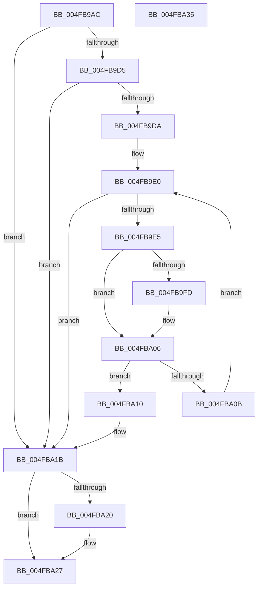

# ExpDiskEnumCallback

- RVA: `0x004FB9AC`–`0x004FBA36` (길이 `138` bytes)
- VA: `0x00000001404FB9AC`
- 실행 섹션: `.text`
- PDB 이름 있음: `예`; PDB Function 태그: `아니요`
- unwind 정보 RVA: `0x0005CAAC`
- 디코드: `43`개 명령, `138/138` bytes 표시
- 미해석 바이트: `0` (있으면 어셈블리에 `.byte`로 보존)

> 이 문서는 커널 이미지의 기계어와 PDB 기호를 분석해 생성했습니다. 4번과 5번은 함수 원형과 자료형을 바이너리 사용 방식에서 추정한 C 해석이며 원본 소스 복구 결과는 아닙니다.

## 1. Dependencies

- 직접 호출 지점: **2**; 고유 호출 대상: **2**
- 직접 호출자로 확인된 함수: **1**
- RIP 상대 이미지 참조: **0**

### Outgoing calls
- `0x004FB9C7` → [ExpGetPartitionTableInfo](../../page/A7/ExpGetPartitionTableInfo_function_00A7B7D4.md) (function, `0x00A7B7D4`)
- `0x004FBA22` → [ExFreePoolWithTag](../../poolcode/B8/ExFreePoolWithTag_function_00B82870.md) (function, `0x00B82870`)

### Direct callers
- [BcdEnumerateDisks](../../page/AB/BcdEnumerateDisks_function_00AB04CC.md) at `0x00AB0652`

### Static image references
- 디코드된 RIP-relative 메모리 참조가 없습니다.

## 2. Other-region calls and transfers

- 다른 실행 섹션으로 향하는 call: **2**
  - `0x004FB9C7` → [ExpGetPartitionTableInfo](../../page/A7/ExpGetPartitionTableInfo_function_00A7B7D4.md) (`.text` → `PAGE`)
  - `0x004FBA22` → [ExFreePoolWithTag](../../poolcode/B8/ExFreePoolWithTag_function_00B82870.md) (`.text` → `POOLCODE`)
- 별도 외부 분기/꼬리 이동을 확인하지 못했습니다.

## 3. Assembly (complete function range)

```asm
004FB9AC  48 89 5C 24 08                  mov qword ptr [rsp + 8], rbx
004FB9B1  57                              push rdi
004FB9B2  48 83 EC 20                     sub rsp, 0x20
004FB9B6  48 83 64 24 40 00               and qword ptr [rsp + 0x40], 0
004FB9BC  48 8D 54 24 40                  lea rdx, [rsp + 0x40]
004FB9C1  49 8B D8                        mov rbx, r8
004FB9C4  40 32 FF                        xor dil, dil
004FB9C7  E8 08 FE 57 00                  call 0x140a7b7d4
004FB9CC  48 8B 4C 24 40                  mov rcx, qword ptr [rsp + 0x40]
004FB9D1  85 C0                           test eax, eax
004FB9D3  78 46                           js 0x1404fba1b
004FB9D5  83 39 01                        cmp dword ptr [rcx], 1
004FB9D8  75 41                           jne 0x1404fba1b
004FB9DA  44 8B 51 04                     mov r10d, dword ptr [rcx + 4]
004FB9DE  33 C0                           xor eax, eax
004FB9E0  41 3B C2                        cmp eax, r10d
004FB9E3  73 36                           jae 0x1404fba1b
004FB9E5  4C 8B 1B                        mov r11, qword ptr [rbx]
004FB9E8  4C 8D 0C C0                     lea r9, [rax + rax*8]
004FB9EC  4D 03 C9                        add r9, r9
004FB9EF  44 8D 40 01                     lea r8d, [rax + 1]
004FB9F3  4A 8B 54 C9 60                  mov rdx, qword ptr [rcx + r9*8 + 0x60]
004FB9F8  49 2B 13                        sub rdx, qword ptr [r11]
004FB9FB  75 09                           jne 0x1404fba06
004FB9FD  4A 8B 54 C9 68                  mov rdx, qword ptr [rcx + r9*8 + 0x68]
004FBA02  49 2B 53 08                     sub rdx, qword ptr [r11 + 8]
004FBA06  48 85 D2                        test rdx, rdx
004FBA09  74 05                           je 0x1404fba10
004FBA0B  41 8B C0                        mov eax, r8d
004FBA0E  EB D0                           jmp 0x1404fb9e0
004FBA10  44 89 43 08                     mov dword ptr [rbx + 8], r8d
004FBA14  40 B7 01                        mov dil, 1
004FBA17  C6 43 0C 01                     mov byte ptr [rbx + 0xc], 1
004FBA1B  48 85 C9                        test rcx, rcx
004FBA1E  74 07                           je 0x1404fba27
004FBA20  33 D2                           xor edx, edx
004FBA22  E8 49 6E 68 00                  call 0x140b82870
004FBA27  48 8B 5C 24 30                  mov rbx, qword ptr [rsp + 0x30]
004FBA2C  40 8A C7                        mov al, dil
004FBA2F  48 83 C4 20                     add rsp, 0x20
004FBA33  5F                              pop rdi
004FBA34  C3                              ret
004FBA35  CC                              int3
```

## 4. C-style interpretation (structured pseudocode)

```c
__int64 __fastcall ExpDiskEnumCallback(__int64 a1, __int64 a2, __int64 a3)
{
    __int64 result;
    __int64 v_rdi;
    __int64 v_rsp;
    unsigned __int64 v_stack_p18;
    unsigned __int64 v_stack_p8;

    v_stack_p8 = v_rbx;
    v_rsp = (v_rsp) - (32);
    v_rdi = 0;
    result = ExpGetPartitionTableInfo(a1, v_stack_p18, a3, a4);
    if (sign_flag) goto loc_004FBA1B;
    if ((*(unsigned int *)(v_stack_p18)) != 1) goto loc_004FBA1B;
    result = 0;
loc_004FB9E0:
    if (0 >= ((unsigned int)((unsigned int)(*(unsigned int *)(v_stack_p18 + 4))))) goto loc_004FBA1B;
    a4 = (result + result * 8) + (result + result * 8);
    a2 = (*(unsigned __int64 *)(v_stack_p18 + a4 * 8 + 96)) - (*(unsigned __int64 *)(*(unsigned __int64 *)(a3)));
    if (!(condition_is_not_equal)) {
        a2 = *(unsigned __int64 *)(v_stack_p18 + a4 * 8 + 104);
        a2 = (a2) - (*(unsigned __int64 *)(*(unsigned __int64 *)(a3) + 8));
    }
    if (a2 == 0) goto loc_004FBA10;
    goto loc_004FB9E0;
loc_004FBA10:
    *(unsigned int *)(a3 + 8) = (unsigned int)(result + 1);
    *(unsigned __int8 *)(a3 + 12) = 1;
loc_004FBA1B:
    result = (unsigned int)((unsigned int)(result + 1));
    if (v_stack_p18 != 0) {
        a2 = 0;
        result = ExFreePoolWithTag(v_stack_p18, a2, result + 1, a4);
    }
    v_rsp = (v_rsp) + (32);
    return 1;
}
```

## 5. (Beta) C Style

```c
int64_t ExpDiskEnumCallback(int64_t Arg1, int64_t Arg2, void *Arg3)
{
    uint8_t *arg3 = (uint8_t *)Arg3;

    int64_t result;
    int64_t local_rdi;
    int64_t local_rsp;
    uint64_t v_stack_p18;
    uint64_t v_stack_p8;

    v_stack_p8 = local_rbx;
    local_rsp = (local_rsp) - (32);
    local_rdi = 0;
    result = ExpGetPartitionTableInfo(Arg1, v_stack_p18, Arg3, a4);
    if (sign_flag) goto loc_004FBA1B;
    if ((*(uint32_t *)(v_stack_p18)) != 1) goto loc_004FBA1B;
    result = 0;
loc_004FB9E0:
    if (0 >= ((uint32_t)((uint32_t)(*(uint32_t *)(v_stack_p18 + 0x4))))) goto loc_004FBA1B;
    a4 = (result + result * 8) + (result + result * 8);
    Arg2 = (*(uint64_t *)(v_stack_p18 + a4 * 8 + 0x60)) - (*(uint64_t *)(*(uint64_t *)(arg3)));
    if (!(condition_is_not_equal)) {
        Arg2 = *(uint64_t *)(v_stack_p18 + a4 * 8 + 0x68);
        Arg2 = (Arg2) - (*(uint64_t *)(*(uint64_t *)(arg3) + 0x8));
    }
    if (Arg2 == 0) goto loc_004FBA10;
    goto loc_004FB9E0;
loc_004FBA10:
    *(uint32_t *)(arg3 + 0x8) = (uint32_t)(result + 1);
    *(uint8_t *)(arg3 + 0xC) = 1;
loc_004FBA1B:
    result = (uint32_t)((uint32_t)(result + 1));
    if (v_stack_p18 != 0) {
        Arg2 = 0;
        result = ExFreePoolWithTag(v_stack_p18, Arg2, result + 1, a4);
    }
    local_rsp = (local_rsp) + (32);
    return 1;
}
```

### 관측된 메모리 오프셋

구조체 형식이 확인되지 않은 접근은 인자 기준의 오프셋으로만 기록했습니다.

| 기준 인자 | 오프셋 표현 | 폭 (bit) | 접근 |
|---|---:|---:|---|
| `Arg3` | `+ 0x0` | `64` | `R` |
| `Arg3` | `+ 0x8` | `32` | `W` |
| `Arg3` | `+ 0xC` | `8` | `W` |

## 6. Execution-region graph

[열기: 2D/3D 그래프와 함수 탐색 컨트롤 패널](../../../control-panel.html?section=text&rva=0x004FB9AC&view=graph)

- 2D 그래프는 위에서 아래로 흐르고, 3D 그래프는 빈 공간을 드래그해 회전합니다. Shift+드래그는 이동, 휠은 확대·축소, 함수 노드 선택은 대상 보고서 이동입니다.

### Static fallback


