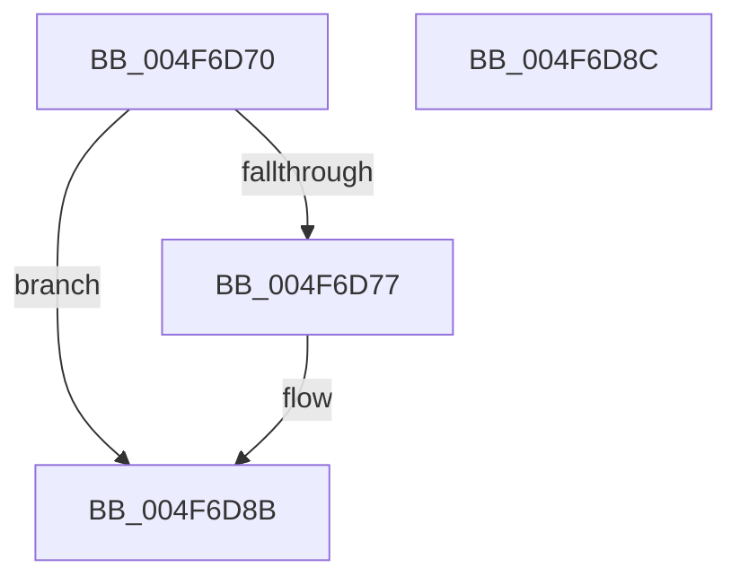

# ExpPoolContextHeaderFromHandle

- RVA: `0x004F6D70`–`0x004F6D8D` (길이 `29` bytes)
- VA: `0x00000001404F6D70`
- 실행 섹션: `.text`
- PDB 이름 있음: `예`; PDB Function 태그: `아니요`
- unwind 정보 RVA: `0x000DB714`
- 디코드: `9`개 명령, `29/29` bytes 표시
- 미해석 바이트: `0` (있으면 어셈블리에 `.byte`로 보존)

> 이 문서는 커널 이미지의 기계어와 PDB 기호를 분석해 생성했습니다. 4번과 5번은 함수 원형과 자료형을 바이너리 사용 방식에서 추정한 C 해석이며 원본 소스 복구 결과는 아닙니다.

## 1. Dependencies

- 직접 호출 지점: **0**; 고유 호출 대상: **0**
- 직접 호출자로 확인된 함수: **2**
- RIP 상대 이미지 참조: **1**

### Outgoing calls
- 직접 디코드된 call 명령이 없습니다.

### Direct callers
- [ExpSecurePoolFromHandle](ExpSecurePoolFromHandle_function_004F6D48.md) at `0x004F6D4E`
- [ExDestroyPool](../65/ExDestroyPool_function_00656030.md) at `0x00656037`

### Static image references
- `0x004F6D77` → RVA `0x00E6BF08` (`.data`; read)

## 2. Other-region calls and transfers

- 다른 실행 섹션으로 향하는 call: **0**
- 별도 외부 분기/꼬리 이동을 확인하지 못했습니다.

## 3. Assembly (complete function range)

```asm
004F6D70  33 C0                           xor eax, eax
004F6D72  48 85 C9                        test rcx, rcx
004F6D75  74 14                           je 0x1404f6d8b
004F6D77  48 33 0D 8A 51 97 00            xor rcx, qword ptr [rip + 0x97518a]
004F6D7E  81 39 BD BD AF AF               cmp dword ptr [rcx], 0xafafbdbd
004F6D84  48 0F 45 C8                     cmovne rcx, rax
004F6D88  48 8B C1                        mov rax, rcx
004F6D8B  C3                              ret
004F6D8C  CC                              int3
```

## 4. C-style interpretation (structured pseudocode)

```c
__int64 __fastcall ExpPoolContextHeaderFromHandle(__int64 a1)
{
    __int64 result;

    result = 0;
    if (a1 != 0) {
        a1 = (a1) ^ (*(unsigned __int64 *)(v_rip + 9916810));
        if ((*(unsigned int *)(a1)) != 0xAFAFBDBDULL) { a1 = 0; }
        result = a1;
    }
    return result;
}
```

## 5. (Beta) C Style

```c
int64_t ExpPoolContextHeaderFromHandle(int64_t Arg1)
{
    int64_t result;

    result = 0;
    if (Arg1 != 0) {
        Arg1 = (Arg1) ^ (*(uint64_t *)(v_rip + 0x97518A));
        if ((*(uint32_t *)(Arg1)) != 0xAFAFBDBDULL) { Arg1 = 0; }
        result = Arg1;
    }
    return result;
}
```

## 6. Execution-region graph

[열기: 2D/3D 그래프와 함수 탐색 컨트롤 패널](../../../control-panel.html?section=text&rva=0x004F6D70&view=graph)

- 2D 그래프는 위에서 아래로 흐르고, 3D 그래프는 빈 공간을 드래그해 회전합니다. Shift+드래그는 이동, 휠은 확대·축소, 함수 노드 선택은 대상 보고서 이동입니다.

### Static fallback


