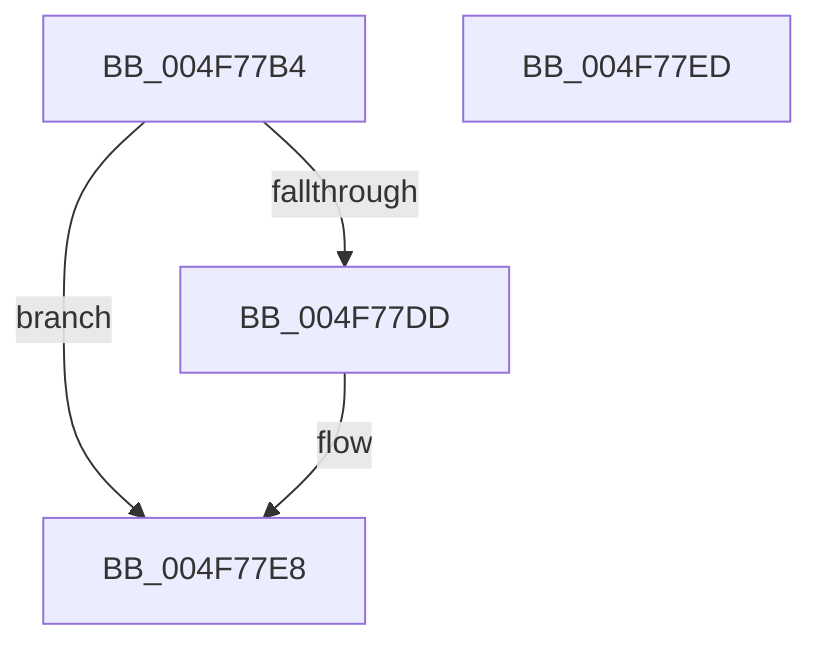

# ExpSaBinaryArrayRemove

- RVA: `0x004F77B4`–`0x004F77EE` (길이 `58` bytes)
- VA: `0x00000001404F77B4`
- 실행 섹션: `.text`
- PDB 이름 있음: `예`; PDB Function 태그: `아니요`
- unwind 정보 RVA: `0x0005C788`
- 디코드: `18`개 명령, `58/58` bytes 표시
- 미해석 바이트: `0` (있으면 어셈블리에 `.byte`로 보존)

> 이 문서는 커널 이미지의 기계어와 PDB 기호를 분석해 생성했습니다. 4번과 5번은 함수 원형과 자료형을 바이너리 사용 방식에서 추정한 C 해석이며 원본 소스 복구 결과는 아닙니다.

## 1. Dependencies

- 직접 호출 지점: **1**; 고유 호출 대상: **1**
- 직접 호출자로 확인된 함수: **3**
- RIP 상대 이미지 참조: **0**

### Outgoing calls
- `0x004F77E3` → [ExFreePoolWithTag](../../poolcode/B8/ExFreePoolWithTag_function_00B82870.md) (function, `0x00B82870`)

### Direct callers
- [ExpSaPageGroupDescriptorFree](../4B/ExpSaPageGroupDescriptorFree_function_004B5EA8.md) at `0x004B5F0E`
- [sub_006E72E8](../6E/Unknown_function_006E72E8.md) at `0x006E734E`
- [sub_006E72E8](../6E/Unknown_function_006E72E8.md) at `0x006E7362`
- [sub_006FBC2C](../6F/Unknown_function_006FBC2C.md) at `0x006FBC5A`

### Static image references
- 디코드된 RIP-relative 메모리 참조가 없습니다.

## 2. Other-region calls and transfers

- 다른 실행 섹션으로 향하는 call: **1**
  - `0x004F77E3` → [ExFreePoolWithTag](../../poolcode/B8/ExFreePoolWithTag_function_00B82870.md) (`.text` → `POOLCODE`)
- 별도 외부 분기/꼬리 이동을 확인하지 못했습니다.

## 3. Assembly (complete function range)

```asm
004F77B4  48 83 EC 28                     sub rsp, 0x28
004F77B8  45 33 D2                        xor r10d, r10d
004F77BB  4C 8B C9                        mov r9, rcx
004F77BE  0F BD CA                        bsr ecx, edx
004F77C1  45 8D 42 01                     lea r8d, [r10 + 1]
004F77C5  41 D3 E0                        shl r8d, cl
004F77C8  44 33 C2                        xor r8d, edx
004F77CB  8D 51 FE                        lea edx, [rcx - 2]
004F77CE  49 8B 0C D1                     mov rcx, qword ptr [r9 + rdx*8]
004F77D2  4E 89 54 C1 08                  mov qword ptr [rcx + r8*8 + 8], r10
004F77D7  48 83 29 01                     sub qword ptr [rcx], 1
004F77DB  75 0B                           jne 0x1404f77e8
004F77DD  4D 89 14 D1                     mov qword ptr [r9 + rdx*8], r10
004F77E1  33 D2                           xor edx, edx
004F77E3  E8 88 B0 68 00                  call 0x140b82870
004F77E8  48 83 C4 28                     add rsp, 0x28
004F77EC  C3                              ret
004F77ED  CC                              int3
```

## 4. C-style interpretation (structured pseudocode)

```c
__int64 __fastcall ExpSaBinaryArrayRemove(__int64 a1, int a2)
{
    __int64 result;
    __int64 v_r10;
    __int64 v_rsp;

    v_rsp = (v_rsp) - (40);
    v_r10 = 0;
    a3 = (unsigned int)((v_r10 + 1) << ((unsigned __int8)(a1)));
    a3 = (unsigned int)((a3) ^ (a2));
    *(unsigned __int64 *)(*(unsigned __int64 *)(a1 + a1 - 2 * 8) + a3 * 8 + 8) = 0;
    if (!(condition_is_not_equal)) {
        *(unsigned __int64 *)(a1 + a1 - 2 * 8) = 0;
        a2 = 0;
        result = ExFreePoolWithTag(*(unsigned __int64 *)(a1 + a1 - 2 * 8), a2, a3, a1);
    }
    v_rsp = (v_rsp) + (40);
    return result;
}
```

## 5. (Beta) C Style

```c
int64_t ExpSaBinaryArrayRemove(void *Arg1, int32_t Arg2)
{
    uint8_t *arg1 = (uint8_t *)Arg1;

    int64_t result;
    int64_t local_r10;
    int64_t local_rsp;

    local_rsp = (local_rsp) - (40);
    local_r10 = 0;
    a3 = (uint32_t)((local_r10 + 1) << ((uint8_t)(Arg1)));
    a3 = (uint32_t)((a3) ^ (Arg2));
    *(uint64_t *)(*(uint64_t *)(arg1 + arg1 - 0x2 * 8) + a3 * 8 + 0x8) = 0;
    if (!(condition_is_not_equal)) {
        *(uint64_t *)(arg1 + arg1 - 0x2 * 8) = 0;
        Arg2 = 0;
        result = ExFreePoolWithTag(*(uint64_t *)(arg1 + arg1 - 0x2 * 8), Arg2, a3, Arg1);
    }
    local_rsp = (local_rsp) + (40);
    return result;
}
```

### 관측된 메모리 오프셋

구조체 형식이 확인되지 않은 접근은 인자 기준의 오프셋으로만 기록했습니다.

| 기준 인자 | 오프셋 표현 | 폭 (bit) | 접근 |
|---|---:|---:|---|
| `Arg1` | `+ 0x0 + rdx*8` | `64` | `R` |
| `Arg1` | `+ 0x0 + rdx*8` | `64` | `W` |

## 6. Execution-region graph

[열기: 2D/3D 그래프와 함수 탐색 컨트롤 패널](../../../control-panel.html?section=text&rva=0x004F77B4&view=graph)

- 2D 그래프는 위에서 아래로 흐르고, 3D 그래프는 빈 공간을 드래그해 회전합니다. Shift+드래그는 이동, 휠은 확대·축소, 함수 노드 선택은 대상 보고서 이동입니다.

### Static fallback


