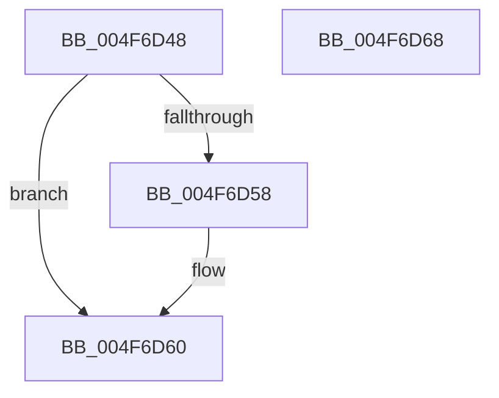

# ExpSecurePoolFromHandle

- RVA: `0x004F6D48`–`0x004F6D69` (길이 `33` bytes)
- VA: `0x00000001404F6D48`
- 실행 섹션: `.text`
- PDB 이름 있음: `예`; PDB Function 태그: `아니요`
- unwind 정보 RVA: `0x0005C788`
- 디코드: `11`개 명령, `33/33` bytes 표시
- 미해석 바이트: `0` (있으면 어셈블리에 `.byte`로 보존)

> 이 문서는 커널 이미지의 기계어와 PDB 기호를 분석해 생성했습니다. 4번과 5번은 함수 원형과 자료형을 바이너리 사용 방식에서 추정한 C 해석이며 원본 소스 복구 결과는 아닙니다.

## 1. Dependencies

- 직접 호출 지점: **1**; 고유 호출 대상: **1**
- 직접 호출자로 확인된 함수: **4**
- RIP 상대 이미지 참조: **0**

### Outgoing calls
- `0x004F6D4E` → [ExpPoolContextHeaderFromHandle](ExpPoolContextHeaderFromHandle_function_004F6D70.md) (function, `0x004F6D70`)

### Direct callers
- [ExFreePool2](../65/ExFreePool2_function_006560A0.md) at `0x00656132`
- [ExSecurePoolUpdate](../65/ExSecurePoolUpdate_function_0065AAE0.md) at `0x0065AAF4`
- [ExSecurePoolValidate](../65/ExSecurePoolValidate_function_0065AB20.md) at `0x0065AB27`
- [ExAllocatePool3](../../poolcode/B8/ExAllocatePool3_function_00B84270.md) at `0x00B844CD`

### Static image references
- 디코드된 RIP-relative 메모리 참조가 없습니다.

## 2. Other-region calls and transfers

- 다른 실행 섹션으로 향하는 call: **0**
- 별도 외부 분기/꼬리 이동을 확인하지 못했습니다.

## 3. Assembly (complete function range)

```asm
004F6D48  48 83 EC 28                     sub rsp, 0x28
004F6D4C  33 D2                           xor edx, edx
004F6D4E  E8 1D 00 00 00                  call 0x1404f6d70
004F6D53  48 85 C0                        test rax, rax
004F6D56  74 08                           je 0x1404f6d60
004F6D58  83 78 04 02                     cmp dword ptr [rax + 4], 2
004F6D5C  48 0F 44 D0                     cmove rdx, rax
004F6D60  48 8B C2                        mov rax, rdx
004F6D63  48 83 C4 28                     add rsp, 0x28
004F6D67  C3                              ret
004F6D68  CC                              int3
```

## 4. C-style interpretation (structured pseudocode)

```c
__int64 __fastcall ExpSecurePoolFromHandle(__int64 a1, int a2)
{
    __int64 result;
    __int64 v_rsp;

    v_rsp = (v_rsp) - (40);
    a2 = 0;
    result = ExpPoolContextHeaderFromHandle(a1, a2, a3, a4);
    if (result != 0) {
        if ((*(unsigned int *)(result + 4)) == 2) { a2 = result; }
    }
    v_rsp = (v_rsp) + (40);
    return a2;
}
```

## 5. (Beta) C Style

```c
int64_t ExpSecurePoolFromHandle(int64_t Arg1, int32_t Arg2)
{
    int64_t result;
    int64_t local_rsp;

    local_rsp = (local_rsp) - (40);
    Arg2 = 0;
    result = ExpPoolContextHeaderFromHandle(Arg1, Arg2, a3, a4);
    if (result != 0) {
        if ((*(uint32_t *)(result + 0x4)) == 2) { Arg2 = result; }
    }
    local_rsp = (local_rsp) + (40);
    return Arg2;
}
```

## 6. Execution-region graph

[열기: 2D/3D 그래프와 함수 탐색 컨트롤 패널](../../../control-panel.html?section=text&rva=0x004F6D48&view=graph)

- 2D 그래프는 위에서 아래로 흐르고, 3D 그래프는 빈 공간을 드래그해 회전합니다. Shift+드래그는 이동, 휠은 확대·축소, 함수 노드 선택은 대상 보고서 이동입니다.

### Static fallback


