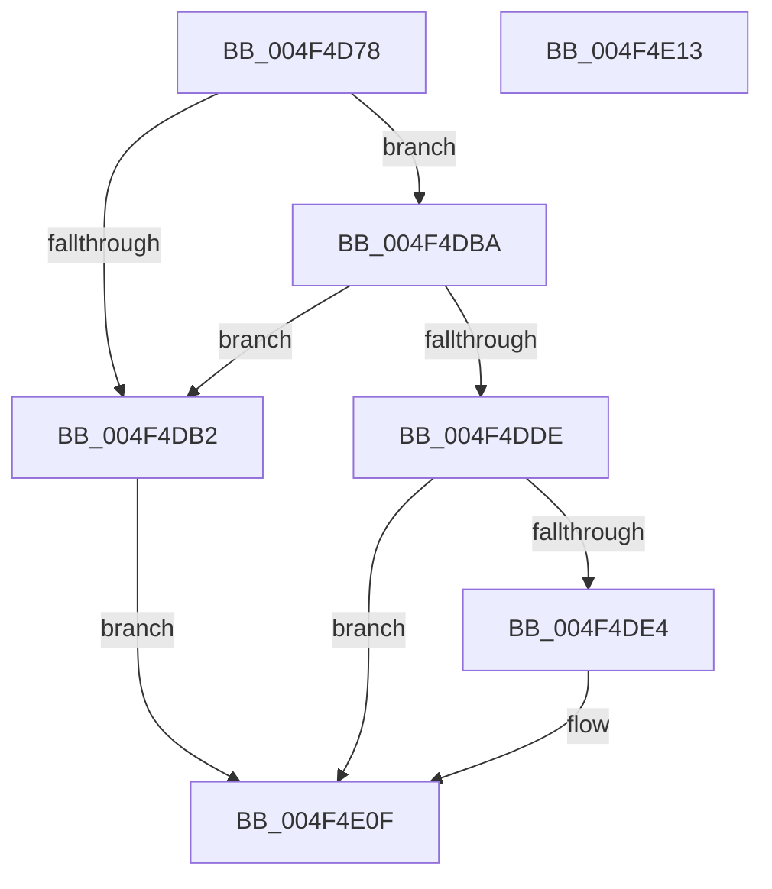

# ExpSelectGCWorkQueue

- RVA: `0x004F4D78`–`0x004F4E14` (길이 `156` bytes)
- VA: `0x00000001404F4D78`
- 실행 섹션: `.text`
- PDB 이름 있음: `예`; PDB Function 태그: `예`
- unwind 정보 RVA: `0x000DB714`
- 디코드: `40`개 명령, `156/156` bytes 표시
- 미해석 바이트: `0` (있으면 어셈블리에 `.byte`로 보존)

> 이 문서는 커널 이미지의 기계어와 PDB 기호를 분석해 생성했습니다. 4번과 5번은 함수 원형과 자료형을 바이너리 사용 방식에서 추정한 C 해석이며 원본 소스 복구 결과는 아닙니다.

## 1. Dependencies

- 직접 호출 지점: **0**; 고유 호출 대상: **0**
- 직접 호출자로 확인된 함수: **1**
- RIP 상대 이미지 참조: **1**

### Outgoing calls
- 직접 디코드된 call 명령이 없습니다.

### Direct callers
- [ExpHpGCTimerCallback](../3A/ExpHpGCTimerCallback_function_003A3040.md) at `0x003A3080`

### Static image references
- `0x004F4D78` → RVA `0x00E30088` (`.data`; read)

## 2. Other-region calls and transfers

- 다른 실행 섹션으로 향하는 call: **0**
- 별도 외부 분기/꼬리 이동을 확인하지 못했습니다.

## 3. Assembly (complete function range)

```asm
004F4D78  48 8B 05 09 B3 93 00            mov rax, qword ptr [rip + 0x93b309]
004F4D7F  44 8B D9                        mov r11d, ecx
004F4D82  41 BA 04 00 00 00               mov r10d, 4
004F4D88  48 8B 10                        mov rdx, qword ptr [rax]
004F4D8B  4C 8B 8A 80 4B 00 00            mov r9, qword ptr [rdx + 0x4b80]
004F4D92  48 8B 05 EF B2 93 00            mov rax, qword ptr [rip + 0x93b2ef]
004F4D99  48 8B 10                        mov rdx, qword ptr [rax]
004F4D9C  49 6B C1 64                     imul rax, r9, 0x64
004F4DA0  4C 8B 82 98 4C 00 00            mov r8, qword ptr [rdx + 0x4c98]
004F4DA7  33 D2                           xor edx, edx
004F4DA9  49 F7 F0                        div r8
004F4DAC  48 83 F8 55                     cmp rax, 0x55
004F4DB0  72 08                           jb 0x1404f4dba
004F4DB2  41 BA 03 00 00 00               mov r10d, 3
004F4DB8  EB 55                           jmp 0x1404f4e0f
004F4DBA  48 8B 05 C7 B2 93 00            mov rax, qword ptr [rip + 0x93b2c7]
004F4DC1  33 D2                           xor edx, edx
004F4DC3  48 8B 08                        mov rcx, qword ptr [rax]
004F4DC6  48 6B 81 00 49 00 00 64         imul rax, qword ptr [rcx + 0x4900], 0x64
004F4DCE  4C 8B 81 50 48 00 00            mov r8, qword ptr [rcx + 0x4850]
004F4DD5  49 F7 F0                        div r8
004F4DD8  48 83 F8 0F                     cmp rax, 0xf
004F4DDC  76 D4                           jbe 0x1404f4db2
004F4DDE  41 83 FB 01                     cmp r11d, 1
004F4DE2  75 2B                           jne 0x1404f4e0f
004F4DE4  48 8B 89 40 49 00 00            mov rcx, qword ptr [rcx + 0x4940]
004F4DEB  33 C0                           xor eax, eax
004F4DED  48 85 C9                        test rcx, rcx
004F4DF0  48 0F 49 C1                     cmovns rax, rcx
004F4DF4  33 D2                           xor edx, edx
004F4DF6  48 6B C0 64                     imul rax, rax, 0x64
004F4DFA  41 8B CA                        mov ecx, r10d
004F4DFD  45 8D 53 02                     lea r10d, [r11 + 2]
004F4E01  49 F7 F0                        div r8
004F4E04  48 83 F8 0F                     cmp rax, 0xf
004F4E08  41 0F 46 CA                     cmovbe ecx, r10d
004F4E0C  44 8B D1                        mov r10d, ecx
004F4E0F  41 8B C2                        mov eax, r10d
004F4E12  C3                              ret
004F4E13  CC                              int3
```

## 4. C-style interpretation (structured pseudocode)

```c
__int64 __fastcall ExpSelectGCWorkQueue(int a1)
{
    __int64 result;
    __int64 v_r10;

    result = (*(unsigned __int64 *)(v_rip + 9679599)) * (*(unsigned __int64 *)(*(unsigned __int64 *)(*(unsigned __int64 *)(v_rip + 9679625)) + 19328));
    a2 = 0;
    if (result < 85) goto loc_004F4DBA;
loc_004F4DB2:
    goto loc_004F4E0F;
loc_004F4DBA:
    a2 = 0;
    result = (*(unsigned __int64 *)(v_rip + 9679559)) * (*(unsigned __int64 *)(*(unsigned __int64 *)(*(unsigned __int64 *)(v_rip + 9679559)) + 18688));
    if (result <= 15) goto loc_004F4DB2;
    v_r10 = 3;
    if (((unsigned int)((unsigned int)(a1))) == 1) {
        a1 = *(unsigned __int64 *)(*(unsigned __int64 *)(*(unsigned __int64 *)(v_rip + 9679559)) + 18752);
        result = 0;
        if (!sign_flag) { result = a1; }
        a2 = 0;
        result = (result) * (result);
        a1 = 3;
        v_r10 = (unsigned int)(a1) + 2;
        if (result <= 15) { a1 = (unsigned int)(v_r10); }
        v_r10 = a1;
    }
    return (unsigned int)((unsigned int)(v_r10));
}
```

## 5. (Beta) C Style

```c
int64_t ExpSelectGCWorkQueue(int32_t Arg1)
{
    int64_t result;
    int64_t local_r10;

    result = (*(uint64_t *)(v_rip + 0x93B2EF)) * (*(uint64_t *)(*(uint64_t *)(*(uint64_t *)(v_rip + 0x93B309)) + 0x4B80));
    a2 = 0;
    if (result < 85) goto loc_004F4DBA;
loc_004F4DB2:
    goto loc_004F4E0F;
loc_004F4DBA:
    a2 = 0;
    result = (*(uint64_t *)(v_rip + 0x93B2C7)) * (*(uint64_t *)(*(uint64_t *)(*(uint64_t *)(v_rip + 0x93B2C7)) + 0x4900));
    if (result <= 15) goto loc_004F4DB2;
    local_r10 = 3;
    if (((uint32_t)((uint32_t)(Arg1))) == 1) {
        Arg1 = *(uint64_t *)(*(uint64_t *)(*(uint64_t *)(v_rip + 0x93B2C7)) + 0x4940);
        result = 0;
        if (!sign_flag) { result = Arg1; }
        a2 = 0;
        result = (result) * (result);
        Arg1 = 3;
        local_r10 = (uint32_t)(Arg1) + 2;
        if (result <= 15) { Arg1 = (uint32_t)(local_r10); }
        local_r10 = Arg1;
    }
    return (uint32_t)((uint32_t)(local_r10));
}
```

## 6. Execution-region graph

[열기: 2D/3D 그래프와 함수 탐색 컨트롤 패널](../../../control-panel.html?section=text&rva=0x004F4D78&view=graph)

- 2D 그래프는 위에서 아래로 흐르고, 3D 그래프는 빈 공간을 드래그해 회전합니다. Shift+드래그는 이동, 휠은 확대·축소, 함수 노드 선택은 대상 보고서 이동입니다.

### Static fallback


